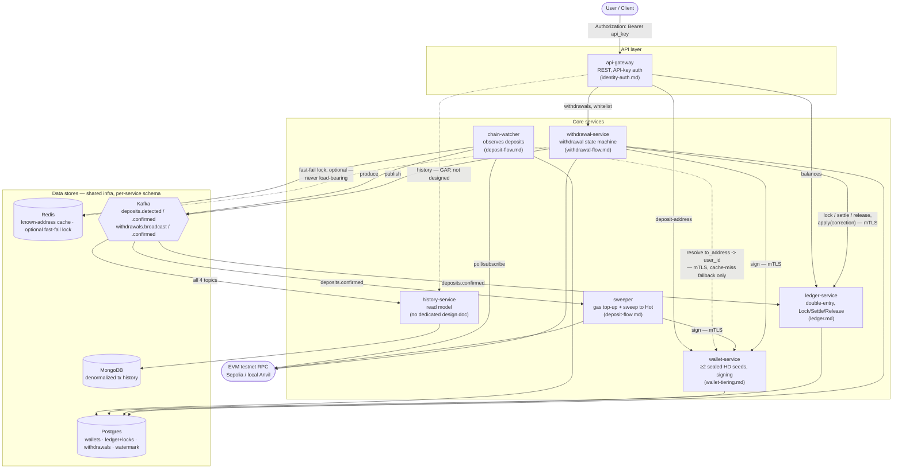

# Custody Wallet — Architecture & Roadmap

A crypto custody wallet backend (deposit / withdraw / internal transfer,
EVM networks, testnet only) built specifically to get real, hands-on
experience with Postgres, Kafka, Redis and MongoDB under load — and,
later, to actually deploy and operate them across multiple VMs instead
of a single-machine Docker Compose stack. Nothing here ever touches
mainnet or real funds.

## Why this domain

A custody wallet forces the interesting distributed-systems problems on
you instead of letting you fake them:

- **Money can't be double-credited or double-spent** → real need for
  idempotency, exactly-once event processing, and transactional
  correctness (Postgres's job).
- **Deposits arrive from an external, asynchronous source** (the chain)
  and have to fan out to several concerns (ledger, notifications, risk
  checks) → real need for an event bus (Kafka's job).
- **Withdrawal requests need a lock so two concurrent requests can't
  both pass a balance check and overdraw an account, and hot addresses
  need a sub-millisecond lookup on every incoming chain event** → real
  need for fast atomic operations (Redis's job).
- **Raw chain data (tx receipts, logs) is bulky, semi-structured, and
  mostly write-once** → a natural fit for a document store instead of
  forcing it into relational columns (MongoDB's job).

## Services

| Service | Responsibility | Talks to |
|---|---|---|
| `wallet-service` | Holds ≥2 sealed HD seeds (encrypted at rest): one derives every user's deposit address (BIP44 `m/44'/60'/0'/0/{index}`), a separate one is the Hot Wallet's signing key — kept apart so a compromised `wallet-service` process can never expose both at once. Signs outgoing transactions (withdrawals, Sweep, Gas Top-Up) on request; never exposes private keys. Warm/Cold tier keys live outside this service entirely (see `docs/design/wallet-tiering.md`). | Postgres (wallets, addresses, sealed seeds), Redis (address-set cache), **EVM testnet RPC — PROPOSED, pending Tech Lead sign-off** (gas price/limit estimation so `wallet-service` can construct outgoing transactions itself instead of trusting caller-supplied gas parameters, and to source a user address's live nonce for Sweep signing; see `docs/design/integration-contracts.md` §2 Open Questions #11 and `docs/design/deposit-flow.md` invariant #12) |
| `chain-watcher` | Polls/subscribes to the EVM testnet RPC, checks incoming transfers against the known-address set, resolves each one to the owning `user_id` (Redis first, `wallet-service` on a cache miss — see `docs/design/deposit-flow.md`'s Address Resolution), waits for confirmations, emits deposit events carrying that `user_id`. Purely an observer — never signs or broadcasts. | Redis (address→`user_id` lookup), Postgres (watermark, observed transfers), Kafka (producer), `wallet-service` (address resolution, mTLS, cache-miss fallback only) |
| `sweeper` | Consumes confirmed deposits, tops up a user's deposit address with gas when its native balance can't cover it, then sweeps the deposit to the Hot Wallet. Signs via `wallet-service`; holds no key material of its own. See `docs/design/deposit-flow.md`. | `wallet-service` (sign, mTLS), EVM testnet RPC (broadcast), Kafka (consumer) |
| `ledger-service` | Source of truth for balances. Double-entry bookkeeping in Postgres. Consumes deposit/withdrawal/transfer events idempotently (dedupe by tx hash + log index, or a client-supplied idempotency key for internal transfers). | Postgres (ledger), Kafka (consumer + producer) |
| `withdrawal-service` | Validates a withdrawal request against the ledger, optionally takes a Redis lock on the user as a fast-fail optimization, reserves funds via `ledger-service`'s Lock (not an immediate debit — see below), asks `wallet-service` to sign, broadcasts, tracks confirmation, then Settles the Lock (the actual debit) on confirmation. The Redis lock is never load-bearing for correctness — the Postgres atomic `locked_balance` `UPDATE` inside `ledger-service`'s Lock creation is the sole boundary preventing overdraft; a lost/expired Redis lock can at worst let a doomed-to-fail concurrent request reach Postgres before being rejected there, not cause an overdraft. See `docs/design/ledger.md` Open Questions #1. | Postgres (read), Redis (optional fast-fail lock), Kafka, `wallet-service` |
| `history-service` | Denormalized, query-optimized transaction history / audit log — the "read model" — fed by Kafka events, stored in MongoDB. | MongoDB, Kafka (consumer) |
| `api-gateway` | User-facing REST API: get deposit address, request withdrawal, request internal transfer, get balance/history. | all of the above |

Event bus (Kafka topics): `deposits.detected`, `deposits.confirmed`,
`withdrawals.broadcast`, `withdrawals.confirmed`, `transfers.internal`.

## System diagram

Solid arrows are decided/built-toward calls that happen on every
request. Dashed arrows are one of three different things, not one —
read the label, not just the line style: an **optional** call never
load-bearing for correctness (the Redis fast-fail lock — `ledger.md`
Open Questions #1); a **fallback-only** call that's fully decided and
mandatory to build, just not on the common path (`chain-watcher`'s
address resolution — the common path is a Redis hit; the mTLS call to
`wallet-service` only fires on a cache miss, but skipping it entirely
would be a real bug, not an optional nicety); or a named **GAP**
(`GET /v1/history` — `history-service` has no dedicated design doc yet,
per the module map in `docs/IMPLEMENTATION_PLAN.md`). `transfers.internal`
and its `api-gateway`/`ledger-service` endpoint are omitted entirely —
also a GAP (`docs/design/integration-contracts.md` §1), not yet
designed, so drawing it here would imply more than exists. Full
wire-level detail (exact payloads, idempotency keys, auth) for every
arrow above: `docs/design/integration-contracts.md`.

## Data model split (the actual point of using 4 different stores)

- **Postgres** — anything that must be transactionally correct: user
  accounts, the double-entry ledger, wallet/address records. If it's
  money, it's in Postgres.
- **Redis** — anything that must be fast and is disposable/rebuildable:
  the known-deposit-address set, withdrawal locks, balance read cache.
  Never the source of truth for a balance.
- **MongoDB** — anything bulky, semi-structured, and append-mostly: raw
  chain tx receipts/logs, the denormalized transaction history feed
  shown to users.
- **Kafka** — the connective tissue: almost everything is event-driven.
  The exceptions are `api-gateway`'s synchronous calls into
  `wallet-service`/`ledger-service`/`withdrawal-service`,
  `withdrawal-service`'s own synchronous calls to `wallet-service` and
  `ledger-service`, and `chain-watcher`'s synchronous call to
  `wallet-service` to resolve a deposit's `user_id` (a real gap fixed on
  Tech Lead review — `docs/design/deposit-flow.md`'s Address Resolution;
  full list, with auth, in `docs/design/integration-contracts.md` §3).

## Security notes (read before building further)

This is a learning project, but "custody wallet" is exactly the kind of
system where sloppy key handling is the whole point of the lesson:

- **Tiered key custody, not one seed for everything.** `wallet-service`
  holds ≥2 sealed BIP39 seeds, each independently encrypted with
  AES-256-GCM under a "master key" env var (`MASTER_KEY_HEX`) that
  stands in for a real KMS/HSM: one derives every user's deposit
  address, a separate one is the Hot Wallet's signing key. Warm and Cold
  tier seeds are never held by `wallet-service`, or any other always-on
  service, at all — sealed, operator-held, decrypted only inside a
  local one-off signing tool when funds move between tiers. Full design
  and rationale: `docs/design/wallet-tiering.md`. In a real system none
  of this key material lives in an env var — it lives in a KMS/HSM and
  `wallet-service` calls out to it instead of holding it in memory.
  Never roll your own derivation/signing crypto — this project uses
  `go-ethereum` + a standard BIP32/39/44 library, not hand-written
  elliptic curve code.
- Each mnemonic is shown exactly once, at generation time, to stdout —
  simulating "write this down and put it in a safe" — and is never
  returned by any API afterward.
- **Internal service-to-service calls that need mTLS** (`wallet-service`'s
  `/v1/sign/*` endpoints today; `ledger-service`'s `apply()` and other
  internal hops as PROPOSED extensions) are backed by a small,
  project-owned local CA and per-service client certificates whose
  Common Name is checked against a per-endpoint allow-list before any
  request is processed — mTLS alone ("some cert the server trusts") was
  not enough to cap blast radius by *which* service is calling. Full
  CA/issuance/rotation design and the CN-authorization mechanism:
  `docs/design/service-auth-mtls.md`.
- Testnet only. No real funds, ever. If you later want to point this at
  a real chain, that's a much bigger conversation about HSMs, multi-sig,
  withdrawal review queues, and key ceremony — out of scope here.

## Phased roadmap

1. **`wallet-service` locally** (this session) — HD wallet generation,
   per-user deposit address derivation, Postgres + Redis, no chain
   connection yet. Testable without any blockchain node.
2. **Feature-complete locally**, all on Docker Compose on one machine
   (same pattern as `playground/`): `chain-watcher` against a local
   Anvil/Hardhat EVM testnet, `sweeper` (moves confirmed deposits to the
   Hot Wallet), `ledger-service`, `withdrawal-service` (sign + broadcast
   + confirm), `history-service`, `api-gateway`.
3. **Observability**: Prometheus metrics per service, Grafana
   dashboards, structured logs, a couple of real alerting rules (stuck
   withdrawal, Kafka consumer lag).
4. **Real multi-VM deployment** — this is where "high availability"
   stops being theoretical: Postgres primary + replica, a 3-broker Kafka
   cluster (KRaft), Redis primary + replica (or Cluster), a MongoDB
   replica set, spread across your VMs. Orchestration platform (k3s vs.
   Docker Swarm vs. plain Compose-over-SSH/Ansible) is a decision to
   make when we get here, not now.
5. **Break it on purpose**: kill a VM/node/pod mid-load-test, watch
   what actually happens (failover time, replica lag, in-flight
   requests) with the k6 + report tooling from `playground/`, adapted
   to hit this system's API instead. This step is most of the actual CV
   story — anyone can say "I used Postgres replication"; "I killed the
   primary during a load test and measured a 4s failover" is different.

## VM sizing (for step 4)

You said 2-3 VMs at 4 vCPU / 8GB each. That's enough to run every
system above in genuine HA form (not single-node) if we're deliberate
about it — sized allocation gets worked out when we reach step 4, after
we know each service's real footprint from steps 1-3.
