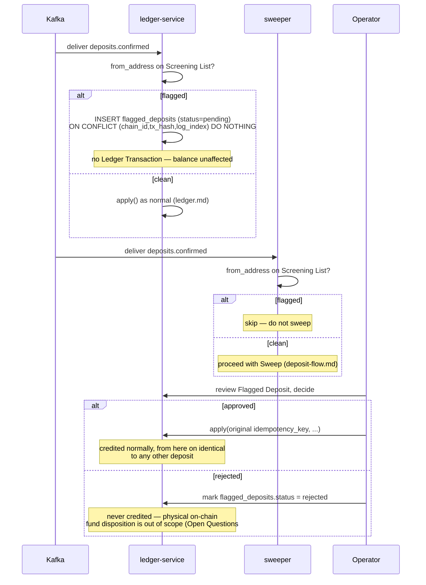

# Compliance / Screening

## Problem

Two related risks the system needs to defend against: (1) a deposit
arriving from an address associated with illicit activity (sanctions,
known hacks/scams) shouldn't silently become spendable balance or get
mixed into the Hot Wallet with everyone else's clean funds; (2) a
withdrawal shouldn't be able to pay out to such an address either. Both
need a shared, consistently-applied list of flagged addresses, checked
at the right point in both the deposit and withdrawal flows.

## Bounded context(s)

New, small bounded context: **Compliance/Screening**. Not a new
always-on service for v1 — the **Screening List** is a static,
operator-maintained config (same distribution pattern as `ledger.md`'s
Asset Registry: loaded at startup by every service that needs it), read
by three existing services:

- `ledger-service` — checks a deposit's `from_address` before crediting.
- `sweeper` — checks a deposit's `from_address` before sweeping, *(see
  Open Questions and Alternatives — this doc deliberately doesn't
  create a `compliance-service` for v1)* independently of what
  `ledger-service` decided, since it consumes `deposits.confirmed`
  directly and doesn't otherwise know the ledger's outcome.
- `withdrawal-service` — checks a Withdrawal Request's `to_address` at
  validation (`withdrawal-flow.md` invariant #14).

## Ubiquitous language

- **Screening List** — an operator-maintained blacklist of addresses
  associated with illicit activity. **Decided: static config (env/YAML)
  for v1**, loaded by `ledger-service`, `sweeper`, and
  `withdrawal-service` at startup (refreshed periodically, same as the
  Asset Registry) — no real third-party provider integrated yet.
- **Flagged Deposit** — a confirmed deposit whose `from_address` matches
  the Screening List. **Never becomes a Ledger Transaction
  automatically** — recorded separately, held for operator review.
  Keyed by the same natural key a normal deposit would use:
  `(chain_id, tx_hash, log_index)`.
- **Screening Resolution** — an operator's manual decision on a Flagged
  Deposit: `approved` (apply the Ledger Transaction now, using the
  deposit's original idempotency key — the same `ledger.apply()` path
  every other deposit uses) or `rejected` (never credited).

## Aggregates & invariants

1. **A deposit whose `from_address` is on the Screening List never
   becomes a Ledger Transaction automatically.** `ledger-service`
   checks the list in its `deposits.confirmed` consumer, before calling
   `apply()` — a match short-circuits into a Flagged Deposit record
   instead of a Ledger Transaction. This is a precondition on the
   *deposit-consumption codepath specifically*, not a change to
   `apply()` itself, which corrections also use (`ledger.md` invariant
   #11) and don't need this check on. (Withdrawals no longer go through
   `apply()` at all for their Reservation — `ledger.md`'s Lock/Settle/
   Release split moved that to its own `lock()`/`settle()`/`release()`
   operations; `apply()`'s only remaining callers are deposits and
   corrections.)
2. **The same check independently blocks Sweep.** `sweeper` checks the
   Screening List itself before broadcasting — it does not rely on
   `ledger-service` having already decided, since it consumes
   `deposits.confirmed` directly off Kafka in parallel. Without its own
   check, a flagged deposit's funds would still get swept into the Hot
   Wallet and mixed with clean funds even though the ledger never
   credited it — defeating the isolation this whole doc exists for.
3. **A Withdrawal Request's `to_address` on the Screening List is
   rejected at validation** (`withdrawal-flow.md` invariant #14), same
   step as the Whitelist and Minimum Withdrawal Amount checks, before
   any Reservation.
4. **A Flagged Deposit is idempotent, keyed like its would-be Ledger
   Transaction.** `INSERT flagged_deposits (chain_id, tx_hash,
   log_index, ...) ON CONFLICT DO NOTHING` — a Kafka redelivery of the
   same `deposits.confirmed` event can't create a duplicate flag.
5. **Approving a Flagged Deposit applies the Ledger Transaction using
   its original idempotency key** — the normal `ledger.apply()` path,
   not a special one. Approval just means "let this through the door
   every other deposit already uses," not a different mechanism.

## Diagram

## Alternatives considered

- **Check the Screening List only in `ledger-service`, not `sweeper`.**
  Rejected — `sweeper` consumes `deposits.confirmed` directly,
  independent of `ledger-service`'s decision. Without its own check,
  flagged funds would still get swept into the Hot Wallet, defeating
  the point.
- **A dedicated `compliance-service`** instead of a shared static list
  read by existing services. Considered, rejected for v1 — checking one
  address against a static list is small enough to embed, matching the
  same reasoning that kept the Treasury Sweep monitor inside
  `withdrawal-service` rather than its own service
  (`wallet-tiering.md`). Worth revisiting if a real paid screening API
  is later adopted (Open Questions #1) — an API call (retries, rate
  limits, latency) fits a dedicated integration point better than
  inline config.
- **Still credit the ledger but freeze withdrawals from that balance.**
  This was the alternative you didn't pick — noted for the record. It
  would need a `frozen_balance` concept split from `available_balance`
  in `ledger.md`, more complexity than the chosen "don't credit at all"
  approach.

## Open questions

1. **Real screening provider vs. static list — Decided: static list for
   v1.** Chainalysis/TRM Labs/Elliptic (paid, accurate, continuously
   updated) or a parsed OFAC SDN feed (free, slower-moving) are the
   real options when this gets revisited — a vendor/budget call, yours
   to make when the time comes, not mine to default on now.
2. **How Flagged Deposits get surfaced to the operator for review** — a
   queue, a CLI command, an admin endpoint? Not designed; this project
   has no admin/ops UI yet at all.
3. **Physical disposition of a `rejected` Flagged Deposit's actual
   on-chain funds** — they're still sitting, real, in the user's
   attribution address; the ledger simply never claims them. What
   happens to them next (reported, held, returned) is a legal/compliance
   question, not an architecture one — explicitly out of scope here.
4. **Should a user with an unresolved Flagged Deposit have *all* their
   withdrawals blocked**, not just the flagged deposit left uncredited?
   Interesting risk question, not asked for, flagging as a future
   consideration rather than designing it now.
