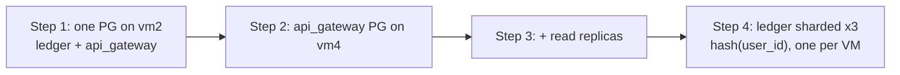

# Database scaling steps 2-4 (lab, vm2/vm3/vm4)

Status: PROPOSED. This is a lab: every Postgres container has an artificial `--cpus 0.5` cap so Postgres is the first
bottleneck. Results say "of this budget", not "of this hardware". Same k6 scenario (20% POST /v1/withdrawals, 55%
balances, 15% deposit-address, 10% whitelist; 100..500 rps) and same cap after every step. Baseline: knee at 200-300 rps.
Extends `multi-node-deployment.md` (supersedes its "no sharding" stance for the lab only).

## Step 2 - functional split (api_gateway to its own Postgres on vm4)
- Changes: config only. New container on vm4 (0.5 CPU), `POSTGRES_DSN` of api-gateway; dump/restore of `api_gateway` (small, stack stopped).
- Measured: knee rps, p95/p99, CPU throttling of both containers. Estimate (E): the auth lookup is most of the ~5k tps read load, so the knee moves up noticeably (E: 300 to 400-500 rps) and the ledger container becomes the limit.
- Rollback: point the DSN back at vm2 (the old DB is kept until the step is accepted).

## Step 3 - read replicas
- Changes: Postgres config (`replicator` role, `pg_hba`, slot with `max_slot_wal_keep_size`) plus code: second pool and a read DSN env var (`POSTGRES_READ_DSN`, empty = off) in api-gateway (key lookup) and ledger-service (balances).
- Decisions:
  - Stale allowed: API-key lookup (revocation lag up to the lag bound, a deliberate weakening of identity-auth invariant 6 that must be amended in that note) and `GET /v1/balances`.
  - Never on a replica: Lock, Settle, Release, Apply, whitelist, withdrawal state.
  - Read-your-writes: a balance right after a Lock may show the old Available; money is still decided on the primary Lock.
  - Routing: read pool first; on replica error or sampled lag above 2 s (sampled once per second, not per request) fall back to the primary for that request. An unknown key on the replica is retried once on the primary (a just-created key must work).
  - Metric `replica_lag_seconds` (replay delay) plus fallback counter; alert at lag above 1 s for 1 min.
  - Failover: manual promote, old primary fenced; fine for a lab, no automation. Async, so the last commits can be lost.
- Measured: primary CPU and throttle %, knee rps, lag during the run, fallback rate, stale-balance observations by the simulator. E: reads leave the primaries, knee moves again; the write path (Lock, deposits on `chain`) is then the limit.
- Rollback: unset the read DSN (flag off), no data change.

## Step 4 - shard the ledger by hash(user_id) (3 containers, one per VM, 0.5 CPU each)
- Changes: code (ledger-service, withdrawal-service, auditor) plus migrations x3 plus config.
- Decisions:
  - Shard key `hash(user_id) mod 3`; the map is static config in ledger-service (`LEDGER_SHARDS` = ordered DSN list, version number logged). ledger-service is the only router: api-gateway and withdrawal-service keep calling the same ledger endpoints and never see shards.
  - A user's account, entries, locks and idempotency keys live on one shard, so Lock, Settle, Release and balances stay single-shard, one transaction, unchanged SQL.
  - One `chain` account (and one `gas_expense` account) per asset per shard. Deposits go to the depositor's shard; Settle and Gas Fee postings go to the shard of the user, or to a fixed shard for gas with no user. This removes the single hot row: expect up to ~3x the ~150 tps measured on the chain row (the 16-way striped prototype reached ~450).
  - Invariants: sum of entries per asset is 0 per shard (every transaction is single-shard) and therefore globally; `total_balance` equals sum of entries and `locked_balance` equals active locks per account, checked per shard. The global check is the sum of the three per-shard results, which the auditor computes per shard and adds (chain accounts are summed across shards for custody reconciliation).
  - Auditor: `LEDGER_RO_DSN` becomes a list; every query runs per shard and is merged; per-shard snapshot skew is accepted and re-checked before raising a finding.
  - Migrations: run on all three, each shard under its own advisory lock; shard id stored in a `shard_meta` row so a service refuses to start on a wrong DSN order.
  - Resharding is out of scope. Method if needed: add shards with a new map version, dual-write/backfill a user's rows (freeze that user by Lock-all), verify with the per-shard sums, flip the map; or use virtual buckets (e.g. 256 buckets mapped to shards) from the start so moving a bucket is the only operation. Not built here.
- Cross-shard INTERNAL TRANSFER (new): `POST /v1/ledger/transfers` with body `{idempotency_key, from_user, to_user, asset_id, amount}`; same-shard transfers are one ordinary transaction. Invariants: no money created or lost (debit and credit both happen or neither), idempotent per key, sender never overdrawn (Lock-style atomic check), entries immutable.
  - Pattern (a), 2PC with `PREPARE TRANSACTION`: the coordinator (ledger-service) keeps a durable transfer log row (`prepared`, `committed`, `aborted`) on the sender shard, prepares both legs, writes the decision, then `COMMIT PREPARED`/`ROLLBACK PREPARED`. Recovery on start and every 10 s finishes in-doubt transactions from the log. `max_prepared_transactions` set above the pool size. Alert on prepared transactions older than 60 s (they hold row locks).
  - Pattern (b), saga: Lock on the sender, credit the receiver (idempotent by key), then Settle the lock; if the credit fails, Release the lock (compensation). Steps are driven by an outbox row with retries; every step is idempotent by the transfer key, so a crash at any point is resumed from the outbox.
  - Flag `TRANSFER_MODE=2pc|saga`. Default recommendation: saga (no locks held across a crash, no `max_prepared_transactions` operational risk, fits the existing Lock/Settle/Release model); 2PC is benchmarked as the strict-atomicity comparison.
  - Metrics: transfer latency histogram by mode; `in_doubt_prepared_count` and oldest age (2PC); `saga_stuck_count`, `saga_compensated_total` (saga). Tests: failure injected at each step per mode, replay of the same key, concurrent opposite transfers (deadlock-free ordering).
- Measured: knee rps against steps 2/3, per-container throttling on all three shards, shard skew, transfer latency 2PC vs saga at a fixed small transfer rate. E: the 3x write capacity helps only if users spread evenly; balances and Lock throughput roughly triple, bounded by the 1-3 ms WireGuard hops from vm4.
- Rollback: step 4 is not reversible online once users write to different shards. Keep the step-3 database untouched and read-only until acceptance; rollback = stop writes, point back to it and discard shard writes (lab data is disposable).

## What stays simulated
The 0.5-CPU cap, the single-instance application services, no automatic failover, async replicas, the simulator's synthetic users and no real resharding. Withdrawal-service's own database (`pg-core`) is not scaled here.

## Open questions for the Tech Lead
1. Accept the weakened revocation guarantee (lag up to the replica bound) for API-key lookup in step 3?
2. Where is the hash function and the shard list owned, config in ledger-service only (assumed)?
3. Does the history-service/Kafka consumer path need per-shard consumers? Assumed the consumer applies through the router.
