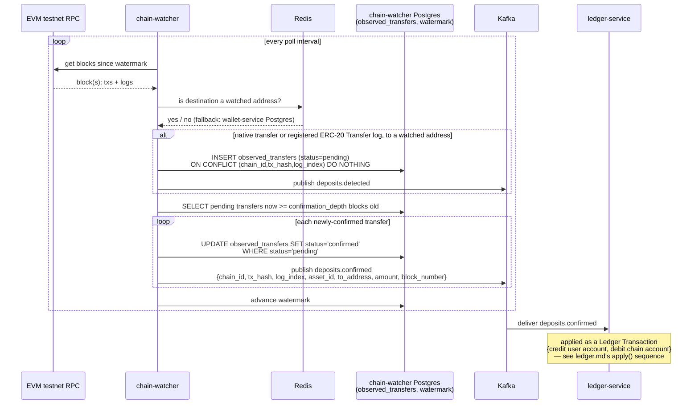
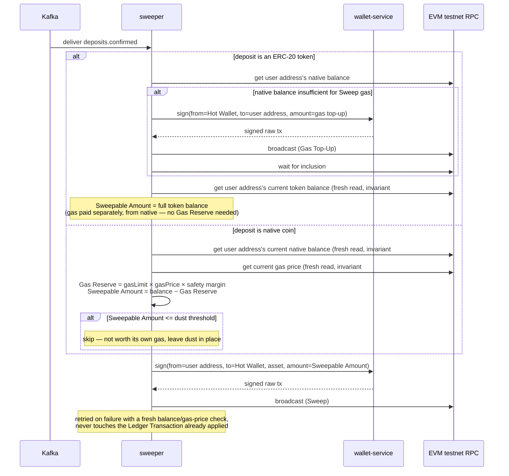

# Deposit flow

## Problem

A user already has a deposit address (`wallet-service`, built). The
system needs to notice when native coin or a registered ERC-20 token
actually arrives at that address on the one supported EVM testnet, wait
for enough confirmations to treat it as final, and credit the user's
ledger account (`ledger.md`) exactly once — even across a
`chain-watcher` restart, a duplicate poll, or (within reason) a chain
reorg.

One address serves both asset types: an ERC-20 balance/transfer is
keyed by the holder's address on the token contract, not by a separate
deposit address, so `wallet-service`'s existing "one chain-agnostic
address per user" design needs no change to support ERC-20 deposits.

## Bounded context(s)

New bounded context: **Deposit Detection**, owned by `chain-watcher`
(named in `docs/ARCHITECTURE.md`'s service table). Reads the known
deposit-address set (Redis, populated by `wallet-service`) and the
**Asset Registry** (owned by the Ledger context, `ledger.md`). Talks to
an external EVM testnet RPC node. Producer to Kafka; consumed by
`ledger-service`.

**Decided (PR #1): sweep model approved** (per `withdrawal-flow.md` and
`wallet-tiering.md`) — confirmed deposits sweep from the user's
attribution address to the Hot Wallet.

**Decided: a new bounded context, Sweep, owned by a new `sweeper`
service** performs the actual movement — not `chain-watcher`. This
resolves what was Open Question #5. `sweeper` consumes `deposits.confirmed`
from Kafka, calls `wallet-service`'s signing endpoint (mTLS, same as
`withdrawal-service` ↔ `wallet-service`) for both the Gas Top-Up and the
Sweep itself, and broadcasts to the EVM testnet RPC. It holds no key
material of its own — every signature comes from `wallet-service`, same
pattern as `withdrawal-service`. This keeps `chain-watcher` a pure
observer (reads the chain, emits events, never signs or broadcasts) and
gives Sweep its own clean boundary instead of quietly expanding
Deposit Detection's scope. `sweeper` is a new addition to
`docs/ARCHITECTURE.md`'s service table — tracked as a follow-up
alongside the other two (chain-watcher's Postgres, the seed split).

## Ubiquitous language

- **Watched Address** — an address `wallet-service` has issued to a
  user. Same address is watched for native transfers and every
  registered ERC-20 contract's `Transfer` events.
- **Confirmation Depth** — number of blocks after inclusion before a
  transfer is treated as final and eligible to credit the ledger. One
  config value for the whole chain in this phase (block-based, not
  asset-based — native and ERC-20 transfers in the same block reach
  finality together).
- **Observed Transfer** — a transfer chain-watcher has seen, keyed by
  `(chain_id, tx_hash, log_index)`, in one of two states: `pending`
  (seen, not yet confirmation-deep) or `confirmed` (confirmation-deep,
  deposit event emitted). This is chain-watcher's own persisted state —
  see Open Questions #1.
- **Deposit Detected** — event emitted the first time a matching
  transfer is seen (any depth), informational only, lets
  `history-service` show the user an incoming/pending deposit.
- **Deposit Confirmed** — event emitted once an Observed Transfer
  crosses Confirmation Depth. The only thing `ledger-service` consumes;
  carries `{chain_id, tx_hash, log_index, asset_id, from_address,
  to_address, amount, block_number}`.
- **Sweep** — the transaction moving a confirmed deposit from the
  user's attribution address to the Hot Wallet (`wallet-tiering.md`).
  Triggered once a deposit reaches `deposits.confirmed`; closes the gap
  between "credited in the ledger" and "actually custodied where
  withdrawals pay from."
- **Gas Top-Up** — a small native-coin transfer from the Hot Wallet to
  a user's attribution address, sent only when that address's native
  balance can't cover the Sweep transaction's own gas cost — which is
  *always* true for a pure ERC-20 deposit, since the address never
  received any native coin. Not a Ledger Transaction and not a Treasury
  Movement (`wallet-tiering.md`) — it's an operating cost paid out of
  the Hot Wallet's balance, same category as any other gas the Hot
  Wallet spends. Solves a *different* problem than Gas Reserve below:
  Gas Top-Up applies when the asset being swept isn't the asset gas is
  paid in (ERC-20); Gas Reserve applies when it's the *same* asset
  (native coin) — the two never both apply to the same Sweep.
- **Gas Reserve** — for a **native-coin** Sweep only: the amount of the
  address's own native balance `sweeper` withholds so the Sweep
  transaction can pay its own gas, instead of sweeping the entire
  balance and leaving nothing to cover the fee. Computed fresh,
  immediately before signing, from a live gas price read (never a
  cached/earlier estimate) — the same freshness requirement invariant
  #9 already puts on the balance read, extended to cover gas price too.
- **Sweepable Amount** — the actual `amount` `sweeper` asks
  `wallet-service` to sign for. For ERC-20: the full current token
  balance (unchanged — Gas Top-Up already ensures gas is covered from a
  *different* balance). For native coin: `current balance − Gas
  Reserve`. If that's at or below a small dust threshold, `sweeper`
  skips the Sweep entirely rather than attempting a transaction not
  worth its own gas.

## Aggregates & invariants

1. **Only Watched Addresses produce events.** chain-watcher checks a
   transfer's destination against the Redis known-address set (falling
   back to `wallet-service`'s Postgres on a cache miss, as the existing
   code already does) before emitting anything for it.
2. **Only registered assets produce events.** Native coin is implicitly
   always registered. An ERC-20 `Transfer` log from a contract address
   not in the Asset Registry is ignored entirely — not even a
   `deposits.detected` event — enforced by chain-watcher filtering
   watched log topics against the registry loaded at startup (refreshed
   periodically; the registry is expected to change rarely).
3. **A given `(chain_id, tx_hash, log_index)` produces at most one
   `deposits.confirmed` event, ever.** Enforced by the Observed
   Transfer's unique natural key and a `pending → confirmed` transition
   guarded by `UPDATE ... WHERE status = 'pending'` (0 rows affected =
   already confirmed, skip). Backstopped by `ledger-service`'s own
   idempotent consumption (`ledger.md` invariant #3) as a second layer —
   deposits are exactly the kind of event where "double-checked" beats
   "checked once."
4. **The watermark only advances past blocks fully processed.**
   chain-watcher never advances its last-processed-block cursor until
   every matching transfer in that block has been durably recorded as
   at least `pending` — otherwise a crash mid-block could skip a
   deposit permanently instead of just reprocessing it (reprocessing is
   safe by invariant #3; skipping isn't).
5. **A Sweep only ever triggers after `deposits.confirmed`.** Sweeping
   an unconfirmed deposit risks moving funds a later reorg takes back —
   the Sweep's finality guarantee rides on the same Confirmation Depth
   the ledger credit already depends on, not a separate, weaker check.
6. **A Sweep is signed by the user's own derived key, never a new key.**
   `wallet-service` already holds the seed that derives every user
   address — unchanged by `wallet-tiering.md`'s seed split, which only
   separates the *Hot Wallet's* key from that seed. So signing a Sweep
   needs no new key material; custody of "who can move a user's swept
   funds" stays exactly where it already was. `sweeper` asks for the
   signature, it never holds or derives the key itself.
7. **Gas Top-Up happens only when needed, and is idempotent per
   deposit.** Before topping up, `sweeper` checks the address's current
   native balance — a retried Sweep attempt must never blindly re-fund
   an address that's already funded, or the Hot Wallet bleeds gas on
   every retry.
8. **A failed or stuck Sweep never touches the Ledger.** The user's
   credited balance (`ledger.md`) is set the moment `deposits.confirmed`
   is applied and is unaffected by whether the Sweep itself succeeds,
   fails, or needs a retry — Sweep is custody housekeeping, not a
   balance-affecting operation.
9. **`sweeper` always re-reads the address's current on-chain balance
   immediately before signing the Sweep itself, not just before Gas
   Top-Up — and, for native coin, the current gas price too.** Never
   reuses a balance or gas-price value read earlier in the same or a
   prior (possibly crashed or Kafka-redelivered) attempt. This is what
   makes a retried Sweep naturally idempotent: if an earlier attempt
   already swept the funds, the current balance is at or near zero and
   there's nothing meaningful left to move, rather than the retry
   signing for a stale, possibly-wrong amount — and a stale gas price
   is exactly what would make a native-coin Sweep under- or
   over-reserve for its own fee.
11. **`wallet-service` never computes Gas Reserve or Sweepable Amount
    itself.** It signs for exactly the `amount` it's given — the same
    invariant #5 in `withdrawal-flow.md` already establishes ("the
    caller specifies *what* to send, never *which key*"), extended
    here to say the caller also owns figuring out *how much* is
    actually sendable. `wallet-service` stays a pure signer with no RPC
    read access of its own; `sweeper` already reads chain state for
    other reasons (balance checks, confirmation tracking), so gas-price
    awareness belongs there, not as new scope for `wallet-service`.
10. **A deposit whose `from_address` is on the Screening List is never
    swept, and never credited by `ledger-service` either** — full
    design in `compliance-screening.md`. Both `sweeper` and
    `ledger-service` check independently, since they each consume
    `deposits.confirmed` directly.

## Diagram

Sweep, owned by `sweeper`, triggered by consuming `deposits.confirmed`:

## Alternatives considered

- **Single-phase: only emit `deposits.confirmed`, drop the
  detected/pending stage.** Rejected — loses the "show the user an
  incoming, unconfirmed deposit" UX `history-service` will want, and
  `docs/ARCHITECTURE.md` already names both topics.
- **No persisted watermark/pending state — re-scan a fixed lookback
  window every poll.** Rejected — either misses deposits during any
  downtime longer than the window, or wastes RPC calls re-scanning
  already-processed blocks indefinitely.
- **Keep chain-watcher's state in Redis only (no Postgres), matching
  today's architecture table.** Considered and rejected: watermark and
  pending-transfer state aren't disposable/rebuildable in the way
  `docs/ARCHITECTURE.md`'s own Redis philosophy requires — losing them
  costs real missed deposits or an expensive full re-scan, not just a
  slower cache-miss. Proposing chain-watcher gets a small Postgres
  dependency instead (Open Questions #1).
- **No Asset Registry — credit any ERC-20 transfer observed on-chain.**
  Rejected — credits users for dust/scam/airdropped tokens nobody asked
  for and bloats the ledger with worthless assets. An explicit allow-
  list is cheap and standard for custody systems.
- **Fold Sweep into chain-watcher instead of a new `sweeper` service.**
  Would avoid one more service to deploy/monitor, but conflates pure
  observation (chain-watcher's job) with signing and broadcasting (a
  much higher-trust operation) inside one process. Rejected per your
  decision — Sweep gets its own service and its own trust boundary.

## Open questions

1. **This proposes chain-watcher gain its own small Postgres schema**
   (watermark + observed_transfers) — a change from
   `docs/ARCHITECTURE.md`'s current table, which lists chain-watcher as
   Redis + Kafka producer only. I think this is necessary for
   correctness (see Alternatives above). Want me to update
   `ARCHITECTURE.md`'s service table once you sign off, or is there a
   constraint I'm missing that keeps chain-watcher stateless?
   **Decided (PR #1): approved.** `ARCHITECTURE.md`'s service table
   still needs updating to reflect this — tracked as a follow-up, not
   done in this doc.
2. ~~Asset Registry population~~ **Decided:** static, operator-
   maintained config (env/YAML list of `{symbol, contract_address,
   decimals}`) — no admin API/UI this phase. **Extended per Dev
   feedback:** the same file is also loaded by `wallet-service`, not
   just `chain-watcher` and `ledger-service` — it needs
   `contract_address` to build ERC-20 calldata when signing. One
   canonical file (`ledger.md`'s Bounded context(s) section), mounted
   identically into all three containers — never a per-service copy.
3. **Confirmation depth**: needs an actual block count once you pick the
   specific testnet (e.g. Sepolia). No strong opinion yet beyond
   "shallow depths risk crediting a deposit that later reorgs out" —
   I'll propose a number once the chain is chosen.
4. **Reorg handling beyond confirmation depth** (a *confirmed* deposit's
   block gets reorged out anyway) is out of scope here — flagging
   rather than silently assuming it can't happen. Worth its own note
   later if it matters for the HA/chaos-testing story in roadmap step 5.
5. ~~Which service owns the Sweep loop?~~ **Decided: a new `sweeper`
   service**, not chain-watcher — see Bounded context(s) above. Keeps
   chain-watcher a pure observer and gives Sweep (a distinct trust
   boundary — it signs and broadcasts) its own home instead of quietly
   widening an existing service's scope.
6. **Gas Top-Up amount** — needs a concrete number (enough for one
   ERC-20 `transfer()` call at the chosen testnet's typical gas price,
   plus margin) once the testnet is chosen alongside Confirmation Depth
   (#3). Same "waiting on chain choice" reason, not guessing now.
