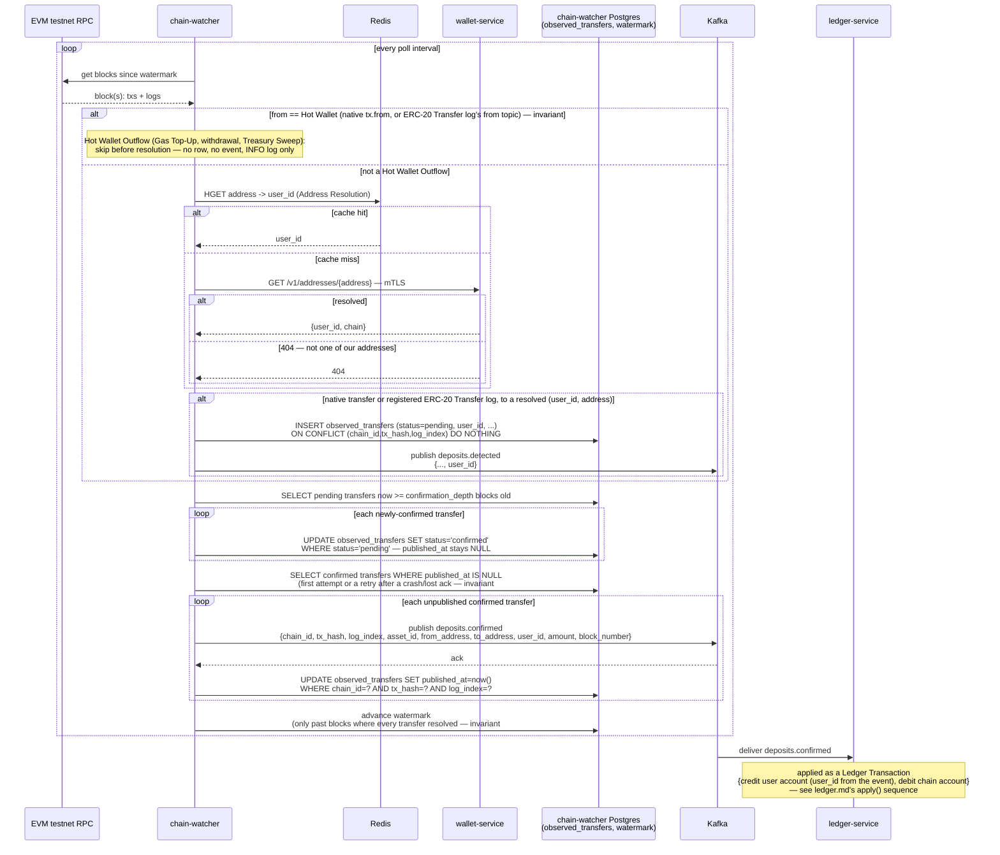
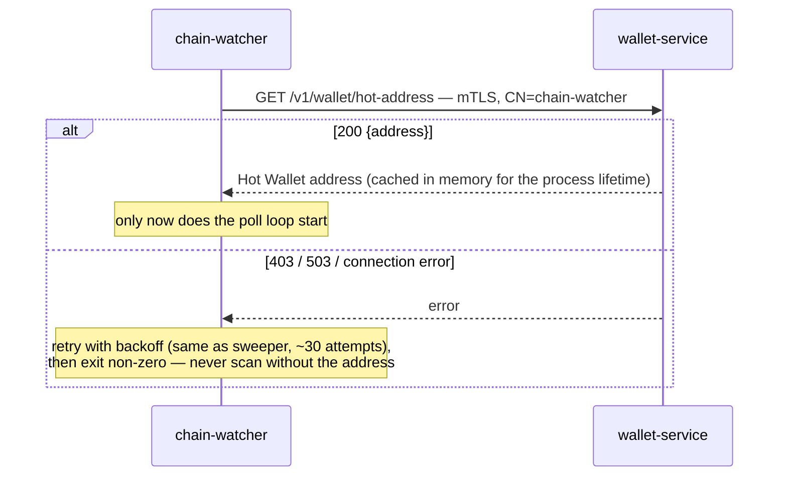
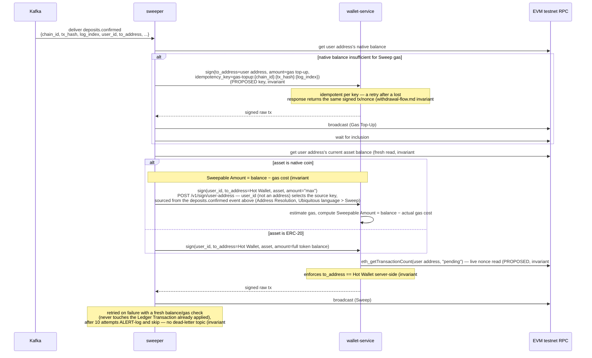

# Deposit flow

## Problem

A user already has a deposit address (`wallet-service`, built). The
system needs to notice when native coin or a registered ERC-20 token
actually arrives at that address on the one supported EVM testnet, wait
for enough confirmations to treat it as final, and credit the user's
ledger account (`ledger.md`) exactly once — even across a
`chain-watcher` restart, a duplicate poll, or (within reason) a chain
reorg.

One address serves both asset types: an ERC-20 balance/transfer is
keyed by the holder's address on the token contract, not by a separate
deposit address, so `wallet-service`'s existing "one chain-agnostic
address per user" design needs no change to support ERC-20 deposits.

## Bounded context(s)

New bounded context: **Deposit Detection**, owned by `chain-watcher`
(named in `docs/ARCHITECTURE.md`'s service table). Reads the known
deposit-address set (Redis, populated by `wallet-service`) and the
**Asset Registry** (owned by the Ledger context, `ledger.md`). Talks to
an external EVM testnet RPC node. Producer to Kafka; consumed by
`ledger-service`.

**Decided (PR #1): sweep model approved** (per `withdrawal-flow.md` and
`wallet-tiering.md`) — confirmed deposits sweep from the user's
attribution address to the Hot Wallet.

**Decided: a new bounded context, Sweep, owned by a new `sweeper`
service** performs the actual movement — not `chain-watcher`. This
resolves what was Open Question #5. `sweeper` consumes `deposits.confirmed`
from Kafka, calls `wallet-service`'s signing endpoint (mTLS, same as
`withdrawal-service` ↔ `wallet-service`) for both the Gas Top-Up and the
Sweep itself, and broadcasts to the EVM testnet RPC. It holds no key
material of its own — every signature comes from `wallet-service`, same
pattern as `withdrawal-service`. This keeps `chain-watcher` a pure
observer (reads the chain, emits events, never signs or broadcasts) and
gives Sweep its own clean boundary instead of quietly expanding
Deposit Detection's scope. `sweeper` is a new addition to
`docs/ARCHITECTURE.md`'s service table — tracked as a follow-up
alongside the other two (chain-watcher's Postgres, the seed split).

**Decided: chosen testnet is Sepolia.** ~12s average block time,
proof-of-stake, post-merge consensus. Its realistic reorg risk is
shallow, short reorgs — typically 1-2 blocks — rather than the deep
reorgs a pre-merge PoW chain could suffer. This is the basis for the
concrete Confirmation Depth and Gas Top-Up numbers below.

## Ubiquitous language

- **Watched Address** — an address `wallet-service` has issued to a
  user. Same address is watched for native transfers and every
  registered ERC-20 contract's `Transfer` events.
- **Address Resolution** — turning a Watched Address into the `user_id`
  it belongs to. **Fixed here — a real gap, not previously designed:**
  `chain-watcher`'s known-address check (invariant #1) used to answer
  only "is this address ours?" (Redis `SISMEMBER` against a plain set),
  which is not enough — `ledger.md`'s Account is keyed by `(user_id,
  asset)`, never by address, so crediting a deposit needs the `user_id`,
  not just a yes/no. Without this, `ledger-service` would receive a
  `deposits.confirmed` event with a `to_address` and nothing telling it
  *whose* Account to credit — the deposit flow as originally drafted
  could not actually credit anyone. Resolved by upgrading that same
  lookup to return `user_id` directly: `wallet-service`'s Redis cache is
  a hash (`address → user_id`), populated the moment `CreateAddress`
  issues a new address, not a set; a cache miss falls back to a new
  `wallet-service` endpoint, `GET /v1/addresses/{address}` (mTLS,
  `integration-contracts.md` §2), never a direct cross-service Postgres
  read (this project's convention is each service owns its own
  Postgres — the deposit-flow doc's earlier phrasing, "falling back to
  `wallet-service`'s Postgres," was imprecise about this and is
  corrected here). `chain-watcher` resolves `user_id` once, at the same
  point it already checks "is this address ours," and carries it on
  both `deposits.detected` and `deposits.confirmed` from then on — every
  downstream consumer (`ledger-service`, `history-service`) reads it
  straight off the event, so neither gains a new synchronous dependency
  on `wallet-service` the way `chain-watcher` now does.
- **Confirmation Depth** — number of blocks after inclusion before a
  transfer is treated as final and eligible to credit the ledger. One
  config value for the whole chain in this phase (block-based, not
  asset-based — native and ERC-20 transfers in the same block reach
  finality together). **Decided: 32 blocks (~6.4 minutes at Sepolia's
  ~12s average block time).** Sepolia's realistic reorg risk is shallow
  — typically 1-2 blocks — so 32 blocks is already 16-32x that observed
  depth, a comfortable safety margin without waiting for full protocol
  finality. It also isn't an arbitrary constant: 32 blocks ≈ one epoch
  under Ethereum's post-merge consensus, roughly what a full node
  exposes via the `safe` block tag — a block very unlikely to be
  reorged under normal network conditions, short of a large-scale
  consensus fault.
- **Observed Transfer** — a transfer chain-watcher has seen, keyed by
  `(chain_id, tx_hash, log_index)`, in one of two states: `pending`
  (seen, not yet confirmation-deep) or `confirmed` (confirmation-deep,
  deposit event emitted). **Decided:** for a native-coin transfer, which
  has no log at all, `log_index = -1` is the sentinel value used in this
  key; an ERC-20 transfer keeps using its real, always ≥0 log index
  (`ledger.md`'s Idempotency Key definition uses the same convention).
  Also carries `published_at` (nullable, set only once Kafka has
  acknowledged `deposits.confirmed` for this row — **new, invariant #3,
  Tech Lead review**, decouples the `pending → confirmed` state
  transition from the Kafka publish so a crash between them can never
  silently drop the event). This is chain-watcher's own persisted state
  — see Open Questions #1.
- **Deposit Detected** — event emitted the first time a matching
  transfer is seen (any depth), informational only, lets
  `history-service` show the user an incoming/pending deposit. Carries
  `{chain_id, tx_hash, log_index, asset_id, from_address, to_address,
  user_id, amount, block_number, detected_at}` — **`user_id` added
  here** (Address Resolution above): without it `history-service` has
  no way to know which user's feed a pending deposit belongs to either,
  the identical gap as `deposits.confirmed`, just for a different
  consumer.
- **Deposit Confirmed** — event emitted once an Observed Transfer
  crosses Confirmation Depth. The only thing `ledger-service` consumes;
  carries `{chain_id, tx_hash, log_index, asset_id, from_address,
  to_address, user_id, amount, block_number}` — **`user_id` added
  here** (Address Resolution above): `ledger-service`'s `apply()` call
  needs a `user_id` to credit (`integration-contracts.md` §2's
  `POST /v1/ledger/transactions` request shape), and nothing upstream
  of this event previously supplied one.
- **Sweep** — the transaction moving a confirmed deposit from the
  user's attribution address to the Hot Wallet (`wallet-tiering.md`).
  Triggered once a deposit reaches `deposits.confirmed`; closes the gap
  between "credited in the ledger" and "actually custodied where
  withdrawals pay from." Signed via `POST /v1/sign/user-address`
  (`integration-contracts.md` §2), whose request shape is `{user_id,
  to_address, asset_id, amount, chain_id}` — **`sweeper` selects the
  source key by `user_id`, not by address** (there is no `from_address`
  field on this endpoint at all; `wallet-service` derives the source
  address from `user_id` itself). This is the same Address Resolution
  gap as `ledger-service`'s, one level further down the pipe: before
  `deposits.confirmed` carried `user_id`, `sweeper` had no way to
  populate this field either — fixed as the same change, not a separate
  one, since `sweeper` reads `user_id` straight off the event it already
  consumes (Address Resolution above). A **user address's own EVM
  nonce**, a completely separate sequence from the Hot Wallet Nonce
  (`withdrawal-flow.md`), is needed to sign it; see invariant #12 for how
  `wallet-service` sources that nonce.
- **Hot Wallet Address Discovery** — how `sweeper` (and
  `withdrawal-service`'s Treasury Sweep monitor, `wallet-tiering.md`)
  learns the Hot Wallet's own address, needed to populate `to_address`
  on a Sweep signing request. **Fixed here — a real gap, Tech Lead
  review:** `wallet-service` derives the Hot Wallet address itself from
  the `hot_wallet` seed at startup (`wallet-tiering.md`'s Hot Wallet
  definition) — it is never a value an operator chooses or types in. A
  second service statically configured with that same address via its
  own env var (e.g. `HOT_WALLET_ADDRESS`) can silently drift from what
  `wallet-service` actually derived — a seed re-init, a config typo, or
  an out-of-band seed change leaves `sweeper` sending every Sweep to the
  wrong `to_address`, safely rejected every time by `wallet-service`'s
  server-side check (invariant #7) but with no deposit ever actually
  swept, and nothing louder than an ordinary-looking `403` in a log
  nobody's specifically watching for. Resolved by a new `wallet-service`
  endpoint, `GET /v1/wallet/hot-address` (`integration-contracts.md`
  §2), which returns the address `wallet-service` itself derived;
  `sweeper` calls it once at startup and caches the result in memory
  (the address never changes for a running `wallet-service` instance).
  Same fix, same reason, for `withdrawal-service`'s Treasury Sweep
  monitor, which has the identical need to know the Hot Wallet's own
  address before it can query its on-chain balance. Same fix pattern as
  Address Resolution above: a config value that can drift is replaced by
  asking the service that actually knows the answer. **Third caller, added
  by the Gas Top-Up bug fix (invariant #17): `chain-watcher`** — it needs
  the Hot Wallet's address to recognise Hot Wallet Outflows. Same endpoint,
  same fetch-once-and-cache rule, never a `HOT_WALLET_ADDRESS` env var
  (the drift argument above applies unchanged — and a wrong address here
  fails *open*, silently crediting users, rather than loudly like a
  wrong Sweep destination does).
- **Hot Wallet Outflow** — **new (Gas Top-Up bug fix).** Any on-chain
  transfer whose sender is the Hot Wallet: for a native transfer the
  transaction's `from`; for an ERC-20 `Transfer` log the log's indexed
  `from` topic. Gas Top-Ups, withdrawals and Treasury Sweeps are all Hot
  Wallet Outflows. By definition a Hot Wallet Outflow is the system moving
  its own money, never a user paying in, so it is never a deposit even
  when its destination is a Watched Address.
- **Gas Top-Up** — a small native-coin transfer from the Hot Wallet to
  a user's attribution address, sent only when that address's native
  balance can't cover the Sweep transaction's own gas cost — which is
  *always* true for a pure ERC-20 deposit, since the address never
  received any native coin. Not a Ledger Transaction and not a Treasury
  Movement (`wallet-tiering.md`) — it's an operating cost paid out of
  the Hot Wallet's balance, same category as any other gas the Hot
  Wallet spends. **Decided: 0.001 ETH per Gas Top-Up.** Math: 65,000 gas
  (typical cost of an ERC-20 `transfer()` call) × 10 gwei (a
  conservative estimate for Sepolia's typical gas price — usually well
  under that in normal conditions, but Sepolia is prone to price spikes
  during faucet drains and load-testing/spam bursts, so this builds in
  margin) ≈ 0.00065 ETH, rounded up to 0.001 ETH so the Sweep
  transaction the top-up is funding always clears with room to spare
  instead of being sized to the exact minimum. Signed via `POST
  /v1/sign/hot-wallet` (Hot Wallet → user address), same endpoint
  `withdrawal-service` uses for payouts — see invariant #13 (**PROPOSED**)
  for the idempotency key `sweeper` supplies on that call. Solves a
  *different* problem than Sweepable Amount below: Gas Top-Up applies
  when the asset being swept isn't the asset gas is paid in (ERC-20);
  Sweepable Amount applies when it's the *same* asset (native coin) —
  the two never both apply to the same Sweep. **A Gas Top-Up is a Hot
  Wallet Outflow into a Watched Address, so `chain-watcher` must not
  treat it as a deposit — invariant #17** (found by the M2 e2e test: the
  original design was silent on this and the user was credited 0.001 ETH
  they never sent). A stuck (underpriced) top-up is fee-bumped by
  `sweeper` (invariant #18), and its gas is recorded in the ledger
  (invariant #19).
- **Sweepable Amount** — for a **native-coin** Sweep specifically: the
  actual `amount` sent, after reserving enough of the address's own
  balance to pay the Sweep transaction's own gas. Sweeping the *entire*
  balance as `amount` would leave nothing to cover the fee, since the
  asset being moved and the asset paying for the move are the same
  account here — a bug found by Dev while implementing `sweeper`,
  unaddressed by Gas Top-Up (which only ever solves the ERC-20 case).
  For ERC-20 Sweeps this concept doesn't apply — `amount` stays the
  full token balance, unchanged, since gas is already covered separately
  via Gas Top-Up. **Who computes it, and how, is not decided
  independently here — it's the same question as
  `integration-contracts.md` Open Questions #11** (does `wallet-service`
  own gas construction, or does the caller?), applied to this specific
  case. See invariant #14 and this doc's Open Questions #9.

## Aggregates & invariants

1. **Only Watched Addresses produce events, and every event they produce
   carries the resolved `user_id` — never just a yes/no.** chain-watcher
   resolves a transfer's destination via Redis first (`HGET` on the
   `address → user_id` hash, `wallet-service`'s Address Resolution
   above) — O(1), no round trip to another service on the common path.
   On a cache miss, it falls back to `wallet-service`'s `GET
   /v1/addresses/{address}` (mTLS, a new synchronous dependency —
   `service-auth-mtls.md`'s Authorization matrix), never a direct
   cross-service Postgres read. A `404` (genuinely not one of our
   addresses — the Redis miss was real, not just stale) means no event
   of either kind is emitted for that transfer, same as before this
   invariant was tightened. A resolution failure that isn't a clean
   `404` (timeout, connection error — `wallet-service` transiently down)
   is **not** treated as "not ours": chain-watcher retries rather than
   dropping the transfer, which composes for free with invariant #4 —
   an unresolved transfer isn't "fully processed," so the watermark
   simply doesn't advance past its block until resolution succeeds.
   **Precondition added by invariant #17:** a Hot Wallet Outflow is
   filtered out *before* this resolution step, so it is never an event of
   either kind regardless of who its destination resolves to.
2. **Only registered assets produce events.** Native coin is implicitly
   always registered. An ERC-20 `Transfer` log from a contract address
   not in the Asset Registry is ignored entirely — not even a
   `deposits.detected` event — enforced by chain-watcher filtering
   watched log topics against the registry loaded at startup (refreshed
   periodically; the registry is expected to change rarely).
3. **A given `(chain_id, tx_hash, log_index)` produces `deposits.confirmed`
   at least once, never zero times — "at most once" was the wrong claim.**
   **Revised, Tech Lead review:** the original design published to Kafka
   as a side effect immediately after the `pending → confirmed` UPDATE
   committed; a crash in that exact window (UPDATE committed, publish
   never happened or was never acknowledged) left the transfer stuck at
   `status = 'confirmed'` forever — no longer picked up by the "find
   newly-confirmed transfers" query (which only looks at `pending` rows)
   — so the deposit would silently never be published, never credited,
   with no error anywhere. **Fixed:** `observed_transfers` gains a
   `published_at TIMESTAMPTZ` column (nullable), set only after Kafka
   acknowledges the publish — never as part of the same UPDATE that
   flips `status`. Every poll loop additionally re-queries
   `WHERE status = 'confirmed' AND published_at IS NULL` and retries the
   publish for any row it finds — whether this is the first attempt or a
   retry after a crash, a slow Kafka broker, or an unacknowledged send.
   This makes `chain-watcher` deliver **at least once**, never the
   silent-drop failure mode above, at the cost of an occasional
   duplicate — which is why invariant #3's title changed from "at most"
   to "at least": a design that can drop a real deposit is a correctness
   bug; a design that can occasionally redeliver one is not, as long as
   every consumer is idempotent. `ledger-service`'s own idempotent
   consumption (`ledger.md` invariant #3, `UNIQUE(chain_id, tx_hash,
   log_index)`) and `sweeper`'s idempotent-by-construction Sweep
   (invariants #8, #10) both already tolerate a duplicate
   `deposits.confirmed` cleanly — this is what makes at-least-once
   delivery safe to choose over the harder, unnecessary problem of
   building real exactly-once delivery. `deposits.detected` keeps its
   original fire-and-forget publish, deliberately **not** given the same
   `published_at` treatment — it's informational-only (Ubiquitous
   language above), so an occasional silently-dropped `detected` event
   costs a user one missed "pending" UI state, never a lost credit; the
   deposit still reaches `confirmed` and gets published (with the
   at-least-once guarantee above) regardless.
4. **The watermark only advances past blocks fully processed.**
   chain-watcher never advances its last-processed-block cursor until
   every matching transfer in that block has been durably recorded as
   at least `pending` — otherwise a crash mid-block could skip a
   deposit permanently instead of just reprocessing it (reprocessing is
   safe by invariant #3; skipping isn't).
5. **A Sweep only ever triggers after `deposits.confirmed`.** Sweeping
   an unconfirmed deposit risks moving funds a later reorg takes back —
   the Sweep's finality guarantee rides on the same Confirmation Depth
   the ledger credit already depends on, not a separate, weaker check.
6. **A Sweep is signed by the user's own derived key, never a new key.**
   The signer is **`sweep-signer`**, not `wallet-service`
   (`key-custody-hsm.md` M3b): the only process that holds the
   user-address Seed (opened from the vault by `hsm-gateway`, in RAM per
   Sweep). `sweeper` asks for the signature, it never holds or derives
   the key itself.
7. **`sweep-signer` enforces server-side that a Sweep signing
   request's destination is always the Hot Wallet — it never trusts the
   caller's `to_address`** (pinned from `hsm-gateway`'s `GET /v1/hot/key`,
   not from `wallet-service`). `POST /v1/sign/user-address` (the endpoint
   `sweeper` calls for the Sweep step, `docs/design/integration-contracts.md`
   §2) lets the caller pick *which user key* signs, by design — that's
   the whole point of the endpoint — but the destination is not
   caller-controlled: `sweep-signer` validates the request's
   `to_address` against the pinned Hot Wallet address itself before signing,
   rather than accepting whatever `sweeper` sends. This caps a
   compromised `sweeper`'s blast radius at "can move already-deposited,
   not-yet-swept user funds into the Hot Wallet," never to an arbitrary
   address — the same spirit as the "no caller-chosen key" constraint
   `withdrawal-flow.md` invariant #5 places on the Hot Wallet's own
   signing endpoint, mirrored here for the destination instead of the
   key. **Decided** (`integration-contracts.md` Open Questions #5).
   **Cross-reference:** this blast-radius argument likewise depends on
   `wallet-service` enforcing, by client-certificate CN, that only
   `sweeper` can call this endpoint at all — see
   `docs/design/service-auth-mtls.md` invariants #2 and #4
   (CN-based authorization).
8. **Gas Top-Up happens only when needed, and is idempotent per
   deposit.** Before topping up, `sweeper` checks the address's current
   native balance — a retried Sweep attempt must never blindly re-fund
   an address that's already funded, or the Hot Wallet bleeds gas on
   every retry. (This balance-check idempotency is separate from, and
   in addition to, the idempotency-key protection at the signing call
   itself — see invariant #13.)
9. **A failed or stuck Sweep never touches the Ledger.** The user's
   credited balance (`ledger.md`) is set the moment `deposits.confirmed`
   is applied and is unaffected by whether the Sweep itself succeeds,
   fails, or needs a retry — Sweep is custody housekeeping, not a
   balance-affecting operation.
10. **`sweeper` always re-reads the address's current on-chain balance
    immediately before signing the Sweep itself, not just before Gas
    Top-Up.** Never reuses a balance value read earlier in the same or a
    prior (possibly crashed or Kafka-redelivered) attempt. This is what
    makes a retried Sweep naturally idempotent: if an earlier attempt
    already swept the funds, the current balance is at or near zero and
    there's nothing meaningful left to move, rather than the retry
    signing for a stale, possibly-wrong amount.
11. **A deposit whose `from_address` is on the Screening List is never
    swept, and never credited by `ledger-service` either** — full
    design in `compliance-screening.md`. Both `sweeper` and
    `ledger-service` check independently, since they each consume
    `deposits.confirmed` directly.
12. **A user address's nonce for a Sweep transaction is sourced by (`sweep-signer` now, same live RPC read)
    `wallet-service` via a live `eth_getTransactionCount(address,
    "pending")` RPC call at signing time, not a DB-tracked counter.**
    **Decided (Tech Lead, 2026-09-30)** — approved as proposed, per Open
    Questions #7, matching `sweeper`'s actual implementation. Reasoning
    kept below since a wrong nonce here is exactly the class of subtle
    correctness bug this project cares about. This is a genuinely different nonce
    sequence from the Hot Wallet Nonce (`withdrawal-flow.md` invariant
    #6), which *is* a DB-tracked atomic counter precisely because the
    Hot Wallet is shared across two concurrent callers
    (`withdrawal-service` and `sweeper`) and genuinely needs
    compare-and-swap allocation to avoid two callers claiming the same
    value. A user address has none of that contention: it never sends
    an outbound tx anywhere else in this system (user addresses only
    ever receive deposits before being swept), and a given address sends
    at most one Sweep transaction per deposit-then-sweep cycle, never
    concurrently with another Sweep for that same address — so a live
    RPC read at the moment of signing is both simpler than standing up a
    per-address DB counter for addresses that will send at most one tx
    in their lifetime, and correct, since there is no concurrent second
    writer to race against the way there is for the Hot Wallet. If a
    Gas Top-Up preceded the Sweep for the same address (invariant #8),
    that top-up landed on the Hot Wallet's own nonce sequence, not this
    address's — it doesn't affect this user address's nonce at all, so
    ordering between the two doesn't matter here.
13. **A Gas Top-Up's `POST /v1/sign/hot-wallet` call is idempotent per
    idempotency key, same as every other caller of that endpoint**
    (`withdrawal-flow.md` invariant #16). **Decided (Tech Lead,
    2026-09-30), per Open Questions #8** — key:
    `gas-topup:{chain_id}:{tx_hash}:{log_index}` — deterministically
    derived from the triggering deposit's own natural key (the same
    tuple `deposits.confirmed`/`ledger.md` already use as *their*
    idempotency key, just namespaced with a `gas-topup:` prefix so it
    can never collide with the deposit's own ledger-side idempotency
    key or with a withdrawal's `idempotency_key`). This works because
    exactly one Gas Top-Up is ever attempted per confirmed deposit
    (invariant #8) — `sweeper` can always recompute this key
    deterministically from the `deposits.confirmed` message it's
    processing, including on Kafka redelivery, without needing to
    persist a separate key of its own. If `sweeper`'s call to
    `wallet-service` succeeds but the response is lost, a retry (with
    the same recomputed key) gets back the original signed tx and nonce
    instead of a second, stranding one.
14. **A native-coin Sweep never signs for the address's full balance —
    some is always reserved for the transaction's own gas.** The
    mechanism depends on `integration-contracts.md` Open Questions #11's
    resolution, not decided independently here:
    - **If `wallet-service` owns gas construction** (that doc's
      recommended option): `sweeper` requests `amount: "max"` on
      `/v1/sign/user-address` for a native-coin Sweep; `wallet-service`,
      already estimating gas to build the transaction it's about to
      sign, computes `Sweepable Amount = balance − actual gas cost`
      itself and signs for that. Strictly more accurate than a
      caller-side estimate, since it uses the exact cost about to be
      charged, not an earlier read that could go stale between
      estimation and broadcast.
    - **If the caller owns gas estimation instead:** `sweeper` must read
      a live gas price immediately before signing (same freshness
      requirement invariant #10 already puts on the balance read),
      compute `Sweepable Amount = balance − (gasLimit × gasPrice ×
      safety margin)` itself, and pass a concrete `amount` — matching
      today's request shape exactly, no API change needed.
    Either way: if the computed Sweepable Amount is at or below a small
    dust threshold, skip the Sweep entirely rather than attempting a
    transaction not worth its own gas, and leave the dust in place —
    it's already credited in the ledger (invariant #9) regardless of
    whether it's ever physically swept.
15. **`sweeper` never gets the Hot Wallet's address from its own local
    config — it fetches it from `wallet-service` (Hot Wallet Address
    Discovery above) once at startup and caches it in memory.** New,
    Tech Lead review. Closes a real config-drift risk: a locally
    configured address can silently diverge from what `wallet-service`
    actually derived, permanently breaking every Sweep behind an
    unremarkable `403` (invariant #7) with no deposit ever getting
    physically swept.
16. **A Sweep that keeps failing is retried a bounded number of times,
    then logged at `ALERT` level and skipped — never silently retried
    forever, and never a separate dead-letter topic.** **Decided (Tech
    Lead, 2026-09-30):** up to 10 attempts per `deposits.confirmed`
    message (each attempt re-reading the live balance per invariant #10,
    so a later manual re-drive of the same message is exactly as safe as
    the original attempt), then one `ALERT`-level log line naming the
    deposit's natural key and the last error, and the Kafka offset is
    still advanced — `sweeper` moves on to the next message rather than
    blocking its consumer group on one stuck record. Safe specifically
    *because* Sweep is custody housekeeping, not a balance-affecting
    operation (invariant #9): the user's funds are already correctly
    credited in the ledger and sitting untouched at their own attribution
    address regardless of whether the physical sweep ever completes — an
    operator can re-drive the skipped record by hand once the underlying
    cause (a stuck RPC node, an expired cert) is fixed, with nothing lost
    in the meantime. **This is deliberately not the same policy
    `ledger-service` gets** for `deposits.confirmed` (`ledger.md`): a
    ledger credit failing to apply *is* a correctness-critical loss if
    given up on, so that consumer must keep retrying rather than ever
    skip-and-ALERT a message — see `integration-contracts.md` §5 for the
    consolidated policy across every consumer. **While a Nonce Gap freeze
    is open** (`withdrawal-flow.md` invariant #19, Decided), every Gas
    Top-Up gets `503` and ends in this skip path; native Sweeps are
    unaffected. Re-drive the skipped records after the operator lifts
    the freeze.

17. **A Hot Wallet Outflow is never a deposit: `chain-watcher` emits no
    `deposits.detected`/`deposits.confirmed` and records no
    `observed_transfers` row for it, even when the destination is a
    Watched Address.** **Decided (Tech Lead; bug found by the M2 e2e test) —
    implemented in commits 07fcb1d and 68e7dac, `make e2e` green; Open
    Questions #12-#15 are all resolved (#16 is a note).**
    Without this, the sweeper's own Gas Top-Up (invariant #13: Hot Wallet
    -> user address, 0.001 ETH) is a native transfer to a Watched Address;
    `chain-watcher` records it as a native deposit, `ledger-service`
    credits the user 0.001 ETH they never sent (a real balance inflation,
    confirmed live: an ERC-20-only user ended with an ETH balance of
    0.001), and `sweeper` may even sweep it as one more deposit. Rules:
    - **Who enforces:** `chain-watcher`, in the Deposit Detection
      context, as the one place that decides what counts as a deposit.
      `ledger-service` and `history-service` are not given a second check:
      they have no way to know the Hot Wallet address (and must not gain a
      `wallet-service` dependency for it — Alternatives), and the event
      simply never exists for them to see.
    - **How it learns the Hot Wallet address:** `GET /v1/wallet/hot-address`
      (Hot Wallet Address Discovery), once at startup, cached in memory —
      the same rule as `sweeper`'s invariant #15, never an env var.
      `chain-watcher` **must not scan a single block until the fetch has
      succeeded** (bounded startup retry, then exit non-zero like
      `sweeper` does): scanning without the address would advance the
      watermark past Hot Wallet Outflows already mis-recorded as deposits.
      Requires `CN=chain-watcher` on that endpoint's allow-list
      (`service-auth-mtls.md`, `integration-contracts.md` §2/§3).
    - **What is compared:** the *sender* only — native: the transaction's
      `from`; ERC-20: the `Transfer` log's `from` topic (not the
      transaction's sender: a Hot Wallet spending via `transferFrom` is
      still the Hot Wallet's money, and a third party moving *its own*
      tokens through a transaction the Hot Wallet happened to send is
      still a deposit by that third party). Byte-wise `common.Address`
      equality, never string comparison (checksum casing). No general "any
      transfer between our own addresses" rule: the other transfers
      between addresses we control — user address -> Hot Wallet (Sweep) —
      already have a non-Watched destination and are ignored by
      invariant #1; no other flow in this system sends from a user
      address, and a rule for hypothetical ones is not designed here.
    - **Skip entirely, do not record.** The filter is applied first, before
      Address Resolution (so no wallet-service call, and a resolution
      outage cannot stall the watermark on a transfer we were going to drop
      anyway) and, for native transfers, before the receipt fetch. Nothing
      is inserted, so `observed_transfers`' `status` CHECK, indexes and the
      `published_at` retry queries are untouched (no migration), and the
      watermark (invariant #4) advances past the block exactly as it does
      for any block with no matching transfer. Idempotency and reorg
      safety come for free: the decision is a pure function of the
      transfer's own `from` and the fixed Hot Wallet address, so a
      re-scan after a crash, a duplicate poll or a `Rewind` reaches the
      same decision — there is no state that could disagree with itself.
      Each skip is logged at INFO with `{tx_hash, log_index, to}` for
      operators (a log line is the whole audit trail; see Alternatives).
    - **A withdrawal to one of our own deposit addresses cannot occur:**
      `withdrawal-service` rejects such a Withdrawal Request at
      validation (`withdrawal-flow.md` invariant #18, **Decided (b)** —
      Open Questions #13), so there is no case in which the Hot Wallet
      sends funds that this rule would then leave uncredited and
      stranded at a deposit address. (This rule stays correct on its own
      if that check were ever bypassed: the outflow is still not a
      deposit; the funds would simply be an operator matter.) Also: transfers already mis-recorded before the fix ships are not
      retroactively corrected, by decision: an environment that ran the
      sweeper before this fix is reset, not repaired — Open Questions #14.
18. **A stuck Gas Top-Up is fee-bumped by `sweeper`, never abandoned.**
    **Decided (Tech Lead), `withdrawal-flow.md` Open Questions #17;
    task 2.8.** A Gas Top-Up holds a Hot Wallet nonce; left underpriced
    it blocks every later Hot Wallet tx, withdrawals included. While
    waiting for a top-up's inclusion, `sweeper` uses `POST
    /v1/sign/hot-wallet/{key}/replace` for its own `gas-topup:…` key
    (`caller_cn` scoping — it can never touch a withdrawal's signature)
    with the same rules as withdrawals: when the node refuses the
    broadcast as underpriced, or the tx is not mined after 20 blocks and
    is underpriced, bump ×1.125, at most 5 times, 50 gwei ceiling, then
    `ALERT` (`withdrawal-flow.md` invariant #21). `sweeper` has no
    database, so it reads `GET /v1/sign/hot-wallet/{key}` for the last
    `replacement_seq` and every version's hash, and treats the top-up as
    done when **any** version is mined. Re-broadcasts only the latest.
    The invariant #16 give-up (10 attempts, `ALERT`, skip) no longer
    abandons a stuck top-up silently: before skipping, the bump path
    must have been exhausted and the `ALERT` names the key, so an
    operator can still bump or fill it.
19. **`sweeper` records the gas of every Gas Top-Up and Sweep it sends
    in the ledger.** **Decided (Tech Lead), including the Entry design —
    `ledger.md` invariant #12; task 2.8.** Once a
    Gas Top-Up or Sweep tx is mined (the point `sweeper` already waits
    for), it posts `POST /v1/ledger/gas-fees` `{chain_id, tx_hash,
    gas_used, effective_gas_price, purpose: gas_topup | sweep}` from the
    receipt, idempotent on `gas:{chain_id}:{tx_hash}`. Covers native
    Sweeps (gas paid out of the deposited ETH, so custody holds
    `deposit − gas` while the user is credited the full deposit) and
    ERC-20 Sweeps (gas paid out of the top-up). The top-up's value
    itself is an internal custody move and posts nothing. **Known
    limitation, accepted (Decided, `ledger.md` Open Questions #6):**
    `sweeper` stays stateless and posts at inclusion, not after a depth,
    so a crash between mined and posted can lose one record.

## Diagram

Startup, `chain-watcher` learning the Hot Wallet address (invariant #17) — nothing is
scanned until this succeeds:

Sweep, owned by `sweeper`, triggered by consuming `deposits.confirmed`:

## Alternatives considered

- **Single-phase: only emit `deposits.confirmed`, drop the
  detected/pending stage.** Rejected — loses the "show the user an
  incoming, unconfirmed deposit" UX `history-service` will want, and
  `docs/ARCHITECTURE.md` already names both topics.
- **No persisted watermark/pending state — re-scan a fixed lookback
  window every poll.** Rejected — either misses deposits during any
  downtime longer than the window, or wastes RPC calls re-scanning
  already-processed blocks indefinitely.
- **Keep chain-watcher's state in Redis only (no Postgres), matching
  today's architecture table.** Considered and rejected: watermark and
  pending-transfer state aren't disposable/rebuildable in the way
  `docs/ARCHITECTURE.md`'s own Redis philosophy requires — losing them
  costs real missed deposits or an expensive full re-scan, not just a
  slower cache-miss. Proposing chain-watcher gets a small Postgres
  dependency instead (Open Questions #1).
- **No Asset Registry — credit any ERC-20 transfer observed on-chain.**
  Rejected — credits users for dust/scam/airdropped tokens nobody asked
  for and bloats the ledger with worthless assets. An explicit allow-
  list is cheap and standard for custody systems.
- **Fold Sweep into chain-watcher instead of a new `sweeper` service.**
  Would avoid one more service to deploy/monitor, but conflates pure
  observation (chain-watcher's job) with signing and broadcasting (a
  much higher-trust operation) inside one process. Rejected per your
  decision — Sweep gets its own service and its own trust boundary.
- **Maintain a DB-tracked nonce counter per user address, mirroring the
  Hot Wallet's.** Rejected (see invariant #12): a user address sends at
  most one outbound tx in its entire lifetime (the Sweep), never
  concurrently with anything else touching that same address, so
  there's no race to protect against — the extra table, migration, and
  allocation logic would exist purely to solve a concurrency problem
  that doesn't occur for this key. A live `eth_getTransactionCount`
  read is simpler and, in this specific single-writer situation, no
  less correct.
- **Let `ledger-service` (and `history-service`) resolve `to_address →
  user_id` themselves, each with their own synchronous call to
  `wallet-service`, instead of `chain-watcher` resolving it once and
  carrying `user_id` on the event.** Rejected: every consumer needing
  its own copy of the address→user mapping (or its own sync dependency
  on `wallet-service`) duplicates the same lookup two or three times per
  deposit instead of once, and quietly breaks the Kafka-only boundary
  `docs/ARCHITECTURE.md` draws between `chain-watcher`'s producers and
  everything downstream — `ledger-service` in particular has never had
  a synchronous dependency on `wallet-service` anywhere else in this
  design, and adding one just for this would be a bigger architectural
  change than extending a lookup `chain-watcher` already performs
  (invariant #1, pre-existing "is this address ours" check).
- **Have `chain-watcher` read `wallet-service`'s Postgres tables
  directly on a cache miss**, matching this doc's own earlier, looser
  phrasing ("falling back to `wallet-service`'s Postgres"). Rejected on
  this pass: cross-service direct DB reads violate the "each service
  owns its own Postgres" boundary the rest of this project holds to
  (`ledger.md`, `withdrawal-service`'s schema, etc. — none of them read
  another service's tables), and skip `service-auth-mtls.md`'s CN
  authorization entirely, since a raw DB connection has no per-endpoint
  allow-list. A real `wallet-service` REST endpoint (mTLS, CN-checked)
  costs one small handler and keeps the same protection every other
  cross-service call in this project already has.
- **(Gas Top-Up fix) Record Hot Wallet Outflows in `observed_transfers`
  with a new status such as `internal` and simply never publish them.**
  Rejected for now: it buys an audit trail nobody consumes, at the price
  of a migration (`status` CHECK), extra predicates on every "unpublished"
  and "pending" query, and a new way to get the invariant wrong (any
  query that forgets to exclude `internal` re-creates this bug). The
  filter is a pure function of the transfer, so nothing needs remembering.
  Cheap to reverse if the Tech Lead wants the audit rows — Open Questions #12.
- **(Gas Top-Up fix) Filter downstream instead: `ledger-service` (and/or
  `sweeper`) drops `deposits.confirmed` whose `from_address` is the Hot
  Wallet.** Rejected as the primary fix: `history-service` would still
  show a phantom "deposit", every consumer would need the Hot Wallet
  address (a new `wallet-service` dependency for `ledger-service`, which
  has none today), and it puts a domain rule ("what is a deposit") in
  three places instead of the one context that owns it. An extra
  belt-and-braces check in `sweeper` (which already knows the address) is
  possible, and decided against — Open Questions #15.
- **(Gas Top-Up fix) Take the Hot Wallet address from an env var
  (`HOT_WALLET_ADDRESS`) on `chain-watcher`.** Rejected — invariant #15's
  drift argument, made worse because a stale value here fails open
  (credits) instead of closed (a `403`).
- **(Gas Top-Up fix) Have `wallet-service` push the Hot Wallet address
  into Redis (like the address hash) for `chain-watcher` to read.**
  Rejected: adds a new Redis key with its own staleness and population
  story for a value that is fixed for the life of a `wallet-service`
  instance; one cached REST call at startup does the same job with the
  authorisation model already in place.
- **(Gas Top-Up fix) Avoid the problem at the source: fund gas from
  somewhere `chain-watcher` doesn't watch, or make the top-up a contract
  call.** Rejected: the Hot Wallet is the gas source by design
  (`wallet-tiering.md`), and the same bug would return for withdrawals to
  any Watched Address; the sender check is the general fix.

## Open questions

1. **This proposes chain-watcher gain its own small Postgres schema**
   (watermark + observed_transfers) — a change from
   `docs/ARCHITECTURE.md`'s current table, which lists chain-watcher as
   Redis + Kafka producer only. I think this is necessary for
   correctness (see Alternatives above). Want me to update
   `ARCHITECTURE.md`'s service table once you sign off, or is there a
   constraint I'm missing that keeps chain-watcher stateless?
   **Decided (PR #1): approved.** `ARCHITECTURE.md`'s service table
   still needs updating to reflect this — tracked as a follow-up, not
   done in this doc.
2. ~~Asset Registry population~~ **Decided:** static, operator-
   maintained config (env/YAML list of `{symbol, contract_address,
   decimals}`) — no admin API/UI this phase. **Extended per Dev
   feedback while implementing `wallet-service`:** the same file is
   also loaded by `wallet-service`, not just `chain-watcher` and
   `ledger-service` — it needs `contract_address` to build ERC-20
   `transfer()` calldata for `/v1/sign/hot-wallet` and
   `/v1/sign/user-address` (`integration-contracts.md` §2). **One
   canonical file** (e.g. `infra/assets.yaml`), mounted identically —
   same host path, same bytes — into all three containers; never a
   per-service copy, so drift between services' views of the registry
   is impossible by construction (`ledger.md`'s Bounded context(s)
   section has the full decision).
3. ~~**Confirmation depth**: needs an actual block count once you pick
   the specific testnet (e.g. Sepolia). No strong opinion yet beyond
   "shallow depths risk crediting a deposit that later reorgs out" —
   I'll propose a number once the chain is chosen.~~
   **Decided:** Sepolia chosen as the testnet. Confirmation Depth = 32
   blocks (~6.4 minutes at Sepolia's ~12s average block time) — see the
   Confirmation Depth entry in Ubiquitous language above for the full
   rationale (margin over Sepolia's observed 1-2 block reorgs, aligned
   with the `safe` block tag).
4. **Reorg handling beyond confirmation depth** (a *confirmed* deposit's
   block gets reorged out anyway) is out of scope here — flagging
   rather than silently assuming it can't happen. Worth its own note
   later if it matters for the HA/chaos-testing story in roadmap step 5.
5. ~~Which service owns the Sweep loop?~~ **Decided: a new `sweeper`
   service**, not chain-watcher — see Bounded context(s) above. Keeps
   chain-watcher a pure observer and gives Sweep (a distinct trust
   boundary — it signs and broadcasts) its own home instead of quietly
   widening an existing service's scope.
6. ~~**Gas Top-Up amount** — needs a concrete number (enough for one
   ERC-20 `transfer()` call at the chosen testnet's typical gas price,
   plus margin) once the testnet is chosen alongside Confirmation Depth
   (#3). Same "waiting on chain choice" reason, not guessing now.~~
   **Decided:** 0.001 ETH per Gas Top-Up — see the Gas Top-Up entry in
   Ubiquitous language above for the gas-cost math (65,000 gas × 10
   gwei, rounded up for margin).
7. ~~**PROPOSED, not decided: user-address nonce sourced via live RPC read
   (invariant #12), not a DB counter.** I'm fairly confident in the
   reasoning (no concurrent writers for a user address, unlike the Hot
   Wallet), but flagging explicitly per your standing instruction to
   never silently decide something a wrong answer would make expensive.
   Please confirm before Milestone 2 (`sweeper`) work starts.~~
   **Decided (Tech Lead, 2026-09-30): approved as proposed** — matches
   `sweeper`'s actual implementation. Invariant #12's `PROPOSED` marker
   removed.
8. ~~**PROPOSED, not decided: Gas Top-Up's idempotency key
   (`gas-topup:{chain_id}:{tx_hash}:{log_index}`, invariant #13).** This
   is a new key-minting scheme, not previously specified anywhere —
   confirm the namespacing (`gas-topup:` prefix over the deposit's
   natural key) is acceptable, or propose a different derivation.~~
   **Decided (Tech Lead, 2026-09-30): approved as proposed** — matches
   `sweeper`'s actual implementation. Invariant #13's `PROPOSED` marker
   removed. Both #7 and #8: if a different value is ever wanted, it's a
   one-constant change, not a re-design.
9. **New, from Dev feedback while implementing `sweeper`: native-coin
   Sweep gas accounting (invariant #14) rides on
   `integration-contracts.md` Open Questions #11's still-open answer.**
   My recommendation: resolve #11 as option (a) (`wallet-service` owns
   gas construction) partly *because* it also gives the cleanest answer
   here — `wallet-service` already knows the exact gas cost it's about
   to charge, at the exact moment of signing, so it's strictly more
   accurate than `sweeper` estimating gas in advance and risking a
   stale price by broadcast time. If you instead pick option (b), this
   doc's fallback (`sweeper` estimates and passes a concrete `amount`)
   needs no further design work — it already matches today's request
   shape. Either way, please resolve #11 before Milestone 2's `sweeper`
   work reaches the native-coin Sweep path.
10. **New, from Tech Lead review: neither Kafka deposit event carried a
    `user_id` at all** — a correctness gap, fixed directly rather than
    left open (same footing as `ledger.md`'s balance-model fixes). As
    drafted, `deposits.confirmed`'s payload had `to_address` but no
    `user_id`, and `ledger-service`'s Account is keyed by `(user_id,
    asset)`, never by address — there was no way for `ledger-service` to
    know whose Account to credit. `deposits.detected` had the identical
    gap for `history-service`. **Fixed:** new Address Resolution term
    above — `chain-watcher` resolves `to_address → user_id` (Redis hash,
    `wallet-service`'s cache-miss fallback endpoint
    `GET /v1/addresses/{address}`, mTLS) once, at the point it already
    checks "is this address ours" (invariant #1, rewritten), and both
    events now carry `user_id`. See `integration-contracts.md` and
    `service-auth-mtls.md` for the updated wire contract and CN
    authorization — `chain-watcher` is a synchronous `wallet-service`
    caller for the first time, which needed its own leaf certificate
    added.
11. **New, from Tech Lead review (2026-09-30): three more fixes, all
    correctness/contract gaps rather than judgment calls, so fixed
    directly.** (a) Invariants #7/#8's `PROPOSED` markers (user-address
    nonce via live RPC, Gas Top-Up idempotency key) approved as-is —
    `sweeper`'s actual implementation already matches. (b) `sweeper` had
    no design-level answer for how it learns the Hot Wallet's own
    address to populate a Sweep's `to_address` — new Hot Wallet Address
    Discovery term and invariant #15: a new `wallet-service` endpoint,
    `GET /v1/wallet/hot-address` (`integration-contracts.md` §2),
    replaces a locally-configured address that could silently drift from
    what `wallet-service` actually derived. (c) Invariant #3's "at most
    once" claim was wrong — a crash between the `pending → confirmed`
    UPDATE and the Kafka publish could silently drop a `deposits.confirmed`
    event forever, never just duplicate one. Fixed by decoupling the
    state transition from the publish via a new `published_at` column
    and a retry-on-`NULL` loop (invariant #3, revised; Observed Transfer
    term, revised) — `chain-watcher` now delivers at-least-once, which is
    safe because every consumer (`ledger-service`, `sweeper`) is already
    idempotent. (d) No documented failure policy existed for a Sweep that
    keeps failing — new invariant #16: bounded retry (10 attempts) then
    `ALERT`-level log and skip, never a dead-letter topic, safe because
    Sweep never gates the ledger credit. See `integration-contracts.md`
    §5 for the same policy applied to `history-service`, and why
    `ledger-service` deliberately gets a different (retry-forever)
    policy instead.
12. ~~**New, PROPOSED (Solution Architect, Gas Top-Up bug found by the M2 e2e
    test): invariant #17 — a Hot Wallet Outflow is skipped entirely by
    `chain-watcher`, never recorded and never published.** Tech Lead to
    confirm (a) skip-and-log rather than an `internal` row (Alternatives),
    (b) sender-only comparison (no general own-address rule), (c) that
    `chain-watcher` refuses to scan until it has the Hot Wallet address,
    and (d) the `CN=chain-watcher` addition to `GET /v1/wallet/hot-address`
    (`service-auth-mtls.md`, `integration-contracts.md`). This is
    non-trivial under `CLAUDE.md` (two services, a new authorisation grant,
    a new invariant), hence the design note; the code itself is small —
    `IMPLEMENTATION_PLAN.md` task 2.7.~~
    **Decided (Tech Lead): all four approved as proposed** — skip-and-log
    (no `internal` row), sender-only comparison, refuse to scan until the
    Hot Wallet address is known, and `CN=chain-watcher` on `GET
    /v1/wallet/hot-address`. Invariant #17's `PROPOSED` marker removed.
    Implemented (commits 07fcb1d, 68e7dac; `make e2e` green).
13. ~~**Open: a withdrawal to an address that is one of our own deposit
    addresses.** With invariant #17 the funds arrive and are credited to
    nobody, and no Sweep runs (the user was already debited, so the money
    is neither lost from the books nor double-credited — but it is
    stranded at the deposit address). Options: (a) accept and document as
    operator-recoverable; (b) `withdrawal-service` rejects a
    `to_address` that resolves via `GET /v1/addresses/{address}` (a new
    dependency, and `withdrawal-flow.md` change); (c) treat it as a real
    Internal Transfer (`integration-contracts.md`'s `transfers.internal`
    GAP). I recommend (a) for this phase — it is an edge case, not the
    e2e bug — but it is your call and touches `withdrawal-flow.md`, which
    I have not changed.~~
    **Decided (Tech Lead): option (b).** `withdrawal-service` rejects a
    Withdrawal Request whose `to_address` is one of our own deposit
    addresses, resolved via `wallet-service`'s `GET
    /v1/addresses/{address}` (200 = ours -> reject; 404 = not ours ->
    continue; any other failure = fail closed, never "not ours"). Design
    in `withdrawal-flow.md` invariant #18; the `withdrawal-service`
    grant on that endpoint is **Decided** (Tech Lead, `withdrawal-flow.md`
    Open Questions #9a, resolved); plan task 3.10.
14. ~~**Open: remediation of deposits already mis-credited by Gas Top-Ups
    before the fix ships.** `chain-watcher` will not rescan history, and
    `ledger.md` has no designed reversal for a confirmed deposit
    credit other than a manual `correction` entry. On the local/e2e stack
    volumes are simply dropped; if any longer-lived environment (Sepolia)
    has run the sweeper, an operator must post a `correction` for each
    affected user. Do you want a one-off script/runbook, or is "testnet,
    wipe it" acceptable?~~
    **Decided (Tech Lead): "testnet, wipe it" — no script, no runbook.**
    Operational consequence: any longer-lived environment whose `sweeper`
    ran before invariant #17 shipped is reset — drop the ledger and
    `chain-watcher` databases and the Kafka state together (they must go
    as a set: `chain-watcher` will not rescan, and `ledger.md` has no
    designed reversal for a confirmed deposit credit, so a partial reset
    would replay or orphan credits). Local/e2e stacks already drop their
    volumes on every run, so nothing further is needed there.
15. ~~**Open, optional: defence in depth in `sweeper`.** `sweeper` already
    holds the Hot Wallet address (invariant #15) and could also skip (no
    top-up, no Sweep) a `deposits.confirmed` whose `from_address` equals
    it, protecting against a `chain-watcher` regression. I did *not*
    include it (a second copy of one rule, no failure it prevents today);
    say if you want it — it would be one guard in `sweeper` plus a test.~~
    **Decided (Tech Lead): not adding.** `sweeper` gets no second Hot
    Wallet Outflow guard. The e2e regression test for invariant #17 (the
    un-skipped "gas top-up is not credited as a deposit" subtest) is the
    safety net, and one rule stays in one service (`chain-watcher`).
16. **Note, not a question: the cached Hot Wallet address is fixed for the
    process lifetime**, exactly like `sweeper`'s. A Hot Wallet seed
    re-initialisation is already a destructive, operator-driven event
    (`wallet-tiering.md`); after one, restart `chain-watcher` (and
    `sweeper`). Flagging only so it is not a surprise.
