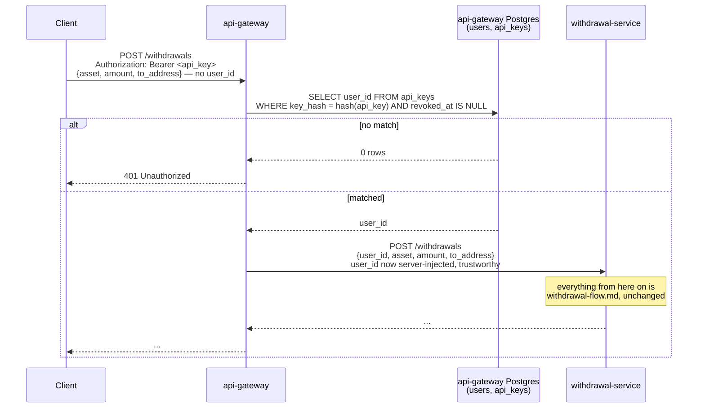
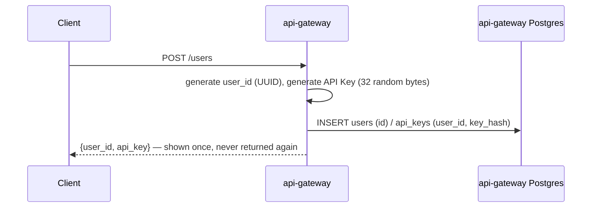

# Identity & Authentication

## Problem

No service in the system authenticates the caller today — every
endpoint (deposit-address lookup, withdrawal requests, whitelist
management) trusts a client-supplied `user_id` at face value. This
makes every custody invariant designed so far — Withdrawal Whitelist,
Minimum Withdrawal Amount, per-user ledger balance — enforceable in
*theory* but meaningless in *practice*, since anyone can act as anyone
by simply naming their `user_id` in a request. This isn't a
"testnet-only" simplification: a custody wallet that doesn't verify who
it's custodying for isn't a custody wallet, regardless of what the
funds are worth. Need a minimal authentication layer — enough that
`user_id` comes from a verified credential, never from client-asserted
trust.

One concrete, already-built impact: `wallet-service`'s existing
`POST /v1/users/{userID}/deposit-address` endpoint (Phase 1, shipped)
takes `userID` straight from the URL path with no verification — this
is the first place that needs retrofitting, not just a concern for
services still on the drawing board.

## Bounded context(s)

New, small bounded context: **Identity**. Owns User accounts and API
Key credentials. Consumed only by `api-gateway` — every other service
(`wallet-service`, `ledger-service`, `withdrawal-service`, `sweeper`)
keeps trusting `user_id` as before, but that trust is now well-founded,
because `api-gateway` is the only path in and it no longer accepts a
client-supplied `user_id` at all (see invariants).

Identity's data (`users`, `api_keys`) lives in `api-gateway`'s own
Postgres, queried directly — not a separate `identity-service` (see
Alternatives).

## Ubiquitous language

- **User** — an account, identified by a system-generated `user_id`
  (UUID, never client-chosen). This is the same `user_id` already
  referenced throughout `ledger.md`, `withdrawal-flow.md`, and
  `deposit-flow.md` — those docs assumed it existed and was
  trustworthy; this doc is what actually creates and authenticates it.
- **API Key** — a credential belonging to one User. Generated once,
  shown in plaintext exactly once at creation — same "shown once"
  ceremony as the master mnemonic and Cold-tier seeds
  (`wallet-tiering.md`). Only a hash is stored, never plaintext. Sent as
  `Authorization: Bearer <api_key>` on every request.
- **Authenticated `user_id`** — the `user_id` `api-gateway` resolves
  from a valid API Key and injects into every downstream call. A
  `user_id` field in a client's request body/params is no longer read —
  request schemas drop it entirely, so there's nothing to silently
  ignore.
- **Revocation** — deleting/deactivating an API Key invalidates it
  immediately, checked on every request via a live Postgres lookup —
  no blocklist needed, unlike a self-contained signed token would
  require.

## Aggregates & invariants

1. **`user_id` is system-generated (UUID), never client-chosen.**
   Created only by `POST /users`, which returns it alongside the
   plaintext API Key. This is what turns "who is this" into a real,
   addressable identity instead of an arbitrary string anyone can
   claim.
2. **API Keys are stored hashed, never plaintext** — same principle
   already established for the master mnemonic/seeds. A leaked
   database dump alone doesn't let anyone authenticate as another user;
   only a leaked plaintext key does.
3. **Every request to `api-gateway` except `POST /users` requires a
   valid `Authorization: Bearer <api_key>` header.** Missing or invalid
   → `401`, rejected before any downstream call. No request reaches
   `wallet-service`/`ledger-service`/`withdrawal-service`/etc. without
   first resolving a real, authenticated `user_id`.
4. **Downstream request schemas drop `user_id` as a client-supplied
   field entirely.** `POST /withdrawals`, whitelist management,
   deposit-address lookup — `api-gateway` injects the authenticated
   `user_id` server-side before forwarding; it is never read from the
   client's body/params again.
5. **Only `api-gateway` is reachable from outside the deployment.**
   `wallet-service`, `ledger-service`, `withdrawal-service`, `sweeper`
   are internal-only — no exposed port in docker-compose, a private
   subnet/firewall rule in the multi-VM phase. This is what makes
   invariant #4 actually hold: without it, someone could bypass
   `api-gateway`'s auth by calling an internal service directly.
6. **Revoking an API Key takes effect on the very next request** — a
   live `SELECT ... WHERE key_hash = ? AND revoked_at IS NULL` lookup,
   not a self-contained signed token. No blocklist or expiry-window
   edge case to design around.

## Diagram

Request lifecycle with auth (withdrawal used as the example; the same
shape applies to every authenticated endpoint):

User / API Key creation:

## Alternatives considered

- **A separate `identity-service`** instead of embedding the check in
  `api-gateway`. Rejected for v1 — every request needs this check, so a
  network hop per request adds latency everywhere for no real isolation
  benefit (nothing else needs to call Identity independently). Same
  reasoning that kept the Screening List and Treasury Sweep checks
  embedded rather than split into their own services.
- **JWT issued by `api-gateway`** instead of an opaque API Key.
  Stateless verification is faster (no DB lookup), but revocation needs
  a blocklist, and this project has no login/session/refresh-token UX
  to justify that tradeoff. Rejected per your decision.
- **Password + login endpoint.** Rejected per your decision — no
  frontend, no session UX to serve; an API-key-only model (mint once,
  use until revoked) matches how every other credential in this system
  is already handled (mnemonic, Cold-tier seeds: shown once, verified
  via hash).
- **Keep trusting client-supplied `user_id`, add per-user rate limiting
  as a partial mitigation.** Rejected — rate limiting slows down abuse,
  it doesn't stop a single unauthorized withdrawal. Treats a symptom,
  not the missing control.

## Open questions

1. **`api-gateway` needs its own Postgres** (`users`, `api_keys`) — not
   currently in `docs/ARCHITECTURE.md`'s service table (today: "talks
   to: all of the above," no store of its own). Another addition to
   that table, tracked as a follow-up alongside the others
   (chain-watcher's Postgres, `sweeper`'s addition).
2. **API Key format and hashing algorithm** — recommending a
   cryptographically random 32-byte token, SHA-256 for the stored hash
   (fine here since this is already a high-entropy random secret, not
   a human-chosen password needing bcrypt/argon2's brute-force
   resistance). Flagging the choice rather than guessing silently.
3. **Rate limiting / brute-force protection** on `POST /users` and on
   invalid-API-key attempts — not designed now, natural fit for the
   observability phase (roadmap step 3).
4. **This only covers "is this your own `user_id`," not a broader
   authorization model.** `compliance-screening.md` and
   `wallet-tiering.md` already assume an **Operator** role (reviews
   Flagged Deposits, runs the local signing CLI for Warm/Cold). My
   instinct: Operator actions stay entirely out-of-band (SSH/direct DB
   access), not a REST API through this same API-key model, since
   Operator isn't a customer-facing role. Flagging rather than
   assuming — worth your explicit call.
