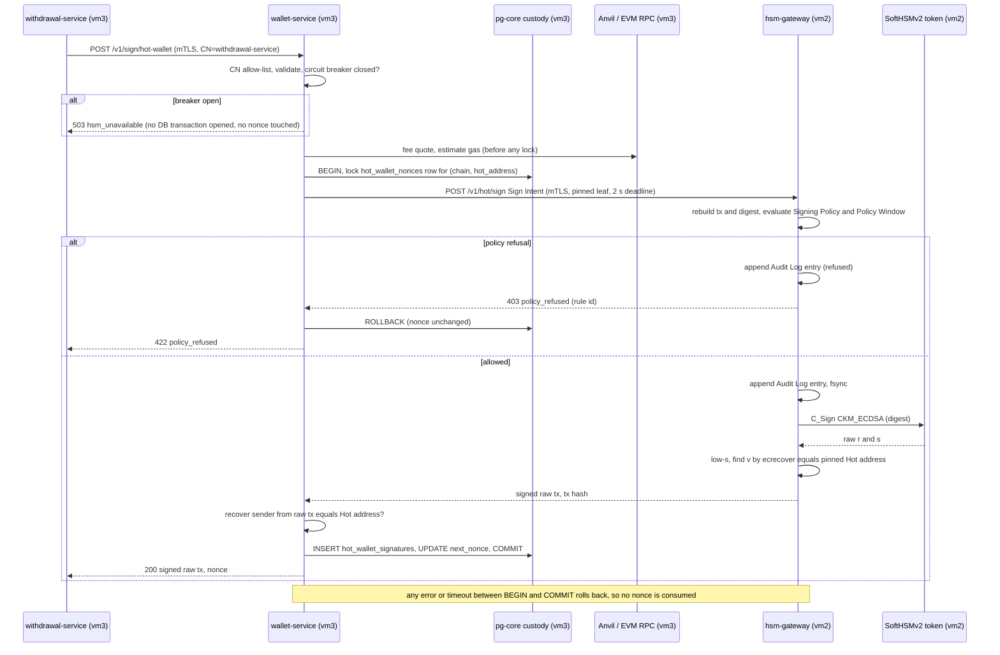
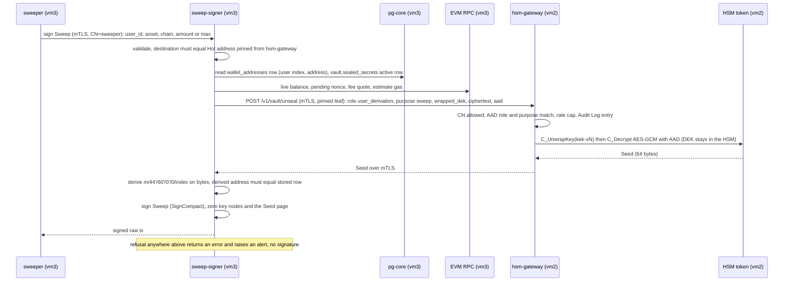
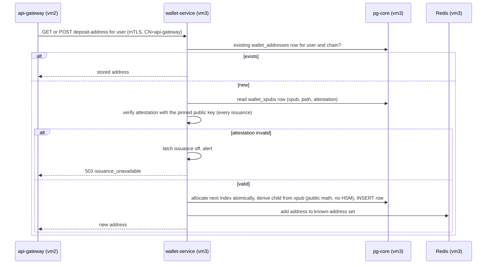
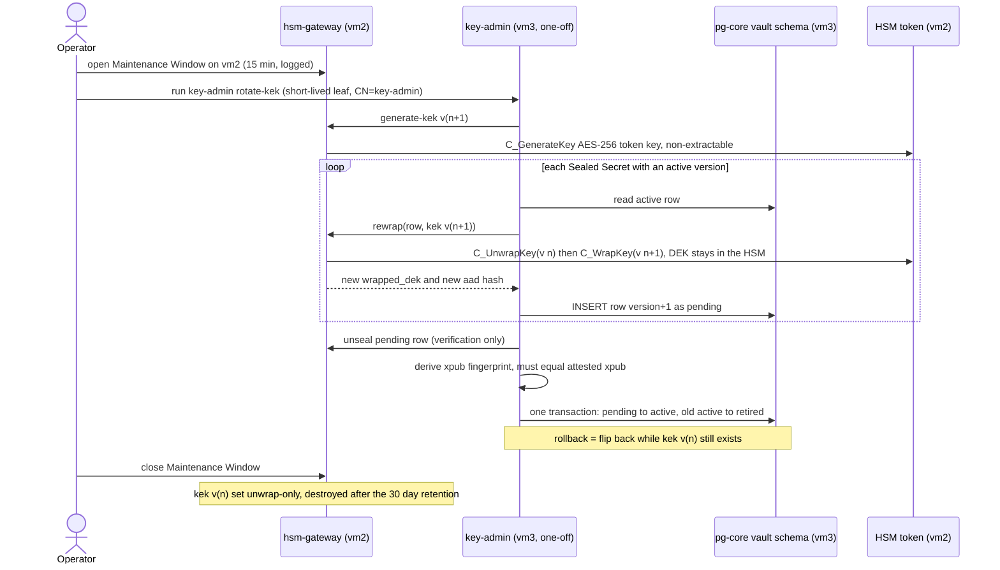
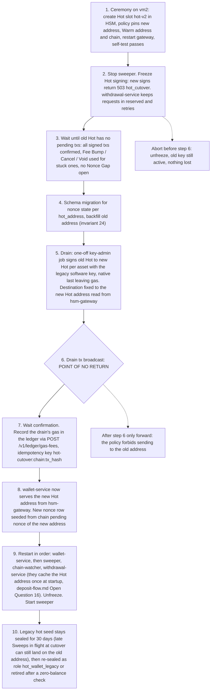
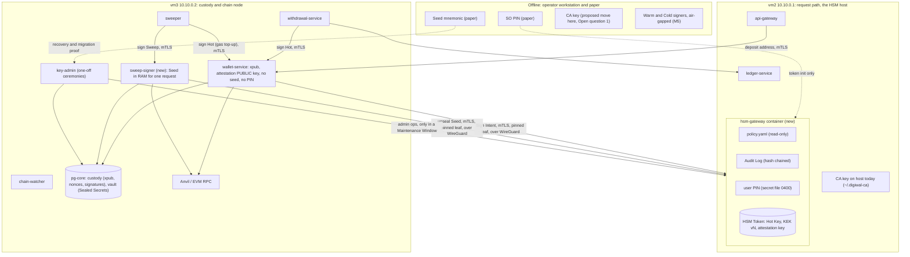

# Key custody: HSM-held Hot Key, KEK/DEK-sealed seed, xpub deposit addresses, isolated sweep signing

Status: M0-M4 built (table below); M5 not started. Design text below is unchanged from the approved proposal.

## Implementation status

| Milestone | State | Verified (where) | NOT verified |
|---|---|---|---|
| M0 spikes | done | `key-custody-hsm-m0-results.md` | vm3 swap / ptrace_scope (spike h) never run on vm3 |
| M1-M3c Signer interface, hsm-gateway + Hot cutover, xpub, sweep-signer, DEK/KEK vault | done | Go suites, SoftHSM tests, local `make e2e-hsm` | never run on vm2/vm3; the Hot cutover only rehearsed locally |
| M4 hardening, secrets, permissions | done (config, scripts, docs) | local `make e2e-hsm` with hardened containers and 0400 keys; `dev/verify.sh` NODE=local: 95 PASS, 0 FAIL, 22 SKIP | `push-certs` against real hosts (ssh stubbed); node-only checks (ownership, swap, ptrace, RLIMIT_MEMLOCK, CA key absent); the token restore drill |
| M4 CA key off vm2 | tooling + `docs/runbooks/ca-key-off-vm2.md` | Makefile dry run | the migration itself (operator task, not done) |
| M4 alerts | 13 rules in `infra/prometheus/alerts.yml`, all unit-tested | `promtool check` and `promtool test` | no Alertmanager exists, so nothing pages; hsm-gateway on vm2 is not scraped by a Prometheus on vm3 (port 9100 is unpublished) |
| M5 Warm/Cold multisig | **not done, deferred** | | |

**Not covered anywhere:** SoftHSMv2 is not tamper-resistant hardware (see above); nothing was ever run on vm2 or vm3.

Tags used on every claim: **VERIFIED** (checked in the repo or by the spike), **DECIDED** (Tech Lead decision, not reopened),
**PROPOSED** (mine, open to overturning), **SPIKE** (unverified, must be proven in M0 before dependent work starts),
**TL CALL** (adds a tool/dependency or changes an earlier decision of yours; see Open questions).

**Safety over convenience.** Wherever safety and simplicity conflicted I chose safety and say so inline (marked "Safety
choice"). The costs are listed in section 5 (latency, an extra service, an operator-run cutover).

**Honest limit, stated once and not repeated softly later:** SoftHSMv2 is a software token. Its security is PIN strength +
file permissions + host isolation. It is **not tamper-resistant hardware**: anyone with root on the host that runs it and
the PIN can use the keys, and a copy of the token directory plus the PIN is a copy of the keys. This design is what a real
HSM would need too (same PKCS#11 surface, same policy-in-front, same rotation), so swapping hardware in later changes the
`hsm-gateway` backend, not the design. The security gained today comes from separation (different host, different
process, policy in front of the key), not from the token itself.

## Decision register

| # | Decision | Tag |
|---|---|---|
| K1 | SoftHSMv2 (PKCS#11) holds the Hot Key and the KEK | DECIDED |
| K2 | The HSM is the "simple kind": no BIP32 inside it | DECIDED |
| K3 | Hot Wallet = one standalone secp256k1 key generated inside the HSM, non-extractable; no longer index 0 of an HD seed. Supersedes `wallet-tiering.md` invariant #7 for Hot; Hot leaves the DEK/KEK flow | DECIDED |
| K4 | Warm = multisig; Cold = multisig or MPC; every signer/share offline (air-gapped) | DECIDED |
| K5 | Deposit addresses: one HD seed, one user = one index, fixed hardened prefix, addresses generated from an xpub so the generator needs no secret | DECIDED |
| K6 | The HD seed (and anything else secret at rest) is protected with DEK/KEK envelope encryption, KEK in the HSM, with rotation | DECIDED |
| K7 | One SLIP-44 coin type per chain (60', 0', 195'...) | DECIDED |
| K8 | HSM runs on vm2, a different host from wallet-service (vm3), behind a small `hsm-gateway` service | DECIDED (placement); my verdict: keep, with three conditions (section 5.1) |
| K9 | `hsm-gateway` signs by intent (it receives unsigned tx fields, rebuilds the digest, applies a Signing Policy), never a caller-supplied digest | PROPOSED |
| K10 | Sweep signing moves out of `wallet-service` into a separate minimal `sweep-signer` container; `wallet-service` holds no seed at all | PROPOSED |
| K11 | Seed handling: store the 64-byte BIP39 seed (not the mnemonic), derive with BIP32 on `[]byte` (btcd `hdkeychain` + `btcec`), drop `go-ethereum-hdwallet` from the sweep path | PROPOSED, TL CALL (new direct dependency) |
| K12 | Go PKCS#11 binding (needs cgo) for `hsm-gateway` only | PROPOSED, TL CALL (new dependency, new image base) |
| K13 | `hsm-gateway` and `sweep-signer` speak mTLS HTTP+JSON like every service today; they join the gRPC move only if `grpc-internal-transport.md` is approved | PROPOSED |
| K14 | The Software Signer does not exist in the production binary (build tag), and the production profile refuses `MASTER_KEY_HEX` | PROPOSED |
| K15 | `hsm-gateway` pins the caller leaf certificates (fingerprint), not just "signed by the project CA" | PROPOSED |
| K16 | Audit log: hash-chained, written (fsync) before a signature is returned, head published to the auditor | PROPOSED |
| K17 | M3 of the brief is split in three (xpub, then sweep-signer, then DEK/KEK + removal of the env key), because the brief's order would force a weaker intermediate state | PROPOSED |

## Where this note departs from, or corrects, the inputs

1. **"wallet-service enforces no destination policy" is true only for the Hot path (VERIFIED).** `Signer.validate`
   (`signing.go:145`) checks hex form, amount, chain id and that the asset is registered, nothing about `to_address`; the
   only destination rule for Hot lives in `withdrawal-service` (`withdrawal-flow.md` invariant #18). The user-address
   (sweep) path *does* pin the destination: `useraddress.go:94` rejects any `to_address != Hot` (`deposit-flow.md`
   invariant #7). So today a compromised `wallet-service` (not only a compromised caller) can sign Hot to any address.
2. **Cold is not "nothing" (VERIFIED):** `infra/treasury.yaml` already has an optional public `cold_address` and the
   service has `ColdFor`. The Safe address model below needs no change to that file either.
3. **Placement on vm2 has two weaknesses the brief did not list**: vm2 hosts other tenants' containers and, once public
   exposure is chosen (`multi-node-deployment.md` Open Question 7), the internet-facing gateway; and the CA key sits on
   vm2, so a vm2 host compromise defeats CN allow-listing for the HSM too. Both are mitigated in 5.1. The availability
   cost is smaller than assumed: withdrawals already need vm2 (the ledger Lock/Settle is on vm2, VERIFIED in
   `multi-node-deployment.md` D1), so vm2 down already stops withdrawals; the new dependency hits Gas Top-Ups,
   sweeps and Treasury Sweeps, which today survive a vm2 outage.
4. **The Hot nonce tables are keyed by `chain_id` only (VERIFIED, migration 000003):** `hot_wallet_nonces` PK
   `chain_id`, `hot_wallet_signatures` UNIQUE `(chain_id, nonce)`, no address column. A key change therefore needs a schema
   change; the new address would otherwise inherit the old key's nonce counter. Not in the brief.
5. **PKCS#11 `CKM_ECDSA` returns raw `r||s` (64 bytes), not DER (SPIKE for the Go binding).** The spike saw DER only
   because `pkcs11-tool` converted it. The conversion work is therefore r,s normalisation (low-s) and recovery-id search,
   not DER parsing.
6. **xpub integrity cannot be fully guaranteed against a fully compromised `wallet-service` host by anything on that host.**
   What is achievable is: prevented for a database-only compromise, detected (not prevented) otherwise, with a residual
   unbacked-credit window (invariant 11 and Open question 6).
7. **`mlock` does not need `CAP_IPC_LOCK` for a few hundred bytes** (it needs a sufficient `RLIMIT_MEMLOCK`), so `cap_drop:
   ALL` and `mlock` are compatible if the seed lives in one dedicated mmap'd page, not the Go heap.
8. **"Hot compromised = Hot's balance lost" is only true with a policy in front of the key.** A bare digest-signing HSM
   lets a compromised `wallet-service` drain Hot in seconds; the policy bounds it to a per-window amount.
9. **A token-directory backup is a second copy of every key in it** (the Hot Key included, because file copy bypasses
   non-extractability). My recommendation is no routine token backup (section 5.6), which differs from the brief's
   "backup of the token directory".

## 1. Problem

`wallet-service` keeps two BIP39 seeds sealed with one AES-256-GCM layer under an environment variable
(`MASTER_KEY_HEX`, `internal/crypto/seal.go`, no AAD, no rotation) and decrypts both into process memory at startup for the
life of the process; the mnemonic transits a Go `string`, which cannot be zeroed (VERIFIED, `main.go:302-311`). The master
key and the sealed seeds sit on the same host. One bug that reads `wallet-service` memory or its environment exposes every
user's transient key and the automated payout key. The standard custody model fixes this with: the payout key generated
inside an HSM and never exportable, signing governed by policy outside the application; seeds encrypted under keys that
live only in the HSM, rotatable; deposit addresses issued from public data so the issuing path holds no secret; the
unavoidable seed-in-RAM moment isolated in a tiny process; Warm and Cold held by independent offline signers. This note
designs that for `wallet-service`, using SoftHSMv2 as the stand-in HSM, and the migration from today's state without
invalidating any existing deposit address.

## 2. Bounded context(s)

Stays inside **Wallet & Signing** (`docs/ARCHITECTURE.md`; `wallet-tiering.md`). It does not need a new bounded context:
the language (Hot Wallet, Sweep, Gas Top-Up, Treasury Sweep, Nonce Gap) is unchanged and the ledger/withdrawal/deposit
contexts see the same wire contracts. What changes is **deployables**, because each trust boundary needs its own process:

| Deployable | Context role | Node | Holds |
|---|---|---|---|
| `wallet-service` (changed) | Address issuance (public math only), Hot signing orchestration (nonce, idempotency, fee bump, void), Treasury file | vm3 | xpub, attestation public key, Hot address. **No seed, no DEK, no PIN, no private key** |
| `hsm-gateway` (new) | Custodian of the HSM Token: Hot Key, KEK(s), attestation key. Policy enforcement and audit for every operation | vm2 | token files, user PIN, policy file, audit log |
| `sweep-signer` (new) | Signs Sweeps only. The one place the user-derivation Seed ever exists in plaintext | vm3 | Seed in RAM for one request at a time |
| `key-admin` (new, one-off, operator-run) | Ceremonies: init, migration, rotation. Not always-on | vm3 container run on demand | transient |

Touched without changing their responsibilities: **Deposit** (`sweeper` calls `sweep-signer` instead of `wallet-service`
for user-address signing), **Withdrawal** (consumes the same Hot sign endpoint; gains one new refusal), **Platform**
(`infra/pki`, Makefile, firewall, compose overlays), **Reconciliation/auditor** (reads the audit head). Not changed:
Ledger, Identity.

## 3. Ubiquitous language

Reused unchanged: Wallet Tier, Hot Wallet, Warm Wallet, Cold Wallet, Hot Floor, Hot Ceiling, Sweep, Gas Top-Up, Treasury
Sweep, Replenishment, Treasury Movement, Nonce Gap, Nonce Filler, Fee Bump, Void, `caller_cn`, Asset Registry, mTLS, CN
authorization policy, Node, Private Network.

- **Hot Key** - the secp256k1 private key of the Hot Wallet, generated inside the HSM Token with `CKA_SENSITIVE=true`,
  `CKA_EXTRACTABLE=false`; its address is the Hot Wallet address (replaces "index 0 of the hot_wallet seed").
- **HSM Token** - the SoftHSMv2 token (files under `/var/lib/softhsm/tokens`) opened only by `hsm-gateway`.
- **`hsm-gateway`** - the service that fronts the HSM Token over mTLS: signs Hot transactions by intent, performs
  KEK operations, enforces the Signing Policy, writes the Audit Log.
- **Sign Intent** - the unsigned EIP-1559 transaction fields (`chain_id, nonce, to, value, data, gas, max_fee, tip`) plus
  the idempotency key and `caller_cn` claim; the only thing `hsm-gateway` signs from.
- **Signing Policy** - the static rule set, held only by `hsm-gateway`, that every Sign Intent must pass (section 4,
  invariant 4). Refusal means no signature.
- **Policy Window** - a rolling time window (1 hour and 24 hours) over which `hsm-gateway` caps the cumulative value it will
  sign per asset, rebuilt from the Audit Log at startup.
- **Audit Log** - the append-only, hash-chained record of every sign/unwrap/admin request and its result.
- **Seed** - the 64-byte BIP39 seed from which the user-derivation HD tree is derived (the mnemonic is only the paper
  backup of it).
- **KEK** (key-encryption key) - an AES-256 key object inside the HSM Token, labelled `kek-v{n}`, never exportable; only
  wraps/unwraps DEKs.
- **DEK** (data-encryption key) - a 256-bit AES key generated inside the HSM, one per sealed secret, stored only as a
  Wrapped DEK.
- **Wrapped DEK** - the DEK encrypted by a KEK (stored in Postgres, useless without the HSM).
- **Sealed Seed** - the Seed encrypted with AES-256-GCM under its DEK, AAD = `role|purpose|key_version|kek_version|SHA256(wrapped_dek)`.
  (Existing term, now a different format.) A **Sealed Secret** is any such row; v1 has only the Seed and the legacy Hot seed.
- **Key Version** - integer per secret role; at most one `active` version per role.
- **xpub** - the extended public key at account level (`m/44'/60'/0'` for EVM). With it anyone can derive every deposit
  address and no private key. **Account xpub** when disambiguation is needed.
- **xpub Attestation** - an ECDSA signature by a dedicated HSM key over the canonical encoding of
  `(domain tag, chain, coin_type, path, xpub, seed_version)`; proves the xpub was issued by a ceremony, not written by
  whoever can write the database.
- **Issued Range** - the derivation indexes `[0, next_index)` that `wallet-service` has allocated.
- **`sweep-signer`** - the minimal container that unseals the Seed per request, derives one child key, signs a Sweep to
  Hot, and zeroes.
- **Signer (interface)** - the seam in `wallet-service` with two backends: **PKCS#11 backend** (calls `hsm-gateway`) and
  **Software Signer** (dev and unit tests only, absent from production builds).
- **Production profile** - a binary built with `-tags prod` and run with `SIGNER_PROFILE=prod`.
- **Ceremony** - an operator-run, logged procedure (init, migration, rotation, Warm/Cold signing) executed by `key-admin`.
- **Maintenance Window** - a time-boxed (15 min) state of `hsm-gateway` opened on vm2 by the operator that permits
  admin operations (generate/rewrap/destroy a KEK, create a Hot Key slot); closed otherwise.
- **Safe** (later milestone) - the audited multisig contract used for Warm and Cold on EVM; **Signer Set** - its owners and
  threshold; **Offline Signer** - an air-gapped machine that signs Safe transaction hashes.

## 4. Aggregates & invariants

Numbering is this note's own. "Enforced by" names the responsible component.

### 4.1 The Hot Key and its signatures

1. **The Hot Key exists only inside the HSM Token and cannot be exported.** `hsm-gateway` generates it with
   `CKM_ECDSA_KEY_PAIR_GEN` (secp256k1) and `CKA_SENSITIVE=true, CKA_EXTRACTABLE=false` (VERIFIED by the spike: attributes
   "sensitive, always sensitive, never extractable", reading the private key via PKCS#11 refused). At every startup
   `hsm-gateway` re-reads those attributes and refuses to serve if the key is extractable or the label is missing. No API
   route exports key material. (Honest limit: the token *files* are a copy of the key, invariant 22.)
2. **Only `hsm-gateway` opens the HSM Token or knows its PIN.** Enforced by mounting the token volume and the PIN secret
   into the `hsm-gateway` container only, owner uid-only permissions, and by `wallet-service`/`sweep-signer` having no
   PKCS#11 library in their images (`wallet-service` and `sweep-signer` build with `CGO_ENABLED=0`, VERIFIED pattern in
   today's Dockerfile).
3. **`hsm-gateway` never signs a digest supplied by a caller.** Its API accepts a Sign Intent, rebuilds the EIP-1559
   transaction and digest itself (go-ethereum, already a dependency), and signs that. There is no route that takes a
   digest. Enforced by API shape plus a contract test that every route's schema has no `digest`/`hash` field. The one
   internal exception is the startup self-test (invariant 5), which signs a fixed transaction that can never be mined
   (nonce `2^64-1`, invalid by EIP-2681).
4. **Every Sign Intent must pass the Signing Policy before any HSM call; a refusal produces no signature and an alert.**
   The policy is a file mounted read-only into `hsm-gateway` on vm2 and exists nowhere `wallet-service` can write
   (`wallet-service` runs on vm3; its own checkout of the repo is not the file `hsm-gateway` reads). Its SHA-256 is logged
   at startup and in every Audit Log entry. v1 rules (PROPOSED):
   - transaction type fixed to EIP-1559 (type 2); `chain_id` equals the single pinned chain; `to` present (no contract
     creation); empty access list; `value` and `data` as below;
   - `data` is empty (native transfer) **or** exactly `transfer(address,uint256)` (selector `a9059cbb`, 68 bytes) and `to` equals the
     registered contract of an allowed asset and `value` is 0; every other selector (`approve`, `transferFrom`, anything
     else) is refused;
   - the recipient (native `to`, or the ERC-20 recipient argument) is not the zero address, not the Hot address, not the
     token contract itself, not the `hsm-gateway`'s own policy-listed denied set;
   - `gas` <= the policy cap for the asset type, `max_fee` <= the Fee Ceiling (50 gwei, the existing decided
     `DefaultFeeCeiling`, VERIFIED), `tip` <= `max_fee`;
   - per-asset `max_per_tx` and **Policy Window** caps (1 h and 24 h) on cumulative payout value, with the worst-case fee
     (`gas * max_fee`) counted in the native-coin window;
   - a request rate cap (signatures per minute) and a global kill switch (policy `enabled: false`);
   - **Treasury Sweep class:** a transfer whose recipient equals the policy-pinned Warm address has its own `max_per_tx`
     (up to Hot Ceiling) and does not consume the payout window, because it moves funds between our own wallets;
   - **Cancel class (Nonce Filler / void):** `value == 0`, empty data, recipient == Hot, any nonce;
   - **Replacement:** a Sign Intent for a nonce already seen is accepted if it is a Fee Bump (same `to`, `value`, `data`,
     higher fees <= ceiling) or a Cancel; window accounting is per nonce at the **maximum** value ever signed for that
     nonce, because at most one version of a nonce can be mined.
   Policy numbers derive from the Asset Registry's `hot_floor`/`hot_ceiling` (PROPOSED rule: 1 h window <= `hot_floor/3`,
   24 h window <= `hot_ceiling`, both config values the Tech Lead tunes, `wallet-tiering.md` Open Questions #2 style).
   **What the policy does not do, plainly:** withdrawal destinations are arbitrary user addresses, so the policy cannot
   allow-list them; a fully compromised `wallet-service` can still send up to the Policy Window to an attacker address. The
   policy turns "drain Hot in seconds" into "lose at most one window, with an alert on the first refusal and a kill
   switch".
5. **A signature leaves `hsm-gateway` only if public-key recovery over the digest returns the pinned Hot address, in
   canonical low-s form, and `wallet-service` independently re-checks it.** `hsm-gateway` converts the raw `r||s` to
   `(r, s, v)`: if `s > N/2` then `s = N - s`; `v` is the recovery id (0 or 1) that makes `ecrecover(digest, r, s, v)`
   equal the expected address (pinned in the policy file, cross-checked against the address derived from `CKA_EC_POINT`).
   At startup, on every PKCS#11 session re-open, and every 10 minutes, `hsm-gateway` signs the self-test transaction and
   verifies recovery; on mismatch it stops serving `/v1/hot/sign` (fails closed) and alerts. `wallet-service` recovers the
   sender from the returned raw transaction and compares it with the Hot address before storing the signature; mismatch
   is an error that rolls the transaction back (invariant 6).
6. **An HSM, policy, network or audit error never consumes a Hot nonce.** VERIFIED structure: in
   `storage.SignHotWallet` the sign callback runs inside the DB transaction that holds the `hot_wallet_nonces` row lock;
   `UPDATE ... next_nonce = next_nonce + 1` and the `INSERT` of the signature happen only after the callback returns, and any
   error rolls the whole transaction back (`hotwallet.go:109-121`). The new callback is just "call `hsm-gateway`, verify,
   return"; the existing structure is kept unchanged. Two additions: (a) a circuit breaker in `wallet-service` checked
   **before** the transaction opens, so an HSM outage costs a fast `503 hsm_unavailable`, not a 2-second row lock per
   attempt; (b) a signature produced by the HSM but lost to a failed commit is harmless to the chain (never returned to a
   caller) and harmless to the policy (invariant 4's per-nonce maximum). Enforced by `wallet-service`; tested by killing
   `hsm-gateway` mid-sign and asserting `next_nonce` is unchanged and a retry with the same key signs the same nonce.
7. **Fail closed, never fall back to a software key.** If `hsm-gateway` is unreachable, refuses, or fails the self-test,
   Hot signing returns `503`. The Software Signer is excluded from production **at build time** (`//go:build !prod` on its
   files), so the production binary physically contains no software backend; the production profile also refuses to start
   if `MASTER_KEY_HEX` or any `SOFT_*` signer variable is present, and refuses a non-`pkcs11` `SIGNER_BACKEND`. Enforced by
   the build tag, startup checks in `wallet-service`, and `make verify` (`go version -m` of the deployed binary shows
   `-tags=prod`; `docker inspect` of every running container shows no `MASTER_KEY_HEX`). Convention is not relied on.
8. **Every sign, unwrap and admin request is in the Audit Log before its result is returned, and if the log cannot be
   written no signature is returned.** Each entry: sequence number, timestamp, caller CN (from the verified certificate),
   `caller_cn` claim, operation, intent fields (chain, nonce, to, value, selector and recipient, fees), digest, matched
   policy rule, result, policy hash, and the SHA-256 of the previous entry (hash chain). `fsync` before responding. The
   file is append-only (`chattr +a` set by the operator on the host; the container cannot unset it without
   `CAP_LINUX_IMMUTABLE`). `GET /v1/audit/head` (sequence, hash) is polled by the auditor on vm3 and stored there, so
   truncation or rewrite on vm2 is detectable from the other node. Enforced by `hsm-gateway`.

### 4.2 Deposit-address issuance and the xpub

9. **The address-issuing path holds no secret.** `wallet-service` has no Seed, DEK, PIN or private key in memory, env,
   disk or database grants. Enforced by (a) process split (K10); (b) a `vault` schema in the custody database holding
   `sealed_secrets`, owned by role `svc_vault` (used by `sweep-signer` and `key-admin`) with `USAGE` revoked from
   `svc_wallet` (role-per-service exists, VERIFIED, `multi-node-deployment.md` invariant 5); (c) `wallet-service` startup
   asserts it cannot `SELECT` from `vault.sealed_secrets` and exits if it can.
10. **Every deposit address is derived from an Attested xpub, verified before use; an unverifiable xpub means no issuance.**
    The xpub, its path and its xpub Attestation are rows in `wallet_xpubs`. The attestation key is a P-256 ECDSA key in the
    HSM (separate from the Hot Key and KEK); its **public** key is pinned in a file mounted into `wallet-service`, outside
    the database. `wallet-service` verifies the attestation (software, microseconds) at startup and **on every issuance**.
    Failure latches issuance off in memory until restart and alerts (`GET /v1/users/{id}/deposit-address` for an existing
    user keeps working from stored rows; creating new ones returns `503`). Chosen over a hash pinned in config because the
    attestation covers path, chain, coin type and version, and rotating the seed needs no config edit on vm3. Safety
    choice: verification on every use costs microseconds and removes the "checked once, swapped later" window.
11. **A swapped xpub that survives invariant 10 (attacker controls the `wallet-service` host) is detected by the seed
    holder, not prevented.** `sweep-signer`, for every Sweep, derives the address from the Seed and requires it to equal
    the stored `wallet_addresses.address` for that user; a separate Address Audit loop in `sweep-signer` re-derives every
    new `wallet_addresses` row and compares, alerting and freezing sweeps on mismatch. A user who deposits to an
    attacker-derived address would still be credited by the ledger (deposit events come from the watched set) while no
    funds reach us: that unbacked-credit window is the interval between issuance and the Address Audit pass (target under
    60 s, below typical confirmation time on a real chain). **This is a residual risk and an Open question for the Tech
    Lead**; only gating ledger credit on the audit would remove it, which I did not design (it couples the Deposit and
    Ledger contexts to a new check).
12. **The xpub is the account node, children are non-hardened, and no child private key ever leaves `sweep-signer`.** EVM:
    `m/44'/60'/0'` hardened prefix, then `/0/{index}` non-hardened; address(user) = `derive(xpub, 0, index)`. This is the
    same tree the existing code uses (`m/44'/60'/0'/0/{index}`, VERIFIED, `hdwallet.go:23`), so **every existing
    `derivation_index` stays valid and every existing address is reproduced bit-for-bit** (migration test: derive from the
    xpub for all existing rows and compare to stored addresses). The known weakness of non-hardened derivation: an xpub plus
    one leaked child private key reveals the account private key and therefore all children. Mitigations: child keys
    exist only inside `sweep-signer` for one signature; the xpub is given to `wallet-service`, `sweep-signer` and the
    auditor only, never an API response or a log line; the xpub is taken at **account depth**, so a leak does not reach
    other accounts or the Hot Key (a different, unrelated key).
13. **xpub issuance is secp256k1-only, so v1 scope is EVM.** Public derivation (BIP32 CKDpub) works for secp256k1 chains:
    EVM (coin 60'), Bitcoin (0', xpub encodings differ by script type), Tron (195'). It does not exist for Solana/ed25519:
    SLIP-10 ed25519 is hardened-only, so there is no public child derivation. Solana would need either a pre-generated
    pool of public addresses loaded from a ceremony (finite, needs top-up ceremonies), or an address generator that
    holds a secret, which contradicts K5; so it is a new design, not an extension. Enforced by `wallet_xpubs.chain` having a
    `CHECK (chain = 'evm')` in v1. `wallet_addresses.chain` (default `'evm'`, VERIFIED) already carries the dimension.
    Whether the Seed is shared across chain families is Open question 8.

### 4.3 The Seed in RAM (sweep-signer)

14. **The Seed exists in plaintext only inside `sweep-signer` (and in ceremony processes), only for the duration of one
    request by default, and is zeroed immediately.** Safety choice: unwrap per request, not cached. Cost: one extra HSM
    round trip (~3-10 ms, E) per Sweep, which is irrelevant at Sweep volumes; a configurable micro-batch window (default 0)
    exists but is off in v1. To make zeroing possible at all: the Seed is stored as 64 raw bytes (K11); it is received into
    one dedicated page (`mmap` + `mlock` + `MADV_DONTDUMP`), never a Go `string`; derivation uses `hdkeychain` on `[]byte`
    and calls `ExtendedKey.Zero()` on every node; signing uses `btcec` `ecdsa.SignCompact` (RFC 6979, canonical low-s),
    whose key type is a zeroable scalar, and the Ethereum signature is assembled from `(r, s, v)`; the page is overwritten
    and `munmap`ed after the signature. **Library decision (K11):** replace `go-ethereum-hdwallet` on this path rather than
    accept the limit, because that library takes a `string` mnemonic and retains derived keys in its `Wallet`, so
    zeroing is impossible by construction. `btcec/v2`, `btcutil` and `dcrd secp256k1` are already in `go.sum` as indirect
    dependencies (VERIFIED in `go.mod`; `hdkeychain` itself is the new direct import, TL CALL). **Residual, stated
    plainly:** Go can copy stacks and the runtime gives no hard guarantee, so zeroing is best-effort. The real controls are
    isolation (invariant 16), short lifetime, no swap, no core dump, and a tiny process. The mnemonic still passes through
    a `string` in the one-off ceremony process (printed once, as today); that process is short-lived and not a service.
15. **`sweep-signer` signs only Sweeps.** It refuses unless: destination equals the Hot address it obtained from
    `hsm-gateway` `GET /v1/hot/key` (the gateway's pinned value; `wallet-service` is not trusted for it); `chain_id` is the
    pinned chain; asset is registered and the call is a native transfer or ERC-20 `transfer`; the user index is within the
    Issued Range and the derived address equals the stored `wallet_addresses` row (invariant 11); `max_fee` <= the Fee
    Ceiling. Every refusal increments a counter and raises an alert. The existing rules (VERIFIED in
    `useraddress.go`: destination = Hot, live balance for `max`, reserve the fee cap, live pending nonce) are carried
    over unchanged; the code moves, it is not redesigned. A Sweep can only ever send to Hot, so the Issued Range check is
    defence in depth (gas burn), not the primary control.
16. **`sweep-signer`'s container is hardened as part of the invariant, and `make verify` checks it**: distroless/static
    image with no shell or package manager, `read_only: true`, `tmpfs: /tmp` with `noexec,nosuid`, `cap_drop: [ALL]`,
    `security_opt: [no-new-privileges:true]`, fixed non-root uid, `ulimits: {core: 0, memlock: <small>}`,
    `memswap_limit == mem_limit` (no container swap), `pids_limit`, no `pid: host`, no published ports (reachable only on
    the Docker network with mTLS, CN allow-list = `sweeper`), process calls `prctl(PR_SET_DUMPABLE, 0)` at start (no ptrace,
    no core), and `kernel.yama.ptrace_scope >= 1` plus swap off are host checks (swap is off on vm2, VERIFIED; vm3 to check
    in M4). **Limit:** this protects against compromise inside a container; root on the host can read any process's memory.
17. **Only `sweep-signer` can ask `hsm-gateway` to unseal the user-derivation Seed**, and only for that role. Enforced by
    `hsm-gateway`'s per-endpoint CN allow-list (K15), by AAD (role `user_derivation`, purpose `sweep`) being checked against
    the caller CN, by a rate cap (default 60 unseals/min) and by the Audit Log. **Blast radius of a `sweep-signer`
    compromise** is the Seed: every user deposit key, so funds sitting on user addresses between deposit and Sweep, plus
    all future deposits until the seed is rotated (invariant 20). This is the accepted tier-model blast radius for the
    user-derivation seed (`wallet-tiering.md` invariant #1); it never includes Hot, Warm or Cold.

### 4.4 DEK/KEK, rotation and removal of the env key

18. **Every secret at rest is a Sealed Secret: AES-256-GCM under its own DEK, the DEK wrapped by a KEK that never leaves the
    HSM.** `vault.sealed_secrets(role, version, status, kek_label, kek_version, wrapped_dek, gcm_nonce, ciphertext,
    created_at)`, `status in (pending, active, retired)`, unique `(role, version)`, at most one `active` per role (partial
    unique index). AAD = `role|purpose|version|kek_version|SHA256(wrapped_dek)`, so a row swapped between roles, versions
    or KEKs, or paired with another row's wrapped DEK, fails authentication. KEK object (SPIKE): AES-256 token key,
    `CKA_TOKEN, CKA_SENSITIVE, !CKA_EXTRACTABLE, CKA_WRAP, CKA_UNWRAP`, label `kek-v{n}`. Wrap mechanism preference:
    `CKM_AES_KEY_WRAP` (RFC 3394; integrity-protected but no AAD, which is why AAD is bound at the GCM layer through
    `SHA256(wrapped_dek)`). Primary path (P1, SPIKE): `hsm-gateway` unwraps the DEK into a session object and performs the
    AES-GCM decrypt **inside the HSM** (`CKM_AES_GCM` with the AAD), so the DEK never leaves it and only the Seed is returned
    over mTLS to `sweep-signer`. Fallback F1: if `CKM_AES_GCM` is unusable, the unwrapped DEK is returned to
    `sweep-signer`, which decrypts with Go `crypto/aes` and zeroes the DEK; DEK and Seed then share the same memory
    lifetime (per request). Fallback F2: if AES wrap/unwrap is unusable, the KEK is an RSA-3072 key pair and DEKs are
    wrapped with `CKM_RSA_PKCS_OAEP` (wrap uses only the public key, unwrap only in the HSM). Fallback F3: if neither works in
    SoftHSMv2, the KEK role is not workable in SoftHSM; then K6 waits for a real HSM and M3c (below) is replaced by an
    operator-unseal design (Argon2id passphrase typed at start), which I would not build without your decision.
    DEK memory lifetime: P1 none outside the HSM; F1 per request in `sweep-signer`.
19. **At most one active version per role; rotation writes a new `pending` version, verifies it, then flips, and keeps the
    previous version until retirement.** Verification before the flip: unseal the new row, derive the xpub fingerprint, and
    compare to the attested xpub. The flip is one transaction (`pending -> active`, `active -> retired`). Rollback is
    flipping back while the old KEK object still exists. `sweep-signer` reads `status = 'active'` per request, so two
    versions are valid during rotation without a restart.
20. **Three kinds of rotation, different purposes, and wrapper rotation does not help after a Seed leak.**
    - **KEK rotation (re-wrap):** new `kek-v{n+1}` generated in the HSM; for each Sealed Secret `hsm-gateway` unwraps with
      v{n} and wraps with v{n+1} **inside the HSM** (`rewrap`, DEK never visible); new row `pending`, verified, flipped.
      Old KEK object stays unwrap-only (`CKA_WRAP=false`) for a retention period (30 days, PROPOSED) then destroyed.
      Cadence: yearly, and on any suspicion the token directory or PIN was exposed. Triggered by the operator through
      `key-admin` during a Maintenance Window.
    - **DEK rotation (re-encrypt):** new DEK, Seed decrypted in the `key-admin` process and re-sealed. Needs the Seed in a
      ceremony process, so it is rarer: when F1 was in use and a `sweep-signer` compromise is suspected but the Seed itself
      is not believed leaked, or yearly with the KEK rotation. Same pending/verify/flip.
    - **Seed rotation (new Seed):** the only response to a *leaked Seed*. New Seed, new xpub, new `seed_version`; new users
      get new-seed addresses; existing addresses keep the old Seed (kept sealed, `retired` but unsealable by
      `sweep-signer`) until their funds are swept and a grace period passes, because deposits can still arrive at old
      addresses. Re-wrapping or re-encrypting does nothing against an attacker who already holds the Seed or the
      mnemonic. Triggered only by the Tech Lead after an incident.
21. **The offline mnemonic is the disaster-recovery record of the Seed, and its validity is proven before the env key is
    removed.** During the M3c migration `key-admin` asks the operator to type the existing mnemonic, derives the xpub
    fingerprint and requires it to match the stored one (proof that the paper backup exists and is right) before the
    first sealing under a KEK. Without this proof losing the KEK would lose the Seed.
22. **No routine token backup in v1; the recovery path is the paper mnemonic plus a new Hot Key.** Reason (Safety choice):
    a copy of the token directory plus the PIN is a copy of the Hot Key and the KEK, and non-extractability does not
    protect against a file copy. Consequences of losing the token with no backup: the Hot Key is gone and funds at the
    Hot address are unrecoverable (bounded by the Hot Ceiling by `wallet-tiering.md` invariant #4; Warm can only restock a
    *new* Hot, not recover the old one); the KEK is gone and every Sealed Secret is unreadable; recovery = ceremony
    `reseal` from the mnemonic under a new KEK, new attestation key and re-attested xpub, plus a Hot cutover (invariant 24)
    to a new Hot Key. Whether to take an encrypted offline token backup anyway is Open question 10. Whatever is decided,
    a **restore drill** into a throwaway container with the same SoftHSMv2 version is part of M4 and quarterly.
23. **After M3c there is no environment-held key anywhere**: `MASTER_KEY_HEX`, `internal/crypto/seal.go`'s master-key path
    and the `-init-seed` flag's env dependency are deleted; the production profile refuses to start if `MASTER_KEY_HEX` is set
    (invariant 7); the Makefile `env` target stops generating it (it currently does, VERIFIED, `dev/Makefile`).

### 4.5 The Hot Key change and its nonce state

24. **Hot nonce state is per `(chain_id, hot_address)`, and a Hot Key change never reuses another key's rows.** Schema
    change (new migration): `hot_wallet_nonces` gets `hot_address` (PK `(chain_id, hot_address)`), `hot_wallet_signatures`
    gets `hot_address` (UNIQUE `(chain_id, hot_address, nonce)`); existing rows are backfilled with the legacy Hot address.
    The lazy row creation pattern is kept (VERIFIED: `lockNonceRow` seeds the row from the chain's pending nonce when absent),
    so the new address starts at its on-chain nonce (0 for a fresh key). The cutover procedure is in 5.5; its point of no
    return is the broadcast of the drain transaction. Enforced by schema constraints and `wallet-service`.

### 4.6 The channel to the HSM, secrets, access

25. **`hsm-gateway` is reachable only on the Private Network address of vm2, over mTLS, and only by pinned callers.** Bound
    to `10.10.0.1` (never `0.0.0.0`, never `eth0`; the DOCKER-USER rule from `multi-node-deployment.md` invariant 8 applies
    and `make verify` probes it from vm3's public side). CN allow-list per endpoint **and** certificate-fingerprint pinning
    (K15): `hsm-gateway` accepts only the specific leaf certificates of `wallet-service`, `sweep-signer`, `key-admin`, listed
    in its config, so a CA-key compromise (the CA key is on vm2, VERIFIED) alone does not mint a caller it will accept.
    Endpoints and callers: `POST /v1/hot/sign` and `GET /v1/hot/key` (`wallet-service`), `GET /v1/hot/key` also
    `sweep-signer`; `POST /v1/vault/unseal` (`sweep-signer`); `POST /v1/attest` (`key-admin`); admin operations
    (`generate-kek`, `rewrap`, `destroy-kek`, `create-hot-slot`) only `key-admin` **and only while a Maintenance Window is
    open**; `/healthz` and `/metrics` on the plain listener like every service (`service-auth-mtls.md` invariant 8).
26. **No secret is in an environment variable, a compose file or git.** The HSM user PIN and the Postgres/other
    passwords the new services need are Compose `secrets:` with `file:` pointing outside the repo (e.g.
    `/etc/digiwal/secrets/hsm-user-pin`, mode 0400, owner = the service uid), mounted at `/run/secrets/...`. The **SO PIN is
    never stored on any host**: used only at token initialisation, typed by the operator, kept on paper. The PIN file is
    readable only by the `hsm-gateway` uid. (Existing practice puts passwords in the gitignored `.env`, VERIFIED, which
    leaks into `docker inspect`; this note does not extend that to the PIN.) `hsm-gateway` calls `C_Login` at most once per
    start and exits without retry on `CKR_PIN_INCORRECT` (invariant: a restart loop with a wrong PIN would lock the token,
    see Failure modes); `restart: on-failure:3` for it, not `unless-stopped`.
27. **Leaf-key files are readable only by their service's uid.** Today `gen-leaf.sh` writes `key.pem` mode 644 and the
    directory 755 (VERIFIED, `infra/pki/gen-leaf.sh:47-48`). PROPOSED: fixed uid per service, `key.pem` 0400, directory
    0500, owned by that uid on the host; the new leaves (`hsm-gateway`, `sweep-signer`, `key-admin`) are issued that way
    from the start.
28. **Each service has its own Postgres role, and only the roles named here touch key material.** `svc_wallet` (custody
    schema: addresses, xpubs, nonces, signatures; no access to `vault`), `svc_vault` (schema `vault`, used by
    `sweep-signer` and `key-admin`; `sweep-signer` additionally gets a read-only grant on `wallet_addresses` and
    `wallet_seeds.next_index` through a view). `hsm-gateway` has **no database access at all** (it receives blobs from the
    caller and keeps its state in the Audit Log). Enforced by Postgres roles and `pg_hba` (`scram-sha-256`, `10.10.0.0/24`).

### 4.7 Warm and Cold (later milestone, interfaces only)

29. **No key that can move Warm or Cold funds exists in any always-on service, in `hsm-gateway`, or alone anywhere.** Warm is
    a Safe with a threshold of at least 2-of-3 owners on separate hardware; Cold is a Safe (or an externally audited MPC
    product) whose owners/shares are on air-gapped machines. Changing a Safe's owners or threshold needs the same threshold.
    Enforced by the contract and by procedure; `wallet-service` and `hsm-gateway` have no Warm/Cold owner key.
30. **Shamir secret sharing is a per-key backup mechanism only, never the way funds are signed.** Reconstructing a key to sign
    puts it whole in one machine's memory; threshold signing (Safe owners, MPC) does not. Do not hand-roll MPC:
    build-vs-buy is "buy an audited product or use Safe"; MPC ECDSA protocol code is not written in this repo.
31. **`wallet-tiering.md` invariants that must be rewritten when this is accepted:** **#1** (Hot separate seed from the user
    seed: still true in spirit, now "Hot Key is an HSM key, not derived from any seed"); **#2** (Warm/Cold sealed seeds never
    in an always-on service: becomes "no Warm/Cold owner key in any always-on service; threshold of independent signers");
    **#7** (each tier is index 0 of its own seed: obsolete; Hot = a labelled HSM key, Warm/Cold = Safe addresses). #3, #4, #5,
    #6, #8, #9 hold unchanged (#9's `treasury.yaml` already carries a public Warm address and a Safe address fits without a
    change). The "Hot Wallet" definition in that note's Ubiquitous language and the Replenishment text ("sealed seed
    decrypted in a local CLI") also change.

## 5. Design detail

### 5.1 Placement of `hsm-gateway`: recommendation and honest trade-off

PKCS#11 is a local shared-library API with no network protocol, so something must front it; `hsm-gateway` is that thin
front and also where policy and audit live (which is what makes the separation worth having).

| | HSM on vm2 (your decision) | HSM as a separate container on vm3 |
|---|---|---|
| vm3 compromise (`wallet-service` RCE or host root) | Token files and PIN are on another host. The attacker can call `hsm-gateway` only through the policy | If container-only: token volume not mounted in the compromised container. If host root: token files and PIN on the same host, so the Hot Key is theirs |
| vm2 compromise (container) | `hsm-gateway` is a separate container with its own volume; api-gateway RCE does not reach it | n/a |
| vm2 compromise (host root) | Token files and PIN readable; CA key readable (can mint certs). Exposure: other tenants' containers (VERIFIED in `multi-node-deployment.md`), internet-facing gateway if made public, the CA key | n/a |
| Latency in the Hot sign critical section | +1 WireGuard RTT (~1.3 ms measured) + TLS record + HSM sign + audit fsync | ~0.2 ms RTT, otherwise the same |
| Availability | vm2 down or WireGuard down = no Hot signing, no Gas Top-Up, no Treasury Sweep, no Sweep unseal. Withdrawals already need vm2 (ledger Lock/Settle). New failure domain only for sweeps/top-ups, which previously survived a vm2 outage | No new failure domain |
| Operability | One more cross-node dependency, a token on a node with 3.1-3.8 of 4 cores at the 500 rps target | Simpler |

**Recommendation: keep vm2, on three conditions; if any is refused, fall back to a separate container on vm3 (the design is
placement-agnostic, only `HSM_GATEWAY_URL` and the certificate change).** The conditions: (1) `hsm-gateway` pins caller
leaf certificates (invariant 25), so the CA key being on vm2 does not by itself let an attacker call it; (2) the CA key
moves off vm2 to the operator workstation, or at minimum the other tenants' containers are removed from vm2 (Open
question 1; `service-auth-mtls.md` invariant #5 forbids the CA key in a container but is silent on the host); (3) the policy
file and audit log on vm2 are root-owned and not mounted into any other container. The honest summary: what the vm2
placement buys is *protection from a vm3 compromise*, which is the most exposed surface that handles untrusted input
(RPC data, request bodies) and is what you named; what it costs is that vm2's host becomes the highest-value host while
being the one with the most unrelated code on it. The policy in invariant 4 is the larger half of the benefit and works on
either placement.

`wallet-service` starts without `hsm-gateway` (address issuance needs only the xpub), reports `/readyz` with a separate
`signing: unavailable` state, and Hot signing endpoints return `503`. It never exits or falls back because the gateway is
down; a restart loop would only add noise.

### 5.2 Sign path and load

The only HSM work inside the DB-locked section is the sign call: `Sign` builds the body (RPC fee quote, gas estimate)
**before** it opens the transaction (VERIFIED, `signing.go:129-134`), then holds the nonce-row lock only across the callback
and two statements.

| Step inside the nonce-row lock | Estimate (E) |
|---|---|
| wallet to `hsm-gateway` over WireGuard, kept-alive TLS connection | 1.3-2 ms RTT |
| policy evaluation and Policy Window lookup (in memory) | < 0.2 ms |
| Audit Log append + `fsync` (before the HSM call is acknowledged) | 2-8 ms on vm2 disk, the dominant term |
| HSM `C_Sign` secp256k1 in SoftHSMv2 | 1-3 ms (SPIKE, includes session handling) |
| recovery check, low-s, response; wallet-side recovery check, INSERT, UPDATE, COMMIT | 2-4 ms |
| **Critical section** | **~8-17 ms, so a ceiling of roughly 60-120 signs/s** |

Compared with the plan: accepted withdrawals are "one or two per second" and are serialised by the nonce row and 2 s Anvil
blocks (`multi-node-deployment.md` invariant 12, VERIFIED), plus Gas Top-Ups and Treasury Sweeps at far lower rate. Headroom is
~30-50x, so the HSM is not the bottleneck of the 500 rps plan, and the extra ~10 ms inside the lock does not change the
accepted-withdrawal rate. The risks are tails, not the mean: vm2 saturating its CPU (the table says vm2 is at 3.1-3.8 of 4
cores near 500 rps) and fsync stalls. Controls: a **2 s deadline** on the gateway call (the lock is never held longer);
the circuit breaker (invariant 6) opens after 3 consecutive failures for 5 s and is checked before the transaction; an
`hsm-gateway` session pool of 4 (login once; SoftHSMv2 is opened with OS locking; **concurrent sign behaviour is a SPIKE**),
with sign operations serialised per key if the spike shows contention; timeouts leave no side effects (invariant 6). If
the fsync dominates, group-commit batching is the first optimisation; it is not in v1.

### 5.3 Hot signing sequence

### 5.4 Sweep sign, address issuance, rotation

### 5.5 Migration, Hot cutover and `GET /v1/wallet/hot-address` consumers

Existing sealed seeds: both are BIP39 mnemonics sealed under `MASTER_KEY_HEX` (VERIFIED); derivation uses an empty BIP39
passphrase (`go-ethereum-hdwallet` default, to confirm in M0 by re-deriving existing addresses).

**User seed (M3a-M3c).** M3a: `key-admin migrate-xpub` opens the old seed with the env key, derives the account xpub at
`m/44'/60'/0'` and the 64-byte Seed, and the attestation is signed; `wallet_xpubs` is filled; migration test requires
`derive(xpub, 0, index) == wallet_addresses.address` for **every** existing row (zero mismatch tolerated, otherwise stop).
M3b: `sweep-signer` takes over Sweep signing, still unsealing the old env-key format (the env key moves from
`wallet-service` to `sweep-signer`'s container only: strictly better, `wallet-service` now has neither seed nor key).
M3c: `key-admin seal-under-kek` performs the proof of invariant 21, seals the Seed under a DEK/KEK (invariant 18), activates it,
and the env key path and `MASTER_KEY_HEX` are deleted. Rollback before deleting the old column: the old `sealed_seed` and
the env key are kept until the new path has served real Sweeps and one rotation drill passed; only then does the final
migration drop them. Existing users' `derivation_index` values are never rewritten.

**Hot cutover (M2).** The old Hot address holds funds and nonce state; the new Hot Key is a different address. Procedure,
operator-run, in a maintenance window, signing frozen by a new operator-only `hot_cutover` freeze (like Nonce Gap, no
HTTP endpoint lifts it, consistent with the `POST /v1/wallet/nonce-gap` precedent):

Interplay: Gap/Void/Cancel/Fee Bump keep using the legacy software signer until step 6 (the software backend still exists in
the non-production build used for the cutover job, `key-admin`, which is why `key-admin` is a separate binary that may
contain the legacy path, never `wallet-service`'s production image). In-flight `signed`/`broadcast` requests are never
Released by the Reaper (`withdrawal-flow.md` invariant #17); step 3 waits for them. Consumers of
`GET /v1/wallet/hot-address` and `system-addresses` (`sweeper`, `chain-watcher`, `withdrawal-service`) see the new
address only after restart, which step 9 orders. `chain-watcher`'s Hot Wallet Outflow rule is unaffected by the drain
(neither side is a user address). The Treasury file needs no edit (Hot is not in it, VERIFIED), but its startup check "warm
!= hot" keeps passing and must be re-run. The auditor's reconciliation of system wallets against the ledger's Chain Account
sees the drain gas as drift unless step 7's ledger entry is posted (Open question 9).

### 5.6 Operations: ordering, verify, monitoring

**First install order** (ceremonies, each logged): (1) vm2 `make hsm-init`: initialise the token (SO PIN typed, user PIN
generated into the secret file), create the Hot slot, KEK, attestation key, print the Hot address and attestation
fingerprint; (2) vm2 `make certs` + `push-certs` with the new leaves; (3) `hsm-gateway` up on vm2; (4) vm3 services.
**Steady state `make up`**: vm2 first (`hsm-gateway` before anything that signs), then vm3; `wallet-service` and
`sweep-signer` tolerate the gateway starting late (503 and retry), never the reverse. **Reboot of vm2** brings
`hsm-gateway` back automatically only in file-PIN mode (Open question 5).

**`make verify` additions** (each a hard failure): the deployed `wallet-service`/`sweep-signer`/`hsm-gateway` binaries carry
`-tags=prod`; no running container has `MASTER_KEY_HEX` or a PIN in `docker inspect` env; `hsm-gateway` self-test status
OK and policy hash equals the expected one; `hsm-gateway` port not reachable from eth0 or from any container but the pinned
ones; token directory mode 0700; leaf `key.pem` mode 0400; compose flags present on the three services (`cap_drop`, `read_only`,
`no-new-privileges`, `memswap_limit`); `sweep-signer` has no shell (`docker exec ... sh` fails); `wallet-service` cannot
`SELECT` from `vault.sealed_secrets`; Audit Log head advancing and equal to the auditor's last record; swap off and
`ptrace_scope >= 1` on both nodes; container count per service (existing invariant 7) includes the three new ones.

**Alerts** (Prometheus, existing stack): any policy refusal, any `sweep-signer` refusal, self-test failure, audit write
failure, unseal rate above normal, unseal from any CN but `sweep-signer`, attestation failure latch, breaker open > 1 min,
Address Audit mismatch, Audit Log head stalled, Maintenance Window open > 15 min, `hsm-gateway` restarted, KEK age > 1 year.

**Compose hardening for `wallet-service` and `hsm-gateway`:** `cap_drop: [ALL]`, `no-new-privileges`, `read_only: true` with
`tmpfs: /tmp`, fixed non-root uid, `pids_limit`, `mem_limit` (existing rule) and `memswap_limit == mem_limit`. `hsm-gateway`
additionally: image with only the binary and `libsofthsm2` (cgo forces a libc base; shell removal where feasible, residual
noted), token volume `0700`, no published port except `10.10.0.1:<next free private port>`, admin operations only within a
Maintenance Window. Today none of these flags exist (VERIFIED) and leaf keys are 644 (invariant 27).

### 5.7 Component and trust-boundary view

What holds which secret: **Hot Key, KEK, attestation private key** only in the HSM Token on vm2. **PIN** only on vm2
(file) and, as the SO PIN, on paper. **Seed** only in `sweep-signer` RAM (per request), the paper mnemonic, and ceremony
processes. **Wrapped DEK + ciphertext** in Postgres on vm3 (useless without the HSM). **xpub, attestation public key, Hot
address** on vm3 (public). **CA key** on vm2's host today. Compromise results: vm3 host = can ask `hsm-gateway` to sign
under the policy and can unseal the Seed through `sweep-signer`'s path (rate-capped, audited), cannot extract the Hot Key,
cannot reach Warm/Cold; vm2 host = Hot Key, KEK, attestation key; neither host alone yields Warm/Cold.

### 5.8 The Signer interface in `wallet-service`

`wallet-service` depends on a `Signer` interface (address, `SignTx(intent) -> raw tx`, health) instead of the concrete
`*hdwallet.Wallet` that `signing.New(...)`, `signTx`, Sign/Replace/Cancel and `UserSigner` take today (VERIFIED). Backends:
PKCS#11 backend (calls `hsm-gateway`, includes the sender-recovery check) and Software Signer (unit tests and the dev
profile, `//go:build !prod`). The idempotency, nonce row, Fee Bump, Void and Nonce Filler logic is unchanged; only the
innermost `signTx` call changes. Fee Bump and Nonce Filler (`signTx` at `hotkeys.go:184`) go through the same Sign Intent route
and the same policy (Replacement and Cancel classes in invariant 4).

### 5.9 Warm and Cold (M5, out of the first delivery)

Interfaces and ceremony only. **Warm:** a Safe on the chain, 2-of-3 owners in separate hardware (target: a hardware wallet,
a second HSM token on a separate host, the operator workstation key; in this dev environment independence is partly
simulated and the note must say so in the runbook). `infra/treasury.yaml` `warm_address` = the Safe address, no schema
change (VERIFIED: file holds a public address only). The Safe contracts are third-party and audited; deploying them to
local Anvil is a new dev-environment dependency (Open question 11). **Replenishment** (Warm to Hot) becomes: operator builds
a Safe transaction (EIP-712 hash) with `key-admin`, carries the hash to Offline Signers (QR/USB), each signs, signatures are
collected and the transaction executed; no private key ever enters an online machine. **Cold:** Safe with a higher
threshold and owners all offline, rarely used; an MPC product (bought, not built) is the alternative, decided by the Tech
Lead at M5. The Treasury Sweep (Hot to Warm, designed, not built) is a Hot-signed transfer and is already covered by the
policy's Treasury Sweep class. Offline signing ceremony: generate keys on air-gapped machines, record only addresses,
Shamir-split a **backup** of each owner key (invariant 30) with shares in separate places, rehearse a signing on testnet
before funds, log every ceremony in the repo (addresses, dates, no secrets).

## 6. Failure modes

| Failure | Behaviour | Detection | Recovery |
|---|---|---|---|
| `hsm-gateway` down / restarting | Hot signing `503 hsm_unavailable` (breaker); no software fallback; Gas Top-Ups and Treasury Sweeps wait; withdrawals stay `reserved` and are retried; unseal fails so Sweeps wait; deposits are still credited and addresses still issued. If down past the Reaper's 5 min, unsigned `reserved` requests are failed and Released (existing behaviour, user retries) | breaker metric, `/healthz`, alert | restart; self-test must pass before it serves |
| vm2 down | as above plus api-gateway and ledger down (withdrawals were already stopped by that) | node down | reboot, `make up`; file-PIN mode comes back automatically, manual-unseal mode needs the operator |
| WireGuard down | cross-node sign and unseal fail closed; local paths on each node continue | handshake stale | self-heals or restart `wg0` |
| Wrong or missing PIN | `hsm-gateway` exits, no retry loop, serves nothing | alert, container exited | fix the secret file; **never** a restart loop (repeated `CKR_PIN_INCORRECT` locks the user PIN, recovery needs the SO PIN) |
| Token files corrupt or lost | no Hot signing, no unseal | self-test, startup failure | invariant 22: mnemonic reseal under a new KEK, new Hot Key and cutover; funds at old Hot lost, bounded by Ceiling |
| Self-test or recovery mismatch (wrong address, wrong v, key swapped) | `/v1/hot/sign` stops serving | alert | investigate before re-enabling; a changed Hot address is never accepted without a cutover |
| Policy refusal | no signature, `422 policy_refused`, alert on every refusal; the withdrawal's behaviour on this new error is Open question 4 | alert | operator inspects; raise a limit by editing policy and restarting, or leave the withdrawal failed/Released |
| Audit Log disk full or write error | no signature (invariant 8) | alert, disk monitor | free space; the log is append-only, rotation by operator with the head hash recorded |
| Audit Log truncated or rewritten | auditor's recorded head no longer matches | auditor alert | treat as a vm2 compromise |
| Gateway restarts mid-sign | HSM signed but response lost: `wallet-service` rolled back, nonce not consumed, policy per-nonce maximum prevents double counting; retry with the same key | none needed | retry |
| `sweep-signer` down | Sweeps wait; `sweeper` retries (bounded, `deposit-flow.md` invariant #16); deposits are credited regardless | health, alert | restart |
| `sweep-signer` compromised | attacker can obtain the Seed through its channel (rate-capped, audited, alerted) | unseal metric/alerts | Seed rotation (invariant 20), sweep all addresses to Hot, rotate; Hot, Warm, Cold unaffected |
| `wallet-service` compromised | can request Hot signatures under the policy (at most one Policy Window, alert on refusal, kill switch); can swap xpub in DB (blocked by attestation unless host controls the pinned key file, then detected by the Address Audit) | refusal alerts, audit mismatch | kill switch `enabled: false`; restart clean; rotate if needed |
| DB-only compromise (SQL) | cannot forge xpub attestation; cannot read Sealed Secrets without HSM; can alter nonce rows and idempotency rows (existing risk) | attestation latch | restore from backup |
| vm2 host compromised | Hot Key, KEK, attestation key, audit log, policy and CA key are exposed | external | full cutover, seed rotation, new CA; this is the worst case, bounded to Hot + transient funds |
| KEK rotation interrupted | pending rows are inert; active row untouched | rotation tool reports | re-run or delete pending, old KEK still present |
| Hot cutover interrupted before step 6 | signing frozen | operator-run | abort and unfreeze; after step 6 continue forward only |
| Clock skew on vm2 | Policy Windows and audit timestamps off | NTP alert | fix; windows are rebuilt from the log at start |

## 7. Alternatives considered

1. **HSM signs a digest only (the simplest `hsm-gateway`).** Rejected. An HSM that signs any digest cannot enforce policy;
   a compromised `wallet-service` asks it to sign anything, so non-extractability protects the key and not the funds. Sign by
   intent costs a second place that builds transactions (go-ethereum, already a dependency) and a policy file to maintain.
2. **Sweeping inside `wallet-service` (one process) with a Seed in its RAM, as today but KEK-sealed.** Rejected: the
   process that parses all request traffic and holds the xpub would also hold the Seed; `sweep-signer` is a few hundred
   lines with no shell and one caller. Cost: one more container, a cross-process unseal call.
3. **CREATE2 deposit contracts (EVM-only), removing user keys.** A factory deterministically creates a forwarder at each user's
   address that sends funds to Hot on demand; no user private key and no Seed exist at all, so the whole sweep-signer and
   Seed-in-RAM section disappears. Not chosen now: EVM-only (breaks K7's multi-chain direction), needs a smart-contract
   audit and deployment/gas design, and the cost model (forwarder deploy per user) needs its own note. Likely the right later option; K5/K10 are
   deliberately separable from it.
4. **Cloud KMS (AWS/GCP).** secp256k1 signing exists there, but it adds an external account, cost, and network dependency
   to a testnet learning project, does not remove the seed-in-RAM problem (no BIP32), and cannot be reasoned about offline.
   The Signer interface keeps it available as a later backend.
5. **HashiCorp Vault transit.** Good KEK holder (AES-GCM, key versioning, rotation built in) but to my knowledge it has no
   native secp256k1 signing (community plugin only), adds a stateful service with its own unseal/HA story, and is a new infra
   piece the codebase does not use. Rejected for v1; a legitimate KEK-only option if the SoftHSM KEK spike fails.
6. **Keep the env key (`MASTER_KEY_HEX`).** Rejected: the key and the ciphertext live on the same host, so a database
   dump plus one environment read yields the Seed; no rotation, no AAD.
7. **HSM on vm3, separate container.** Kept as the explicit fallback (5.1); weaker against a vm3 host compromise, simpler.
8. **KEK encrypts the Seed directly, no DEK.** Simpler for one 64-byte secret. Kept the DEK layer because K6 is decided and
   it makes KEK rotation a re-wrap of 40 bytes without ever decrypting the Seed (P1), and gives "anything else secret at
   rest" a uniform format. The extra complexity is real for a single secret; flagged in Open question 12.
9. **Pin the xpub hash in config instead of an HSM attestation.** Rejected: covers only the xpub bytes, not path/chain/version,
   needs a config edit and restart on vm3 on every seed rotation, and is no stronger against a vm3 host compromise.
10. **Cache the unsealed Seed in `sweep-signer` for hours.** Rejected as a Safety choice; cost is one HSM round trip per Sweep.
11. **Hot as an HD child inside the HSM (BIP32 HSM).** Out by your decision K2.

## 8. Delivery plan

Each milestone is independently shippable and verifiable; none changes an existing address or breaks an existing
endpoint contract except where stated.

**M0: Spikes (no production code).** Run in throwaway containers, results recorded in this note. (a) AES-256 token key with
`CKA_WRAP/UNWRAP`; `CKM_AES_KEY_WRAP` wrap/unwrap of a 32-byte DEK; `CKM_AES_KEY_WRAP_PAD`; `CKM_AES_GCM` encrypt/decrypt with
AAD, including decrypting with an *unwrapped* session key; RSA-OAEP wrap as the fallback; (b) concurrent `C_Sign`
(1/4/16 goroutines, 10 000 signatures): throughput, p99, errors, behaviour of the session pool; (c) raw `r||s` output,
low-s and recovery against go-ethereum, for 10 000 random digests; (d) at-rest check: import an AES key with known bytes
and grep the token directory to see whether sensitive attributes are encrypted at rest under the PIN; (e) token-lock
behaviour after repeated wrong PINs; (f) cgo PKCS#11 binding choice (`miekg/pkcs11` versus `ThalesGroup/crypto11`: maintenance,
license, SoftHSM support) on alpine and debian bases; (g) `hdkeychain` + `btcec` produce identical addresses to
`go-ethereum-hdwallet` for the existing mnemonic and indexes 0-1000, and `Zero()` coverage; (h) vm3 swap and
`ptrace_scope`. **Gate:** if (a) fails for both AES and RSA wrap, M3c is replaced per invariant 18's F3 and the Tech Lead
is asked.

**M1: Signer interface and software backend, no behaviour change.** Introduce the interface, route Sign/Replace/Cancel and
`UserSigner` through it, add the `prod` build tag and the production-profile startup checks (refuse `MASTER_KEY_HEX`
in prod once M3c lands; until then a documented dev profile). *Tests:* the whole existing suite unchanged, including the
"real EVM accepts the signature" chain test; new tests that a `-tags prod` build fails to compile a reference to the Software Signer
and that the prod profile refuses a software backend.

**M2: `hsm-gateway`, Hot Key in SoftHSMv2, Hot cutover.** `hsm-gateway` (policy, audit, self-test, pinned certs, Maintenance
Window), PKCS#11 backend, nonce-state migration (invariant 24), the cutover procedure (5.5), hardening flags for `hsm-gateway`.
*Tests:* SoftHSMv2 in CI as a service container; the chain test run against the HSM backend (a real EVM node accepts the
signature); policy table-driven tests (every rule accepts and refuses, including replacement, cancel, Treasury Sweep class,
ERC-20 `approve` refusal); recovery/low-s property test; kill the gateway mid-sign and assert nonce unchanged and a same-key
retry returns the same nonce; policy-file-edit changes the logged hash; cutover rehearsal on the dev stack with a stuck tx
and an in-flight Gas Top-Up; audit chain verification and truncation detection.

**M3a: xpub + attestation.** `wallet_xpubs`, attestation key, `key-admin migrate-xpub`, issuance from xpub with per-issuance
verification, issuing path no longer needs the seed. *Tests:* every existing row reproduced from the xpub; attestation swap
and tamper tests latch issuance off; concurrent issuance never reuses an index.

**M3b: `sweep-signer`.** New binary and container; `sweeper` calls it; the user-address endpoint is removed from
`wallet-service`; `wallet-service` loses the seed and the env key; Address Audit loop. *Tests:* all existing Sweep and
`useraddress` tests ported; refusal tests for every rule in invariant 15; derived-address mismatch refused; no shell /
hardening checks in `make verify`; memory test that no mnemonic string exists on this path.

**M3c: DEK/KEK, rotation, removal of the env key.** `sealed_secrets`, KEK in the HSM, mnemonic proof, `rewrap`,
`rotate-kek`, `rotate-dek`, Seed rotation runbook, delete `MASTER_KEY_HEX` and the env path. *Tests:* seal/unseal under
P1 (or the F1/F2 variant chosen by M0), AAD tamper (swap rows between roles/versions), KEK rotation with a Sweep running
concurrently, rollback, interrupted rotation, restore drill, `grep -r MASTER_KEY_HEX` empty outside history.

**M4: Operational hardening.** Compose flags on `wallet-service`, `hsm-gateway`, `sweep-signer`; leaf-key permissions and fixed
uids; secrets as files; CA-key location decision applied; alerts; `make verify` additions; the token restore drill.

**M5: Warm/Cold multisig (separate design addendum before starting).** Safe deployment, the Replenishment ceremony, offline
signer procedure, rewrite of `wallet-tiering.md` invariants #1/#2/#7. Out of the first delivery.

## 9. Edits other docs will need (not done here)

- `docs/design/wallet-tiering.md`: Hot Wallet definition; invariants #1, #2, #7 (4.7); Replenishment text; Open Question 8
  (several Hot Wallets) notes that each Hot Key is an HSM slot with its own nonce row.
- `docs/ARCHITECTURE.md`: `wallet-service` row and "Security notes" (no "master key" env var; HSM, KEK/DEK, xpub); services
  table gains `hsm-gateway`, `sweep-signer`; system diagram; the "Never roll your own derivation/signing crypto" line stays and is
  honoured (btcd, go-ethereum).
- `docs/design/withdrawal-flow.md`: invariants #5, #6 (nonce per `(chain, hot_address)`), #22/#23 (Fee Bump and Nonce Filler go
  through the policy); the new `422 policy_refused` outcome (Open question 4).
- `docs/design/deposit-flow.md`: invariants #6, #7, #12 (the signer is `sweep-signer`, not `wallet-service`; destination pinned
  from `hsm-gateway`); Hot Wallet Address Discovery.
- `docs/design/integration-contracts.md` §2 and §3: `POST /v1/sign/user-address` moves to `sweep-signer`; new `hsm-gateway`
  and `sweep-signer` rows; caller lists.
- `docs/design/service-auth-mtls.md`: authorization matrix (new CNs `hsm-gateway`, `sweep-signer`, `key-admin`; certificate
  pinning on `hsm-gateway`); leaf-key permissions; invariant #5's scope (CA key off the host or tenants removed).
- `docs/design/multi-node-deployment.md`: D1 placement and invariant 9 ("MASTER_KEY_HEX only on vm3" becomes obsolete; HSM token on vm2),
  budget table (`hsm-gateway` on vm2 ~0.1 core / 0.15 GB, `sweep-signer` on vm3 ~0.05 core / 0.1 GB, E), port map, failure
  table (vm2 down now also stops sweeps and Gas Top-Ups).
- `docs/design/grpc-internal-transport.md`: G1's edge list gains `wallet-service -> hsm-gateway`, `sweeper -> sweep-signer`,
  `sweep-signer -> hsm-gateway` if that note is approved first (Open question 13).
- `docs/design/reconciliation-audit.md`: auditor polls the audit head; drain gas entry.
- Non-doc follow-ups (Dev, after approval; listed so the gate is visible): `dev/Makefile` (`env` stops generating
  `MASTER_KEY_HEX`, new `hsm-init`/`key-*` targets, `verify`), `dev/nodes/vm2.yml`/`vm3.yml`, `e2e/docker-compose.yml`
  (interpolation of `MASTER_KEY_HEX` goes away), `infra/pki/gen-leaf.sh` (permissions), `services/wallet-service`
  (`crypto/seal.go`, `hdwallet`, `signing`, `storage`, migrations), new `services/hsm-gateway`, `services/sweep-signer`,
  `infra/hsm-policy.yaml` (public data, committed like `treasury.yaml`, mounted on vm2 only).

## 10. Open questions (for the Tech Lead)

**Blocking** means M2 (or the named milestone) cannot start before an answer.

1. **BLOCKING (before M2): placement conditions.** Keep `hsm-gateway` on vm2 with (a) caller-certificate pinning, (b) the CA key
   moved off vm2 to your workstation (issuance then needs the workstation; today `make certs`/`push-certs` run on vm2) or the
   other tenants removed from vm2, (c) policy/audit root-owned and unmounted elsewhere? Or fall back to a separate container
   on vm3? My recommendation: vm2 with all three.
2. **BLOCKING (before M2): PKCS#11 binding and image base (K12).** A Go PKCS#11 library needs cgo, which `wallet-service`'s
   alpine/`CGO_ENABLED=0` pattern does not use today. Candidates: `miekg/pkcs11` or `ThalesGroup/crypto11`; base alpine
   (`softhsm` package) or debian slim (what the spike used). New dependency, your call. M0(f) produces the comparison.
3. **BLOCKING (before M3b): replace the derivation library on the sweep path (K11).** Direct BIP32 via `btcd/btcutil/hdkeychain`
   on `[]byte`, storing the 64-byte BIP39 seed instead of the mnemonic; `go-ethereum-hdwallet` stays only for tests/dev.
   The alternative (keep the string-based library and document that zeroing is impossible) is available but I advise against it
   given your priority.
4. **BLOCKING (before M2): policy numbers and the refusal contract.** Confirm the windows (1 h `<= hot_floor/3`, 24 h `<=
   hot_ceiling`, per-tx cap) and what `withdrawal-service` does on `422 policy_refused`: my proposal is that the request
   stays `reserved` (not signed, so the Reaper's existing timeout Releases it) and an operator alert fires, never a retry
   loop; that is a new outcome in `withdrawal-flow.md` and needs your decision.
5. **PIN custody mode.** File secret on vm2 (survives reboots, PIN and token on the same host) versus operator-typed unseal
   at every `hsm-gateway` start (PIN only in RAM; vm2 reboot means no signing until you unseal). Production profile should
   be manual unseal; the dev environment is "always-on" so I proposed file mode for v1. Your call.
6. **xpub integrity residual (invariant 11).** Accept "prevented for DB-only compromise, detected within ~60 s for a
   `wallet-service` host compromise, with an unbacked credit possible in that window", or require ledger credit to wait for
   an Address Audit confirmation (couples Deposit/Ledger to a new check)?
7. **Hot cutover downtime.** Signing is frozen for the length of the drain (minutes on Anvil). Acceptable as a maintenance
   window, and may the legacy Hot seed be kept sealed 30 days?
8. **One Seed for all chain families (K7 implies it) versus one Seed per family.** Safety favours per-family seeds (a
   leak of the EVM Seed does not touch Bitcoin); v1 has only EVM, so this costs nothing now and is expensive to change later.
9. **Ledger/auditor treatment of the cutover drain gas** (`POST /v1/ledger/gas-fees` with a cutover idempotency key, as
   in 5.5), and the auditor polling the audit head: confirm both, or tell me the preferred route.
10. **Token backup.** My recommendation is none (invariant 22) and accepting a bounded Hot loss; if you want one, how is it
    encrypted (an existing tool, not a new one) and where is the passphrase kept? With one operator, Shamir over the passphrase
    adds no real separation.
11. **Warm/Cold (M5):** Safe contracts deployed to Anvil are a new third-party dev dependency; which Warm signer set is
    realistic in your environment (hardware wallet, second token on another host, workstation), and MPC product or Safe-only for
    Cold? Not needed before M5.
12. **Is the DEK layer worth it for one secret?** Decided (K6), kept; flagged because with a single 64-byte secret the
    complexity is real. A simpler variant (KEK encrypts the Seed directly) remains available if M0 shows the wrap path is awkward.
13. **gRPC note interplay.** If `grpc-internal-transport.md` is approved first, `hsm-gateway` and `sweep-signer` should adopt it
    in the same pass; if this note lands first they ship as mTLS HTTP+JSON and migrate with the others.
14. **Spike-dependent, not a question yet:** if M0(a) finds no workable AES wrap/unwrap/GCM in SoftHSMv2, the KEK role needs the
    RSA fallback or a different design (invariant 18); I will bring that back to you rather than choose.
