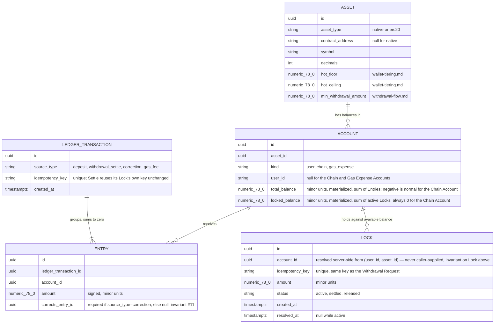
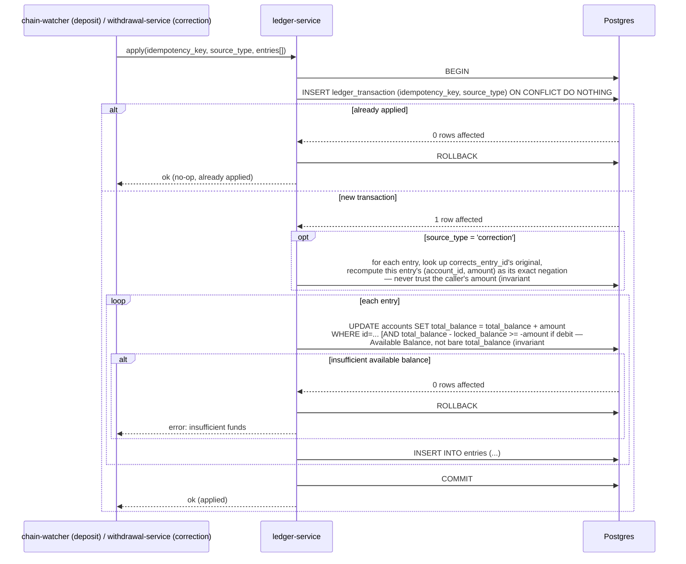
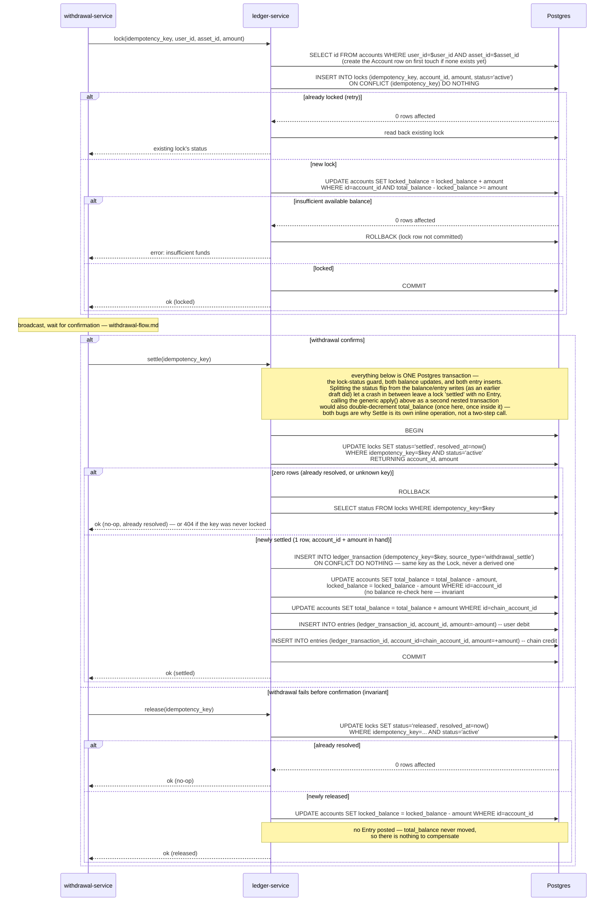

# Ledger

## Problem

Deposits (from `chain-watcher`, once built) and withdrawals (from
`withdrawal-service`, once built) both need a single, transactionally
correct place that says what each user owns, per asset, right now — and
how it got that way. This is the piece the whole project exists to get
right: a balance can never be double-credited by the same on-chain event
processed twice, and a withdrawal can never push a balance negative even
under concurrent requests. Native coin support already existed in the
architecture doc; this design also covers ERC-20 tokens, since that's
in scope for v1.

## Bounded context(s)

New bounded context: **Ledger** (owned by a new `ledger-service`,
matching the service already named in `docs/ARCHITECTURE.md`). It is
the source of truth for balances — Postgres, per that doc's data-model
split ("if it's money, it's in Postgres"). It sits next to the existing
**Wallet & Signing** context (`wallet-service` — key custody and address
derivation only, no balance knowledge, unchanged by this doc) as two
separate contexts, exactly as the architecture doc already implies.

This doc also defines the **Asset Registry** as part of this context
(ledger owns "what assets exist and can be credited"), even though four
other services also read from it, not just `ledger-service` itself —
**found incomplete on Tech Lead review** (only `chain-watcher` and
`wallet-service` were listed here before; `sweeper` and
`withdrawal-service` need it just as much and were silently missing):
- `chain-watcher` — filters ERC-20 `Transfer` logs against registered
  contract addresses (`deposit-flow.md` invariant #2).
- `wallet-service` — needs `contract_address` to build ERC-20
  `transfer()` calldata when it signs a Withdrawal, Sweep, or Gas
  Top-Up.
- `sweeper` — needs `asset_type`/`contract_address` to decide which
  branch it's in (native coin vs. ERC-20 — `deposit-flow.md`'s Sweep and
  Gas Top-Up logic both branch on this) and which balance query to make
  (native `eth_getBalance` vs. an ERC-20 `balanceOf` call). Without it,
  `sweeper` has an `asset_id` and nothing telling it what kind of asset
  that is.
- `withdrawal-service` — needs `min_withdrawal_amount` for validation
  (`withdrawal-flow.md` invariant #10, drawn as a call the service makes
  against its own state, `WD->>WD: validate(...)`) and `hot_floor`/
  `hot_ceiling` for its sweep-monitor loop (`wallet-tiering.md`).

**Decided: one canonical Asset Registry file, not per-service copies.**
A single file (e.g. `infra/assets.yaml`, checked into the repo) is
mounted identically — same host path, same bytes — into every
container that reads it (`chain-watcher`, `ledger-service`,
`wallet-service`, `sweeper`, `withdrawal-service`). None of them gets
its own local copy; there is exactly one file to edit, so drift between
services' views of the registry is impossible by construction, not just
discouraged by convention. This is the answer to the risk Dev flagged
while
implementing `wallet-service`'s side of this.

## Ubiquitous language

- **Asset** — a thing with a balance: either the chain's native coin
  (`asset_type = native`) or an ERC-20 token (`asset_type = erc20`,
  identified by `contract_address`). Has a `symbol` and `decimals` for
  display only — the ledger itself stores integer minor units (wei /
  token base units), never floats, and never as Postgres `bigint`
  **(fixed — see invariant #10)**: a signed 64-bit `bigint` caps out
  around 9.22 × 10^18, which is only ~9.2 ETH once minor units are wei
  — every 18-decimal token on this chain overflows it at a completely
  ordinary balance, not an edge case. Every `amount`/`*_balance` column
  in this doc's schema is `NUMERIC(78,0)` — enough digits for
  `uint256`'s max (~1.16 × 10^77) regardless of the asset's own
  `decimals`. Also carries three operational
  parameters, set per-asset at registration time:
  - `hot_floor` / `hot_ceiling` — **Decided:** Floor = 6h × this asset's
    expected peak hourly withdrawal volume; Ceiling = Floor × 4. Full
    rationale and the Treasury Sweep/Replenishment mechanics that use
    them: `wallet-tiering.md`.
  - `min_withdrawal_amount` — **Decided:** for native coin, 15× the
    current typical gas cost of a withdrawal tx; for ERC-20, set
    manually by the operator at registration (no price oracle exists to
    compare a token's value against gas cost automatically — see Open
    Questions #3 below). Enforced at withdrawal validation time: see
    `withdrawal-flow.md`.
- **Asset Registry** — the allow-list of assets the system will credit
  deposits for and permit withdrawals of. A transfer of an asset *not*
  in the registry is observed by `chain-watcher` but never reaches the
  ledger (see `deposit-flow.md`).
- **Account** — a balance scoped to `(user_id, asset)`. A user gets one
  Account per asset they've ever touched, not one per chain — consistent
  with `wallet-service` already issuing one chain-agnostic EVM address
  per user.
- **Chain Account** — one per asset, *not* tied to a user_id. The
  double-entry counterparty for every deposit/withdrawal. Its
  `total_balance` is always `-(net funds ever moved between users and
  the chain)` — **expected and allowed to go negative**: every
  withdrawal (a credit to the Chain Account) that outpaces deposits so
  far pushes it further negative, by design, since it's the mirror
  image of custody funds leaving. Invariant #1's never-go-negative rule
  applies only to a user's Available Balance, never to the Chain
  Account — enforcing non-negativity on it would make ordinary
  withdrawals fail. Its `locked_balance` stays 0 always (no Lock is ever
  placed against it — see the Lock definition below), so "available"
  is meaningless for it; only `total_balance` matters, and it's
  reconciled against the real on-chain balance of the hot wallet for
  that asset — a genuine "did we lose or fabricate money" check, not
  just bookkeeping ceremony.
- **Gas Expense Account** — **new; Decided (Tech Lead), invariant #12.** One
  per chain's native asset (`asset_type = native`), `kind =
  'gas_expense'`, not tied to a user. The double-entry counterparty for
  gas our own transactions burn: every mined tx we sign (withdrawals,
  including reverted ones; Nonce Fillers; Gas Top-Ups; Sweeps; later
  Treasury Sweeps) pays gas out of custody to the validators, which no
  user Entry accounts for. Its `total_balance` only ever decreases
  (cumulative gas spent, negative, same sign convention as the Chain
  Account); `locked_balance` is always 0; never Locked, never checked by
  invariant #1.
- **Gas Fee** — **Decided (Tech Lead).** One Ledger Transaction per mined tx we
  signed, `source_type = 'gas_fee'`: `{Gas Expense Account −fee, Chain
  Account +fee}` in the native asset, where `fee = gasUsed ×
  effectiveGasPrice` from that tx's receipt. The Chain Account side keeps
  `−ChainAccount.total_balance` equal to what custody really holds after
  gas has left it.
- **Entry** — a single, immutable, append-only signed-amount posting to
  one Account. Never updated or deleted; a correction is a new entry
  referencing the one it corrects.
- **Ledger Transaction** — a set of ≥2 Entries, posted atomically, whose
  amounts sum to zero across the accounts they touch (double-entry). A
  deposit's Ledger Transaction = `{credit user account, debit chain
  account}`; a withdrawal's = `{debit user account, credit chain
  account}`.
- **Idempotency Key** — what makes replaying the same source event a
  no-op. Deposits: `(chain_id, tx_hash, log_index)` — log_index matters
  because one tx can carry several ERC-20 `Transfer` events, each a
  separate deposit. **Decided:** a native-coin transfer has no log at
  all, so for native deposits `log_index = -1` is used as the sentinel
  value in this tuple; ERC-20 deposits keep using the real, always ≥0
  log index (`docs/design/integration-contracts.md` Open Questions #2,
  resolved; same convention used in `deposit-flow.md`'s Observed
  Transfer definition). Withdrawals: a client-supplied UUID, minted by
  `api-gateway` at request time and carried through the whole withdrawal
  lifecycle (see `withdrawal-flow.md`).
- **Total Balance** — an Account's actual settled balance: the sum of
  every posted Entry, materialized as a column (`total_balance`) updated
  in the same transaction as each Entry insert, not recomputed by
  summing Entries on every read. What used to be simply called
  "balance" — renamed once Locked/Available Balance were introduced
  below, so "balance" alone is never ambiguous again.
- **Locked Balance** — the portion of an Account's Total Balance
  currently held by `active` Locks (below), materialized as a column
  (`locked_balance`). Represents capacity reserved for in-flight
  withdrawals that hasn't actually left custody yet — no Entry backs
  it.
- **Available Balance** — `total_balance − locked_balance`, always
  computed, never stored as its own column. What a user can actually
  withdraw right now, and what invariant #1's overdraft check protects.
- **Lock** — a hold placed against an Account's Available Balance,
  created idempotently keyed on the same `idempotency_key` the
  Withdrawal Request already carries (`withdrawal-flow.md`'s
  Reservation is exactly this). (**Decided (Tech Lead), `withdrawal-flow.md`
  invariant #20:** that key becomes the server-minted Withdrawal Key
  `withdrawal:{withdrawal_id}`, never the client's string, which is only
  unique per user. No `ledger-service` change: it accepts any key up to
  256 characters.) **Callers never pass an `account_id`**
  — `account_id` is `ledger-service`'s own internal primary key, never
  known outside it. `lock()`'s actual signature is
  `lock(idempotency_key, user_id, asset_id, amount)`; `ledger-service`
  resolves (and, on a first touch, creates) the `(user_id, asset_id)`
  Account internally and stores its `account_id` on the `locks` row —
  the same resolve-or-create step `apply()` already implicitly does for
  deposit/correction entries, just made explicit here since it's now
  Lock's only caller-facing identifier for "whose balance." Posts no
  Entry and never touches `total_balance` — it only moves capacity from
  "available" to "locked" by incrementing `locked_balance`. Resolves
  exactly once, one of two ways:
  - **Settle** — the withdrawal actually happened. Posts the real debit
    Entry (and the Chain Account's credit Entry) against `total_balance`
    for the Lock's exact amount, and decrements `locked_balance` by the
    same amount. The only point in a withdrawal's life where an Entry
    is posted. **Its Ledger Transaction reuses the Lock's own
    `idempotency_key` unchanged** (not a derived key — a Lock Settles at
    most once, invariant #7, so there's no collision to namespace
    against) with `source_type = 'withdrawal_settle'`.
  - **Release** — the withdrawal never happened (rejected before
    Settle, abandoned, failed to broadcast, etc.). Decrements
    `locked_balance` only; `total_balance` is untouched because nothing
    was ever posted against it — so releasing needs no Compensating
    Entry, just the Lock going away.
  The Chain Account never has Locks placed against it — it's credited
  directly as part of a Settle's Ledger Transaction, not reserved in
  advance — so its `locked_balance` is always 0 and effectively unused.

## Aggregates & invariants

1. **An Account's Available Balance (`total_balance − locked_balance`)
   can never go negative.** Enforced inside the same Postgres
   transaction that creates a Lock: `UPDATE accounts SET locked_balance
   = locked_balance + $amount WHERE id = $id AND total_balance -
   locked_balance >= $amount`. Zero rows affected means insufficient
   available funds; no Lock row is committed. The row lock this UPDATE
   naturally takes is what makes two concurrent withdrawal requests
   against the same Account serialize correctly — this is now the
   actual, sole correctness boundary preventing overdraft (see Open
   Questions #1's resolution — a Redis lock, if implemented anywhere in
   the withdrawal path, is an optional fast-fail optimization only,
   never a substitute for this). A debit Entry is no longer what this
   check guards directly — see invariant #7, which is why Settle can
   never itself fail on insufficient funds.
2. **Every Ledger Transaction's entries sum to zero, scoped to one
   Asset.** Enforced in `ledger-service` application code, inside one DB
   transaction (all entries inserted, or none). "Sum to zero" is
   evaluated per-asset, not as a bare cross-asset sum — every Entry in
   a single Ledger Transaction must reference an Account whose
   `asset_id` matches every other Entry in that same transaction; a
   Ledger Transaction touching two different assets is rejected before
   any entry is inserted, since amounts of different assets summing to
   zero numerically would be meaningless (10 wei + (-10) USDC-minor-
   units is not a balanced transaction, it's two unrelated numbers that
   happen to cancel). This needs direct unit-test coverage, not just
   integration tests — Postgres has no simple constraint for either "no
   inserts across two apps" or "sums to zero within one asset." Locks
   are not Ledger Transactions and post no entries, so this invariant
   only ever applies to deposits, Settles, and corrections.
3. **A source event is applied at most once.** `UNIQUE(chain_id,
   tx_hash, log_index)` for deposits (native deposits use `log_index =
   -1` as their sentinel, per the Idempotency Key definition above) /
   `UNIQUE(idempotency_key)` for withdrawals on the `ledger_transactions`
   table. Insert uses `ON CONFLICT DO NOTHING`; the caller treats a
   no-op as "already applied" and acks/moves on, not as an error.
4. **Entries are immutable.** No code path issues `UPDATE` or `DELETE`
   against the entries table. A correction is a new, opposite Entry with
   `corrects_entry_id` set — the entries table is the audit log, the
   materialized `total_balance` is a cache of it.
5. **An asset outside the Asset Registry can never have an Account or an
   Entry.** `accounts.asset_id` is a foreign key into `assets`; rows in
   `assets` are only ever inserted by an explicit registry-admin action
   (out of scope for this doc — see `deposit-flow.md`'s open questions),
   never auto-created from an observed on-chain transfer.
6. **A Lock is created idempotently, keyed on `idempotency_key`.**
   `UNIQUE(idempotency_key)` on the `locks` table, `INSERT ... ON
   CONFLICT (idempotency_key) DO NOTHING` — mirrors invariant #3's
   pattern. A retried `lock()` call for a key that already has a row
   reads back that row's current status instead of attempting a second
   hold; this is what makes `withdrawal-service` safe to retry the
   Reservation step without ever double-locking the same withdrawal.
7. **A Lock resolves to Settled or Released exactly once, never both.**
   Guarded the same way as every other state transition in this project:
   `UPDATE locks SET status = 'settled' WHERE idempotency_key = $key AND
   status = 'active'` (or `'released'` for Release) — zero rows affected
   means it already resolved, and the caller treats that as a no-op, not
   an error. Because the amount moved at Settle time is exactly what
   this same Lock already reserved out of Available Balance at creation
   time, Settle can never itself fail on insufficient funds — the check
   already happened once, at Lock creation (invariant #1).
8. **Releasing a Lock posts no Entry.** It only decrements
   `locked_balance` by the Lock's amount; `total_balance` is untouched,
   because Settle never ran and nothing was ever posted against it. This
   is what makes reversing a withdrawal that failed before it actually
   happened cheap — no Compensating Entry, no touch to the immutable
   Entries table at all (see `withdrawal-flow.md`'s revised invariant
   #3).
9. **A debit Entry that is *not* part of a Lock's Settle must check
   Available Balance (`total_balance - locked_balance`), never bare
   `total_balance`, before posting.** This applies to `apply()`'s only
   remaining debit path once Settle moves out of it (see the Diagram
   section below): a correction. Without this check, a correction could
   take `total_balance` below what one or more currently-`active` Locks
   already reserved — retroactively breaking the very guarantee those
   Locks made to `withdrawal-service` at creation time (invariant #1),
   even though the correction itself never touched `locked_balance`. A
   Settle's own debit is exempt from re-checking (invariant #7 already
   covers why: its amount is exactly what its own Lock reserved, and it
   decrements `locked_balance` by that same amount in the same
   statement, so it can never invalidate *other* Locks' reservations).
10. **Every `amount`/`*_balance` column is `NUMERIC(78,0)`, never
    `bigint`.** A signed 64-bit `bigint` overflows at ~9.22 × 10^18 —
    only ~9.2 ETH once expressed in wei, an entirely ordinary balance
    for this system to need to represent, not an edge case. `NUMERIC
    (78,0)` covers `uint256`'s full range (max ≈ 1.16 × 10^77, 78
    digits) regardless of which asset or how many `decimals` it has.
    Applies to `accounts.total_balance`, `accounts.locked_balance`,
    `locks.amount`, `entries.amount`, and `assets.hot_floor`/
    `hot_ceiling`/`min_withdrawal_amount` alike — anywhere a minor-unit
    amount is stored, not just the ones a first pass happened to touch.
11. **A correction can only ever reverse a specific, already-posted
    Entry — never mint an arbitrary credit.** `source_type = 'correction'`
    is rejected by `ledger-service` unless every Entry in it carries a
    non-null `corrects_entry_id` pointing at an existing Entry, and that
    new Entry's `(account_id, amount)` is the exact negation of the
    Entry it corrects (same account, opposite sign, identical
    magnitude) — `ledger-service` computes the correction's entries from
    the referenced originals server-side, it never trusts amounts a
    caller supplies for a correction. This is what stops a compromised
    or buggy `withdrawal-service` from using the correction path (needed
    for the Compensating Entry case, `withdrawal-flow.md` invariant #3)
    to credit an arbitrary user an arbitrary amount out of nothing — the
    request can name *which* prior debit it's reversing, never *how
    much* to create. Also enforced at the transport layer: only
    `CN=withdrawal-service` may call the endpoint that creates
    corrections at all (`service-auth-mtls.md`), but that's
    defense-in-depth, not the primary control — the primary control is
    this server-side negation check, since `withdrawal-service` itself
    is the one caller expected to post corrections and is exactly the
    caller this invariant has to hold up against if compromised.
12. **Every mined tx we sign has its gas recorded exactly once, as a
    Gas Fee, and gas never touches a user's Account.** **Decided (Tech
    Lead)** — both recording gas in the ledger (`withdrawal-flow.md` Open
    Questions #22) and this Entry design (Open Questions #5).
    - **Entries:** `{gas_expense(native asset): −fee, chain(native
      asset): +fee}`, sum zero per asset (invariant #2). The user is
      never debited for gas: a confirmed withdrawal debits exactly
      `amount` at Settle; a reverted one is Released in full.
    - **Amount:** `fee = gas_used × effective_gas_price` from the mined
      receipt, computed by `ledger-service` from the two values the
      caller sends (never a caller-supplied total). Only the version
      that was mined pays: a Fee Bump's unmined versions, and a
      cancelled withdrawal whose nonce a Nonce Filler consumed, post
      nothing for themselves (the filler posts its own Gas Fee).
    - **Idempotency:** `idempotency_key = gas:{chain_id}:{tx_hash}` —
      one tx, one Gas Fee, whoever reports it; a replay with the same
      values returns the existing transaction, different values →
      `409`.
    - **API:** a dedicated `POST /v1/ledger/gas-fees` `{"chain_id",
      "tx_hash", "gas_used", "effective_gas_price", "purpose"}` →
      `200 {"ledger_transaction_id","amount"}` (`purpose` ∈
      `withdrawal`, `withdrawal_reverted`, `nonce_filler`, `gas_topup`,
      `sweep`, `treasury_sweep`; stored on the transaction for
      reporting). Not part of Settle (reverts, fillers, top-ups and
      sweeps have no Settle) and not a `source_type` on `POST
      /v1/ledger/transactions` (that endpoint is `CN=withdrawal-service`
      only and its correction rules don't apply); a separate endpoint
      gets its own CN allow-list: `withdrawal-service`, `sweeper`.
      `ledger-service` derives both accounts itself; the caller never
      names one.
    - **When, and who posts:** after the tx is final for its flow.
      `withdrawal-service`: at Settle for a confirmed withdrawal and at
      `→ failed` for `tx_reverted` (both after Withdrawal Confirmation
      Depth), and for a mined Nonce Filler when the Reaper Releases its
      request (`withdrawal-flow.md` invariant #26). `sweeper`: for each
      Gas Top-Up and Sweep tx once it is mined (`deposit-flow.md`
      invariant #19 — no extra depth wait). **Known limitation, accepted
      (Decided, Open Questions #6):** `sweeper` stays stateless, so a
      crash between a tx being mined and its Gas Fee being posted can
      lose that one record, and a reorg that changes `gasUsed` after
      inclusion is not reflected. Both are small drifts the
      reconciliation would show.
    - **Trust:** `ledger-service` has no chain RPC and cannot verify the
      tx; a compromised caller could post a fake Gas Fee. The damage is
      bounded — no user balance moves, only the system accounts, and the
      on-chain reconciliation would show the mismatch.
    - **Reconciliation scope (Decided, Open Questions #7):**
      `−ChainAccount.total_balance` per asset = **all custody** — the
      Hot Wallet plus unswept deposits plus the ETH dust left at user
      addresses after ERC-20 Sweeps — not the Hot Wallet alone. The
      reconciliation job itself stays deferred (Open Questions #2).

## Diagram

Aggregate shape:

Applying a Ledger Transaction — used for **deposits** (`deposit-flow.md`,
straight credit, no Lock involved) and for **corrections**
(`withdrawal-flow.md`'s Compensating Entry, `source_type='correction'`,
invariant #11). **Not used for Settle** — Settle has its own atomic
operation below, folded into the same transaction as the Lock's own
status transition, precisely to avoid this diagram's debit step running
as a *second*, separate transaction against balances a Lock already
accounted for (see the Settle diagram's note on why that used to
double-decrement):

Lock → Settle / Release — the withdrawal-specific lifecycle
(`withdrawal-flow.md`'s Reservation), replacing "debit at reservation
time" with "reserve capacity now, move real money only if it actually
happens":

## Alternatives considered

- **(Gas) Fold the Gas Fee into Settle.** Rejected: reverted txs, Nonce
  Fillers, Gas Top-Ups and Sweeps have no Settle; one endpoint for every
  mined tx keeps one rule. Settle stays unchanged.
- **(Gas) Keep gas outside the ledger as an operational record.**
  Rejected by the Tech Lead (`withdrawal-flow.md` Open Questions #22):
  the Chain Account would drift from custody by every gas payment.

- **No entries table, only a materialized balance.** Rejected — no
  audit trail, no way to reconstruct how a balance got corrupted if a
  bug ever does that. The entries table is also the most realistic and
  CV-relevant part of this design; dropping it defeats the point.
- **Compute balance by summing entries on every read instead of
  materializing it.** Simpler and always self-consistent, but doesn't
  scale and isn't how real ledgers operate. Rejected for v1; a nightly
  job that recomputes from entries and diffs against the materialized
  balance is a good future addition, not needed now.
- **No Chain Account / no double-entry pairing — just credit or debit
  the user account directly.** Simpler, but throws away the
  reconciliation property (ledger's implied custody balance vs. the
  real on-chain hot-wallet balance) — one of the most valuable and
  realistic checks a custody system can run, and cheap to keep.
- **Enforce "entries sum to zero" via a Postgres trigger/constraint
  instead of application code.** More bulletproof, but Postgres has no
  clean way to check a batch-insert sums to zero without a deferred
  constraint trigger — more complexity than v1 needs. Worth revisiting
  in the observability/reliability phase (roadmap step 3).
- **Make a Redis lock the primary mechanism preventing withdrawal
  overdraft, instead of an optional optimization on top of Postgres.**
  This is the alternative to Open Questions #1's resolution. Rejected:
  Redis isn't as durable or consistent as Postgres — a lock can expire
  under load or be lost outright on a Redis restart — so making it
  load-bearing for a correctness property (no overdraft) would mean
  correctness depends on Redis's availability, which this project's own
  data-model split says it should never be for anything money-related.
- **Debit the user's Account immediately when a Withdrawal Request is
  accepted (the original single-`balance` design), instead of
  Lock-then-Settle.** Rejected on review, flagged by the Tech Lead as
  too simple: it meant every pre-broadcast failure — by far the common
  case — needed a Compensating Entry just to undo something that never
  actually left custody, touching the immutable Entries table for money
  that never moved. It also gave "balance" only one meaning, so a user
  with a withdrawal in flight had no way to see "confirmed funds" vs.
  "funds tied up but not yet actually sent" separately — a real
  custodial product needs that distinction. The Total/Locked/Available
  split (this doc) reserves capacity without pretending funds moved
  until a withdrawal actually Settles, and confines Compensating
  Entries to the one case where they're genuinely needed: a `disputed`
  withdrawal abandoned after it had already Settled
  (`withdrawal-flow.md` invariant #9).

## Open questions

1. ~~`docs/ARCHITECTURE.md` describes a Redis lock on the user as the
   mechanism preventing a withdrawal overdraft. I'm treating invariant
   #1 (the Postgres `UPDATE ... WHERE balance >= amount`) as the actual
   correctness boundary, and would use a Redis lock only as an optional
   fast-fail optimization (reject an obviously-concurrent second request
   before it reaches Postgres at all) — never as the thing correctness
   depends on. Want me to design it that way, or is there a reason you
   want Redis to be load-bearing here?~~
   **Decided: Option A.** The Postgres atomic `UPDATE ... WHERE
   total_balance - locked_balance >= amount` on Lock creation (invariant
   #1) is the sole correctness boundary preventing overdraft — **revised
   from "the debit-entry check" to "the Lock-creation check"** once the
   Total/Locked/Available split replaced "debit at reservation time"
   (see the Alternatives-considered entry on this same change). A Redis
   lock, if implemented anywhere in the withdrawal path, is purely an
   optional fast-fail optimization — it may reject an obviously-
   concurrent second request before it reaches Postgres at all, saving a
   DB round-trip, but nothing about correctness is ever allowed to
   depend on it holding or even existing. Reasoning: Redis isn't as
   durable or consistent as Postgres — a lock can expire under load or
   be lost outright on a Redis restart — so it must never be the
   mechanism overdraft-prevention actually relies on; only Postgres's
   atomic UPDATE guarantees no overdraft. `docs/ARCHITECTURE.md`'s
   `withdrawal-service` row has been updated to say the same thing, so
   the docs don't contradict each other.
2. I've scoped the on-chain reconciliation check (comparing
   `-ChainAccount.balance` against the hot wallet's real balance) as
   schema-supported but not built — no reconciliation job/service in
   this phase. Confirm that's fine to defer.
3. Assuming raw token-unit balances are enough for v1 (no USD/FX
   display layer). Flag if you want price data in scope now.
4. No new technology introduced — Postgres only, per the existing
   data-model split.
5. ~~**PROPOSED: Gas Fee Entries (invariant #12).** Decided by the Tech
   Lead that gas goes in the ledger; the Entry shape, the new
   `gas_expense` account kind, `source_type = 'gas_fee'`, the
   `gas:{chain_id}:{tx_hash}` key and the new `POST /v1/ledger/gas-fees`
   endpoint (`CN=withdrawal-service`, `CN=sweeper`) need review.~~
   **Decided (Tech Lead): approved as proposed.**
6. ~~**Open: `sweeper` posts Gas Fees without durable state.** `sweeper`
   has no database. A crash after a tx is mined but before its Gas Fee
   is posted loses that record: on redelivery the Sweep is already done
   (balance zero) and a Sweep tx has no key to recover its hash from
   (Gas Top-Ups can be recovered via `GET /v1/sign/hot-wallet/{key}`).
   It also posts at inclusion, not after a confirmation depth, so a
   reorg that changes `gasUsed` is not reflected. Both are small drifts
   the reconciliation would show; closing them needs `sweeper` state
   (or a chain-side scanner of our own txs). Accept for now?~~
   **Decided (Tech Lead): accept the small drift for now; `sweeper`
   stays stateless.** Recorded as a known limitation in invariant #12.
7. ~~**Open (pre-existing #2, now sharper): reconciliation scope.** With
   Gas Fees, `−ChainAccount.total_balance` per asset equals all custody,
   which includes not only the Hot Wallet but unswept deposits and the
   ETH dust left at user addresses after an ERC-20 Sweep (Gas Top-Up
   minus the Sweep's gas). A reconciliation job against the Hot Wallet
   alone would always differ by that dust. Still deferred; flagging the
   definition it will need.~~ **Decided (Tech Lead): scope = all
   custody as described; the reconciliation job stays deferred.**
