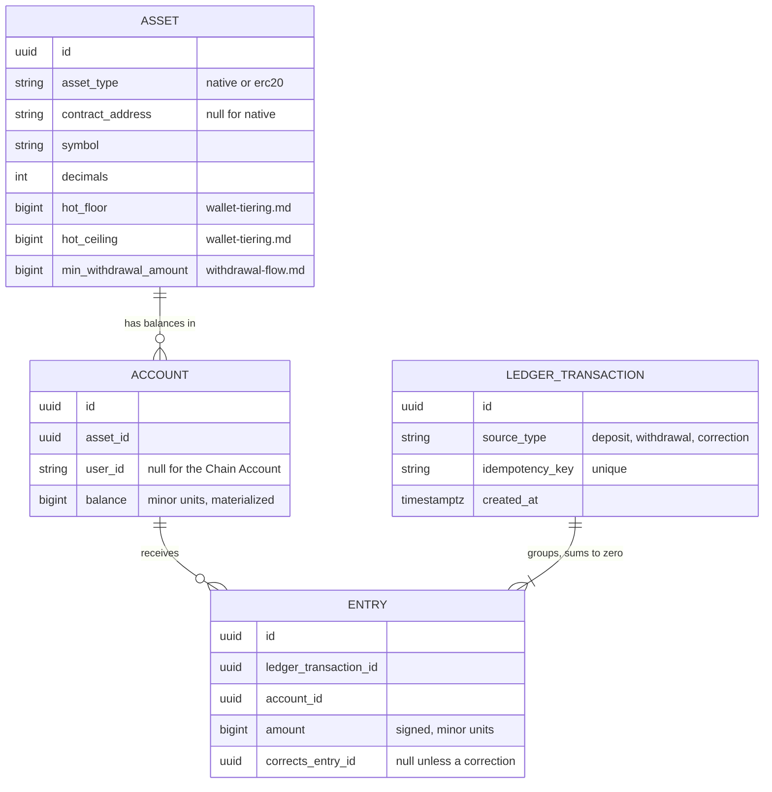
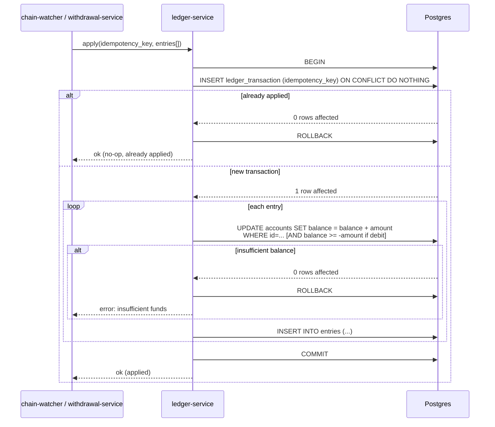

# Ledger

## Problem

Deposits (from `chain-watcher`, once built) and withdrawals (from
`withdrawal-service`, once built) both need a single, transactionally
correct place that says what each user owns, per asset, right now — and
how it got that way. This is the piece the whole project exists to get
right: a balance can never be double-credited by the same on-chain event
processed twice, and a withdrawal can never push a balance negative even
under concurrent requests. Native coin support already existed in the
architecture doc; this design also covers ERC-20 tokens, since that's
in scope for v1.

## Bounded context(s)

New bounded context: **Ledger** (owned by a new `ledger-service`,
matching the service already named in `docs/ARCHITECTURE.md`). It is
the source of truth for balances — Postgres, per that doc's data-model
split ("if it's money, it's in Postgres"). It sits next to the existing
**Wallet & Signing** context (`wallet-service` — key custody and address
derivation only, no balance knowledge, unchanged by this doc) as two
separate contexts, exactly as the architecture doc already implies.

This doc also defines the **Asset Registry** as part of this context
(ledger owns "what assets exist and can be credited"), even though
`chain-watcher` (see `deposit-flow.md`) reads from it too.

## Ubiquitous language

- **Asset** — a thing with a balance: either the chain's native coin
  (`asset_type = native`) or an ERC-20 token (`asset_type = erc20`,
  identified by `contract_address`). Has a `symbol` and `decimals` for
  display only — the ledger itself stores integer minor units (wei /
  token base units), never floats. Also carries three operational
  parameters, set per-asset at registration time:
  - `hot_floor` / `hot_ceiling` — **Decided:** Floor = 6h × this asset's
    expected peak hourly withdrawal volume; Ceiling = Floor × 4. Full
    rationale and the Treasury Sweep/Replenishment mechanics that use
    them: `wallet-tiering.md`.
  - `min_withdrawal_amount` — **Decided:** for native coin, 15× the
    current typical gas cost of a withdrawal tx; for ERC-20, set
    manually by the operator at registration (no price oracle exists to
    compare a token's value against gas cost automatically — see Open
    Questions #3 below). Enforced at withdrawal validation time: see
    `withdrawal-flow.md`.
- **Asset Registry** — the allow-list of assets the system will credit
  deposits for and permit withdrawals of. A transfer of an asset *not*
  in the registry is observed by `chain-watcher` but never reaches the
  ledger (see `deposit-flow.md`).
- **Account** — a balance scoped to `(user_id, asset)`. A user gets one
  Account per asset they've ever touched, not one per chain — consistent
  with `wallet-service` already issuing one chain-agnostic EVM address
  per user.
- **Chain Account** — one per asset, *not* tied to a user_id. The
  double-entry counterparty for every deposit/withdrawal. Its balance is
  always `-(net funds ever moved between users and the chain)`. Exists
  so `-ChainAccount.balance` can be reconciled against the real on-chain
  balance of the hot wallet for that asset — a genuine "did we lose or
  fabricate money" check, not just bookkeeping ceremony.
- **Entry** — a single, immutable, append-only signed-amount posting to
  one Account. Never updated or deleted; a correction is a new entry
  referencing the one it corrects.
- **Ledger Transaction** — a set of ≥2 Entries, posted atomically, whose
  amounts sum to zero across the accounts they touch (double-entry). A
  deposit's Ledger Transaction = `{credit user account, debit chain
  account}`; a withdrawal's = `{debit user account, credit chain
  account}`.
- **Idempotency Key** — what makes replaying the same source event a
  no-op. Deposits: `(chain_id, tx_hash, log_index)` — log_index matters
  because one tx can carry several ERC-20 `Transfer` events, each a
  separate deposit. Withdrawals: a client-supplied UUID, minted by
  `api-gateway` at request time and carried through the whole withdrawal
  lifecycle (see `withdrawal-flow.md`).
- **Available Balance** — an Account's current balance, materialized as
  a column updated in the same transaction as each Entry insert (not
  recomputed by summing Entries on every read).

## Aggregates & invariants

1. **An Account's balance can never go negative.** Enforced inside the
   same Postgres transaction that inserts a debit entry:
   `UPDATE accounts SET balance = balance - $amount WHERE id = $id AND
   balance >= $amount`. Zero rows affected means insufficient funds; the
   whole Ledger Transaction rolls back, no Entry is written. The row
   lock this UPDATE naturally takes is what makes two concurrent
   withdrawal requests against the same Account serialize correctly —
   this is the actual correctness boundary, not an external lock (see
   Open Questions #1).
2. **Every Ledger Transaction's entries sum to zero.** Enforced in
   `ledger-service` application code, inside one DB transaction (all
   entries inserted, or none). This needs direct unit-test coverage,
   not just integration tests — Postgres has no simple constraint for
   "these rows I'm about to insert sum to zero."
3. **A source event is applied at most once.** `UNIQUE(chain_id,
   tx_hash, log_index)` for deposits / `UNIQUE(idempotency_key)` for
   withdrawals on the `ledger_transactions` table. Insert uses
   `ON CONFLICT DO NOTHING`; the caller treats a no-op as "already
   applied" and acks/moves on, not as an error.
4. **Entries are immutable.** No code path issues `UPDATE` or `DELETE`
   against the entries table. A correction is a new, opposite Entry with
   `corrects_entry_id` set — the entries table is the audit log, the
   materialized balance is a cache of it.
5. **An asset outside the Asset Registry can never have an Account or an
   Entry.** `accounts.asset_id` is a foreign key into `assets`; rows in
   `assets` are only ever inserted by an explicit registry-admin action
   (out of scope for this doc — see `deposit-flow.md`'s open questions),
   never auto-created from an observed on-chain transfer.

## Diagram

Aggregate shape:

Applying a Ledger Transaction (the operation both `deposit-flow.md` and
`withdrawal-flow.md` call into):

## Alternatives considered

- **No entries table, only a materialized balance.** Rejected — no
  audit trail, no way to reconstruct how a balance got corrupted if a
  bug ever does that. The entries table is also the most realistic and
  CV-relevant part of this design; dropping it defeats the point.
- **Compute balance by summing entries on every read instead of
  materializing it.** Simpler and always self-consistent, but doesn't
  scale and isn't how real ledgers operate. Rejected for v1; a nightly
  job that recomputes from entries and diffs against the materialized
  balance is a good future addition, not needed now.
- **No Chain Account / no double-entry pairing — just credit or debit
  the user account directly.** Simpler, but throws away the
  reconciliation property (ledger's implied custody balance vs. the
  real on-chain hot-wallet balance) — one of the most valuable and
  realistic checks a custody system can run, and cheap to keep.
- **Enforce "entries sum to zero" via a Postgres trigger/constraint
  instead of application code.** More bulletproof, but Postgres has no
  clean way to check a batch-insert sums to zero without a deferred
  constraint trigger — more complexity than v1 needs. Worth revisiting
  in the observability/reliability phase (roadmap step 3).

## Open questions

1. `docs/ARCHITECTURE.md` describes a Redis lock on the user as the
   mechanism preventing a withdrawal overdraft. I'm treating invariant
   #1 (the Postgres `UPDATE ... WHERE balance >= amount`) as the actual
   correctness boundary, and would use a Redis lock only as an optional
   fast-fail optimization (reject an obviously-concurrent second request
   before it reaches Postgres at all) — never as the thing correctness
   depends on. Want me to design it that way, or is there a reason you
   want Redis to be load-bearing here?
2. I've scoped the on-chain reconciliation check (comparing
   `-ChainAccount.balance` against the hot wallet's real balance) as
   schema-supported but not built — no reconciliation job/service in
   this phase. Confirm that's fine to defer.
3. Assuming raw token-unit balances are enough for v1 (no USD/FX
   display layer). Flag if you want price data in scope now.
4. No new technology introduced — Postgres only, per the existing
   data-model split.
