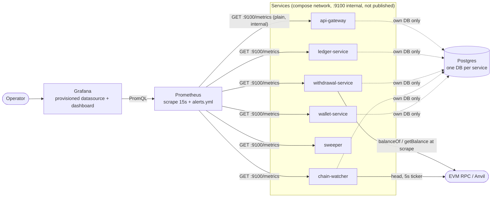

# Monitoring dashboard (Prometheus + Grafana)

Status: PROPOSED, awaiting Tech Lead review. Implements the "Observability" roadmap step in
`docs/ARCHITECTURE.md` (Prometheus metrics per service, Grafana dashboards, a few alerting rules) for the
operator-facing questions below.

## Problem

The operator needs one Grafana dashboard that answers, at a glance: how much is in the Hot, Warm and Cold
wallets per asset and where Hot sits against its Floor and Ceiling; how many users exist and how many were
active each day; how many deposits and withdrawals happen per day; whether anything is stuck (withdrawals,
Sweeps, Gas Top-Ups, a Nonce Gap, the Reaper raising ALERTs, failed or blocked items); and how far
`chain-watcher` is behind the chain. Prometheus and Grafana already run (`infra/docker-compose.yml`) but
nothing feeds them: no service exposes `/metrics`, Prometheus only scrapes itself, and Grafana has no
datasource or dashboard.

## Bounded context(s)

No new bounded context and no new service. This is a cross-cutting **Observability** concern that each
existing context implements for the data it already owns:

| Context (service) | Contributes |
|---|---|
| Identity (`api-gateway`) | total users |
| Ledger (`ledger-service`) | credited deposits/day, active users/day, ledger liabilities, Locks, failed events, flagged deposits |
| Withdrawal (`withdrawal-service`) | withdrawals/day and by status, stuck counts, Reaper activity, Nonce Gaps, **on-chain Hot/Warm/Cold balances**, Hot Floor/Ceiling |
| Deposit observation (`chain-watcher`) | watermark vs chain head |
| Sweeping (`sweeper`) | in-flight Sweeps/Gas Top-Ups, Fee Bumps, ALERTs (it has no DB; process metrics only) |
| Wallet & Signing (`wallet-service`) | Hot Wallet freeze state (Nonce Gap) |
| Infra (`infra/`) | Prometheus scrape config, alert rules, Grafana provisioning |

New shared Go module `pkg/metrics` (same pattern as the existing `pkg/events`, wired with a `replace`
directive) so the listener, registry setup and the cached scrape-time collector helper exist once.

## Ubiquitous language

Reused unchanged: Hot/Warm/Cold Wallet, Hot Floor, Hot Ceiling, Treasury Sweep, Gas Top-Up, Sweep, Fee Bump,
Reaper, Stuck Request Timeout, Stuck Reservation Timeout, Stuck Broadcast Blocks, Nonce Gap, Nonce Filler,
Lock, Chain Account, Asset Registry, `disputed`, ALERT (the Reaper's and sweeper's existing "ALERT:" log
condition).

New:
- **Metrics Endpoint** — a plain-HTTP `/metrics` listener on its own port (`METRICS_PORT`, default 9100),
  never the API or health listener, never published to the host.
- **Scrape-time collector** — a Prometheus collector that reads its own service's DB (or the RPC) when
  scraped, with a short cache, so gauges are the current truth rather than in-process tallies.
- **On-chain figure** — a number read from the chain RPC. **Ledger figure** — a number derived from a
  service's Postgres. Every panel's title carries which one it is.
- **Active User** — a user with at least one ledger Entry or Lock on their user Account on that UTC day
  (see Open Question 4: this is transacting activity, not API activity).
- **Stuck** — a Withdrawal Request past the *existing* timeout for its status (below); no new thresholds.
- **Day** — always a UTC calendar day.

## Aggregates & invariants

No new aggregate; nothing here writes business state. Invariants of this feature:

1. **Observability never owns or mutates business data.** Every metric is read-only, computed by the service
   that owns the data (`docs/ARCHITECTURE.md` "per-service schema"). No service's DB is read by another
   service or by Grafana. Enforced by: no Postgres datasource is provisioned in Grafana, and collectors use
   only their own service's pool (code review item).
2. **One definition of "stuck".** The stuck gauges read the same config values the Reaper is built from
   (`STUCK_REQUEST_TIMEOUT`, `STUCK_RESERVATION_TIMEOUT`, `STUCK_BROADCAST_BLOCKS`; `INCLUSION_TIMEOUT`,
   `FEE_BUMP_AFTER_BLOCKS`, `MAX_FEE_BUMPS` in `sweeper`), passed from `main.go` to both. A second copy of a
   threshold in a collector or a Prometheus rule is a bug.
3. **Labels are bounded.** Allowed labels: `asset` (registry symbol), `wallet` (hot|warm|cold), `status`,
   `kind`, `rule`, `day`, `chain_id`, `service`. Never `user_id`, address, tx hash, withdrawal id or idempotency
   key (cardinality, and it would leak identifiers into a store with no access control).
4. **A failed read yields no sample, not a wrong one.** If a scrape-time query or RPC call fails, the collector
   omits that series and sets `digiwal_collector_up{collector}` to 0; it never serves a zero or a stale value
   as current. On-chain gauges also export `…_read_timestamp_seconds` so freshness is visible.
5. **Metric values never feed logic.** Balances are exported as `float64` in whole-asset units (minor units /
   10^decimals) for display; money correctness stays in `NUMERIC(78,0)` paths.
6. **No business endpoint is added to the metrics listener**, and `/metrics` is never served on `api-gateway`'s
   public listener (it would be reachable by clients and would disclose user count).
7. **The Hot Floor/Ceiling shown are the Asset Registry's**, read from the same file the service already
   loads (`hot_floor`, `hot_ceiling`), never hardcoded in dashboard JSON.

## Decision (a): data source per panel

**Chosen: Prometheus metrics instrumented in each owning service (scrape-time collectors for DB/RPC-derived
numbers, ordinary counters for events). Grafana gets exactly one datasource: Prometheus.**

Why not Grafana's Postgres datasource against service DBs: the stack gives every service its own database
(`ledger`, `chain_watcher`, `api_gateway`, `withdrawal`, `custody`), and the architecture's rule is per-service
schema ownership. Reading them from Grafana is a cross-service DB read in all but name: it couples the
dashboard to five private schemas (a migration silently breaks panels), needs five credentials in a
provisioned file, and cannot express the two things that are not in any DB at all (on-chain balances, the
RPC head, `sweeper` in-flight state). Why not a dedicated exporter: it must either read the DBs (same
violation, one level removed) or call each service for data they do not expose, so it is a sixth service for no
benefit; the owning service already has the pool, the RPC client and the config the number depends on.

**Truth classification** (also printed in panel titles):

| Number | Source | Class |
|---|---|---|
| Hot, Warm, Cold balance | `eth_getBalance` / ERC-20 `balanceOf` at scrape (cached 10s) | **On-chain truth** |
| Hot Floor / Ceiling | Asset Registry file | Config |
| Ledger liabilities (sum of user balances) | `ledger-service` DB | Ledger-derived |
| Total users, active users, deposits/day, withdrawals/day | owning service DB | Ledger/service-derived |
| chain head | `chain-watcher` RPC call | On-chain truth |
| watermark | `chain-watcher` DB (`watermark.block_number`) | Service-derived (what it has scanned) |
| Stuck/ALERT/Reaper | `withdrawal-service` DB + in-process counters | Service-derived |

Hot/Warm balances are deliberately **not** read from the ledger: the ledger tracks user liabilities, not
treasury tiers (Treasury Movements never touch it, `wallet-tiering.md` invariant #5). The reconciliation view
(on-chain Hot+Warm+Cold vs ledger liabilities) is the one place both appear side by side; a gap is expected
(user deposit addresses hold unswept funds in transit, gas is spent) so it is a trend panel, not an alert.

## Decisions (b), (c): metrics, SQL, and panels

Prefix `digiwal_`. Scrape interval 15s (changed from 5s: collectors hit DBs/RPC). Day-bucketed series are
**gauges recomputed from the DB on each scrape for the last 14 UTC days**, labelled `day="YYYY-MM-DD"`, and
shown as bar charts from an instant query. Chosen over `increase(counter[1d])` because it is exact,
survives restarts and Prometheus downtime, has no step-alignment/timezone drift, and bounds cardinality to
14 x small label sets. Cost: one indexed GROUP BY per scrape, cached 60s.

### 1. Wallet balances and Hot limits — `withdrawal-service`

`withdrawal-service` already holds the Hot and Warm addresses (fetched once at startup from
`GET /v1/wallet/system-addresses`, CN allow-list already includes it), has an RPC client (`chain.Balance` for
native), and reads the Asset Registry including `hot_floor`/`hot_ceiling`. It is also where the (designed, not
yet built) Treasury Sweep monitor will live, so the balance read is shared code, not a duplicate.
Needed additions: ERC-20 `balanceOf` on its `chain.Chain` (sweeper has `TokenBalance`; withdrawal-service does
not), and a Cold address (see Open Question 1: no Cold address exists in any config today).

| Metric | Type | Labels |
|---|---|---|
| `digiwal_wallet_balance` | gauge | `wallet`, `asset` |
| `digiwal_wallet_balance_read_timestamp_seconds` | gauge | `wallet`, `asset` |
| `digiwal_hot_wallet_floor` | gauge | `asset` |
| `digiwal_hot_wallet_ceiling` | gauge | `asset` |

Panels (time series, one per asset via a `$asset` variable, unit "short"):
- Series `digiwal_wallet_balance{wallet="hot",asset="$asset"}` plus `digiwal_hot_wallet_floor` and
  `digiwal_hot_wallet_ceiling` as two extra **queries** styled by overrides (red dashed Floor, orange dashed
  Ceiling), not static thresholds, so a registry edit moves the lines. Threshold shading is also set with
  Grafana "from query" disabled; the lines are the source of truth.
- Warm and Cold: separate time series (`wallet="warm"`, `wallet="cold"`), no limits (none are defined).
- Stat row: Hot balance as % of band: `(hot - floor) / (ceiling - floor)`.

The registry is re-read when it changes only if `withdrawal-service` reloads it; today it loads once at
startup (chain-watcher reloads). Floor/Ceiling gauges reflect what the process loaded; a registry edit needs
a restart or the reload that `chain-watcher` already has (Open Question 6).

### 2. Total users — `api-gateway`

`digiwal_users_total` gauge. `SELECT count(*) FROM users` (own DB), cached 60s. Stat panel plus a time series
of the same metric for growth.

### 3. Deposits and withdrawals per day

- **Deposits** — `ledger-service` (credited deposits are the money truth, one per `(chain_id, tx_hash,
  log_index)`, idempotent):
  `digiwal_ledger_deposits_by_day{day,asset}` gauge:
  ```sql
  SELECT date_trunc('day', lt.created_at AT TIME ZONE 'UTC') AS day, a.symbol AS asset, count(DISTINCT lt.id)
  FROM ledger_transactions lt JOIN entries e ON e.ledger_transaction_id = lt.id
  JOIN accounts ac ON ac.id = e.account_id AND ac.kind = 'user' JOIN assets a ON a.id = ac.asset_id
  WHERE lt.source_type = 'deposit' AND lt.created_at >= now() - interval '14 days' GROUP BY 1, 2
  ```
  (label `asset` = the registry symbol). Flagged-pending deposits are not credited, so they are not counted here;
  they appear in section 5.
- **Withdrawals** — `withdrawal-service`: `digiwal_withdrawal_requests_by_day{day,status}` gauge,
  `SELECT date_trunc('day', created_at AT TIME ZONE 'UTC'), status, count(*) FROM withdrawal_requests WHERE
  created_at >= now() - interval '14 days' GROUP BY 1, 2`. "Withdrawal transactions per day" panel = the
  `confirmed` series; the stacked variant shows confirmed / failed / rejected / disputed / in-flight. A
  withdrawal is bucketed by the day it was **requested**, not confirmed (one GROUP BY, no per-status date
  column; says so in the panel description).
- Panels: two bar charts (instant query, x = `day`), plus a stacked bar of withdrawals by status.

### 4. Daily active users — `ledger-service`

`digiwal_ledger_active_users_by_day{day}` gauge (no asset label: a user active in two assets counts once):
```sql
SELECT day, count(DISTINCT user_id) FROM (
  SELECT date_trunc('day', e.created_at AT TIME ZONE 'UTC') AS day, ac.user_id FROM entries e JOIN accounts ac
    ON ac.id = e.account_id AND ac.kind = 'user' WHERE e.created_at >= now() - interval '14 days'
  UNION
  SELECT date_trunc('day', l.created_at AT TIME ZONE 'UTC'), ac.user_id FROM locks l JOIN accounts ac
    ON ac.id = l.account_id WHERE l.created_at >= now() - interval '14 days') t GROUP BY day
```
Entries cover credited deposits, settled withdrawals and corrections; Locks cover accepted withdrawal attempts
including ones later released or failed. Bar/time-series over the 14 days (a longer window is a constant).
Limitation: a user who only reads their balance is not "active" (Open Question 4).

### 5. Stuck and other statuses

**Stuck definitions** (all from existing code/config):

| Item | Stuck when | Source threshold |
|---|---|---|
| Withdrawal `requested` | `updated_at` older than Stuck Request Timeout (5m) | `STUCK_REQUEST_TIMEOUT` |
| Withdrawal `validated`, `reserved`, `signed` | `updated_at` older than Stuck Reservation Timeout (5m) | `STUCK_RESERVATION_TIMEOUT` |
| Withdrawal `broadcast` | chain head − `broadcast_head_seen` >= 128 blocks | `STUCK_BROADCAST_BLOCKS` |
| Withdrawal `disputed` | any (it needs an operator by definition) | n/a |
| Gas Top-Up / Sweep in flight | in flight longer than `INCLUSION_TIMEOUT` (5m); Fee Bumps count up; exhausted at `MAX_FEE_BUMPS` (5) | sweeper config |

Note `requested`/`validated` stuck rows are transient (the Reaper reclaims them on its next pass);
`reserved`, `signed`, `broadcast` stuck rows are ALERT-only and persist until an operator acts, so those
are the ones that matter for paging.

`withdrawal-service` (scrape-time unless noted):

| Metric | Type | Labels | Query / increment point |
|---|---|---|---|
| `digiwal_withdrawal_requests` | gauge | `status` | `SELECT status, count(*) FROM withdrawal_requests GROUP BY status` |
| `digiwal_withdrawal_stuck` | gauge | `status` | counts per the table above (broadcast uses the chain head the Reaper already reads) |
| `digiwal_withdrawal_oldest_age_seconds` | gauge | `status` (non-terminal only) | `now() - min(updated_at)`; 0 when none |
| `digiwal_reaper_actions_total` | counter | `rule` = `stale_request`, `stale_reservation`, `replaced_or_dropped` | incremented where the Reaper calls `MarkFailed` (existing `Reason*` constants) |
| `digiwal_reaper_alerts_total` | counter | `kind` = `reserved-no-void`, `reserved-void-failed`, `signed-stuck`, `signed-recheck`, `broadcast-stuck` | in `alerter.raise` when an ALERT is actually emitted (after de-dup; existing `kind` strings) |
| `digiwal_reaper_last_pass_timestamp_seconds` | gauge | none | set at the end of `Reaper.Step` |
| `digiwal_nonce_gaps` | gauge | `state` = `unreported`, `total` | `count(*) FROM nonce_gaps` / `WHERE reported_at IS NULL` |
| `digiwal_whitelist_blocked` | gauge | none | `count(*) FROM whitelist_entries WHERE blocked_at IS NOT NULL` |

`wallet-service`: `digiwal_hot_wallet_frozen{chain_id}` gauge (1 when `hot_wallet_nonces.frozen_from_nonce IS NOT
NULL`) and `digiwal_hot_wallet_frozen_from_nonce{chain_id}`. Wallet-service owns the freeze, so it is the
authoritative Nonce Gap signal; `withdrawal-service`'s `nonce_gaps{state="unreported"}` says the report to it
is failing.

`sweeper` (no DB, "keeps no state", so these are process metrics that reset on restart; acceptable because
in-flight work is by definition short-lived and a restart re-consumes Kafka):

| Metric | Type | Labels |
|---|---|---|
| `digiwal_sweeper_inflight` | gauge | `kind` = `gas_topup`, `sweep` |
| `digiwal_sweeper_inflight_oldest_age_seconds` | gauge | `kind` |
| `digiwal_sweeper_fee_bumps_total` | counter | `kind` |
| `digiwal_sweeper_alerts_total` | counter | `kind` = `bump_exhausted`, `bump_refused`, `cancelled_by_operator`, `gas_fee_report_failed` (the four existing `s.alert` sites in `bump.go`) |
| `digiwal_sweeper_events_abandoned_total` | counter | none (consume.go gives up after `MAX_ATTEMPTS`) |

`ledger-service`: `digiwal_ledger_failed_events` gauge (`count(*) FROM failed_events`),
`digiwal_ledger_flagged_deposits{status}` gauge (screening-held deposits; `pending` is "blocked awaiting
review"), `digiwal_ledger_active_locks` and `digiwal_ledger_active_locks_oldest_age_seconds` (uses
`locks_active`), and `digiwal_ledger_user_liabilities{asset}` (`SUM(total_balance) FROM accounts WHERE kind='user'`,
whole-asset units) for the reconciliation panel.

Panels: a "Needs attention" stat row (each turns red when > 0): stuck withdrawals, `disputed`, hot wallet
frozen, unreported Nonce Gaps, sweeper alerts in 1h, failed events, pending flagged deposits, blocked
whitelist entries; a Reaper activity time series (`increase(digiwal_reaper_actions_total[1h])` by rule and
alerts by kind); a stacked current-withdrawals-by-status bar; and Prometheus's own firing alerts via the
Grafana "Alert list" panel (datasource alerts).

### 6. chain-watcher lag — `chain-watcher`

The watermark is `watermark.block_number` ("last fully scanned block", `Store.Watermark`); the head comes
from the `Chain.Head` call it already makes.

| Metric | Type | Labels | Source |
|---|---|---|---|
| `digiwal_chainwatcher_watermark_block` | gauge | `chain_id` | scrape-time `Store.Watermark` |
| `digiwal_chain_head_block` | gauge | `chain_id` | its own 5s ticker goroutine calling `Chain.Head`, independent of the poll loop |
| `digiwal_chain_head_read_timestamp_seconds` | gauge | `chain_id` | set with it |
| `digiwal_chainwatcher_confirmation_depth` | gauge | `chain_id` | `CONFIRMATION_DEPTH` (so Grafana knows the *expected* lag floor) |

The head gauge is read on its own ticker, **not** taken from the poll loop, so a hung poll loop shows as
growing lag instead of a frozen head and frozen watermark that look like zero lag. Panels: time series of
head vs watermark, a stat of `head - watermark`, and `time() - head_read_timestamp` (RPC read health).
Expected steady-state lag is small (one poll interval of blocks) because the watermark is the scan position;
deposit confirmation waits `CONFIRMATION_DEPTH` behind it separately. Caveat: the head is the head of the
RPC node chain-watcher uses; if that node itself is behind the network (Sepolia provider), this cannot show
it. Locally the node is Anvil, so it is the chain.

## Decision (d): scraping, mTLS, provisioning

**Scrape path: plain HTTP on a dedicated, internal-only `METRICS_PORT` (9100) in every service.**
`service-auth-mtls.md` invariant #8 already exempts `/healthz` "and a future `/metrics`" from client certs
(plain listener, so Prometheus needs no CA material). It is a separate port from the health/API listener
because (i) `api-gateway` has a single client-facing listener (published as host `:8084`) that must not serve
metrics, and (ii) uniformity: one rule for all seven services (`wallet-service`, `ledger-service`,
`withdrawal-service` also have mTLS listeners; `chain-watcher`, `sweeper`, `history-service` only a plain
health port). Port 9100 is not added to any `ports:` list, so it is reachable only inside the compose network.
Prometheus runs in the same project (`digiwal-dev` merges infra + e2e + dev), so targets resolve by service
name. mTLS scraping (a `prometheus` leaf cert, a CN allow-list per metrics listener) was considered; see
Alternatives and Open Question 2.

**Provisioning as code** (all new files under `infra/`, no UI-only config):
- `infra/prometheus/prometheus.yml`: scrape jobs (one per service, `static_configs` `<service>:9100`), keep
  the self-scrape, `scrape_interval: 15s`, `rule_files: [/etc/prometheus/alerts.yml]`.
- `infra/prometheus/alerts.yml`: the rules below.
- `infra/grafana/provisioning/datasources/prometheus.yml`: one datasource, `uid: prometheus`,
  `url: http://prometheus:9090`, default.
- `infra/grafana/provisioning/dashboards/dashboards.yml`: file provider, path `/var/lib/grafana/dashboards`,
  `allowUiUpdates: false`.
- `infra/grafana/dashboards/digiwal-overview.json`: the dashboard (uid fixed `digiwal-overview`).
- `infra/docker-compose.yml`: mount the above read-only into `grafana` and `alerts.yml` into `prometheus`;
  set `GF_DASHBOARDS_DEFAULT_HOME_DASHBOARD_PATH` so it is the home page. No change to `e2e/` or `dev/`
  compose files (the metrics port is on by default; no env needed).

## Decision (e): alert rules (small, Prometheus rules)

Prometheus `rule_files`, no Alertmanager (none exists; adding one is new infra, Open Question 3). Firing alerts
show on Prometheus `/alerts` and in the dashboard's Alert list panel.

| Alert | Expression | For |
|---|---|---|
| `HotWalletBelowFloor` | `digiwal_wallet_balance{wallet="hot"} < on(asset) digiwal_hot_wallet_floor` | 2m |
| `HotWalletAboveCeiling` | `... > on(asset) digiwal_hot_wallet_ceiling` (a Treasury Sweep should have fired) | 10m |
| `WithdrawalStuck` | `digiwal_withdrawal_stuck{status=~"reserved\|signed\|broadcast"} > 0` or `digiwal_withdrawal_requests{status="disputed"} > 0` | 1m |
| `HotWalletFrozen` | `digiwal_hot_wallet_frozen == 1` (Nonce Gap) | 0m |
| `ReaperDead` | `time() - digiwal_reaper_last_pass_timestamp_seconds > 5 * 30` (5 x `REAPER_INTERVAL`) | 0m |
| `ChainWatcherLag` | `digiwal_chain_head_block - digiwal_chainwatcher_watermark_block > digiwal_chainwatcher_confirmation_depth + 20` | 5m |
| `SweeperAlert` | `increase(digiwal_sweeper_alerts_total[10m]) > 0` | 0m |
| `TargetDown` / `CollectorDown` | `up == 0` / `digiwal_collector_up == 0` | 2m |

The Floor alert closes the loop `wallet-tiering.md` invariant #4 already requires ("crossing the Floor
triggers an alert") and which no code implements today. The `+ 20` margin and the 5x Reaper multiple are
initial values for the Tech Lead to tune.

## Diagrams

### C4 container update (new edges only)



### Sequence: one scrape of withdrawal-service (balance + stuck + limits)

```mermaid
sequenceDiagram
    participant P as Prometheus
    participant W as withdrawal-service :9100
    participant C as scrape-time collector
    participant DB as withdrawal DB (own)
    participant R as Chain RPC
    P->>W: GET /metrics
    W->>C: Collect()
    alt cache older than 10s
        C->>DB: status counts, oldest ages, stuck counts, by-day, nonce_gaps
        C->>R: eth_getBalance / balanceOf (hot, warm, cold) per asset
        R-->>C: balances (or error)
        C->>C: floor/ceiling from loaded Asset Registry
    end
    C-->>W: samples (a failed read omits its series, collector_up=0)
    W-->>P: text exposition
    Note over P: rules evaluate alerts.yml; Grafana queries Prometheus only
```

User flow: the dashboard is a single operator page (rows: Balances, Users and activity, Deposits and
withdrawals, Needs attention, Chain lag); no navigation flow beyond that, so no user-flow diagram.

## Alternatives considered

1. **Grafana Postgres datasource on the service DBs** (zero Go code, SQL directly in panels). Rejected: breaks
   per-service DB ownership, five credentials, schema coupling, and it cannot reach the on-chain balances,
   the RPC head or sweeper's in-flight state, so we would need Prometheus anyway.
2. **A dedicated exporter service** that fans in from all services. Rejected: it either reads private DBs (same
   violation) or needs new internal APIs on every service; a sixth deployable to secure with mTLS for nothing
   the owning service cannot do in a few dozen lines.
3. **Counters + `increase(...[1d])` for per-day counts.** Rejected for the per-day panels (inexact across
   restarts/downtime, step/timezone alignment); kept for event-like series (Reaper actions, alerts, Fee Bumps)
   where rate is the natural view.
4. **mTLS scrape** (Prometheus client cert, CN allow-list per metrics listener). Not rejected on merit: it is
   the more consistent choice if metrics are considered sensitive. Rejected for v1 because invariant #8 already
   decided the exemption, the port is not published, labels carry no identifiers (invariant #3), and it adds a
   leaf cert plus TLS wiring to seven listeners for a testnet. Easy to adopt later: `prometheus.yml`
   `tls_config` plus `gen-leaf.sh prometheus`.
5. **Hot/Warm balance from the ledger (Chain Account).** Rejected: the ledger does not model treasury tiers;
   it would show a number that is not the wallet's balance.
6. **Put the treasury balance collector in `wallet-service`** (it owns the addresses). Rejected: it has no
   registry read of Floor/Ceiling, would need a new RPC balance path, and it is the signing service whose
   surface should stay minimal; `withdrawal-service` already has all three inputs and the future Treasury
   Sweep monitor.

## Task breakdown (dev-sized, one PR each)

1. **`pkg/metrics` module.** `Serve(addr, *prometheus.Registry)` on `METRICS_PORT`, a cached scrape-time
   collector helper (TTL, per-collector `digiwal_collector_up`, 5s query timeout), Go runtime/process
   collectors. Unit-tested. Adds `prometheus/client_golang` (Open Question 5). Prerequisite for all below.
2. **`infra/` wiring.** `prometheus.yml` jobs + 15s interval + `rule_files`, `alerts.yml`, Grafana
   provisioning files, compose mounts, home-dashboard env. Dashboard JSON can land with a stub row first.
3. **`api-gateway`.** Metrics listener (not on the public listener); `digiwal_users_total`.
4. **`ledger-service`.** Metrics listener; deposits/day, active users/day, liabilities, active Locks (+ oldest
   age), failed events, flagged deposits. Test against `testdb` with fixture rows incl. a day boundary and a
   user active via Lock only.
5. **`chain-watcher`.** Metrics listener; watermark collector; independent head ticker; depth gauge. Test:
   head ticker keeps advancing while the poll loop is blocked.
6. **`withdrawal-service` (a): DB metrics.** Status counts, stuck/oldest-age (thresholds passed from the same
   config the Reaper gets), by-day, nonce gaps, blocked whitelist, Reaper counters and last-pass gauge,
   alerter counter. Test each stuck boundary against the Reaper's own cutoffs.
7. **`withdrawal-service` (b): treasury balances.** ERC-20 `balanceOf` on `chain.Chain`; balance collector for
   hot/warm(/cold); Floor/Ceiling gauges from the registry. Depends on Open Question 1 for Cold.
8. **`sweeper`.** Metrics listener; in-flight tracking with start times, Fee Bump/alert/abandoned counters at
   the existing `s.alert` and consume sites.
9. **`wallet-service`.** Metrics listener; Hot Wallet frozen gauges from `hot_wallet_nonces`.
10. **Dashboard JSON** (`digiwal-overview.json`) built against the real metric names, checked on the dev
    stack where the simulator generates traffic; then the alert rules exercised (e.g. lower `hot_floor` in the
    dev registry, stop the Reaper).
11. **Docs.** `docs/DEVELOPMENT.md` (how to open Grafana, metric port convention) and a one-line cross-reference
    in `service-auth-mtls.md` invariant #8 noting `/metrics` is now on its own port. No tester-owned work here.

`history-service` gets only the shared listener with Go runtime metrics (it contributes no dashboard panel);
add it in task 1's wiring or skip it (Open Question 7).

## Open questions (for the Tech Lead)

1. **Cold Wallet address.** No config holds one (`infra/treasury.yaml` lists Warm only and says Cold is
   deliberately not listed; `wallet-tiering.md` invariant #9). A Cold balance panel needs a public address.
   Proposal: add an optional `cold_address` to `treasury.yaml`, served by `wallet-service`'s
   `system-addresses` (still `withdrawal-service` only), public address only. Is that acceptable, and is it
   one Cold address per chain? Without it the Cold panel is blank. This is a small change to a decided file
   and a `wallet-service` endpoint, so it is yours to approve.
2. **Metrics transport.** Plain internal port (this design) vs mTLS scrape. Metrics here reveal aggregate
   balances and counts, not identifiers. OK for testnet, or do you want mTLS from day one?
3. **Alert delivery.** Rules fire in Prometheus only; there is no Alertmanager and the operating model rules out
   chat tooling. Is "visible on the dashboard and `/alerts`" enough, or do you want Alertmanager (new infra)?
4. **What is a "daily active user"?** This design uses ledger activity (an Entry or Lock that day), the only
   definition computable from existing data. API activity (any authenticated request, including balance
   reads) is not recorded anywhere; capturing it needs a `api-gateway` change, e.g. a Redis HyperLogLog per day
   (`PFADD`), which adds a Redis dependency to `api-gateway` (it has none today). Which do you want?
5. **New dependency:** `github.com/prometheus/client_golang` in every service's `go.mod` (via `pkg/metrics`).
   The roadmap already says "Prometheus metrics per service", but the library choice is yours.
6. **Registry reload.** `withdrawal-service` loads the Asset Registry once at startup; `chain-watcher` reloads
   it. For Floor/Ceiling to follow an edit without a restart, `withdrawal-service` needs the same reload.
   Include in this work, or accept restart-to-apply?
7. **`history-service`** has no panel in this design. Instrument it now (runtime metrics only) or leave it out
   until it has a design doc?
8. **Kafka consumer lag** (named in the roadmap's alert list) is not covered: it needs either an exporter
   (new infra) or consumer-side metrics in `ledger-service`, `sweeper` and `history-service`. Deferred; `sweeper`
   in-flight age and `ledger` failed events are the proxies. Want it in scope?
9. **Day boundary.** All "per day" views use UTC days. Say if you want a different timezone (a single constant).
10. **Withdrawal "per day" bucketing** is by request date, not confirmation date. Fine, or do you want
    `confirmed_at`-bucketed counts for the confirmed series (one extra query)?
11. **Persistence.** Prometheus has no volume in `infra/docker-compose.yml`, so history (and the lag/balance
    time series) is lost on container recreation, although the per-day bar charts are rebuilt from the DBs. Add
    a `prometheus_data` volume (and a retention setting)?

## Invariants checklist for the dev and tester

- No Postgres datasource in Grafana; no service reads another service's DB (invariant 1).
- Thresholds come from one config instance shared with the Reaper / sweeper (invariant 2).
- No `user_id`, address, tx hash or withdrawal id in any label (invariant 3).
- A failed read omits the series and drops `collector_up` (invariant 4).
- `/metrics` is never on `api-gateway`'s public listener; port 9100 is unpublished (invariant 6).
- Hot Floor/Ceiling lines come from the registry gauges, not constants in the JSON (invariant 7).
- Day-bucketed gauges: a day boundary, an empty day (no series, not a stale value), and a user active in two
  assets counted once.
