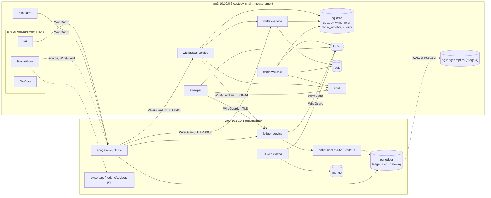
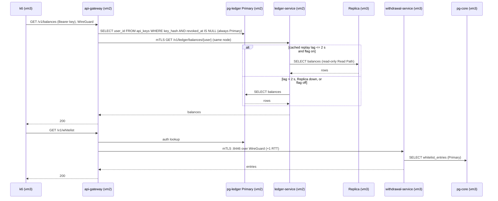
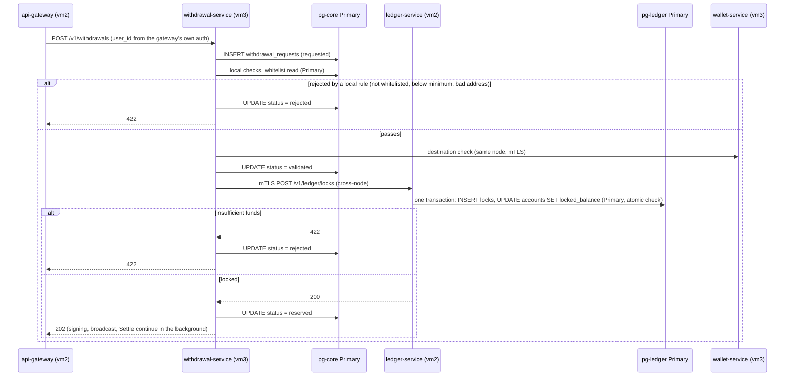
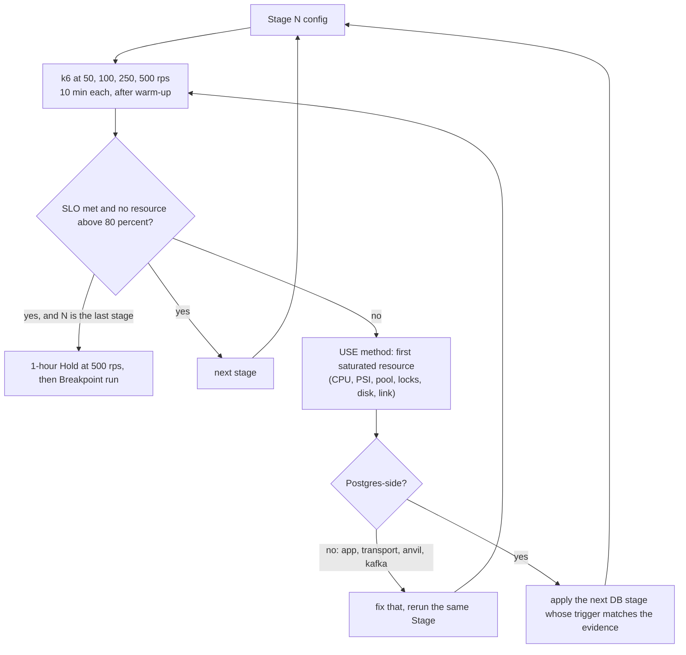

# Multi-node deployment, database scaling and the 500 rps load test (dev environment, vm2 + vm3)

Status: PROPOSED. Awaiting Tech Lead review. Delivers `ARCHITECTURE.md` roadmap step 4 ("Real multi-VM deployment")
in the reduced form the Tech Lead decided (two nodes, plain Compose, no automatic HA) and prepares step 5 ("Break it
on purpose"). Nothing in this note has been implemented; every number is either **measured** (inspected on vm2/vm3 on
2026-10-05, marked M) or an **estimate** (marked E, to be recalibrated by milestone M3 before anyone relies on it).

## Problem

The always-on dev stack runs as one Compose project on one 4 vCPU / 7.8 GB node (vm2) and is already past its limits:
RAM is exhausted, the kernel OOM-killed `anvil` (3.6 GB RSS) today at 10:42 UTC, `java` (Kafka) at 04:33 and another
tenant's `python` yesterday, and `anvil` and `kafka` burn most of two cores. A second identical node (vm3) is available
over a WireGuard tunnel. The Tech Lead wants to (1) spread the services evenly over the two nodes, (2) make room for
Prometheus, Grafana and exporters, (3) push 500 requests/second for one hour through `api-gateway` with k6, and (4) use
that to **scale the database and find where it breaks**, while keeping the application services single-instance.
There is no automatic failover in this phase. This note decides placement, the private network and firewall, how
service names and mTLS keep working across hosts, a staged and measurable database scaling plan, the load-test plan
with acceptance and abort criteria, how the stateful pieces move, and what each failure does.

## Bounded context(s)

No new domain bounded context: this is a deployment/operations concern laid over the existing ones, and it must not
change what they own.

| Context | What this note touches | What it must not change |
|---|---|---|
| Platform (infra/, dev/, e2e/ compose, `infra/pki`, `infra/prometheus`) | New per-node layer, WireGuard addressing, firewall policy, node-aware Prometheus config, per-node Makefile targets | The e2e stack stays single-host and unchanged; `make e2e` must keep working |
| Ledger (`ledger.md`) | Optionally (gated, Stage 4) one replica read path for balances; Postgres tuning | Lock/Settle/Release/Apply stay on the primary, one transaction, same SQL (invariants 1-2 below) |
| Identity (`identity-auth.md`) | An *optional* API-key cache is raised as a decision; default is no change | Invariant #6 (revocation is a live lookup) stays true unless the Tech Lead amends it explicitly |
| Withdrawal (`withdrawal-flow.md`), Deposit (`deposit-flow.md`), Wallet (`wallet-tiering.md`) | Move to another host and database server; connection settings | Single instance of each (chain-watcher's advisory lock, the Reaper, the Hot Wallet nonce row) |
| Service auth (`service-auth-mtls.md`) | Names resolve to private addresses; no PKI change (see Network) | CN-based authorization, the CA, leaf validity |
| Observability (`reconciliation-audit.md` decisions (c)/(d); `monitoring-dashboard.md` is referenced there but is not in the repo) | Where Prometheus/Grafana live and how they reach every target; new exporters | Services expose `/metrics` on their own internal port, never publicly |

## Ubiquitous language

Existing terms are reused as defined in their design docs (Hot Wallet, Lock, Settle, Release, Chain Account, Gas
Expense Account, Asset Registry, API Key, Reaper, Nonce Gap, Whitelist Cooldown). New or touched terms:

- **Node** - one VM running its own Docker Compose project; here `vm2` (private `10.10.0.1`) and `vm3` (`10.10.0.2`).
- **Private Network** - the WireGuard network `10.10.0.0/24` between the nodes; the only network on which service ports are reachable from another host.
- **Public Interface** - `eth0` with the node's public IP; no service port is ever reachable through it.
- **Database Server** - one Postgres process; here `pg-ledger` and `pg-core` (a server holds several of the existing per-service databases).
- **Primary / Replica** - the one writable Postgres of a Database Server / its physical streaming copy on the other node.
- **Replication Lag** - how far the Replica's replayed WAL is behind the Primary, in seconds (replay delay).
- **Read Path** - one specific endpoint-to-query route allowed to read from a Replica; all others are Primary-only.
- **Client Pool** - the connection pool inside a service (pgxpool). **Server Pool** - PgBouncer's pool of real server connections.
- **Measurement Plane** - k6, Prometheus, Grafana and the exporters; the only things on a node that are not the system under test.
- **Offered Rate** - requests/second k6 *tries* to send (open model); **Achieved Rate** - what completed. The gap is the finding.
- **Stage / Hold / Breakpoint run** - a fixed-rate step of the plan / the one-hour run at 500 rps / a ramp beyond 500 rps to find where it breaks.
- **Perf Dataset** - synthetic users, accounts and entries seeded directly in SQL for the load test (not produced by real deposits).

## Measured starting point (2026-10-05)

| Fact | Value |
|---|---|
| vm2 now | 7.9 GB RAM, ~1 GB available, no swap, load average 6 on 4 cores; 38 GB of 96 GB disk used. Three OOM kills in under a day (anvil 3.6 GB RSS, Kafka JVM, a tenant's python) (M) |
| vm3 now | 637 MB used of 7.9 GB, 2.7 GB of 96 GB disk, **Docker 29.1.3 + Compose 2.40.3 already installed** (vm2: Docker 29.8.1 / Compose 5.5.1), kernel 6.8.0-139 (vm2 -138) (M) |
| WireGuard | `wg0` up on both: vm2 `10.10.0.1/24`, vm3 `10.10.0.2/24`, UDP 51820, keepalive 25, MTU 1420. RTT ~1.2-2 ms (one early sample showed a 50 ms spike while vm2 was CPU-saturated; jitter under CPU saturation is itself a finding). Throughput ~190 Mbit/s (~23 MB/s) over WireGuard vs ~200 Mbit/s over the public IP, so the *link*, not WireGuard, is the ceiling (M) |
| Exposure today | **Every published port is `0.0.0.0` and `[::]` on vm2** (5432, 6379, 27017, 9092, 8545, 8080, 8443-8446 ...), `ufw` inactive, `DOCKER-USER` empty. Postgres is `custody/custody`, Redis and Mongo have weak/no auth, Anvil exposes its public dev keys. This is reachable from the internet **now**, independent of this design (M) |
| Container footprint now (idle-ish, with the simulator at 80 users) | anvil 2.0 GB / 55% core; kafka 1.1 GB (`-Xmx1G`) / 2% now (150% reported earlier, unexplained, see Risks); postgres 177 MB / 12%; mongo 136 MB; every Go service 7-26 MB / under 1% except withdrawal-service 7% (its 1 s pollers); redis 7 MB (M) |
| Anvil state file | `--state` rewrites `/data/anvil-state.json` **in place and non-atomically**: observed at 0 B, 327 MB and 439 MB within seconds, with ~237 MB/s of disk writes during a dump (M). A kill during a dump can leave a truncated file |
| Postgres | 16.15, `shared_buffers=128MB`, `work_mem=4MB`, `max_connections=100`, 16 backends in use, `pg_stat_statements` available but not preloaded. Total data **~320 MB** (ledger 109 MB: 105k ledger_transactions, 210k entries, 164 accounts, 20.7k locks; withdrawal 60 MB: 21.8k requests, 41k outbox rows; chain_watcher 24 MB; custody 20 MB; api_gateway 8 MB, 81 API keys) (M). **The whole dataset fits in RAM many times over**, so at today's size nothing in Postgres can be I/O-bound |
| Code facts that decide the plan | (a) every service builds its pool with `pgxpool.New(dsn)`: pgx defaults (4 connections on 4 cores, named prepared-statement cache); (b) `api-gateway` builds its mTLS clients with `&http.Transport{TLSClientConfig: ...}` and its wallet client with the default transport: Go's default is **2 idle connections per host** and HTTP/2 is off, so above ~2 concurrent calls it closes and re-handshakes connections; (c) `Authenticate` is one indexed Postgres lookup per request; (d) `ledger.Apply` and `Settle` update the **Chain Account row** of the asset on every deposit/settle and `Lock` updates the user's account row, so those rows are serialization points; (e) `wallet-service` locks one `hot_wallet_nonces` row `FOR UPDATE` for every signature; (f) `chain-watcher` holds a **session advisory lock** (`pg_try_advisory_lock`) on a dedicated connection; (g) every service runs golang-migrate at startup on the *same DSN* as its pool, and the pgx5 migrate driver takes a session advisory lock; (h) no `LISTEN/NOTIFY`, no `SKIP LOCKED`, no explicit prepared statements; `FOR UPDATE` appears only inside transactions (wallet nonce row, withdrawal `pipeline.go`, auditor findings); (i) metrics collectors run SQL at **scrape time** (`obs.Collector`, `stats.go` with `count(DISTINCT ...)` over `entries`); (j) Redis clients take only `REDIS_ADDR` (no password option); (k) leaf cert SAN is `DNS:<service>, DNS:localhost` only |

## Decisions already made by the Tech Lead (not reopened here)

1. Spread services evenly over vm2/vm3, accounting for Anvil.
2. Prometheus, Grafana and exporters are coming; reserve capacity; the monitor must not compete with the load test for cores.
3. Target: **500 rps sustained for 1 hour** through `api-gateway`, k6, mostly reads with a few percent writes and some 401s.
4. Priority is to **scale the database and find where it breaks**; application services stay single-instance.
5. Plain Docker Compose per node, WireGuard between them, `extra_hosts`/explicit private addresses to keep service names; published ports bind to the private address or localhost; Docker bypasses ufw so `DOCKER-USER` rules are required.
6. **No automatic HA/failover.** Two nodes cannot make a quorum; no fake HA.
7. k6 and the simulator do not sit on the node whose capacity is being measured.

## Decisions made in this note (reviewable; each can be overturned in review)

| # | Decision | Why |
|---|---|---|
| D1 | **vm2 = request-path node**: `api-gateway`, `ledger-service`, `pg-ledger` (databases `ledger` + `api_gateway`), PgBouncer for it, `history-service`, `mongo`. **vm3 = custody/chain node + Measurement Plane**: `wallet-service`, `withdrawal-service`, `pg-core` (`custody`, `withdrawal`, `chain_watcher`, `auditor`), `kafka`, `redis`, `anvil`, `chain-watcher`, `sweeper`, `simulator`, k6, Prometheus, Grafana, and the ledger Replica (Stage 4) | Each service sits on the same node as its own database (a cross-node query costs ~1.3 ms per round trip and `Lock` is ~6 round trips while holding a hot row lock); ledger and withdrawal, the two write-heavy databases, land on different Database Servers; anvil (a 440 MB state dump, 237 MB/s of disk writes) is kept away from `pg-ledger`'s WAL fsyncs |
| D2 | Two Database Servers, not five and not one: `pg-ledger` and `pg-core` | Splits write-heavy ledger from write-heavy withdrawal with zero code change |
| D3 | Cross-node calls use the **same service names**: `extra_hosts: <svc>:<private IP>` on the caller plus the callee's *published host port* in the URL env var; local calls keep Docker DNS and port 8443 | No PKI change (SAN already `DNS:<svc>`), no code change |
| D4 | k6 is pinned to **core 3 of vm3** (`cpuset`), Prometheus/Grafana/exporters share that core and the SUT residents of vm3 are pinned to cores 0-2; k6 calls the gateway at `10.10.0.1:8084` | Load generator never shares a core with the system under test; the cost is that vm3's SUT has 3 cores, not 4, which the budget below accounts for |
| D5 | Every container gets `mem_limit`; Docker log rotation set in `/etc/docker/daemon.json` on both nodes | An OOM now kills the offending container's cgroup, not a random neighbour; today only anvil/simulator rotate logs and `daemon.json` does not exist |
| D6 | The auditor and the simulator's own balance checks are the **correctness oracle** of the load test; the auditor runs between stages and after the Hold, not during them | Its `RepeatableRead` scans would perturb the measurement |

## Aggregates & invariants

The ledger, withdrawal and identity aggregates keep every invariant in their own notes. These are the invariants this
deployment adds; "enforced by" says who is responsible.

1. **Money decisions read the Primary.** `Lock`, `Settle`, `Release`, `Apply`, every withdrawal state transition, and the withdrawal validator's whitelist/cooldown read (`WhitelistStatus`, also `Recheck`) always run on the Primary of their database. Enforced by construction: a service has exactly one DSN for these, pointing at the Primary (or its PgBouncer); a Replica DSN exists only where invariant 2 allows it.
2. **The Replica Read Path set is exactly one route**: `ledger-service` `GET /v1/ledger/balances/{user_id}` (serving `GET /v1/balances`). Not on it, with the reason: API-key `Authenticate` (revocation, identity-auth #6), `GET /v1/deposit-address` (the wallet endpoint is create-or-get), whitelist and withdrawal reads (they live on `pg-core`, which has no Replica; a stale whitelist after a DELETE would be a security hole), the auditor's cross-database reconciliation (a snapshot skewed by lag reads as drift). Enforced by `ledger-service` holding a second pool used only by `handleBalances`, behind a flag that defaults to off.
3. **Replica staleness is bounded and falls back, it never fails.** Acceptable staleness for balance display: replay lag ≤ 2 s (alert at 1 s). `ledger-service` samples replay lag once per second (cached, not per request); above 2 s, or Replica unreachable, `handleBalances` uses the Primary. Enforced by `ledger-service` (when Stage 4 is enabled). Read-your-writes consequences a user can see: after a confirmed deposit the new balance can show up to ~2 s late (the deposit itself is already seconds old by Confirmation Depth); after `POST /v1/withdrawals` returns 202, Available can still show the old, higher value for up to ~2 s. Neither affects money: a second withdrawal on that stale display is decided by the Lock on the Primary and is rejected there if funds are gone.
4. **One Primary per database, and promotion is manual and fenced.** Nothing promotes a Replica automatically. Before promotion the old Primary must be stopped and its data directory marked unusable so that it cannot be restarted writable (it is rebuilt as a Replica afterwards). Enforced by the runbook and by the Makefile refusing `up` for a Primary role while a `PROMOTED` marker file exists on the other node.
5. **Each database has one owning role.** `svc_ledger` owns `ledger`, `svc_gateway` owns `api_gateway`, `svc_withdrawal` owns `withdrawal`, `svc_wallet` owns `custody`, `svc_chainwatcher` owns `chain_watcher`; `CONNECT` is revoked from `PUBLIC`; the existing `auditor_ro` and `grafana_ro` keep their read-only grants (`default_transaction_read_only`). `custody/custody` no longer exists after M1. Enforced by Postgres roles and `pg_hba.conf` (`scram-sha-256`, source `10.10.0.0/24` only).
6. **Migrations and the advisory lock never go through PgBouncer.** golang-migrate's session advisory lock and `chain-watcher`'s `pg_try_advisory_lock` need a stable server session. Enforced by connecting those two paths straight to the Postgres port; this needs one small code change (a separate migrate DSN, see Code changes).
7. **Single instance per application service, across both nodes.** A service never runs on both nodes. Enforced by node-specific Compose overlays (each service appears in exactly one) and a `make verify` check that counts containers per service across both nodes.
8. **No published port on a public address.** Every published port binds to `127.0.0.1` or the node's `10.10.0.x`; `DOCKER-USER` and the host firewall independently drop anything arriving on `eth0` except SSH and the peer's WireGuard UDP. Enforced by both layers (defence in depth) and verified from the *other* node's public side by `make verify`.
9. **Key material stays where its service runs.** `MASTER_KEY_HEX` and the sealed seeds exist only on vm3 (where `wallet-service` runs); the CA key stays on vm2 (`~/.digiwal-ca`); each node receives only the leaf directories of the services it runs (leaf keys are currently world-readable, mode 644: tightened to root-only on the host). Enforced by the per-node `certs` target.
10. **Chain state and the databases roll together.** Anvil's volume, `pg-core`, `pg-ledger` and Kafka describe one history; restoring any one of them without the others is invalid. Enforced by the runbook: either keep all or `reset-all`.
11. **The load test cannot pass with a red ledger.** After every Stage and after the Hold: for every asset the sum of `entries` is 0; every `accounts.total_balance` equals the sum of its entries; every `locked_balance` equals the sum of its active locks; the simulator logs no `DRIFT`/`ANOMALY`; the auditor has no new critical finding. Enforced by the `verify-ledger` target (read-only SQL against the Primary) plus the existing checkers.
12. **A hard-capped Hot Wallet path.** During load runs the number of *accepted* withdrawals is capped (Load profile); accepted withdrawals are bounded by the Hot Wallet nonce row (one signature at a time) and by Anvil's 2 s blocks, and that serialization is unchanged by this note.

## Placement and budgets

Reserved on each node for kernel, Docker, page cache and other tenants: **1.0 GB RAM and 0.3 core** (vm2 also has other tenants' containers, e.g. a python web UI, ~0.15 GB / 0.1-0.3 core: they must be quiesced during the Hold or the budget below is wrong).

CPU is "cores at 500 rps" (E): gateway 0.5 with connection reuse, 1.0 with per-request handshakes; Postgres derived from ~1,100 simple indexed queries/s plus ~25-50 write transactions/s (a deliberately generous 2x); everything else from measured idle plus load scaling. RAM is steady-state (E) with the `mem_limit` in the last column.

| Container | Node | CPU (cores, E) | RAM steady (E) | `mem_limit` | Note |
|---|---|---|---|---|---|
| api-gateway | vm2 | 0.5-1.0 | 0.2 GB | 0.5 GB | the entry point; handshake churn is the swing factor |
| ledger-service | vm2 | 0.3 | 0.1 GB | 0.3 GB | |
| pg-ledger (Primary: `ledger`, `api_gateway`) | vm2 | 1.2 | 1.8 GB | 2.5 GB | `shared_buffers` 768 MB |
| pgbouncer (ledger) | vm2 | 0.15 | 0.05 GB | 0.1 GB | enabled at Stage 3 |
| history-service | vm2 | 0.1 | 0.05 GB | 0.2 GB | |
| mongo | vm2 | 0.1 | 0.35 GB | 0.6 GB | `--wiredTigerCacheSizeGB 0.25`; default would size to host RAM |
| node/cAdvisor/postgres exporters (vm2) | vm2 | 0.3 | 0.3 GB | 0.5 GB | cAdvisor housekeeping 10 s |
| **vm2 total** | | **3.1-3.8 of 4** | **~2.9 GB + 1.0 reserve + tenants 0.15 = ~4.1 of 7.8** | | CPU is tight; RAM leaves ~3.5 GB of page cache for `pg-ledger` |
| pg-core (Primary: `custody`, `withdrawal`, `chain_watcher`, `auditor`) | vm3 | 0.8 | 1.0 GB | 1.5 GB | `shared_buffers` 512 MB |
| pg-ledger Replica (Stage 4+) | vm3 | 0.4 | 0.9 GB | 1.2 GB | `shared_buffers` 256 MB; absent before Stage 4 |
| wallet-service | vm3 | 0.3 | 0.1 GB | 0.3 GB | master key and sealed seeds live here only |
| withdrawal-service | vm3 | 0.4 | 0.1 GB | 0.3 GB | |
| anvil | vm3 | 0.6 (measured 0.5-1.0) | 1.5 GB (measured 2.0, peak 3.6) | **2.5 GB** | see Anvil |
| kafka | vm3 | 0.4 | 0.8 GB | 1.0 GB | `KAFKA_HEAP_OPTS=-Xmx512m -Xms512m` (volume is tiny; measured heap is 1 GB) |
| redis | vm3 | 0.05 | 0.05 GB | 0.3 GB | `maxmemory 256mb`, only wallet-service and chain-watcher use it |
| chain-watcher, sweeper, simulator | vm3 | 0.35 total | 0.15 GB | 0.2 GB each | simulator at `SIM_RATE` low during the Hold |
| **SUT residents of vm3 (cores 0-2)** | | **2.9 of 3 without the Replica, 3.3 with it** | | | the Replica forces the simulator and sweeper to idle during Stage 4 runs |
| k6 | vm3 core 3 | 0.5 (E, see below) | 0.6 GB | 1.0 GB | |
| Prometheus + Grafana + node/cAdvisor/postgres/redis/kafka exporters | vm3 core 3 | 0.5 | 1.4 GB (Prometheus 0.8, Grafana 0.25, exporters 0.35) | 1.8 GB | |
| **vm3 total** | | **3.4-3.8 SUT + 1.0 Measurement Plane on a separate core** | **~7.2 GB worst case with Replica: tight** | | without the Replica ~6.3 GB |

Honest reading of this table: **total CPU demand (~8.3 of 8 cores) is about equal to total supply, so the cluster is
expected to saturate CPU somewhere near the 500 rps target**; that is a legitimate outcome of the test, not a placement
failure, but it means the Measurement Plane's 1 core and vm2's other tenants matter. M3 re-measures every row at 50 rps
and the table is corrected before Stage 1 starts. If RAM on vm3 is too tight with the Replica, the first thing to give is
the Replica's `shared_buffers` (it only serves one tiny query), then Anvil's retained history.

**k6 cost (E):** k6 is Go and uses ~1 core per 1-2k simple requests/s; with a small JS scenario, JSON parsing and
`check()` on every response, ~0.3-0.6 core at 500 rps and ~0.5-0.6 GB for 200-400 VUs. It is pinned to one core with
~2x headroom. Using the **open-model** `constant-arrival-rate` executor (not a fixed VU count) is mandatory: a closed
model slows down when the SUT slows down and hides exactly the latency we are looking for. Placed on vm3 it steals 25% of
vm3, which is why vm3 hosts the cheaper, mostly asynchronous half of the system and why its SUT is pinned to 3 cores.
Why not vm2: vm2 holds the synchronous request path and the hottest Postgres, and shares the node with other tenants.
Why not a third place: there is none; this is the cheapest honest answer with two nodes. WireGuard encryption of
k6's traffic costs ~2% of a core on each end (E: ~16 Mbit/s at 500 rps).

## Network design

**Addressing.** Already up: `wg0` vm2 `10.10.0.1/24`, vm3 `10.10.0.2/24`, UDP 51820, `PersistentKeepalive 25`, enabled at boot. Docker bridges stay `172.17/172.18` (no overlap). Containers on the project network get MTU **1400** (`driver_opts: com.docker.network.driver.mtu`) so packets bound for `wg0` (MTU 1420) are not fragmented or black-holed; `make verify` checks with a don't-fragment ping.

**Port map** (host side; container ports unchanged). "Private" = bound to the node's `10.10.0.x`, "local" = `127.0.0.1`, "-" = not published (reachable only on the project network).

| Service | Node | Host binding | Why reachable |
|---|---|---|---|
| api-gateway `8080` | vm2 | **private + local** `:8084` | k6 and the simulator on vm3; public exposure is Open Question 7 |
| ledger-service `8443` (mTLS) | vm2 | private `:8444` | withdrawal-service, sweeper (vm3) |
| ledger-service `8080` | vm2 | - | no remote user |
| pg-ledger | vm2 | private `:5432` and PgBouncer `:6432` | Replica (replication), exporters, auditor |
| mongo | vm2 | local `:27017` | history-service (same node); auditor over `ssh`/private if needed |
| wallet-service `8443` / `8080` | vm3 | private `:8443` / `:8080` | gateway (plain HTTP today, documented gap, now only on the Private Network), chain-watcher, sweeper, withdrawal, auditor |
| withdrawal-service `8443` | vm3 | private `:8446` | gateway |
| pg-core | vm3 | private `:5432` | auditor, exporters |
| kafka `9092` | vm3 | private `:9092` | ledger-service, history-service (vm2); advertised listener stays `kafka:9092`, which resolves on both nodes |
| redis | vm3 | local only (containers reach it by name) | wallet-service, chain-watcher are both on vm3 |
| anvil `8545` | vm3 | private `:8545` | simulator, sweeper... all on vm3; auditor |
| every service `/metrics` (`9100`) | both | private `:9101`..`:9108`, one per service | Prometheus (vm3) scrapes both nodes |
| node/cAdvisor/DB exporters | both | private `:9100`, `:8081`, `:9187`, ... | Prometheus |
| Prometheus `9090`, Grafana `3000` | vm3 | **local only**, reached via `ssh -L` | the Tech Lead; Grafana's anonymous-Admin setting must never be public |

All other published ports in today's compose files (`8081`, `8082`, `8083`, `8085`, `8086`, the plain `8080`s) are dropped from the multi-node overlay.

**Firewall (both nodes).** Policy, not commands:
- Host `INPUT`: allow established, loopback, `wg0` (from `10.10.0.0/24`), SSH 22 (consider source restriction later), UDP 51820 **only from the peer's public IP**; drop the rest. `ufw` may express this, but it does **not** govern Docker-published ports.
- `DOCKER-USER` (evaluated for traffic to published ports after DNAT): accept established/related; accept input from `wg0` and from the Docker bridges; **drop every new connection arriving on `eth0` that was DNAT'd to a container** (conntrack `DNAT` state), with the allowed public list empty for now; the rule set is persisted (`iptables-persistent` or a systemd unit) and re-applied after Docker restarts. Container egress to the peer leaves via `wg0` and is masqueraded to the node's `10.10.0.x`, so the peer sees one source address, which keeps the allow rules simple.
- Port bindings (Network decision above) are the first line; the firewall is the second. Binding to an explicit IPv4 address also stops Docker's `[::]` binding.
- **Rollout order matters:** the firewall and the rebinding go in **first** (M1), before any service moves, because the exposure is already live.

**Name resolution and mTLS.** `service-auth-mtls.md` issues one leaf per service with CN = service name and SAN `DNS:<service>, DNS:localhost`; Go verifies the server name taken from the URL host. With `extra_hosts: ledger-service:10.10.0.1` on vm3 the URL `https://ledger-service:8444` resolves to the private address and **verifies against the existing certificate: no change to `gen-leaf.sh`, no new SANs, no re-issue.** Only the port differs from a same-node call. CN authorization is untouched. Using raw IPs in URLs would break (no IP SAN), so the rule is "always the service name". Per-node differences are expressed only as env overrides in the node overlay (e.g. on vm2: `WITHDRAWAL_SERVICE_URL=https://withdrawal-service:8446`, `WALLET_SERVICE_URL=http://wallet-service:8080`, `KAFKA_BROKERS=kafka:9092` plus `extra_hosts`). Leaf directories are copied from vm2 (where the CA lives) to vm3 over SSH on the Private Network; the CA key never leaves vm2. The api-gateway to wallet-service plain-HTTP gap is not closed here; it is now confined to the Private Network (an improvement over today's public `:8080`), and still unauthenticated at the application layer.

**Cross-node traffic at 500 rps (E).** Roughly half of the request mix crosses once (whitelist, withdrawal reads, deposit-address, and all POSTs go gateway(vm2) to vm3): ~300 calls/s x ~3 KB (request + response with TLS records) is ~1 MB/s, ~8 Mbit/s of ~190 Mbit/s. Add k6 to gateway ~4 Mbit/s, withdrawal to ledger and Kafka (tens of KB/s), Postgres WAL to the Replica (~25-50 write transactions/s: tens to hundreds of KB/s steady, MB/s bursts after a checkpoint's full-page writes), Prometheus scrapes (~1-2 MB/min). **Where it stops being fine:** (1) a handshake per request (see Bottlenecks) adds ~4 KB and one extra round trip, still small; (2) **bulk seeding of the Perf Dataset** into a Primary with a live Replica: ~3-5 GB of WAL is ~2-4 minutes at 23 MB/s, so lag will grow; seed before the Replica is attached (a base backup of 10 GB takes ~7 min); (3) cross-node traffic would only approach the link ceiling at several thousand rps. The binding cost of the link at this load is **latency** (+1.3 ms per hop, +~8 ms inside a `Lock` transaction if its connection were remote, which D1 avoids), not bandwidth.

## Diagrams

### Container view: two nodes and the private link

### Sequence: read requests across the nodes (balances with the Replica enabled)

### Sequence: POST /v1/withdrawals (rejected path and accepted path)

### Flow: the staged improve-measure loop

## Database scaling plan (the core)

**Honest expectation first (E).** The read-heavy mix at 500 rps means ~1,100 simple primary-key/unique-index queries per
second (500 auth lookups + ~350 service reads + ~150 other) and ~25-50 write transactions per second (3% POST
`/v1/withdrawals` = ~15/s, 1% POST `/v1/whitelist` = ~5/s, plus the one-or-two accepted withdrawals/s and their Settles).
A 4-core Postgres executes thousands of such statements per second, and the current dataset is 320 MB. **Postgres is
unlikely to be the first thing to break at 500 rps**; the stages below are ordered so that the plan still teaches
something if that is true, because (a) Stage 0 includes a DB-only ceiling test that separates "the database" from "the
application in front of it", and (b) the Perf Dataset (below) deliberately grows the data past RAM so the database *can*
become the limit. If the DB is not the limit at 500 rps, that is the result; the Breakpoint run then finds the real order
of failure.

**Perf Dataset (Open Question 5).** To make the DB do real work: ~20,000 users with API keys and deposit addresses created
through the real API (`POST /users`, create-or-get address), ~200 of them funded by real on-chain deposits (the funded
cohort used for accepted withdrawals), and the ledger grown by direct SQL to ~20M `entries` (~5 GB with indexes, E:
~250 B/entry row+indexes), larger than the 768 MB `shared_buffers` plus the ~2.5 GB of page cache. SQL seeding bypasses
`Apply`, so it must insert balanced entries against the Chain Account to keep invariant 11 true; the auditor's *custody
reconciliation against the chain* will not match and is excluded for perf runs.

### Stages (one change per stage, each re-run at 250 and 500 rps, 10 minutes each)

| Stage | Change | Config or code | What it should show | Trigger to go on / evidence to keep |
|---|---|---|---|---|
| **S0 baseline** | Today's layout in the new topology: one Postgres (all five databases) on vm2 with defaults, plus observability only (`shared_preload_libraries=pg_stat_statements`, `track_io_timing`, `log_lock_waits`, postgres exporter). Also run **pgbench with custom scripts** that replay the three hot statements (API-key lookup, balance read, `Lock` transaction) directly against the Primary from the *other* node, and `pg_test_fsync` once per node | config; pgbench runs in a throwaway `postgres:16-alpine` container (already used image) | DB-only ceiling (tps at p95 < 5 ms) independent of the gateway, mTLS and JSON; fsync latency of each node's disk (decides whether `synchronous_commit=on` is cheap) | If end-to-end rps saturates far below the DB-only ceiling, the bottleneck is not Postgres: go to the Bottlenecks table before touching the DB |
| **S1 split** | `pg-ledger` = {ledger, api_gateway} on vm2; `pg-core` = {custody, withdrawal, chain_watcher, auditor} on vm3. Each service's DSN host changes; database names and schemas do not | **no code**: DSN env + per-service roles (M1) | Write-heavy ledger and withdrawal stop sharing WAL, locks and `shared_buffers`; Postgres CPU per node roughly halves; authentication lookups sit next to the gateway | Keep if p95 or CPU improves vs S0; the split is correct even if it does not, because it is a precondition for placement |
| **S2 tune + pool** | Postgres settings for a node shared with other containers (below); Client Pool sized per service via DSN parameters `pool_max_conns`, `pool_min_conns`, `pool_max_conn_lifetime` (pgx reads them from the connection string): gateway 16, ledger 16, withdrawal 16, wallet 8, chain-watcher 4 (+1 dedicated advisory connection). Server backends then stay ~50 on `pg-ledger`, ~45 on `pg-core` | config only | Removes queuing in the 4-connection default pools; `pgxpool` saturation gauge (`PoolCollector`, alert at 80%) stays below the alert | Little's law check: busy connections = rps x time held; if pool wait time is non-zero but active backends exceed ~2-4 per core, more pool makes it worse: go to S3 |
| **S3 PgBouncer** | PgBouncer on the Primary's node, **transaction pooling**, `default_pool_size` 16 per database/user, `max_client_conn` 500; services raise Client Pools (e.g. 64) while server connections stay ~16-20 | new infra piece (Open Question 5) + **one code change** (migrate DSN, invariant 6) + DSN parameter `default_query_exec_mode=cache_describe` (or PgBouncer >= 1.21 with `max_prepared_statements`) | Whether a large client-side pool plus a small server pool beats a moderately sized direct pool: it should only win if S2's run showed backend contention or connection churn | Keep only if throughput or p99 improves vs S2 at equal CPU; otherwise remove it (it adds a hop and a failure mode) |
| **S4 Replica + one Read Path** | Physical streaming Replica of `pg-ledger` on vm3 (replication slot with `max_slot_wal_keep_size` ~5 GB, async); `handleBalances` on the Replica behind a flag; lag-based fallback (invariant 3) | new `replicator` role + `pg_hba` line; **code in ledger-service**, gated, off by default | `pg-ledger` Primary CPU saved by the balances share (~35% of requests, E); replay lag under load; what stale balances look like in the simulator | Build the Replica regardless (it is also the manual-recovery copy, see Failures); **turn the Read Path on only if** the Primary's CPU or `pg_stat_statements` show the balance query as a top cost, or p99 of `/v1/balances` is the limiter |
| **S5 table level** | Autovacuum and fillfactor for the update-heavy tables (below); consider UUIDv7 for `entries.id`; the `stats.go` scrape-time queries rewritten or throttled | ops SQL (needs a place in the repo: Open Question 11) / small code | Table and index bloat, autovacuum lag, scrape-time query cost as `entries` grows | Only on evidence: `n_dead_tup` ratio, `pg_stat_user_tables` update/HOT ratios, vacuum duration, scrape duration |

**Postgres settings for a 4 vCPU / 8 GB node shared with containers (E starting values, verified by S0/S2):**
`pg-ledger`: `shared_buffers` 768 MB, `effective_cache_size` 3 GB, `work_mem` 8 MB, `maintenance_work_mem` 256 MB,
`max_connections` 100 (no higher; PgBouncer is the way to more clients), `wal_compression=on`, `checkpoint_timeout=15min`,
`max_wal_size=4GB`, `checkpoint_completion_target=0.9`, `random_page_cost=1.1`, `effective_io_concurrency=200` (confirm
the disk with `pg_test_fsync` and fio-style numbers first: the earlier iostat suggests fast storage but it was one sample),
`autovacuum_max_workers=3`, `log_min_duration_statement=200ms`, `log_lock_waits=on`, `track_io_timing=on`,
`pg_stat_statements` on. `pg-core`: the same with `shared_buffers` 512 MB. **`synchronous_commit` stays `on` on both**
(money; no "faster" setting is part of this plan). Docker: `shm_size` 256 MB, `mem_limit` as in the budget, data on a named
volume (never `tmpfs`).

**Table-level notes grounded in the migrations (S5):**
- `entries` is append-only (immutable trigger), `ledger_transactions` is insert-only after creation, `observed_transfers` changes status once, `withdrawal_requests` is updated on every state transition. Insert-only tables need the PG13+ insert-triggered autovacuum (`autovacuum_vacuum_insert_scale_factor` ~0.05) to keep the visibility map fresh for index-only scans, not aggressive dead-tuple vacuuming.
- `accounts` and `locks` are the hot, frequently updated rows. `accounts.total_balance/locked_balance` are not indexed, so updates are HOT-eligible if the page has room: set `fillfactor` 70-80 on `accounts`. `locks` updates `status`, which changes membership of the partial index `locks_active`, so those updates are not HOT; `withdrawal_requests` has the index `(status, updated_at)` and so no transition is HOT. Give `withdrawal_requests`, `withdrawal_outbox`, `locks` and `accounts` per-table autovacuum settings (scale factor ~0.02, cost limit raised), and watch bloat on `withdrawal_requests_status_updated`.
- `entries.id` and `ledger_transactions.id` are random UUIDs (`gen_random_uuid()`): every insert dirties a random index page, which inflates WAL (full-page images) and cache churn once the index exceeds RAM. UUIDv7 would fix that but is a schema/ID-generation change: noted as the S5 option, not recommended before evidence.
- **Partitioning is not recommended.** `ledger_transactions.idempotency_key` must stay globally unique (`ledger.md` invariant 3) and `entries` references `ledger_transactions` by foreign key; PostgreSQL requires a partitioned table's unique keys to include the partition key, so time partitioning would break the global-uniqueness invariant. `observed_transfers` and `withdrawal_requests` have natural keys without a time column for the same reason. At ~20M entries (a few GB) partitioning gains nothing the indexes do not already give.
- **The ledger's real write serialization is application-level, not Postgres-level:** every deposit `Apply` and every `Settle` updates the one Chain Account row per asset (and gas fees update the Gas Expense Account row); concurrent transactions queue on that row lock, held until commit (~4 statements after the lock in `Settle`). Its ceiling is roughly 1 / (lock-hold time): ~1,000/s at ~1 ms hold on one node, ~200/s if a transaction crossed the link (~5 ms), so keeping `ledger-service` and `pg-ledger` together matters. It is far above the accepted-withdrawal rate the Hot Wallet nonce row allows, so it should not bind at this load; the evidence to look for is `pg_locks` / `pg_stat_activity` `Lock: transactionid`/`tuple` waits on `accounts`. If it ever binds, the fix is a design change to the Chain Account (derive it, or batch/net its updates), not sharding.
- **Sharding, Citus and multi-primary are not justified by the 500 rps target** (writes are tens per second, two orders of magnitude under a single node's capacity). Evidence that would trigger the conversation: after S1-S5, a `pg-ledger` Primary pinned above ~80% CPU or I/O with query time dominated by ledger tables (not locks on the Chain Account row, which sharding by user would not fix), sustained write TPS in the hundreds with commit latency rising, or the dataset growing past what one node's disk and RAM hold.

**PgBouncer compatibility (read from the code):**
- *Transaction mode works* for: all `Begin/Commit` transactions (`Apply`, `Lock`, `Settle`, `Release`, `CreateUser`, the wallet's `FOR UPDATE` nonce transaction, withdrawal's `FOR UPDATE` in `pipeline.go`), and the auditor/stats `RepeatableRead` read-only transactions (one pinned transaction).
- *Breaks without a fix:* (1) pgx's default named prepared-statement cache (the pooler hands out a different server connection per transaction: "prepared statement does not exist"): fix with DSN `default_query_exec_mode=cache_describe` or `simple_protocol`, or PgBouncer >= 1.21 with `max_prepared_statements`; (2) the migration step's session advisory lock on the shared DSN: fix with a separate direct migrate DSN (a small code change in each service's `Connect`); (3) `chain-watcher`'s session `pg_try_advisory_lock` connection: connect that service **directly** (it uses a pool of a few connections anyway).
- `ALTER ROLE ... SET default_transaction_read_only` (auditor_ro, grafana_ro) is applied at server connection start per (database, user) pair, so it survives pooling; the auditor and Grafana connect directly anyway.
- No `LISTEN/NOTIFY`, `SKIP LOCKED` or session `SET` usage was found.

**API-key lookup and caching (decision for the Tech Lead, Open Question 4).** Today: one indexed lookup per request,
live, so a revocation applies to the very next request (identity-auth invariant 6, README). The lookup is a unique-index
probe on a small table (~0.1 ms of Postgres CPU, E): it is expected to be *cheap*, and the 401 path (unknown key) costs the
same, which makes unauthenticated floods a database load (there is no rate limiting anywhere: noted, out of scope). **Default: no
cache.** If S0-S2 show the `api_gateway` query among the top statements, the *only* option offered is an **in-process,
bounded-TTL, positive-only cache in `api-gateway`** (TTL <= 2-5 s, `singleflight` per key, entries evicted on 401 or
on revocation observed locally): a revoked key then works for up to the TTL, which is a deliberate weakening that must be
approved and written into `identity-auth.md` invariant 6 before it ships. A Redis cache is **not** proposed: it adds a new
dependency for the gateway (Redis is owned by wallet-service/chain-watcher in `ARCHITECTURE.md`), a cross-node hop, and the
same revocation delay. Revocation has no HTTP endpoint (operator tool), so a short TTL is the cheapest of the weakenings.

## What else will bottleneck, and how the test exposes it

Ordered by my expectation (E), earliest first. The stage plan makes each visible because only one component changes at a time.

| # | Likely bottleneck | Why (from the code) | How the test exposes it | Fix, if it shows |
|---|---|---|---|---|
| 1 | **mTLS handshake per request and ephemeral-port exhaustion** between gateway and ledger/withdrawal (and plain HTTP to wallet) | `http.Transport{TLSClientConfig}` has 2 idle connections per host and HTTP/2 off; above ~2 concurrent calls connections are closed and re-established: an ECDSA P-256 mutual handshake is ~0.5-1 ms of CPU across both sides and an extra round trip (cross-node ~1.3 ms). At ~300-500 new connections/s the ~28k ephemeral ports sit near their 60 s TIME_WAIT limit | Stage 50/100 first: count new TCP connections/s (`node_netstat`/`ss`), gateway CPU per request, `TcpExtTWRecycled`/TIME_WAIT count, latency step when crossing nodes | Dev micro-fix: `MaxIdleConnsPerHost` and `MaxConnsPerHost` sized to the pool, `IdleConnTimeout`, optionally `ForceAttemptHTTP2`; widen `ip_local_port_range`. **Measure before and after** (it is the cheapest result in the whole plan) |
| 2 | **Client Pool defaults** (4 connections) | pgx default `max(4, NumCPU)`; every request needs one for auth plus one for the downstream service | `pgxpool` metrics (acquire wait, acquired/max) already exist (`PoolCollector`) | S2 |
| 3 | **api-gateway CPU** | JSON, auth, three outbound client types, one process on a node that also hosts `pg-ledger` | per-container CPU (cAdvisor), Go runtime metrics, CPU PSI | If it is the limit, that is a result (the TL said services stay single); a second gateway instance is an Open Question only if needed |
| 4 | **Scrape-time collectors** | `stats.go` and `obs.Collector` run `count(DISTINCT ...)`/`sum` over `entries` on every 15 s scrape; cost grows with the table, and the Perf Dataset makes it multi-second | scrape duration per target, `pg_stat_statements` top by total time | S5: rewrite as incremental counters or raise the scrape interval for those jobs only |
| 5 | **Withdrawal write path**: `POST /v1/withdrawals` is ~5-8 statements and, when accepted, a Lock, a signature (nonce row `FOR UPDATE`), a broadcast and a Settle; the 1 s pollers add constant load | Accepted withdrawals are limited by the Hot Wallet nonce row and by Anvil's 2 s blocks regardless of the database | Separate k6 scenarios and thresholds for rejected vs accepted POSTs; `pg_locks` on `hot_wallet_nonces`; withdrawal state-age histogram | The accepted rate is capped by design (Load profile); this is a ceiling to *report*, not to fix here |
| 6 | **Anvil** | One core pinned, 2-3.6 GB RSS, and a 440 MB state dump every `--state-interval` seconds (237 MB/s of disk writes seen) competing with `pg-core`'s WAL on the same disk | disk `await`/PSI I/O on vm3, `pg-core` commit latency spikes aligned with dumps, anvil RPC latency, chain-watcher lag alert | Longer `--state-interval` (60-300 s), lower `--prune-history`, memory limit (see Anvil) |
| 7 | **Kafka** | One broker, one partition per topic: consumer throughput is bounded to one consumer per group; 150% CPU observed once, unexplained | consumer lag (no service exports it yet: the kafka exporter fills the gap), broker CPU | Volume at this load is a few events/s, so it should not bind; investigate the 150% before blaming the partition count |
| 8 | **Disk and page cache on `pg-ledger`'s node** | 7.8 GB shared by Postgres, Kafka, Mongo and tenants | `node_memory`, major faults, `pg_stat_io`, buffer hit ratio | Move load off the node or reduce `shared_buffers` neighbours |
| 9 | **Network link / jitter** | 190 Mbit/s and ~1.3 ms per hop | per-hop latency from gateway metrics; WireGuard handshake age | Not expected to bind (see Network) |
| 10 | **Postgres itself** | Only with the Perf Dataset, bad plans, or Chain Account lock queues | `pg_stat_statements`, `pg_stat_activity` wait events, locks, buffer hit ratio, checkpoint/WAL stats | The DB stages above |

## Load-test plan

**Traffic mix (proposed, Open Question 9):** `GET /v1/balances` 35%, `GET /v1/withdrawals/{key}` 22%, `GET /v1/whitelist` 20%,
`GET /v1/deposit-address` 17%, `POST /v1/withdrawals` 3% (of which **at most ~1 rps may be accepted**: only the 200-user funded
cohort carries enough balance; the rest are deliberately rejected: not whitelisted, below minimum, bad address, insufficient
funds), `POST /v1/whitelist` 1%, requests with a bad or missing key (401) 2%. Users are drawn from the 20k-user population with a
skewed distribution (a few percent of users produce a large share) so the data is not uniformly cached. The executor is
`constant-arrival-rate` with ~100 pre-allocated and ~400 maximum VUs; per-route thresholds; the idempotency keys for
`GET /v1/withdrawals/{key}` are created in k6's `setup`, which does not count towards the rate.

**Stages:** each of 50, 100, 250, 500 rps for 10 minutes (the first 2 minutes are warm-up and excluded), a 5-minute rest
between stages (ledger check, then idle), then the **Hold: 500 rps for 60 minutes** on the best configuration, then (separate run, only
after a passed Hold) the **Breakpoint run**: 500 to 2,000 rps in 250 rps steps of 5 minutes, stopping at the first sustained
SLO breach. The Tech Lead's existing step guidance in `reconciliation-audit.md` (1x/5x/10x, 15 minutes each) is compatible
and may replace the 10-minute stages.

**Metrics per stage** (all from Prometheus except where noted):
- k6: offered vs achieved rate, `dropped_iterations`, p50/p95/p99 per route, error and 401 counts (expected exactly the intended 2%).
- Per service (existing `pkg/metrics`): request rate/latency/5xx by route, Client Pool acquired/max and acquire wait, Go runtime.
- Postgres (postgres exporter + `pg_stat_statements`): connections by state, TPS, top statements by total and mean time, wait events, `pg_locks` waits (especially `accounts`, `hot_wallet_nonces`), cache hit ratio, checkpoint and WAL rate, dead tuples and autovacuum activity, **replication lag (replay)** and slot retained WAL, temp files.
- Node: CPU by mode **including steal**, CPU and I/O **PSI**, run queue, memory available, major faults, disk `await`/util, network errors and retransmits, TCP connections and TIME_WAIT, conntrack count, WireGuard last handshake.
- Containers (cAdvisor): CPU throttling, memory working set vs `mem_limit`, OOM events.
- Kafka: consumer lag per group, broker CPU; Anvil: block time, RPC latency, restart count; chain-watcher lag (existing alert).
- Business safety: stuck withdrawals (the 5-minute thresholds), outbox age, `failed_events`, auditor findings, simulator `DRIFT`/`ANOMALY`.

**Pass/fail for "500 rps for 1 hour"** (proposed; the latency and error numbers are the Tech Lead's own Objectives, the rest are mine):
1. Achieved rate >= 99.5% of offered for the whole Hold, `dropped_iterations` < 0.5%.
2. Server-side latency p50 <= 50 ms, p95 <= 200 ms, p99 <= 2 s on every synchronous endpoint (measured by the service histograms, excluding on-chain waits); k6-side numbers reported alongside (they include the extra hop).
3. 5xx plus timeouts < 0.1%; exactly the intended 401s and the intended 422 rejections, nothing else.
4. Invariant 11 holds after the Hold: zero ledger drift, zero `DRIFT`/`ANOMALY`, no new critical auditor finding.
5. No stuck withdrawals: none older than the 5-minute thresholds, every accepted request reaches `confirmed` (or a legitimate `rejected`/`failed`), outbox drained, Kafka consumer lag back under 10 s within 5 minutes of the end.
6. No container OOM-killed or restarted, no CPU-throttling storm, Replica lag (if enabled) p99 <= 2 s, Client Pool saturation < 80%.

**Abort conditions** (a watcher target samples these every 10 s; k6 `abortOnFail` thresholds cover the first two):
- k6: 5xx or timeout rate > 5% for 60 s, or p99 > 10 s for 60 s, unless the run is a Breakpoint run.
- Any node `MemAvailable` < 600 MB for 30 s, **or any container OOM-killed or restarted**, or swap in use (if swap is added).
- Disk usage > 85% on either node, `pg-ledger` WAL or replication-slot retained WAL > 4 GB, Prometheus data approaching its size cap.
- Postgres connections > 90 of `max_connections`, or an unexplained rollback/deadlock rate.
- Simulator or auditor reports `DRIFT`/`ANOMALY`, or invariant 11's SQL check turns red: **stop immediately and keep the state for inspection.**
- Anvil restarted (the chain rolled back; see Anvil).

## Data safety and stateful moves

**Dev data: preserve or reset (Open Question 1).** The data on vm2 is simulator-generated, ~320 MB of Postgres, 1.3 GB of
Kafka, 384 MB of Mongo and a 440 MB chain. **Recommendation: `make reset` once, then rebuild in the new layout.** It is the
only way to get a consistent set (invariant 10) and the load test needs a fresh Perf Dataset anyway. The one thing to keep
is `dev/.env` (the master key): it moves to vm3 as it is, or a new key is generated if the data is reset (nothing sealed
under the old key survives anyway).

If the Tech Lead wants to preserve it: stop the simulator and all writers; `pg_dump` each of `custody`, `withdrawal`,
`chain_watcher` (and `auditor`) to `pg-core` over the Private Network (23 MB/s; minutes), leave `ledger` and `api_gateway` in
place (they stay on vm2; the old server is converted to `pg-ledger`); stop Anvil **cleanly** (`docker stop` with a long grace
period) and copy its volume; copy the Kafka and Mongo volumes while stopped; bring everything up together. Partial preservation
(for example only the ledger) is invalid.

**Per store:**
- *Postgres*: new servers are created fresh with `initdb`-time roles (init script per server, replacing `e2e/init-db.sql`'s single-server assumption); wallet seeds are re-created by the existing `init-seed` step on vm3.
- *Kafka*: topics re-created by the existing loop (5 topics, 1 partition, replication factor 1). Single broker, no replication: **disk loss = loss of unconsumed events**; the idempotent consumers make a replay from the producers' outbox/observed tables safe, but no automation exists.
- *Mongo*: single node, no replica set (two nodes cannot form one with a quorum); `history-service` is a read model rebuildable from Kafka only within retention, so treat it as disposable.
- *Redis*: disposable (address cache is rebuilt by cache-miss fallback; the optional lock is not load-bearing). No persistence needed.
- *Anvil*: see below.

**Anvil: safe configuration (OOM lesson).** What happened: `--prune-history 1000` keeps the last 1,000 *states* in memory (RSS reached 3.6 GB), the kernel OOM-killed it, and the chain rolled back by the blocks after the last dump; chain-watcher logged a reorg. What a hard kill does (M): `--state` rewrites the whole 440 MB file in place, so a kill (or `docker kill`, or OOM) during a dump can leave a truncated file, and even a clean kill loses up to `--state-interval` seconds of blocks. Consequences for the services: chain-watcher's cursor and `scanned_blocks` are ahead of the chain (reorg handling; hashes mismatch), `wallet-service`'s next Hot Wallet nonce in `pg-core` may be ahead of the chain's account nonce, so signed withdrawals queue behind a Nonce Gap (`disputed` path in `withdrawal-flow.md`), and the Reaper eventually fails them. Recommended configuration for the multi-node environment (the values are E, to be tuned in M3):
1. `mem_limit` 2.5 GB so only Anvil is killed, and `restart: unless-stopped` as today.
2. `--prune-history` lowered (start at 128; nothing reads historical state: the services read blocks, receipts and logs, as the dev compose already notes).
3. `--state-interval` raised to 60-120 s (the dump costs ~1 s of one core and ~440 MB of writes, which also stalls `pg-core`'s fsyncs on the same disk), `stop_grace_period` 60 s so a normal `down` completes a final dump.
4. Before every planned restart, copy the state file while Anvil is stopped and keep the previous copy (a manual known-good). If Anvil is killed uncleanly during a load run it is an abort condition and the run is invalid; recovery is `reset-all` (as `dev/README.md` already says), not trying to reconcile.
5. For a Hold, optionally run Anvil without `--state` (in-memory, deterministic) so nothing writes to the shared disk during the measurement; the cost is that a restart resets the chain and everything with it. Open Question 8 asks which the Tech Lead prefers.

## Operations

**Makefile evolution (describe only).** `dev/Makefile` today builds one Compose command from `infra/docker-compose.yml`, `e2e/docker-compose.yml` and `dev/docker-compose.yml`. It evolves to:
- A `NODE` variable (`vm2` or `vm3`, read from `/etc/digiwal/node` so a mistyped `make up` on the wrong host is impossible) selects one more overlay, `dev/nodes/<NODE>.yml`, which holds the node's *service list*, `extra_hosts`, per-node env overrides, host bindings, `mem_limit`/`cpuset`, and the Measurement Plane on vm3. Each service appears in exactly one overlay (invariant 7). The e2e and single-host `make up` keep working with no `NODE`.
- Per-node targets: `up`, `down`, `reset`, `status`, `logs`, `certs` (installs only this node's leaf directories), `env` (per-node `.env`: the master key only on vm3, database passwords on each), `firewall` (applies and persists the policy), `roles` (creates the per-service database roles), `verify`.
- Cluster targets run from vm2 over SSH on the Private Network: `up-all`, `down-all`, `reset-all`, `status-all`, `verify-all`. They only orchestrate the per-node targets in the order below, wait for health with explicit probes, and refuse to run if the two nodes' repository commits or Compose major versions differ. There is one repo checkout per node (synced by `git`); images are built on each node (same CPU architecture, no registry).
- Load-test targets: `perf-seed`, `perf-stage RATE=...`, `perf-hold`, `perf-breakpoint`, `verify-ledger`, `perf-watch` (the abort-condition watcher), `perf-report` (collects k6 summary, key Prometheus queries and `pg_stat_statements` into a dated directory).

**Startup order (cluster):** WireGuard handshake and firewall verified, then `pg-ledger` (vm2) and `pg-core`, `kafka`, `redis`, `anvil` (vm3), then Kafka topics and database roles/migrations, then `wallet-service` (seeds once), `ledger-service`, `withdrawal-service`, `chain-watcher`, `sweeper`, `history-service`, `api-gateway`, then the simulator, then the Measurement Plane. `depends_on` cannot cross hosts, so cross-node waits are explicit probes in `up-all`. After a reboot each node recovers by itself (`restart: unless-stopped`, `wg-quick@wg0` enabled); a service that starts before its remote dependency must retry rather than exit: the simulator and withdrawal-service are documented to; **ledger-service, sweeper, history-service, chain-watcher and api-gateway are unverified and are tested in M10**.

**`make verify`:** (1) WireGuard last handshake < 3 min on both ends and a don't-fragment ping at MTU 1400 succeeds; (2) from each node, a connection to every published port of the *peer's public IP* fails and to its private IP succeeds only for the intended ports; (3) every `/healthz`, a cross-node mTLS call per direction succeeds, and a call with a wrong CN is refused; (4) `pg_isready` and `SHOW`-level checks of the role and `pg_hba` rules, the Replica's `pg_stat_replication` state and lag; (5) Kafka topics exist and consumer groups are connected; (6) exactly one container per service across both nodes (invariant 7); (7) Prometheus shows every target `up`; (8) simulator `stats` shows `errors=0 drift=0` and `verify-ledger` passes. It reuses the simulator's existing drift check as the continuous oracle and adds the SQL checks of invariant 11, which the simulator does not do because it only compares per-user expectations.

**Tear-down:** `down-all` stops everything but keeps volumes; `reset-all` drops them on both nodes (and the PROMOTED marker); the firewall and WireGuard stay in place on purpose. `make down` on one node never touches the other.

**Monitoring wiring.** One Prometheus on vm3 (core 3). A node-aware scrape file (new, beside `infra/prometheus/prometheus.yml`, which stays for single-host dev) lists every target by private address and port. `alerts.yml` is reused as is and gains rules for replication lag, node memory/PSI/disk, container OOM and Postgres connection saturation. New images (Open Question 5): node-exporter, cAdvisor, postgres-exporter (x2), redis-exporter, kafka-exporter; MongoDB exporter is optional and not recommended. **Disk:** `infra/docker-compose.yml` sets `retention.time=2y`; with cAdvisor and the Postgres exporter the series count is plausibly 20-30k, i.e. ~170-260 MB/day (E), ~120-190 GB over two years, which exceeds the 96 GB disk: add `--storage.tsdb.retention.size` (~25 GB) and cut cAdvisor labels. The Engineering dashboard's `grafana_ro` datasource keeps pointing at the `auditor` database, now on `pg-core`.

## Failure behavior (no automatic HA, by decision)

| Failure | What stops | What keeps working | Detection | Manual recovery | Data impact |
|---|---|---|---|---|---|
| Single container crashes | that service | everything else | `up == 0`, Docker | `restart: unless-stopped`; if it loops, `make logs` | none; Anvil: see Anvil |
| **vm2 down** | api-gateway (the whole external API), ledger-service, pg-ledger (`ledger`, `api_gateway`), history, mongo, the ledger Replica's source | wallet-service, chain-watcher, sweeper, anvil, Kafka, pg-core (deposits keep being observed and queue in Kafka and the outbox; sweeps continue) | `up`, WireGuard handshake stale, k6 errors | **A:** reboot vm2 and `make up` (data on disk; consumers catch up from Kafka offsets). **B (disaster):** promote the Replica on vm3, run ledger-service and api-gateway on vm3 with an env override, re-point `ledger` DSNs, rebuild vm2 as the new Replica | **Replica is asynchronous: commits in the last replay-lag window (ms, E) can be lost.** A Kafka offset may then be ahead of the promoted ledger: a deposit credit can be missing. Detect with the auditor, repair by rewinding the consumer group to before the failure (the ledger is idempotent on tx hash + log index); a lost Lock/Settle is a manual `disputed`-path decision. Synchronous replication would remove this at a write-latency and availability cost (Open Question 3) |
| **vm3 down** | wallet-service (no signing, no new addresses), withdrawal-service (withdrawals 503), pg-core, Kafka (ledger and history consumers stall; chain-watcher cannot publish), Redis, Anvil, chain-watcher, sweeper, k6, **Prometheus and Grafana (the monitor dies with the node)** | `GET /v1/balances` (ledger and its database are on vm2), authentication, 401s | k6/WireGuard on vm2 side (no local monitor) | reboot vm3, `make up`; Anvil may need `reset-all` if killed mid-dump | Kafka and `pg-core` data are on vm3's disk; Anvil rolls back to its last dump (invariant 10): chain-watcher and nonce state ahead of the chain |
| **WireGuard link down** (both nodes up) | every cross-node call: gateway to withdrawal/wallet (502/503 on those routes), ledger and history to Kafka, withdrawal to ledger (Lock/Settle/Release), sweeper to ledger, Prometheus scrape of the other node | each node's local paths; `GET /v1/balances` and authentication keep working on vm2 | WireGuard handshake stale, scrape failures | usually self-heals (keepalive 25 s); otherwise restart `wg-quick@wg0`; no promotion is ever needed or done for a link failure | None lost; replication lag grows and the slot retains WAL (bounded by `max_slot_wal_keep_size`). Risk: a partition longer than the Reaper's 5-minute timeouts means the Reaper may fail requests whose Lock/Settle could not be reached; reconcile with the auditor afterwards |
| **pg-ledger Primary down** (node up) | ledger-service, Lock/Settle/Release, authentication, balances, the whole external API | deposits queue in Kafka, wallet/withdrawal reads | pool errors, `pg_isready` | restart the container (WAL replay); if the volume is lost, promote the Replica (as vm2 case B, only the database moves) | same async-replica caveat |
| **pg-core Primary down** | withdrawal-service, wallet-service, chain-watcher, auditor | reads of balances and authentication | same | restart; there is no Replica of `pg-core` (the cost of having only one Replica, Open Question 3) | restore from the last dump if the volume is lost: **there is no backup in this plan** beyond optional `pg_dump`s |
| **Replica down** | nothing functional (Read Path falls back to the Primary); manual-recovery copy is gone | everything | replay lag alert, slot retention | rebuild with a base backup; drop the slot if retention nears its cap | none |
| Both nodes down | everything | | | boot both, WireGuard, `up-all` | consistent as of the last commits; Anvil rule above |

## Alternatives considered

1. **Docker Swarm or k3s over WireGuard** (rejected by the Tech Lead's decision 5; recorded for completeness): overlay networking, scheduling and rolling updates, at the cost of an etcd/Raft quorum that two nodes cannot provide and a new layer to learn that is not the point of this exercise. Compose + WireGuard keeps every placement decision explicit, which is what a staged DB experiment needs.
2. **Everything on vm2, k6 on vm3** (not rejected as a baseline: S0 should be run once like this to prove the multi-node layout earns its complexity): it keeps Postgres and all calls local but cannot fit in 7.8 GB or 4 cores (the budget above sums to ~8.3 cores and ~13 GB).
3. **k6 and monitoring on vm2, SUT on vm3** (the mirror image): vm3 is the clean node and a better home for the measured path, but vm2 holds the other tenants, a 3.6 GB-RSS Anvil history and today's data; moving the measured path would mean moving the databases too. Equivalent in principle; rejected because vm2's tenants would contaminate the Measurement Plane instead of the SUT, which is worse.
4. **Five separate Postgres servers** (one per service): the cleanest isolation and the best ownership story, but ~5 x (shared buffers + backends + exporter) of RAM the nodes do not have, and no extra measurement value over two servers.
5. **Replica on the same node as its Primary** or **no Replica at all**: simpler, but a same-node Replica gives no recovery value and no real replication-over-the-link measurement; with no Replica the DB stage that the Tech Lead asked about (read scaling, lag, read-your-writes) is not exercised. The Replica is therefore built but its read routing is gated on evidence.
6. **Read scaling through a Redis balance cache instead of a Replica:** `ARCHITECTURE.md` mentions a "balance read cache" for Redis, but it moves the staleness problem into a cache with its own invalidation rules and does not teach replication; rejected for now. Raised again only if the Replica Read Path does not pay.
7. **PgBouncer from the start:** rejected as step one: at the current pool sizes the server connection count (~50) is not the problem, and it would break prepared statements, migrations and the advisory lock until fixed; it enters at S3 where its effect can be measured against S2.
8. **Sharding/Citus:** not justified by the 500 rps target (see S5 evidence conditions).
9. **Sync replication and a 3-broker Kafka / Mongo replica set:** these are the "real HA" of roadmap step 4 and do not fit on two nodes without a quorum; they are deliberately deferred (decision 6), see Open Question 10.

## Code changes this implies (small, so this note is the design gate for them)

| Change | Where | Needed by | Size |
|---|---|---|---|
| Separate migrate DSN (e.g. `POSTGRES_MIGRATE_DSN`, defaulting to `POSTGRES_DSN`) | each service's `Connect` | S3 (and chain-watcher advisory lock stays direct) | small, five services |
| HTTP transport reuse (`MaxIdleConnsPerHost`, `MaxConnsPerHost`, `IdleConnTimeout`, optionally HTTP/2) | api-gateway clients; withdrawal-service and sweeper clients to ledger/wallet | Bottleneck 1, M5 | small, measure before/after |
| Replica pool and gated route | ledger-service `handleBalances` + lag sampler | S4 | small, flag default off |
| Optional API-key cache | api-gateway | only if Open Question 4 is answered yes | small plus an identity-auth amendment |
| (none) pool sizes, `default_query_exec_mode`, roles, Postgres settings, firewall, ports, extra_hosts | DSN env and overlays | S1-S3 | config only |

Anything beyond this list is a new design question, not an implementation detail.

## Open questions (for the Tech Lead; each has my recommendation)

1. **Reset or preserve the existing dev data?** Recommend **reset once** (`make reset`, new layout, new Perf Dataset); preserving is described above but is fragile (invariant 10).
2. **Is the placement in D1 right, and may vm2's other tenants be stopped during the Hold?** vm2's budget is ~3.1-3.8 of 4 cores before a tenant's 0.1-0.3. Alternative: swap the nodes (SUT critical path on the clean node vm3, Measurement Plane on vm2); I rejected it (Alternatives 3) but it is your call. Without quiescing tenants, results on vm2 will be noisy.
3. **Replica semantics and manual-recovery promise.** Async (recommended: no write-latency or availability penalty, an RPO of a few ms of lag, repairable by Kafka replay for deposits) vs `synchronous_commit=remote_write` to one Replica (RPO 0, +~1.3 ms per commit inside hot-row locks, writes block if the Replica is down). Also: do you want a Replica of `pg-core` too (RAM does not allow it on vm2 without removing something)? Recommend: async, one Replica (`pg-ledger`), none for `pg-core`.
4. **API-key caching:** none (recommended), or an in-process 2-5 s positive-only cache that deliberately weakens identity-auth invariant 6 for that long. Decide only after S0-S2 evidence.
5. **New images and the Perf Dataset.** Approve PgBouncer, node-exporter, cAdvisor, postgres-exporter, redis-exporter, kafka-exporter (the codebase uses none of them yet; recommend yes, no MongoDB exporter). And the dataset: 20k users, 200 funded, ~20M `entries` seeded by SQL with the auditor's custody-vs-chain reconciliation excluded for perf runs (recommended) vs real-deposits-only (realistic but the DB never leaves RAM).
6. **Per-service database roles and the Redis/Mongo gaps.** I put per-service Postgres roles (SCRAM, `pg_hba` limited to `10.10.0.0/24`, `CONNECT` revoked from `PUBLIC`) and a non-root Mongo user in scope for M1 because `custody/custody` is internet-reachable today. Redis cannot be authenticated without a code change (clients accept only `REDIS_ADDR`): recommend leaving Redis unauthenticated on the Private Network/local only. OK?
7. **Public exposure of `api-gateway`.** Recommend private + localhost only for now (k6 and the simulator reach it over WireGuard); a public listener needs TLS (the gateway is plain HTTP and carries Bearer keys) and rate limiting, neither of which exists.
8. **Anvil persistence during the Hold:** keep `--state` with a 60-120 s interval (recommended, restart-safe) or run in memory for the measurement (no disk interference, a restart loses the chain)?
9. **Load profile and acceptance.** Mix as proposed (3% POST withdrawals of which <= ~1 rps accepted, 1% whitelist writes, 2% 401); latency/error targets are your existing Objectives (50/200/2000 ms, 5xx < 0.1%) plus Achieved >= 99.5% and a clean ledger. Is the accepted-withdrawal cap acceptable given "few % writes", since accepted withdrawals are bound by the Hot Wallet nonce row and Anvil's block time, not by the database?
10. **A third node or arbiter later** (would enable Kafka KRaft quorum, Mongo replica set, a real failover test for roadmap step 5)? Not designed here. For step 5 itself: the Measurement Plane must live on the node that is *not* being killed, so I propose a `MONITOR_NODE` variable rather than a fixed placement.
11. **Where do ops SQL (autovacuum, fillfactor, roles, replication, extensions) live?** Service migrations are per service and run as the service role; I recommend a new `infra/postgres/` directory of idempotent SQL applied by the `roles`/`up` targets (like the auditor's `roles/*.sql`).
12. **Small cross-cutting calls:** a 2 GB swap file on both nodes as an OOM safety net (I lean no, it hides memory pressure and hurts Postgres latency); Prometheus size cap of ~25 GB; `daemon.json` log rotation (needs a Docker restart on each node, i.e. a short outage of whatever runs there). Confirm all three.
13. **Who may make the small code changes in the table above without a further design note** (they are config-level or a few lines each), and should the transport fix be measured *before* it is made (recommended: yes, the "before" run is the evidence)?

## Tech Lead decisions (2026-10-05, recorded by Dev)

Answers to the Open Questions above, as given in review. Unanswered questions are marked; the Dev does not act on those
that change what is reachable or restarts something running without confirmation.

| # | Decision |
|---|---|
| 1 | **Preserve** the existing dev data (not reset). The Postgres stays where it is on vm2; Kafka, Redis and Anvil state move to vm3 only with the stack stopped and verified (invariant 10). |
| 2 | Placement in D1 is accepted; vm2's other tenants may be stopped during the Hold. |
| 3 | **Standalone databases, no replication.** Two independent Postgres servers (S1): `pg-ledger` on vm2 = {`ledger`, `api_gateway`}; `pg-core` on vm3 = {`custody`, `withdrawal`, `chain_watcher`}. **No replica (S4), no PgBouncer (S3), no S2 tuning for now**; milestones M9 and M10 stay deferred, M8 is reduced to the split. (First recorded as "one Postgres, S0 only"; corrected the same day: the Tech Lead's "standalone" means no replica, not one server.) |
| 4 | No API-key cache. Revisit only if measurement shows the lookup is slow. |
| 9 | Load mix and acceptance numbers accepted as proposed. |
| 13 | Code changes: the **HTTP transport reuse** fix is allowed (not database scaling; measure "before" first). The **migrate-DSN** change (S3) and the **replica route** (S4) are **on hold** with the database scaling they belong to. |
| 5, 6, 7, 8, 11, 12 | Accepted as recommended (per-service roles and a Mongo user; Redis private-network-only; gateway on the private network and localhost only; Anvil `--state` at 60-120 s; ops SQL in `infra/postgres/`; no swap file, Prometheus capped at ~25 GB, log rotation in `daemon.json`). |
| 10 | Not answered (third node: later). |
| access | The Tech Lead reaches databases, Grafana and Prometheus through **SSH tunnels**; no public allow-list entry is needed. |
| stop | The Dev may stop the vm2 stack to apply M1 (Docker restart for `daemon.json`) and to move state. |

Consequences for the plan: placement D1 stands as written (each service next to its own database). M0-M8 (with S1 as the
only database change), M12 (the Hold, on S1 plus the transport fix) and M13 stay; M9-M11 (PgBouncer, Replica, S5) are
deferred. The Postgres moves between nodes are `pg_dump`/restore of three small databases with the whole stack stopped.

## Risks

- **CPU is the likely first limit (E).** The budget sums to ~8.3 cores on 8; the result "the cluster saturates near 500 rps on CPU, at the gateway and Postgres" is plausible and is not a design failure. Estimates may be off by 2x either way: M3 recalibrates.
- **Docker/Compose version skew:** vm2 Docker 29.8.1 / Compose 5.5.1 vs vm3 Docker 29.1.3 / Compose 2.40.3 (distro package). The same Compose v2 file format, but `include`, `extra_hosts`, `cpuset`, `mem_limit` and network options can differ in behaviour. Mitigation: `make doctor` prints and compares versions, `up-all` refuses a major mismatch, restrict the overlays to features present in 2.40, and align the versions when convenient.
- **A live exposure exists today** (Postgres `custody/custody`, Redis, Mongo, Kafka, Anvil keys on the public IP). M1 should not wait for the rest of this design.
- **MTU/fragmentation on WireGuard** can look like random stalls; the 1400 container MTU and the verify check mitigate it.
- **Anvil's non-atomic state dump** and its disk burst can corrupt the chain and slow `pg-core` commits on vm3; mitigated, not eliminated.
- **No backup exists** in this plan beyond a Replica and optional dumps; the dev data is disposable by assumption.
- **Async Replica promotion can lose the last commits**, and the Kafka offset may be ahead (see Failures). Documented, manual.
- **The monitor shares fate with vm3**: killing vm3 blinds Prometheus (see Open Question 10).
- **Singletons that must stay singletons:** two chain-watchers, two Reapers or a second Hot Wallet signer after a hasty "recovery on the other node" would corrupt state; invariant 7 and the verify check exist for this.
- **Services that exit when a remote dependency is down** (unverified for five services) turn a link blip into restarts; tested in M10.
- **Scrape-time SQL in services** will get slower with the Perf Dataset and can distort results; watch scrape duration, move to S5 early if it shows.
- **`monitoring-dashboard.md`** is cited by existing notes and by `infra/prometheus` but is not in `docs/design/`; I relied on what `infra/` and `reconciliation-audit.md` say.
- **Single measurement per configuration** is statistically weak on shared VMs (other tenants, noisy neighbours, steal); repeat the Hold decision-critical runs at least twice, and record CPU steal and PSI with every run.

## Implementation outline (task titles; each independently verifiable)

1. **M0, Record the baseline:** capture today's per-container CPU/RAM/disk and Postgres/Kafka facts into `docs/qa` (read-only), including the Kafka 150% CPU investigation. Verified by the committed measurement note.
2. **M1, Harden before moving anything:** Docker `daemon.json` log rotation; firewall policy (`INPUT` + `DOCKER-USER`) persisted on both nodes; rebind every published port to `127.0.0.1`/`10.10.0.x`; per-service Postgres roles and `pg_hba`; Mongo user. Verified by `make verify` checks 2 and 4 from the peer's public side.
3. **M2, Per-node overlays and Makefile:** `NODE`, overlays, `certs`/`env`/`firewall`/`roles`/`verify`, Docker network MTU, `mem_limit`/`cpuset`. Verified by `config` rendering and `make verify` on an empty cluster.
4. **M3, Single-VM-equivalent run in the new layout:** `up-all` (S0 layout, one Postgres), simulator healthy, all targets `up`, per-container footprint recalibrated into the budget table. Verified by simulator `errors=0 drift=0` for an hour.
5. **M4, Measurement Plane:** node-aware Prometheus config, exporters, retention cap, replication/node/OOM alert rules (tested with the existing `check.sh`), Engineering dashboard panels for Postgres, node and PSI. Verified by every target `up` and promtool tests.
6. **M5, Load tooling:** k6 scripts (mix, open-model executor, thresholds), `perf-seed` for the Perf Dataset, `verify-ledger`, `perf-watch`, `perf-report`. Verified by a 50 rps smoke run with a clean ledger check.
7. **M6, Baseline runs (S0):** DB-only pgbench ceiling and `pg_test_fsync` per node; end-to-end 50/100/250/500 with the current transport. Verified by the dated reports.
8. **M7, Gateway transport fix and re-measure:** the HTTP client change, before/after report.
9. **M8, S1 split and S2 tuning/pool sizing:** two Database Servers, DSNs, settings, pool parameters; reruns.
10. **M9, S3 PgBouncer:** migrate-DSN change, exec-mode parameter, PgBouncer service; rerun and keep/remove decision recorded.
11. **M10, S4 Replica:** `replicator` role, slot, base backup, `ledger-service` gated Read Path and lag fallback, promotion runbook rehearsal (documented, manual), a startup-without-dependencies test for every service.
12. **M11, S5 on evidence:** table-level settings or scrape-query changes only if the data asks for them.
13. **M12, The Hold:** 60 minutes at 500 rps on the best configuration with all acceptance and abort checks; Breakpoint run afterwards.
14. **M13, Failure rehearsal (feeds roadmap step 5):** stop one container, one node, the link, and the `pg-ledger` Primary under 100 rps; compare with the failure table and record the real recovery times.

## Addendum (2026-10-06): three-node layout, vm4 as the stateless tier

Status: PROPOSED; the placement was approved by the Tech Lead, the details below are for review. This **supersedes
the two-node placement** above for the lab (sections "Placement and budgets", "Network design" and "Failure
behavior" stay as history). It does not change any invariant, bounded context or the database plan: DB scaling and
sharding are explicitly out of scope and are a later, separate discussion. Goal of this lab: **under load the
Postgres containers are the first bottleneck**, with honest measurement. A third identical node, vm4
(10.10.0.3, 4 vCPU / 8 GB), joins the WireGuard mesh; RTT between nodes is about 1 to 3 ms.

### Placement

| Node | WG IP | Runs |
|---|---|---|
| vm2 | 10.10.0.1 | Postgres container `postgres` (databases `ledger`, `api_gateway`), Mongo. Nothing else heavy. |
| vm3 | 10.10.0.2 | Postgres `custody`/`withdrawal`/`chain_watcher` (pg-core), Kafka, Redis, Anvil, wallet-service, withdrawal-service, chain-watcher, sweeper, monitoring (Prometheus, Grafana, Alertmanager, exporters, cAdvisor), auditor, **k6 load generator** |
| vm4 | 10.10.0.3 | Stateless tier: api-gateway, ledger-service, history-service, simulator |

Each service is still in exactly one overlay (invariant 7): `dev/nodes/vm4.yml` is new, `vm2.yml` switches off
api-gateway, ledger-service, history-service (profile `elsewhere`), `vm3.yml` already has no copies of them.
Changing the single-instance rule is not part of this.

### What changes in cross-node calls

- **New remote hops:** api-gateway, ledger-service and history-service are now remote from their databases
  (vm4 to vm2: `POSTGRES_DSN` host becomes `10.10.0.1`, Mongo likewise for history). Every ledger query pays 1 to 3 ms
  of RTT, which lengthens transactions and so lock hold time on the hot `chain` row (see below).
- api-gateway to wallet-service/withdrawal-service (vm3) and ledger-service to Kafka (vm3) stay remote as before.
  withdrawal-service and sweeper (vm3) call ledger-service on vm4 instead of vm2: `extra_hosts: ledger-service:10.10.0.3`.
  Simulator on vm4 reaches the gateway locally.
- **mTLS and names:** unchanged mechanism. Services keep their service names, `extra_hosts` maps them to the node IP;
  no PKI change. The only new material is leaf certificates for api-gateway, ledger-service and history-service
  issued for vm4 (same CA, same SANs, which are service names, so `make certs` just distributes them to vm4 instead of vm2).
  Other nodes' trust is unchanged.
- **Ports** are bound to the node's WG IP (and `127.0.0.1` where only local use is needed), never `0.0.0.0`:
  vm2 `10.10.0.1:5432` (Postgres) and Mongo only to WG; vm4 `10.10.0.3:8444` (ledger-service), `10.10.0.3:8443` or
  the gateway's port for the k6 target; the rest as in the two-node note. Anything published for the public side stays closed.

### Firewall and WireGuard

Already done: a three-peer full mesh (every node has the two others as peers, `AllowedIPs` /32, keepalive 25 s) and
`firewall.sh` takes comma-separated peers. Rule per node: accept `wg0` from the two peer IPs only on the ports above,
persist both `INPUT` and `DOCKER-USER`. `make verify` checks from each peer that the unlisted ports are closed and
that 1400-byte pings pass between all three pairs.

### How Postgres is made the bottleneck honestly

1. **Give everything else headroom.** The stateless tier owns vm4 alone, so its 4 vCPU are not shared with a DB, Kafka or Anvil.
   Record CPU, PSI and steal on all three nodes with each run; a result counts as "Postgres-bound" only if vm2's Postgres
   is at its CPU/IO/lock ceiling while vm4 has clear CPU headroom (target below 60%) and k6 on vm3 is not saturated.
2. **Write-heavy mix through the single hot `chain` account.** Every deposit credit and every withdrawal Lock/Settle
   touches the one `chain` account row, so those writes serialize on a row lock inside `ledger`. The k6 mix leans to
   deposits and withdrawals (for example 60% writes) over balance reads. This is intentionally the real
   shape of the system, not a synthetic hotspot, and it is what makes `ledger` saturate first.
3. **Optional `cpus` cap on Postgres containers, not used by default.** If vm2 still is not the limit, set
   `cpus: "2"` on the `postgres` container in `vm2.yml` (and say so in the report). If it is used, the report must
   state "Postgres limited to N cpus", because it changes the claim from "Postgres is the bottleneck of this hardware" to
   "of this budget". Start without it.
4. **Caveat:** pg-core on vm3 shares the node with Kafka and Anvil (both heavy), so a saturated vm3 may look like a
   pg-core limit when it is a neighbour limit. The goal is therefore stated for the `ledger` Postgres on vm2; judge pg-core
   with `pg_stat_activity` waits and `node_pressure`, not the container CPU alone.

### Failure table (delta to the two-node table)

| Failure | What stops | What keeps working | Data impact |
|---|---|---|---|
| **vm4 down** | the whole external API (gateway), ledger-service (Lock/Settle/Release, credits), history, simulator; withdrawals in flight fail or are reaped | Postgres, Mongo, Kafka, wallet, chain-watcher (deposits keep queuing in Kafka/outbox), monitoring | **Data safe**: all state is on vm2/vm3. Restart vm4 and `make up`; consumers catch up from Kafka offsets |
| **vm2 down** | ledger and api_gateway databases and Mongo, so ledger-service, api-gateway, history are up but fail every request | wallet, chain-watcher, sweeper, Kafka, pg-core, monitoring | as the old vm2 row, minus the Replica option (no Replica in this lab, no DB scaling) |
| **vm3 down** | wallet, withdrawal, pg-core, Kafka, Redis, Anvil, monitoring, k6 | gateway auth and `GET /v1/balances` (vm4 plus vm2) | as the old vm3 row |
| Link down to one node | calls to that node only; with vm4 isolated, the API is down | the other pair | none lost; see the old link row |

### Cutover plan (no data moves)

DBs stay on vm2, so nothing is copied.
1. `make verify` on the mesh; add `dev/nodes/vm4.yml`; distribute the new leaf certs and `.env` secrets to vm4 (`make certs env`).
2. On vm2 stop api-gateway, ledger-service, history-service (the databases and Mongo stay up). Order: gateway first, so no new
   requests; then ledger-service; then history. Withdrawals in flight reach their terminal state through the Reaper, or are reconciled by the auditor.
3. Update the vm2 overlay (profile `elsewhere` for the three), vm3 overlay (`extra_hosts: ledger-service:10.10.0.3`), re-render with `config`.
4. On vm4 `make up`; wait for health; then restart wallet-service-side clients (withdrawal-service, sweeper) on vm3 so they re-resolve `ledger-service`.
5. Check: `make verify`, all Prometheus targets `up`, simulator `errors=0 drift=0`, auditor clean, then a 50 rps k6 smoke before the full runs.

**Rollback:** stop the three services on vm4, revert the overlays (git revert of the placement commit), `make up` on vm2 and vm3,
re-run the checks. Safe at any point because no database was moved and no schema or message format changed. Do not run the
same service on both nodes at once (invariant 7).

### Open questions for the Tech Lead (new)

1. **Does one Postgres container hold both `ledger` and `api_gateway` on vm2?** I assumed yes (as today). Then api-gateway's
   sessions compete with the ledger for the same CPU, which suits "Postgres is the bottleneck" but muddies attribution. Splitting them is a DB-scaling topic, so I left it.
2. **Is the `cpus` cap acceptable if vm2 is not the first to saturate?** Recommendation: try without; use it only if the data shows vm4 or k6 limiting first, and label the report.
3. **k6 on vm3** shares a node with Kafka and Anvil and its network path to vm4 is over WireGuard. If k6 shows CPU use above about 70% or timing noise, move it to vm4's idle capacity or run it with fewer VUs. I did not move it, as it was placed on vm3 by decision.
4. **Monitoring on vm3 still dies with vm3** (as before); vm4 down is visible there, vm3 down is not.
