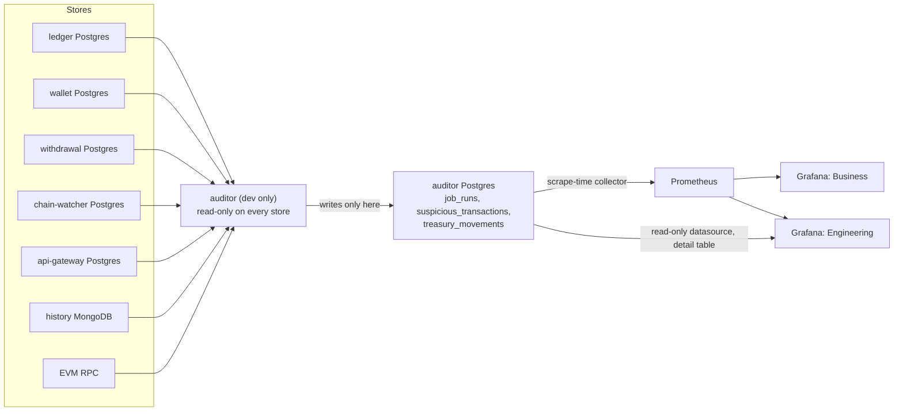
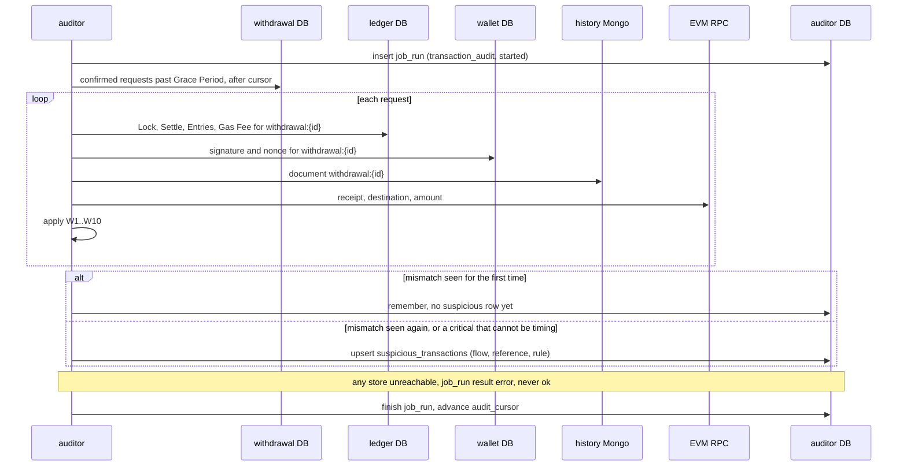

# Auditor, reconciliation and the two dashboards (dev environment)

Status: PROPOSED, revised after Tech Lead feedback (per-transaction auditor with direct read access, two
Grafana dashboards). Awaiting final review. Amends `monitoring-dashboard.md` (see "Amendments" below) and
delivers what `ledger.md` Open Questions #2 and #7 deferred.

## Problem

Money correctness rests on write-time invariants (double entry, append-only Entries, a Lock resolves once, one
nonce per signature). Nothing re-checks them afterwards and nothing follows one transaction across every store
that should know about it. A bug, a lost Gas Fee (`ledger.md` #6, accepted), a reorg, a manual edit, a lagging
read model or a key used outside `wallet-service` would stay invisible until a user complains.

Two audiences need to see the result:
- **Manager:** user actions (deposits, withdrawals), their results, wallet balances, all-time trends. Nothing
  about services.
- **Tech Lead:** both flows under normal and high traffic, Sweeper, Reaper, the Hot wallet, performance, and the
  auditor's findings.

## Scope: dev environment only

The auditor in this design is a **dev-environment tool** with full read access to every store (Tech Lead
decision). It is not the production design. A production auditor needs its own access model (least privilege,
no access to key material) and is out of scope. To keep it from leaking into production by accident:
- It refuses to start unless `AUDITOR_ENV=dev` and the chain id is on a configured dev allow-list (local Anvil
  or the test network).
- Its credentials exist only in the dev compose project.

## Bounded context(s)

New bounded context **Audit**, owned by a new service `auditor`. It owns no money and writes no business state.

| Reads (read-only, direct) | Writes |
|---|---|
| `ledger-service` Postgres, `wallet-service` Postgres, `withdrawal-service` Postgres, `chain-watcher` Postgres, `api-gateway` Postgres, `history-service` MongoDB, the EVM RPC | only its own Postgres `auditor`: `job_runs`, `suspicious_transactions`, `treasury_movements`, `audit_cursor` |

Why a separate service and direct reads:
- **Independence.** The auditor runs its own SQL against the raw tables. It calls no service API and imports no
  service code. A bug in a service's query or a compromised service cannot also hide inside the check (shared
  code is a shared bug).
- **Ground truth.** An API reports what the service believes. A table is what is stored.
- It audits `withdrawal-service`, so it must not live inside it.

This is a deliberate exception to "no service reads another service's database"
(`monitoring-dashboard.md` invariant 1): one read-only reader, dev only. The auditor's SQL is coupled to five
schemas, so each schema-changing PR must run the auditor's contract tests (task A2).

## Ubiquitous language

Reused: Chain Account, Hot/Warm/Cold Wallet, Hot Floor/Ceiling, Treasury Sweep, Sweep, Gas Top-Up, Lock, Settle,
Gas Fee, Fee Bump, Nonce Filler, Nonce Gap, Reaper, Withdrawal Key, Withdrawal Confirmation Depth, ALERT.

New:
- **Audit Run** — one execution of a job (`job_runs` row): job, start, end, Result, finding count.
- **Result** — `ok`, `warn` (only warn findings), `fail` (at least one critical), `error` (the job could not
  complete, for example RPC or a store down). `error` is never counted or shown as `ok`.
- **Suspicious Transaction** — one violated rule for one deposit, withdrawal or treasury movement, stored in
  `suspicious_transactions`.
- **Grace Period** — how long after a transaction became final the auditor tolerates a mismatch that is only
  lag (a read model behind, an event in flight) before it counts as suspicious.
- **Custody (on chain)** — per asset: Hot + Warm + Cold + every deposit address + native dust at deposit
  addresses (`ledger.md` #7).
- **Explained Delta / Residual** — the part of (on-chain custody − ledger custody) explained by value that has
  crossed the custody boundary but is not yet in the ledger, and what is left after removing it.
- **Treasury Movement** — a transfer in which at least one side is the Hot, Warm or Cold address, recorded in
  `treasury_movements` and classified.

## Aggregates & invariants

No new aggregate in a money context.

1. **The auditor never writes outside its own database.** No write to any service database, MongoDB or chain.
   It raises findings, never repairs. Enforced by: database roles without write grants, and a test that fails
   on any non-`SELECT` statement against a foreign store.
2. **A job that did not run must not look like it passed.** `error` is its own Result. The dashboard separates
   `last_run` from `last_success`, and a job that has not run for 3 intervals is stale on its own.
3. **Only final transactions are audited.** A deposit or withdrawal is audited once it is past its confirmation
   depth plus the Grace Period. A mismatch caused by in-flight state is not a finding.
4. **Two-pass.** Different stores cannot be read at one instant. A mismatch must be seen in two consecutive
   runs before it becomes a `suspicious_transactions` row. Checks that cannot be timing (the ledger checks and
   the signing audit) are recorded at once.
5. **`suspicious_transactions` is idempotent and permanent.** One row per `(flow, reference, rule)`. A row is
   never deleted. If the mismatch disappears the row moves to `resolved` with a time, if it is dismissed by a
   human it is `acknowledged` with a note.
6. **Metrics carry counts only.** Labels are limited to `flow`, `rule`, `severity`, `status`, `job`, `asset`,
   `wallet`, `kind` (`monitoring-dashboard.md` invariant 3). No user id, address, tx hash or id in a label.
   Detail is read from the table (Engineering dashboard, below).
7. **Run history survives restarts.** "Last run" and "Result" are read from `job_runs` by a scrape-time
   collector. A failed read omits the series.
8. **Dev-only guard** (see Scope).
9. **The auditor queries only the tables it needs.** It never reads `wallet_seeds` or `master_wallet`. Full
   access is a convenience for dev, not a reason to read key material. Enforced by a test that scans the
   auditor's SQL for those table names.

## Decision (a): per-transaction rules

### Withdrawal (`flow = withdrawal`), for each request that is final

Stores: `withdrawal-service` (request), `ledger-service` (Lock, Settle), `wallet-service` (signature),
`history-service` (document `_id = withdrawal:<withdrawal_id>`), chain (receipt).

| # | Rule | Severity |
|---|---|---|
| W1 | `confirmed` request has exactly one `withdrawal_settle` ledger transaction with key `withdrawal:{id}`, and `settle_ledger_tx_id` equals it | critical |
| W2 | A ledger `withdrawal_settle` exists only for a request that is `confirmed` (or `disputed` with a refund) | critical |
| W3 | Amount and asset agree across request, Lock, Settle debit Entry and history document | critical |
| W4 | `failed` / `rejected` request has no active Lock and no `withdrawal_settle` (Released, or refunded by exactly one correction) | critical |
| W5 | Status and `tx_hash` in the history document match the request after the Grace Period | warn, then critical |
| W6 | Signed request has exactly one `hot_wallet_signatures` row for `withdrawal:{id}`, `caller_cn = withdrawal-service`, nonce equal to the request's | critical |
| W7 | The mined tx for a `confirmed` request: receipt success, `to`/value (or ERC-20 recipient/amount) equal the request's destination and amount, block equals `confirmed_block` | critical |
| W8 | No two requests share a mined tx hash, no request has two mined versions (original and Fee Bumps) | critical |
| W9 | `confirmed` request has a Gas Fee transaction `gas:{chain_id}:{tx_hash}` after the Grace Period (`ledger.md` #12) | warn |
| W10 | `reverted` tx: Lock Released, `failed`/`tx_reverted`, Gas Fee posted as `withdrawal_reverted` | critical |

### Deposit (`flow = deposit`), for each observed transfer that is final

Stores: `chain-watcher` (`observed_transfers`), `wallet-service` (`wallet_addresses`), `ledger-service`
(deposit transaction by `(chain_id, tx_hash, log_index)`), `history-service`, chain (log or tx).

| # | Rule | Severity |
|---|---|---|
| D1 | A `confirmed` observed transfer has exactly one deposit ledger transaction (or a `flagged_deposits` row for a Screening List address, never both) | critical |
| D2 | A deposit ledger transaction has an observed transfer behind it | critical |
| D3 | Credited user = owner of `to_address` in `wallet_addresses` | critical |
| D4 | Amount and asset agree across observed transfer, ledger Entry and history document, and equal the on-chain value | critical |
| D5 | The on-chain log or tx exists in the canonical chain at the recorded block | critical |
| D6 | History document status matches after the Grace Period | warn, then critical |
| D7 | On-chain transfer to a deposit address (scan) with no observed transfer after the Grace Period (missed by the watcher) | critical |

### Treasury and Hot Wallet signing (`flow = treasury`)

| # | Rule | Severity |
|---|---|---|
| T1 | `eth_getTransactionCount(hot, B)` ≤ `hot_wallet_nonces.next_nonce` (higher means signed outside `wallet-service`) | critical |
| T2 | Every mined Hot Wallet tx is one of the stored versions for its nonce (original, Fee Bump, cancel) | critical |
| T3 | Every Hot signature belongs to a known purpose: a `withdrawal_requests` key, or a sweeper key (`gas-topup:`, `sweep:`, `treasury:`), with an allowed `caller_cn` | critical |
| T4 | Every Treasury Movement outbound from Hot has a matching signature | critical |
| T5 | A Treasury Movement from Warm or Cold with no operator-side record is reported as `info` (offline CLI, no record exists), any movement to an address outside our tiers from Warm or Cold is `warn` | warn |

### Ledger integrity (`flow = ledger`), each run

L1 each Ledger Transaction sums to 0 per asset. L2 `total_balance` = Σ Entries. L3 `locked_balance` = Σ active
Locks. L4 no user Available below 0. L5 per asset Σ all accounts = 0. L6 a correction exactly negates its target,
each target reversed at most once. L7 `settled` Lock ⇔ exactly one `withdrawal_settle`. L8 Gas Fee keys unique and
well formed. L9 the immutability triggers on `entries` exist and are enabled. All critical, run in one
`REPEATABLE READ, READ ONLY` transaction (full scan now, incremental plus nightly full when `entries` is large).

### Aggregate reconciliation (`flow = custody`), each run

```
on_chain_custody(B) = Σ balance at Hot, Warm, Cold, every deposit address, at finalized block B
ledger_custody      = −ChainAccount.total_balance                          (ledger.md #7)
explained_delta     = deposits mined ≤ B not yet credited
                    − withdrawals mined ≤ B not yet Settled
                    − Hot Wallet gas paid ≤ B not yet posted
residual            = on_chain_custody − ledger_custody − explained_delta
```

`warn` for a first non-zero residual, `critical` if it persists or exceeds `RECON_TOLERANCE` per asset. This
catches funds on chain that no per-transaction rule looks for. Also: Σ user balances ≤ custody (solvency), and
Hot balance ≥ Σ active Locks of that asset.

## Decision (b): data model

```sql
CREATE TABLE suspicious_transactions (
    id             BIGSERIAL PRIMARY KEY,
    flow           TEXT NOT NULL CHECK (flow IN ('withdrawal','deposit','treasury','ledger','custody')),
    reference      TEXT NOT NULL,        -- withdrawal_id, or chain_id:tx_hash:log_index, or check scope
    rule           TEXT NOT NULL,        -- W1..W10, D1..D7, T1..T5, L1..L9, C1
    severity       TEXT NOT NULL CHECK (severity IN ('info','warn','critical')),
    status         TEXT NOT NULL DEFAULT 'open' CHECK (status IN ('open','resolved','acknowledged')),
    detail         JSONB NOT NULL,       -- both sides of the mismatch, store by store
    first_run_id   BIGINT NOT NULL,
    last_run_id    BIGINT NOT NULL,
    detected_at    TIMESTAMPTZ NOT NULL DEFAULT now(),
    resolved_at    TIMESTAMPTZ,
    note           TEXT,
    UNIQUE (flow, reference, rule)       -- invariant 5
);

CREATE TABLE job_runs (
    id BIGSERIAL PRIMARY KEY, job TEXT NOT NULL, started_at TIMESTAMPTZ NOT NULL,
    finished_at TIMESTAMPTZ, result TEXT CHECK (result IN ('ok','warn','fail','error')),
    findings INT NOT NULL DEFAULT 0, error TEXT);

-- every transfer with Hot, Warm or Cold on one side, found by scanning the chain
CREATE TABLE treasury_movements (
    chain_id BIGINT NOT NULL, tx_hash TEXT NOT NULL, log_index INT NOT NULL,   -- -1 native
    asset TEXT NOT NULL, amount NUMERIC(78,0) NOT NULL,
    from_address TEXT NOT NULL, to_address TEXT NOT NULL,
    from_tier TEXT NOT NULL, to_tier TEXT NOT NULL,                             -- hot|warm|cold|deposit|user|external
    kind TEXT NOT NULL,   -- hot_to_warm, warm_to_hot, warm_to_cold, cold_to_warm, hot_to_cold, cold_to_hot,
                          -- sweep, gas_topup, withdrawal, deposit_into_tier, unexplained
    block_number BIGINT NOT NULL, block_time TIMESTAMPTZ NOT NULL,
    PRIMARY KEY (chain_id, tx_hash, log_index));

CREATE TABLE audit_cursor (job TEXT PRIMARY KEY, last_block BIGINT, last_id TEXT, updated_at TIMESTAMPTZ);
```

**Treasury scan.** ERC-20 via `eth_getLogs` (`Transfer`, topics filtered on the three tier addresses), native
ETH by scanning blocks for txs from or to them (plain transfers to and from EOAs, no trace API needed).
Warm→Hot and everything involving Cold is done by the offline CLI and recorded nowhere else, so the chain is
the only source. `kind` comes from the tiers of both sides, `unexplained` is an outbound from Hot with no
signature (rule T4).

## Decision (c): Dashboard 1, Business (manager)

Folder `Business`. Every timeline covers **all time** (time range defaults to "since first data") and each
metric also has a **current value** tile. Plain language, no service names.

| Row | Panels |
|---|---|
| **Activity** | Deposits per day (count and amount), withdrawals requested, completed, failed per day, new users and active users per day, each as all-time bars plus today's value |
| **Result** | Withdrawal success rate over time, time to complete a withdrawal split into **our processing time** and **waiting for the blockchain**, time for a deposit to be credited |
| **Money** | Hot, Warm and Cold wallet balance per asset (current and timeline), total user balances vs funds on chain, tile **"Funds verified"** (green when the latest `reconciliation` Result is `ok` and recent) |
| **Trouble** | Withdrawals needing attention (stuck, disputed), failed in the last 24h by plain reason, open suspicious transactions (a single number) |

Notifications by email are **out of scope for now** (no Alertmanager). Alerts show in Prometheus `/alerts` and a
Grafana alert-list panel.

**All-time means history must be kept.** Prometheus gets a persistent volume and a long retention
(`--storage.tsdb.retention.time`, proposed 2y, Open Question 3). Because a `day` label grows without bound, the
"gauge per day for the last 14 days" design in `monitoring-dashboard.md` is replaced for these panels by
**monotonic counters derived from the owning service's DB at scrape time**: `digiwal_deposits_credited_total`,
`digiwal_deposit_amount_total`, `digiwal_withdrawals_total{status}`, `digiwal_withdrawal_amount_total`,
`digiwal_users_total`, bucketed per day in Grafana with `increase()`. Data starts when Prometheus first scrapes.

**Cold wallet.** Add an optional `cold_address` (public address, per chain) to `infra/treasury.yaml`, served by
`wallet-service` `GET /v1/wallet/system-addresses` (still `withdrawal-service` only, plus `auditor`).

## Decision (d): Dashboard 2, Engineering (Tech Lead, operator)

Folder `Engineering`. One row per area.

| Row | Panels |
|---|---|
| **Auditor** | **Suspicious transactions**: open count by severity, by flow and rule, oldest open age, new per day (all time). Table "Periodic checks" (one line per job: last run, result, findings, duration, last success). Detail table of open `suspicious_transactions` (Grafana Postgres datasource on the `auditor` database only, read-only role, this dashboard only). Reconciliation residual timeline |
| **Deposit flow** | Rate, detected→credited latency, `chain-watcher` lag, consumer lag, flagged deposits |
| **Withdraw flow** | Throughput per stage, **duration per transition** (histograms), error rate by `reject_reason`, outbox backlog (oldest unpublished age) |
| **Sweeper** | In-flight Sweeps, Gas Top-Ups, Treasury Sweeps, completion time, Fee Bumps, ALERTs |
| **Reaper** | Minimum for now (last pass, actions per rule, stuck counts). To be extended after real experience (Tech Lead decision) |
| **Wallets** | Hot, Warm, Cold: current balance, Hot Floor and Ceiling lines, list of treasury movements (`treasury_movements`: hot→warm, warm→hot, warm→cold, cold→warm, other tier pairs, unexplained), Hot coverage (Hot balance ÷ active Locks), time since last rebalance, Nonce Gap and freeze state |
| **Gas and Fee Bumps** | Hot ETH balance timeline with a gas reserve line, gas spent by `purpose` (from ledger gas transactions), runway estimate. Fee Bump timeline and max fee against the fee ceiling |
| **Performance** | Request rate, error rate and latency p50/p95/p99 per service and route, DB pool, RPC latency and errors, Kafka lag, Go runtime. Targets: p50 50ms, p95 200ms, p99 2s on every synchronous endpoint, server-side, excluding on-chain waits, health and metrics |

**New metrics** (on top of `monitoring-dashboard.md`): HTTP request count and duration histogram per route
(shared middleware in `pkg/metrics`), pgx pool stats, withdrawal stage-duration histogram (observed at each
transition), outbox oldest-unpublished age, and the auditor's:

| Metric | Type | Labels |
|---|---|---|
| `digiwal_job_last_run_timestamp_seconds`, `..._last_success_timestamp_seconds`, `..._last_duration_seconds`, `digiwal_job_interval_seconds` | gauge | `job` |
| `digiwal_job_last_result` (1 for the current result) | gauge | `job`, `result` |
| `digiwal_suspicious_open` | gauge | `flow`, `rule`, `severity` |
| `digiwal_suspicious_oldest_open_age_seconds` | gauge | `severity` |
| `digiwal_suspicious_detected_total` | counter (from DB) | `flow`, `rule`, `severity` |
| `digiwal_recon_custody` (on_chain, ledger, explained, residual) | gauge | `asset`, `component` |
| `digiwal_hot_wallet_replacements_total` (`hot_wallet_replacements`, covers `withdrawal-service` and `sweeper`) | counter (from DB) | `kind`, `caller` |
| `digiwal_hot_wallet_last_max_fee_gwei`, `..._fee_ceiling_gwei`, `digiwal_hot_gas_reserve` | gauge | |
| `digiwal_gas_fee_wei_total` (ledger gas transactions) | counter (from DB) | `purpose` |

**Alerts** (Prometheus rules, visible only on `/alerts` and the dashboard): `SuspiciousOpen` (critical open > 0),
`JobFailed`, `JobError` (2 runs), `JobStale` (no run for 3 intervals), `HotGasLow`, `HotGasRunwayLow` (< 48h),
`FeeAtCeiling` (≥ 90% of ceiling), `FeeBumpStorm`, plus the existing set from `monitoring-dashboard.md`.

## Diagrams





## Objectives (every number the dashboards and alerts need)

Proposed values unless marked. These feed panel thresholds and alert rules, nothing hardcoded in JSON.

| Area | Point | Proposed |
|---|---|---|
| API latency | p50 / p95 / p99, synchronous endpoints, server-side | 50ms / 200ms / 2s (Tech Lead) |
| | Same targets at high load | yes |
| | 5xx rate, availability | < 0.1%, 99.9% |
| Load profile | Normal and peak deposits and withdrawals per minute, "high traffic" multiple | open |
| | Ramp steps and duration | 1x, 5x, 10x, 15 min each |
| Withdraw | Request → broadcast p95 (our own time) | 5s |
| | Success rate over 24h | 99% |
| | Stuck thresholds (existing) | request 5m, reservation 5m, broadcast 128 blocks |
| | Fee Bumps per tx before alert (max 5) | 3 |
| Deposit | `chain-watcher` lag | depth + 20 blocks |
| Messaging | Oldest unpublished outbox event | 30s |
| | Kafka consumer lag | 10s |
| | `history-service` freshness p95 | 5s |
| Sweeper | Sweep completion p95, max in-flight age | 10 min |
| | Treasury Sweep reaction after crossing Ceiling | 15 min |
| Wallets | Hot Floor and Ceiling per asset | existing, registry |
| | Warm and Cold limits | open |
| | Gas reserve (txs at fee ceiling), runway alert | 20, 48h |
| | Fee ceiling, "at ceiling" alert | 50 gwei, 90% |
| | Fee Bump storm per hour, rebalance overdue after | open |
| Auditor | Interval, max lag from final to audited | 5 min, 15 min |
| | Grace Period before lag counts as suspicious | 2 runs |
| | Reconciliation tolerance ERC-20, ETH | 0, 0.01 ETH |
| | Open critical suspicious allowed | 0 |
| | Time to acknowledge | open |
| Data | Prometheus retention | 2y |
| Resources | DB pool saturation, RPC p95 and error rate | 80%, 500ms and 1% |

## Amendments to `monitoring-dashboard.md` (that file is not edited here)

1. One dashboard `digiwal-overview` → two: `digiwal-business` and `digiwal-engineering`, in folders `Business`
   and `Engineering` (Decisions c, d above).
2. Invariant 1 ("no Postgres datasource") → one exception: a read-only datasource on the **`auditor`** database,
   Engineering dashboard only.
3. "Day-bucketed gauges for the last 14 days" → monotonic DB-derived counters bucketed by `increase()` in
   Grafana (all-time views), and a persistent Prometheus volume with long retention (its Open Question 11
   becomes required).
4. Open Question 1 (Cold address) is decided: add `cold_address` to `treasury.yaml`.
5. Open Question 3 (Alertmanager) is decided for now: none, no email.
6. Performance targets and the new request, pool and stage metrics are added (above).
7. Task 8 (`sweeper` Fee Bump counter) is dropped: `hot_wallet_replacements` already records every Fee Bump for
   both callers.

## Alternatives considered

- **Per-service audit endpoints.** My earlier design. Rejected by the Tech Lead for dev: the auditor wants the
  raw tables, and an API only reports what the service believes.
- **Auditor inside `withdrawal-service`.** Rejected: it is the audited party.
- **Everything as Grafana SQL panels.** Rejected for the aggregate checks (needs the chain and several
  databases at once) and for history (no all-time retention of results, no last-run record).
- **Hash-chained `operator_actions` and Anchors.** In the previous revision. Dropped here: with direct read
  access the auditor checks state directly, and the dev environment does not need tamper evidence. Revisit for
  production.

## Task breakdown (dev-sized, one PR each)

A1. **`auditor` skeleton.** Service, `auditor` Postgres, dev-only guard, read-only roles per store, compose
entry, `job_runs`, scheduler, `pkg/jobrun` and the `job_runs` collector (on `pkg/metrics`,
`monitoring-dashboard.md` task 1). Test: refuses to start with a non-dev chain id.
A2. **Read access and contract tests.** Read-only DB users (including Mongo), auditor SQL isolated in one
package, a test that every query is a `SELECT`, a test that scans for `wallet_seeds`/`master_wallet`, and a
schema contract test that runs in each service's CI so a migration cannot silently break the auditor.
A3. **Withdrawal rules W1–W10.** Fixture per rule, plus the Grace Period and two-pass behavior.
A4. **Deposit rules D1–D7.**
A5. **Ledger integrity L1–L9.**
A6. **Treasury scan, `treasury_movements`, rules T1–T5.** Includes ERC-20 log scan and native block scan.
A7. **Aggregate reconciliation** with Explained Delta.
A8. **`cold_address`** in `treasury.yaml` and `system-addresses`, Cold balance in `withdrawal-service`'s
balance collector.
A9. **Metrics for the manager dashboard** (counters in Decision c) and **Business dashboard JSON**.
A10. **Performance metrics** (`pkg/metrics` HTTP middleware, pgx pool, stage histogram, outbox age).
A11. **Engineering dashboard JSON**, auditor datasource, alert rules, Prometheus volume and retention.
A12. **Gas and Fee Bump metrics** (`wallet-service` replacements counter and fee gauges, ledger gas counter).
A13. **Load profile and e2e.** Scripted ramp with Grafana annotations. Cases: break a ledger Entry →
`ledger_integrity` fails, stop `history-service` → W5/D6 `warn` then critical, sign a tx with the Hot key
outside `wallet-service` (Anvil) → T1 critical, kill the RPC → `error` and `JobStale`.

A1 and A2 first. A3–A7 are independent of each other once A2 is done.

## Open questions (for the Tech Lead)

1. **Grace Period and two-pass** defaults (2 runs ≈ 10 min). Longer hides real problems, shorter produces noise
   from lag.
2. **ETH reconciliation tolerance** (proposed 0.01 ETH).
3. **Prometheus retention** (2y proposed). Longer, or "forever" with a larger disk?
4. **Treasury scan range.** From the first block of the dev chain, or from a configured start block?
5. **`unexplained` and T5 severity.** An outbound from Hot with no signature is critical (T4). Should a Warm or
   Cold movement with no record stay `info`, or `warn`?
6. **Load profile numbers** (normal and peak rate, multiple), the one set of values only you can provide.
7. **Suspicious workflow.** `acknowledged` needs a way to be set (SQL, or a small CLI). SQL is enough for dev?
8. **Production.** A production auditor needs its own design (least privilege, no seed access, no direct DB
   coupling). Do you want a placeholder task in the plan so this dev tool is not mistaken for it?

## Invariants checklist for the dev and tester

- No write to any foreign store, and the auditor refuses to start on a non-dev chain (invariants 1, 8).
- `error` is never `ok`, `JobStale` fires without a stored result (invariant 2).
- Only final transactions are audited, a mismatch is seen twice before it is recorded (invariants 3, 4).
- One row per `(flow, reference, rule)`, never deleted (invariant 5).
- No identifier in any metric label (invariant 6).
- "Last run" survives a restart (invariant 7).
- No query touches `wallet_seeds` or `master_wallet` (invariant 9).
- All-time panels use DB-derived counters, not day-labelled gauges.
