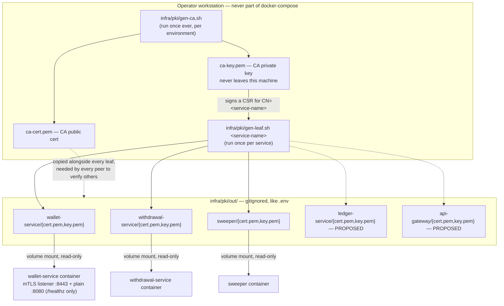
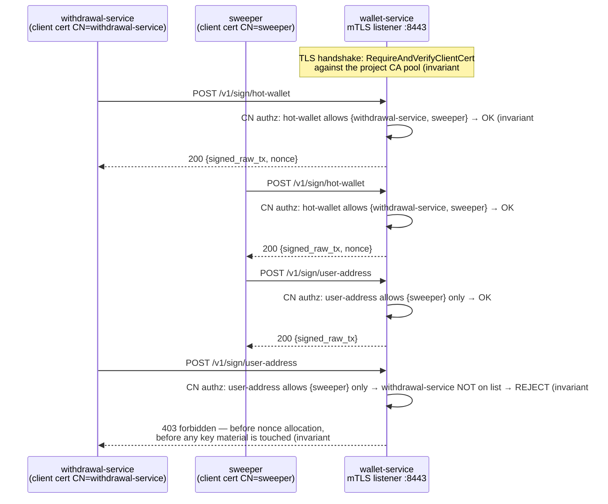

# Service-to-service auth: mTLS + CA + CN authorization

## Problem

`withdrawal-flow.md` and `deposit-flow.md` both decided (Open Questions,
resolved) that `wallet-service`'s two signing endpoints are protected by
mTLS. Both docs also each carry a load-bearing security argument that
quietly assumes more than "mTLS" actually delivers on its own:
`withdrawal-flow.md` invariant #5 says a fully compromised
`withdrawal-service` "can't turn the signing endpoint into a way to
drain an arbitrary user's address; the blast radius is capped at 'can
spend from the Hot Wallet'" — and `deposit-flow.md` invariant #7 makes
the mirror argument for a compromised `sweeper`. Neither argument is
actually true yet, because "mTLS" as currently specified only means
"presents *some* certificate the server trusts" — there is no CA to
issue certificates from, no story for how a certificate gets into a
container, and, critically, no code anywhere that checks *which*
service is calling before letting it hit `/v1/sign/hot-wallet` or
`/v1/sign/user-address`. A compromised `withdrawal-service` holding any
valid client certificate could call `/v1/sign/user-address` today and
pick any user's derivation key — exactly what invariant #5 says can't
happen. This doc designs the missing piece: a small, project-owned CA,
per-service leaf certificates with a Common Name (CN) identifying each
service, and a CN-based authorization check enforced inside
`wallet-service` itself before any signing logic runs.

## Bounded context(s)

No new bounded context or service. This is infrastructure plus a
code-level mechanism that plugs into the existing **Wallet & Signing**
context (`wallet-service`) — the primary, mandatory scope, since that's
where the two flow docs' security arguments actually live. By the same
mechanism and for the same reasons, this doc also recommends (marked
**PROPOSED** throughout) extending the identical treatment to the
**Ledger** context's state-mutating endpoints (`apply()`,
`lock`/`settle`/`release` — `ledger-service`, not yet built) and, once
their own endpoints are actually designed, to the
various `api-gateway → *` internal hops `integration-contracts.md` §3
lists as "not specified for this internal hop itself." Nothing here
changes any context's responsibilities — only how a caller proves, and
gets checked for, its identity when crossing into another service.

## Ubiquitous language

- **Certificate Authority (CA)** — the single, project-owned root of
  trust used to sign every internal service's certificate. Not a public
  or browser-trusted CA; exists solely so `wallet-service` (and, later,
  other internal services) can verify "this connection really comes
  from a service we issued a certificate to."
- **CA key** — the CA's private signing key. The single most sensitive
  artifact this doc introduces — generated once, held only by the
  operator, and, like the master mnemonic (`docs/ARCHITECTURE.md`
  Security notes), never checked into the repo or present in any
  running container's environment or filesystem.
- **CA certificate** — the CA's self-signed public certificate.
  Distributed (read-only) into every service that needs to verify a
  peer's leaf certificate — this one is not sensitive, only the key is.
- **Leaf certificate** — a certificate the CA issues to one specific
  internal service. Used both to authenticate that service as a client
  (when it calls another service) and, where the service also accepts
  incoming calls, to serve TLS as that service.
- **Common Name (CN)** — the X.509 Subject field this design uses as a
  service's authenticated identity on the wire. A leaf certificate with
  `CN=sweeper` is how `wallet-service` knows a request came from the
  `sweeper` service specifically — not just "some holder of a
  CA-signed certificate."
- **Service identity** — the fact, established once at cert-issuance
  time and unchanging afterward, that one particular CN corresponds to
  one particular service named in `docs/ARCHITECTURE.md`'s service
  table.
- **mTLS** (mutual TLS) — already decided, `withdrawal-flow.md` Open
  Questions #2: both sides of a connection present and verify a
  certificate signed by the shared CA, not just the server proving its
  identity to the client.
- **CN authorization policy** — the static, per-endpoint mapping of
  which CN(s) may call it. This doc's central new mechanism; everything
  else here (the CA, the certs, the docker-compose wiring) exists to
  make this check meaningful.
- **mTLS listener** — the specific TLS-terminating port/handler group
  in a service that requires and verifies a client certificate signed
  by the project CA, as distinct from a plain listener used only for
  health checks (see invariant #8).

## Aggregates & invariants

1. **Every mTLS-designated call in this system is backed by one
   project-wide CA.** A certificate not signed by that CA is rejected
   at the TLS handshake itself, before any HTTP-level processing —
   enforced via Go's standard `crypto/tls`:
   `tls.Config{ClientAuth: tls.RequireAndVerifyClientCert, ClientCAs:
   <CA cert pool>}` on each receiving service's mTLS listener. No new
   crypto library — this is the same "never roll your own crypto"
   principle `docs/ARCHITECTURE.md` already states, applied to
   transport auth instead of signing.
2. **A valid, CA-signed client certificate is necessary but never
   sufficient to call a given endpoint.** The CN it carries must also
   be on *that specific endpoint's* CN authorization policy allow-list.
   This check happens in middleware inside the receiving service,
   before the handler runs — before nonce allocation, before touching
   any key material, before any other request processing. An
   unauthorized CN gets `403`, immediately, not a partial response or a
   response that leaks whether the request would otherwise have
   succeeded. **This is the invariant that was previously missing and
   is the whole point of this doc.**
3. **The CN authorization check is never delegated to, or assumed to
   have already been performed by, anything upstream of the service
   itself.** No reverse proxy, load balancer, API gateway pass-through,
   or service mesh exists anywhere in this project's docs that could be
   trusted to have filtered the request first — each service checks its
   own policy, unconditionally, on every request.
4. **`withdrawal-service`'s certificate can never be used to call
   `POST /v1/sign/user-address`.** Concretely: the CN authorization
   policy for that endpoint contains only `sweeper`. This is the exact
   mechanism that makes `withdrawal-flow.md` invariant #5's and
   `deposit-flow.md` invariant #7's "blast radius capped" arguments
   actually hold, rather than being aspirational prose sitting on top
   of an unenforced "mTLS" label. **Cross-reference, both directions:**
   `withdrawal-flow.md` invariant #5 and `deposit-flow.md` invariant #7
   each now carry a one-line pointer back to this invariant.
5. **The CA key never exists inside any docker-compose service's
   container, environment variable, or volume — only leaf certificates
   and the CA's public certificate do.** Mirrors `wallet-tiering.md`
   invariant #2's treatment of Warm/Cold seeds: if the CA key were
   present in a running container, every certificate it could ever sign
   would effectively already be "hot," defeating the point of having a
   separate CA at all.
6. **A leaf certificate's CN is fixed at issuance and always equals the
   exact service name used in `docs/ARCHITECTURE.md`'s service table**
   (`wallet-service`, `withdrawal-service`, `sweeper`, `ledger-service`,
   `api-gateway`, …). No service is ever issued a certificate bearing
   another service's name, and no certificate/key pair is ever shared
   across two different services — one identity, one cert.
7. **PROPOSED — extend the identical mechanism to every `ledger-service`
   endpoint that mutates state** (`POST /v1/ledger/transactions`,
   `POST /v1/ledger/locks`, `.../settle`, `.../release` —
   `integration-contracts.md` §2), restricted to `CN=withdrawal-service`
   only, on every one of them. The blast-radius argument here is less
   dramatic than the signing endpoints' (a compromised
   `withdrawal-service` can already move ledger balances via its normal
   validated flow), but an unauthenticated or wrongly-authenticated
   caller of any of these four could post arbitrary debit/credit entries
   or resolve someone else's Lock directly, bypassing every validation
   step `withdrawal-flow.md` invariants #10–#14 place in front of them —
   that's a real integrity gap, not a cosmetic one, so the same
   treatment is worth applying for consistency, and applying to all four
   uniformly rather than just the one that existed when this invariant
   was first written: `lock`/`settle`/`release` are exactly as
   security-sensitive as `apply()` was, just split across three
   endpoints instead of one (`ledger.md`'s Lock/Settle/Release rework).
   Since `ledger-service` doesn't exist yet, this should be built in
   from the start (Milestone 1) rather than retrofitted later — see
   Open Questions #2.
8. **A service's health-check endpoint is exempt from the client-
   certificate requirement, served on a separate plain (non-mTLS)
   listener**, so it stays reachable by docker-compose healthchecks and
   (later) Prometheus scraping without either of those needing a
   project CA certificate of their own. This exemption applies only to
   `/healthz` (and a future `/metrics`) — never to any endpoint that
   touches business logic, ledger state, or key material.

## Diagram

Certificate issuance and distribution (one-time setup, plus a
per-service step for each new internal service):

Enforcement at request time — the invariant this doc exists to add
(shows both an allowed and a rejected call):

## Authorization matrix (v1)

Pulled from `integration-contracts.md` §3's caller list — no new
callers invented here.

| Service (server) | Endpoint | Allowed caller CN(s) | Status |
|---|---|---|---|
| `wallet-service` | `POST /v1/sign/hot-wallet` | `withdrawal-service`, `sweeper` | **Decided here** — required, blocks nothing else, closes the gap the Tech Lead flagged |
| `wallet-service` | `POST /v1/sign/user-address` | `sweeper` only | **Decided here** — same |
| `wallet-service` | `GET`/`POST /v1/users/{userID}/deposit-address` | `api-gateway` | **PROPOSED** — see Open Questions #4 |
| `wallet-service` | `GET /healthz` | (no client cert required — plain listener, invariant #8) | Decided here |
| `ledger-service` | `POST /v1/ledger/transactions` (`apply`), `POST /v1/ledger/locks`, `.../{key}/settle`, `.../{key}/release` | `withdrawal-service` only, on all four | **PROPOSED**, invariant #7 — build in at Milestone 1 |
| `ledger-service` | any future `api-gateway`-facing read endpoint (balances, etc.) | `api-gateway` | **PROPOSED, not yet applicable** — no such endpoint is designed yet (`integration-contracts.md` §2 marks it **PROPOSED HERE, low confidence**); apply this row once it exists, don't invent its path now |
| `withdrawal-service` | `POST /withdrawals`, `GET /withdrawals/{idempotency_key}`, `POST /whitelist`, `DELETE /whitelist/{id}` | `api-gateway` | **PROPOSED, deferred** — see Open Questions #4 |
| `history-service` | (its API is a GAP per `integration-contracts.md` §2) | `api-gateway`, once designed | **PROPOSED, not yet applicable** |

Explicitly **not** in this matrix because no design doc names them as a
synchronous caller: `chain-watcher` never calls `wallet-service` (it
only reads Redis/Postgres/RPC and produces to Kafka — `deposit-flow.md`
Bounded context(s)), so it needs no leaf certificate for this purpose.

## CA and certificate design

**Scope check, up front:** this is a testnet-only, single-operator,
docker-compose project (`docs/ARCHITECTURE.md` roadmap step 4 is the
first mention of anything beyond one machine). Everything below is
sized for that, not for a production PKI.

### The CA itself

A one-time shell script, `infra/pki/gen-ca.sh`, wrapping plain
`openssl` (already assumed available — not a new project dependency).
It generates:

- `ca-key.pem` — the CA's private key. **Generated once per
  environment, shown/handled exactly the way `wallet-service`'s master
  mnemonic is** (`docs/ARCHITECTURE.md` Security notes, `make
  init-master-wallet`): created by the operator, kept off the repo and
  off every running container, backed up outside of git if the operator
  wants durability. If it's lost, the fix is "regenerate the CA and
  every leaf cert," not a crisis — there's no production value behind
  it.
- `ca-cert.pem` — the CA's self-signed public certificate. Not
  sensitive; every service that needs to verify a peer's leaf
  certificate gets a read-only copy of this file.

Run exactly once per environment (mirrors `make gen-key`'s "run once,
per environment" framing in `services/wallet-service/README.md`).

### Per-service leaf certificates

A second script, `infra/pki/gen-leaf.sh <service-name>`, run once per
service that needs one:

- Generates a fresh keypair, a CSR with `CN=<service-name>` and a SAN
  entry matching that service's docker-compose network alias (e.g.
  `DNS:wallet-service`), and signs it with the CA key, producing
  `infra/pki/out/<service-name>/{cert.pem,key.pem}`.
- One cert/key pair per service identity, used both as that service's
  client credential (when it calls someone else) and, where the
  service also accepts incoming mTLS connections (`wallet-service`,
  later `ledger-service`), as its TLS server credential too — no
  separate "server cert" vs. "client cert" ceremony; at this scale
  that distinction adds a second cert-per-service for no real benefit.
- `withdrawal-service`, `sweeper`, and `wallet-service` get one now
  (mandatory scope). `ledger-service` and `api-gateway` get one
  whenever their own PROPOSED rows above are actually built — the
  script and CA are already reusable, so this is a five-minute step
  each time, not new design work.

Everything under `infra/pki/out/` is gitignored, the same way `.env`
already is (`services/wallet-service`'s existing pattern) — this needs
a `.gitignore` entry added as part of implementing task 0.6 below.

### Getting certs into containers

Plain docker-compose bind mounts — this project's existing style
(`services/wallet-service/docker-compose.yml` already mounts nothing
fancier than env vars and named volumes; no init-container pattern,
no secrets manager, no Vault agent sidecar exists anywhere in this
repo, so introducing one here would be new infra this project doesn't
otherwise use). Concretely, each service's own `docker-compose.yml`
gets a read-only volume mount of its own `infra/pki/out/<service-name>/`
directory to e.g. `/certs`, plus environment variables pointing at the
mounted files (`TLS_CERT_FILE=/certs/cert.pem`,
`TLS_KEY_FILE=/certs/key.pem`, `TLS_CA_FILE=/certs/ca-cert.pem`) —
same shape as the existing `MASTER_KEY_HEX` env-var pattern.

`wallet-service` additionally needs a second, plain HTTP listener for
`/healthz` only (invariant #8), so `make up`'s existing
`curl -sf http://localhost:8080/healthz` healthcheck (in
`services/wallet-service/Makefile`) keeps working unmodified; the
actual `/v1/*` API moves to a new mTLS listener (e.g. `:8443`).

### Rotation

**PROPOSED: manual "regenerate and redeploy," no automated pipeline,
for v1.** This project has no incident-response or rotation story
anywhere else (the master mnemonic itself is a generate-once artifact
with no rotation plan) — building automated short-lived-cert rotation
(a cron job, a sidecar, a cert-manager-style controller) here would be
solving an operational problem this project doesn't actually have at
this trust level: one operator, one docker-compose stack, testnet
funds only. If a cert needs to change (compromise suspected,
service renamed), the operator re-runs `gen-leaf.sh` for that service
and restarts its container — the same "regenerate, redeploy" motion
this project already uses for the master key. Flagging explicitly, as
asked: I think manual is the right call here, not a default I'm
sneaking past review — see Open Questions #3 if you disagree.

### Certificate lifetime

**PROPOSED:** CA certificate valid 10 years (3650 days); leaf
certificates valid 2 years (730 days). Rationale: this isn't protecting
production value, so there's no security reason to force frequent
rotation, and a short lifetime here would only generate operational
friction (a testnet stack that mysteriously stops working because a
30-day cert silently expired) with no compensating benefit. Two years
for leaves rather than matching the CA's ten is a small, cheap nod
toward "rotation is still a normal event that happens sometime," not
"never" — but this is a proportionality judgment call, not a hard
technical requirement; see Open Questions #3.

## Alternatives considered

- **No CN-based authorization — rely on "any CA-signed cert is
  enough," i.e. today's implicit state.** This is literally the gap
  the Tech Lead flagged. Rejected: it doesn't cap blast radius by
  identity at all — `withdrawal-flow.md` invariant #5's and
  `deposit-flow.md` invariant #7's whole point is that a *specific*
  compromised service can't reach a *specific* endpoint, which an
  "any valid cert" policy can't express.
- **Network segmentation instead of mTLS + CN checks** (e.g. separate
  docker networks per trust tier, with `sweeper` unable to reach
  `wallet-service`'s user-address route at the network layer).
  Rejected: docker-compose's networking primitives can express "which
  services share a network," not "which service may call which
  specific HTTP route on a service they otherwise share a network
  with" — `withdrawal-service` and `sweeper` both legitimately need to
  reach `wallet-service` at all, just not the same two endpoints on
  it. Getting finer-grained than that with network policy alone would
  mean iptables rules or a CNI/service-mesh layer this project doesn't
  use anywhere else — more infra, not less, for a weaker guarantee.
- **A shared bearer token per caller instead of client certificates.**
  Rejected — mTLS is already decided (`withdrawal-flow.md` Open
  Questions #2), not something this doc reopens. mTLS is also strictly
  harder to leak by accident than a bearer token (which can end up in
  a log line or a stray `curl -v`), and ties identity to the TLS layer
  itself rather than an application-layer header a future change could
  forget to check.
- **A real external PKI tool** (`step-ca`, `cfssl`, HashiCorp Vault's
  PKI secrets engine) instead of plain `openssl` scripts. Considered
  and rejected as disproportionate for a single-operator local testnet
  project — flagging explicitly per `CLAUDE.md`'s "don't pick new
  tech without flagging it" rule: `openssl` is not a new dependency
  (already assumed present), while any of these three would be a new
  service/tool this repo doesn't otherwise run. Worth revisiting only
  if this project ever reaches the multi-VM phase (roadmap step 4) and
  cert issuance needs to happen across machines the operator doesn't
  have shell access to simultaneously.
- **A YAML-driven CN authorization policy, loaded at startup (and
  possibly hot-reloadable).** Considered, recommending against for v1:
  there are exactly two rules for `wallet-service` today and one
  proposed for `ledger-service` — not enough to justify a config
  format, a loader, and (if hot-reloadable) a way to audit when it
  last changed. A security-critical "who can call what" policy sitting
  in application code means changing it goes through the same code
  review as every other invariant in this project; a YAML file could
  be edited without that scrutiny. Recommending a small, explicit,
  hardcoded map in `wallet-service` instead (e.g.
  `var endpointCNPolicy = map[string][]string{...}`), revisited if the
  rule count grows past a handful. See Open Questions #1.
- **Automated short-lived-cert rotation from day one.** Rejected for
  v1 for the reasons under "Rotation" above — this project has no
  rotation story anywhere else yet, and building one here first, for
  the lowest-stakes credential in the system, would be solving a
  problem out of order.

## Open questions

1. ~~Hardcoded CN-policy map vs. a config file.~~ **Decided: hardcoded
   Go map** inside `wallet-service`, as recommended (Alternatives
   above) — proportionality and code-review-scrutiny grounds. Revisit
   if the rule count grows past a handful once `ledger-service`/
   `api-gateway` join in.
2. ~~Sequencing of the PROPOSED extensions.~~ **Decided, as
   recommended:** `wallet-service`'s two `/v1/sign/*` rules ship now,
   as their own task (0.6 below). `ledger-service`'s rule (invariant
   #7) ships as part of Milestone 1, built in from the start on every
   state-mutating endpoint (`apply()`, task 1.3; `lock`/`settle`/
   `release`, task 1.7) since `ledger-service` doesn't exist yet, not
   retrofitted later. `api-gateway`'s various proxied-endpoint rules
   wait until each specific downstream endpoint is actually designed —
   no CN rule invented ahead of the endpoint it would attach to.
3. ~~Cert lifetimes and manual-only rotation.~~ **Decided, as proposed:**
   10y CA / 2y leaf certs, manual regenerate-and-redeploy, no automated
   pipeline — proportionate to a testnet project with no other
   rotation story anywhere else.
4. **Should `wallet-service`'s already-shipped, currently-open
   `/v1/users/{userID}/deposit-address` endpoints move behind the new
   mTLS listener with `CN=api-gateway`, in the same task 0.6, or stay
   as they are for now?** `identity-auth.md`'s existing argument
   ("`wallet-service` isn't reachable from outside the deployment")
   already covers their trust story at the network-boundary level, just
   not at the peer-identity level this doc adds everywhere else. Moving
   them now is consistent and cheap once the CA exists, but touches
   already-shipped code outside this task's original ask (mTLS for the
   signing endpoints specifically). Recommending yes, for consistency,
   but flagging rather than assuming — this is also where
   `api-gateway`'s own leaf certificate (matrix row above) actually
   gets used for the first time, so the two decisions are linked.
   **Still open — Tech Lead deferring explicitly (not overlooked):**
   endpoint stays as-is for now, precisely because it touches
   already-shipped code; the matrix row above stays **PROPOSED**. Come
   back to this once there's a concrete reason to touch that endpoint
   anyway, rather than as a standalone migration.
5. ~~ECDSA P-256 vs. RSA-4096 for the CA and leaf keys.~~ **Decided:
   ECDSA P-256**, as recommended — faster generation, smaller
   certificates, no strong reason to prefer RSA at this trust level.
