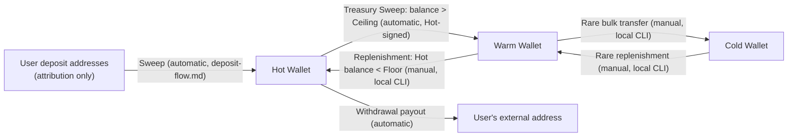
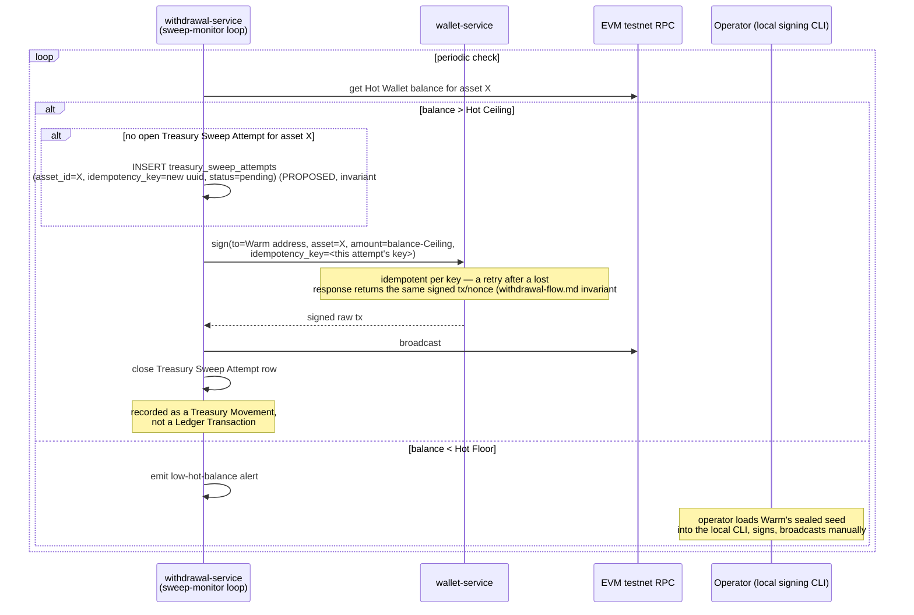

# Wallet tiering (hot / warm / cold)

## Problem

As drafted so far (`withdrawal-flow.md`), there's exactly one tier of
key material: everything — user address derivation *and* the payout
wallet — lives behind one seed, continuously decrypted in
`wallet-service`'s memory. That means compromising the one always-on
service holding decrypted keys exposes the entire custody balance, not
just what's needed for near-term automated withdrawals. Tiering caps
that blast radius: an attacker who fully compromises the automated
signing path can only ever reach what's in Hot, because Warm's and
Cold's key material is never loaded by anything that's always-on.

## Bounded context(s)

Extends **Wallet & Signing**, but doesn't add new always-on services for
Warm/Cold. The shape:

- **Hot** lives inside `wallet-service` as designed in
  `withdrawal-flow.md` — a seed held continuously decrypted, signs
  automatically via the existing signing endpoint.
- **Warm and Cold are not services.** Their sealed seeds are never
  present in the config/env of anything running in docker-compose. They
  exist only as sealed blobs, decrypted solely inside a small standalone
  local CLI tool the operator runs by hand when moving funds. This is
  operator tooling, not system architecture — deliberately outside the
  automated surface.

## Ubiquitous language

- **Wallet Tier** — `hot | warm | cold`. Classifies which key material
  an address's private key belongs to, and therefore how reachable that
  key is to an automated process.
- **Hot Wallet** — the address `wallet-service` holds a continuously
  decrypted key for; the only tier capable of fully automatic signing.
  Used exclusively for `withdrawal-service`'s automatic payouts and for
  Treasury Sweeps out of itself. **Decided: derived at `m/44'/60'/0'/0/0`
  — index 0 of Hot's own dedicated seed** (invariant #1), reusing the
  same BIP44 convention `wallet-service` already uses for user addresses
  (`m/44'/60'/0'/0/{index}`, `internal/hdwallet/hdwallet.go`). Index 0
  collides with nothing: it's a different seed entirely, so the
  identical path derives a completely different key from any user's
  address. Unlike user-address derivation, which allocates a fresh
  index per user, Hot's seed only ever derives this one address — no
  index-allocation scheme needed for it. Warm and Cold Wallets use the
  same convention (index 0 of their own respective sealed seeds) for
  consistency, so the operator's local signing CLI can reuse
  `wallet-service`'s existing `hdwallet` package rather than a second
  key-generation mechanism — lower-stakes to get right than Hot's path
  since it's operator-driven, not automated, but stated here so it's a
  deliberate choice, not whatever the CLI happens to hardcode.
- **Warm Wallet** — an address whose key is sealed and never loaded by
  any always-on service. Replenishes Hot, operator-triggered, when
  Hot's balance drops below its Floor.
- **Cold Wallet** — an address whose key is sealed under a key that
  never appears in any running service's configuration; decrypted only
  inside the local signing CLI, by the operator, rarely. Holds the bulk
  reserve.
- **Hot Ceiling** — balance above which Hot's excess is swept up to
  Warm. **Decided: Ceiling = Hot Floor × 4.**
- **Hot Floor** — balance below which Hot needs replenishment from
  Warm. **Decided: Floor = 6 hours × this asset's expected peak hourly
  withdrawal volume** — 6h chosen as a reasonable window for an operator
  to notice a low-balance alert and manually replenish (per invariant
  #4's decision to keep replenishment manual, not automatic). Both
  values are set per-asset on the Asset Registry's `hot_floor` /
  `hot_ceiling` fields (`ledger.md`), starting from this formula and
  refined once real k6 load-test throughput exists (roadmap step 5) —
  the ratio and mechanism are the architecture; the exact numbers are a
  risk-tolerance call, yours to tune.
- **Treasury Sweep** — automatic, threshold-triggered movement of funds
  *out* of Hot, up to Warm. Hot-signed — same trust boundary as an
  automatic withdrawal, just a different destination. Signed via `POST
  /v1/sign/hot-wallet` (`integration-contracts.md` §2), same endpoint and
  same idempotency-per-key requirement (`withdrawal-flow.md` invariant
  #16) as every other caller of it — see the **Treasury Sweep Attempt**
  term and invariant #6 below for how its idempotency key is minted.
- **Replenishment** — manual, operator-triggered movement of funds
  *down* into Hot (from Warm) or into Warm (from Cold), via the local
  signing CLI.
- **Treasury Movement** — the record of a Sweep or Replenishment.
  Explicitly **not** a Ledger Transaction (`ledger.md`) — moving funds
  between the system's own wallets doesn't change any user's balance,
  so it never touches the Account/Entry model. Tracked separately, for
  ops/audit purposes.
- **Treasury Sweep Attempt** — **PROPOSED**, new term. A small
  `withdrawal-service`-owned record `(asset_id, idempotency_key, status,
  detected_at)` created the first time the sweep-monitor loop observes
  Hot's balance crossing above Hot Ceiling for a given asset, and closed
  once that Treasury Sweep is broadcast (or the balance drops back under
  Ceiling on its own, e.g. a concurrent withdrawal draining it before the
  sweep fires). Exists solely to give the Treasury Sweep's
  `POST /v1/sign/hot-wallet` call a stable idempotency key across
  retries — see invariant #6.

## Aggregates & invariants

1. **Hot's signing key is a separate seed from the one deriving user
   deposit addresses.** Even though user addresses only transiently
   hold funds before being swept (per `deposit-flow.md`'s sweep
   addition), one compromised seed must never expose both "every user's
   transient private key" and "the automated payout key." This revises
   `docs/ARCHITECTURE.md`'s current "one master mnemonic for the entire
   system" line — flagged explicitly in Open Questions #1, your call.
2. **Warm's and Cold's sealed seeds never appear in any always-on
   service's environment or config.** They're decrypted only inside the
   local signing CLI, run manually by the operator. If a seed for a tier
   is present in `docker-compose.yml`/`.env`/a running container, that
   tier isn't actually Warm or Cold — it's Hot with a different label.
3. **An automated process can only ever move funds it's authorized to
   sign for.** Hot's key authorizes payouts and upward sweeps out of
   Hot; it grants no access to Warm's or Cold's balances. This is what
   makes "Hot compromised" bounded to "Hot's balance lost," not
   "everything lost."
4. **Hot's balance is bounded on both sides.** Crossing the Ceiling
   triggers an automatic Treasury Sweep (Hot → Warm). Crossing the Floor
   triggers an alert, not an automatic action — replenishment needs the
   operator, by design (per your decision).
5. **A Treasury Movement never posts a Ledger Transaction.** It's
   recorded in its own, much simpler table (which wallet address, which
   asset, how much, which direction, when) — it must stay clearly
   separate from anything that touches a user's Account.
6. **A Treasury Sweep's `POST /v1/sign/hot-wallet` call is idempotent per
   idempotency key, same as every other caller of that endpoint**
   (`withdrawal-flow.md` invariant #16). **PROPOSED**, not previously
   decided anywhere: unlike a Withdrawal Request or a Gas Top-Up, a
   Treasury Sweep has no pre-existing client request or deterministic
   triggering event to derive a key from — the sweep-monitor loop just
   polls Hot's balance periodically. A time-bucketed key (e.g.
   `treasury-sweep:{asset_id}:{hour}`) was considered and rejected (see
   Alternatives) because it can silently dedupe two *real*, back-to-back
   sweeps that happen to land in the same bucket. Instead: the
   sweep-monitor loop persists a **Treasury Sweep Attempt** row the first
   time it observes the balance crossing above Ceiling for that asset
   (analogous to how a Withdrawal Request row is created once, before
   any signing happens — `withdrawal-flow.md` invariant #11), minting a
   fresh UUID as that row's `idempotency_key` at creation. Every retry of
   the sign call for this same crossing reuses that same row's key until
   the sweep is broadcast, at which point the row closes. A later,
   separate crossing of Ceiling (after the row closes) mints a new row
   and a new key — so two genuinely distinct sweeps are never conflated,
   unlike the time-bucket alternative.
7. **Each tier's address is always index 0 of its own dedicated seed,
   never incremented.** `m/44'/60'/0'/0/0` for Hot, Warm, and Cold
   alike, each under a seed unique to that tier. There is no
   multi-account or multi-address scheme within a tier — one seed, one
   address, for the lifetime of that tier's key material. If a tier
   ever needs a second address (not designed for here), that's a new
   seed and a new tier label, not a second index under an existing one.

## Diagram

Fund-flow shape across tiers:

The automatic half (Treasury Sweep) vs. the manual half (Replenishment):

## Alternatives considered

- **Keep the single shared seed (today's model).** Rejected — defeats
  the purpose; one memory dump of `wallet-service` would expose every
  tier.
- **Automatic Warm → Hot replenishment** (the option you didn't pick).
  Rejected per your decision — automating it would require Warm's key
  to be loaded by an always-on process too, which collapses the actual
  security difference between Hot and Warm down to a policy label
  rather than a real property.
- **Real air-gapped hardware / HSM for Cold.** Out of scope — no such
  hardware exists in this project. Simulated cold (separate sealed
  seed, decrypted only in a local one-off CLI) gets the real operational
  discipline and most of the security property, and can be swapped for
  genuine hardware later without touching this design.
- **A dedicated `treasury-service`** instead of a sweep-monitor loop
  inside `withdrawal-service`. Considered, recommending against it for
  v1 — checking Hot's balance and signing a sweep when over Ceiling is
  small enough not to justify its own service/container/deploy story
  yet. Worth splitting out if it grows (e.g. once multiple chains each
  need independent monitoring).
- **Time-bucketed Treasury Sweep idempotency key** (e.g.
  `treasury-sweep:{asset_id}:{hour}`), considered for invariant #6.
  Rejected: it's simpler (no new table) but it dedupes on wall-clock
  time rather than on "is this actually a retry of the same sweep,"
  which can silently swallow a second, legitimate sweep if Hot's balance
  crosses Ceiling twice within the same bucket (e.g. a large deposit
  swept in right after the first sweep already fired). A per-crossing
  attempt row, minted once and reused only until that specific sweep
  closes, doesn't have that failure mode.

## Open questions

1. **Biggest one.** Hot's signing key needs to be a separate seed from
   the one deriving user deposit addresses (invariant #1) — this
   revises `docs/ARCHITECTURE.md`'s stated security model ("one master
   mnemonic for the entire system") to "wallet-service holds at least
   two sealed seeds." That's exactly the kind of repo-level,
   expensive-to-reverse call `docs/TEAM_OPERATING_MODEL.md` says is
   yours, not mine to default on.
   **Decided (PR #1): approved.** `wallet-service` will hold ≥2 sealed
   seeds. `ARCHITECTURE.md`'s "one master mnemonic" line still needs
   updating to match — tracked as a follow-up, not done in this doc.
2. ~~Hot Ceiling / Hot Floor values~~ **Decided:** Floor = 6h × expected
   peak hourly withdrawal volume (per asset); Ceiling = Floor × 4.
   Worked example at a plausible demo/load-test scale (100
   withdrawals/hour, avg 0.05 ETH each → 5 ETH/hour): Floor = 30 ETH,
   Ceiling = 120 ETH. The absolute numbers don't matter on testnet —
   what's decided is the formula and that it's per-asset, config-driven
   (`ledger.md`'s `hot_floor`/`hot_ceiling` fields), and revisited once
   real k6 throughput data exists (roadmap step 5).
3. **What happens to a withdrawal when Hot's real on-chain balance can't
   cover it** even though the ledger already reserved/debited the user
   (Hot underfunded relative to what's been promised)? My inclination:
   that's a `failed` withdrawal with a compensating entry, per
   `withdrawal-flow.md`'s existing invariants #3/#4, with the low-Hot-
   balance alert as the operator's cue to replenish so the user can
   retry. Flagging as the connection point between the two docs rather
   than redesigning `withdrawal-flow.md` here.
4. **This resolves `withdrawal-flow.md`'s Open Question #1** (sweep vs.
   direct payout model) — tiering only makes sense on top of a sweep
   model, so I'm treating "sweep" as decided now unless you want to
   revisit it. I haven't edited `withdrawal-flow.md` or `deposit-flow.md`
   to reflect this yet — holding off until you confirm, since you asked
   me not to rush ahead of your agreement.
   **Decided (PR #1): approved.** `deposit-flow.md` now has the Sweep
   section (address → Hot Wallet, including gas top-up); this doc's own
   diagram already assumed it.
5. Sweep-monitor loop living inside `withdrawal-service` (recommended)
   vs. its own service — your call if you disagree with the
   recommendation in Alternatives.
6. **PROPOSED, not decided: Treasury Sweep Attempt row + minted-UUID
   idempotency key (invariant #6), instead of some other scheme.** This
   is a new piece of state (a small `treasury_sweep_attempts` table) not
   previously part of this doc's design — flagging per the "never
   silently decide a new key-minting scheme" instruction. Confirm this
   is acceptable, or propose a simpler alternative if one exists that
   doesn't reintroduce the time-bucket dedupe risk.
