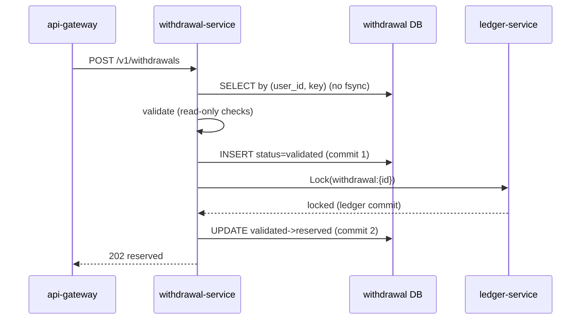

# Withdrawal commit reduction (write path)

## Problem

`POST /v1/withdrawals` saturates at ~250-380 req/s on the 3-node dev
environment. CPU is idle; the limit is WAL fsync on the Postgres holding
the `withdrawal` DB (vm3): 1.6 ms avg at 200 rps, 2.3-2.9 ms at 700 rps,
~60% of wall time in fsync, commits queueing on `WALWrite`. `commit_delay`
gave ~10%. Decision (Tech Lead): cut the number of WAL-flushing commits per
withdrawal; no faster disks, no `synchronous_commit=off`.

Today an accepted request costs, on the request path: (1) `Create` INSERT
`requested` = commit 1; (2) `requested -> validated` UPDATE = commit 2;
(3) ledger `Lock`, one transaction (insert `locks` + update `accounts`) =
1 commit on the ledger DB; (4) `validated -> reserved` UPDATE = commit 3.
So 3 commits on the withdrawal DB, 1 on the ledger DB. A rejected request
costs 3 (insert, validated or not, then `rejected`) or 2. Signing,
broadcast, confirm and outbox run in the background pipeline, but they
write to the same withdrawal DB and share its fsync budget; they are out
of scope here except that any saved request-path commit also frees budget
for them.

## Bounded context(s)

Withdrawal (`withdrawal-service`: `internal/api`, `internal/store`,
Reaper), and its one call into Ledger (`Lock`, unchanged contract). No new
service, store or event.

## Ubiquitous language

Existing terms only (Withdrawal Request, Withdrawal Key, Reservation,
Reaper, Stuck Request / Stuck Reservation Timeout, guarded transition,
`requested`/`validated`/`reserved`). No new terms.

## Invariants that constrain the options (withdrawal-flow.md)

- #11: row is created idempotently first; duplicates never re-validate,
  re-reserve or re-sign; every transition is a guarded `UPDATE ... WHERE
  status = <expected>`.
- "No external side effect before durable state": the ledger Lock must not
  be sent before a durable row carrying the Withdrawal Key exists.
- #17: Reaper fails `requested` after 5 min; Releases `validated` after 5
  min (safe because a `validated` key was never sent to `wallet-service`);
  `reserved` needs the `void` proof.
- #10/#18: validation is read-only and precedes any Lock.

## Options

### A. Validate in memory first, INSERT directly as `validated` (or `rejected`)

Run `validator.Check` before touching the DB, then one INSERT with the
final status (`ON CONFLICT (user_id, idempotency_key) DO NOTHING`, same
read-back on conflict). **Saves 1 commit** (accepted: 3 -> 2 on the
withdrawal DB; rejected: 2 -> 1).

- Invariant touched: #11 ("row first"). Validation has no side effect (it
  only reads the whitelist, screening list, wallet-service), so running it
  before the insert is safe; the invariant that matters, one winning insert
  per key and no re-lock/re-sign of a duplicate, is still enforced by the
  UNIQUE index. To avoid validating duplicates, do a plain `Get` first
  (a read, no fsync); concurrent racers may both validate, only one inserts.
- Reaper: `requested` becomes unreachable for new rows (no row exists
  before a verdict). Keep the `requested` rule for rows from before the
  deploy; it is then dead code and can go later. `validated` rule (5 min
  Release) is unchanged and now also covers "accepted, crashed before Lock".
- Behaviour change (flag to Tech Lead): "no verdict" (dependency down) now
  leaves **no row**, so the key is not spent. The 503 body can say "retry
  with the same key"; this reverses the Decided "key is spent" rule of
  #11 option B / #18 in the client's favour. Optional: keep the old text
  to avoid a contract change.
- Crash/retry: crash before INSERT: nothing exists, retry is a fresh
  request. Crash after INSERT, before Lock: `validated`, no Lock; a retry
  reads back `validated`; Reaper Releases (404 "never locked" is fine) and
  fails it. Crash between Lock and the final UPDATE: `validated` + active
  Lock; retry reads back `validated` (never re-locks, #11); Reaper
  Releases after 5 min, `failed/stale_reservation`, funds back. Same as
  today.
- Tests: store tests for `Create` get a status argument (or a
  `CreateValidated`/`CreateRejected`); api unit tests with fake
  `Requests` change; the "503 leaves `requested`" e2e case becomes "503
  leaves no row"; Reaper `requested` test stays while the rule stays.

### B. A plus: drop the `validated -> reserved` UPDATE from the request path

After the Lock succeeds, reply 202 `validated` and let the pipeline's
existing `reserved -> signed` step also accept `validated`: it replays the
idempotent `Lock` (same key, returns the active lock), then signs, then one
guarded `UPDATE ... WHERE status IN ('validated')`  to `signed`. **Saves a
second commit** (accepted: 3 -> 1 on the request path; the pipeline's own
commit count is unchanged because `reserved` was a pass-through).

- Invariant touched: #17's "`validated` was never sent to wallet-service"
  stops being true, so the Reaper's `validated` Release would race a sign.
  The Reaper must use the `void` proof for `validated` rows that have an
  active Lock too (i.e. treat `validated` like `reserved`). That is a real
  change to the most safety-critical rule, and `reserved` loses its
  meaning as "Lock confirmed durable on our side".
- Crash/retry: crash between Lock and sign: row `validated`, Lock active;
  the pipeline picks it up and continues, so the request no longer fails
  after 5 min (better than today). Crash after sign: row still `validated`,
  `wallet-service` holds the nonce; replay returns the same tx (#16).
- Client contract: 202 `validated` instead of `reserved`, and the user
  "has a reservation" only after the fact. Needs Tech Lead sign-off.
- Tests: pipeline, Reaper (void path for `validated`), api status
  assertions, e2e state-sequence checks. Largest test impact of the three.

### C. Lock first, row afterwards (rejected)

Mint `withdrawal_id` in memory, call the Lock, then do one INSERT as
`reserved`. Saves 2 commits but sends the ledger Lock before any durable
row exists: a crash leaves an orphan Lock the Reaper cannot find (it
scans our table), permanently reducing the user's Available Balance. It
violates "no external side effect before durable state". Rejected.

## Recommendation

Do **A** now; hold **B** until A is re-measured. A is local to
`handleCreate`/`Create`, keeps every Reaper proof rule, and changes client
behaviour only on the 503 path. B halves the remaining request-path
commits but rewrites #17's `validated` rule and the client-visible status;
take it only if A is not enough and the Tech Lead accepts that change.

## Expected gain (estimate, not a measurement)

If fsync is the only limit, throughput scales roughly with commits per
request on the withdrawal DB: A takes 3 to 2 (up to ~1.5x on the request
path, ~25-33% fewer commits counting the ~4 writes/withdrawal measured
overall), so ~250-380 rps could become ~330-500 rps. Fewer commits also
shorten the `WALWrite` queue, so the gain could be slightly higher; the
pipeline's background commits and the ledger DB are unchanged and may
become the next limit. B would add roughly another 1.3-1.5x on the same
reasoning. Re-measure with the k6 write mix in this repo (single-run
numbers above are noisy; use repeated runs and watch `pg_stat_wal` and
fsync time).

## Diagram (option A)

## Alternatives considered

Beyond B and C above: only grouping commits in the application (batching
several requests' writes into one transaction) is another route; it adds a
queue, latency and a partial-failure mode, and is rejected as more
machinery than removing a commit outright.

## Open questions

1. Under A, should the dependency-down 503 stop saying "retry with a new
   key"? (Recommend yes; it changes Decided #11-B/#18 wording.)
2. Is B acceptable (Reaper uses `void` for `validated`; 202 status becomes
   `validated`)?
3. Is the measured "~1.5 inserts + ~2.5 updates" per withdrawal on the
   withdrawal DB consistent with 3 request-path commits plus background
   pipeline writes? Confirm which background commits share the fsync before
   trusting the gain estimate.
