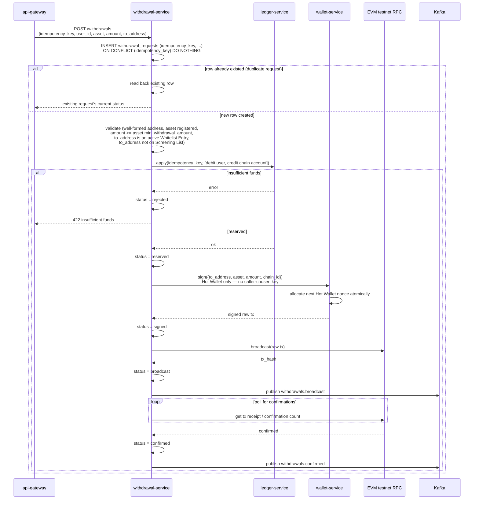
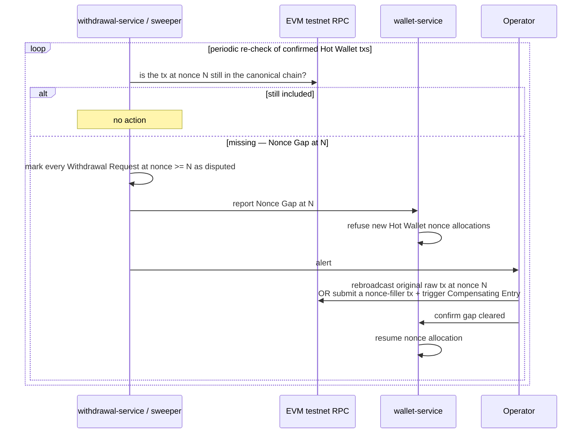
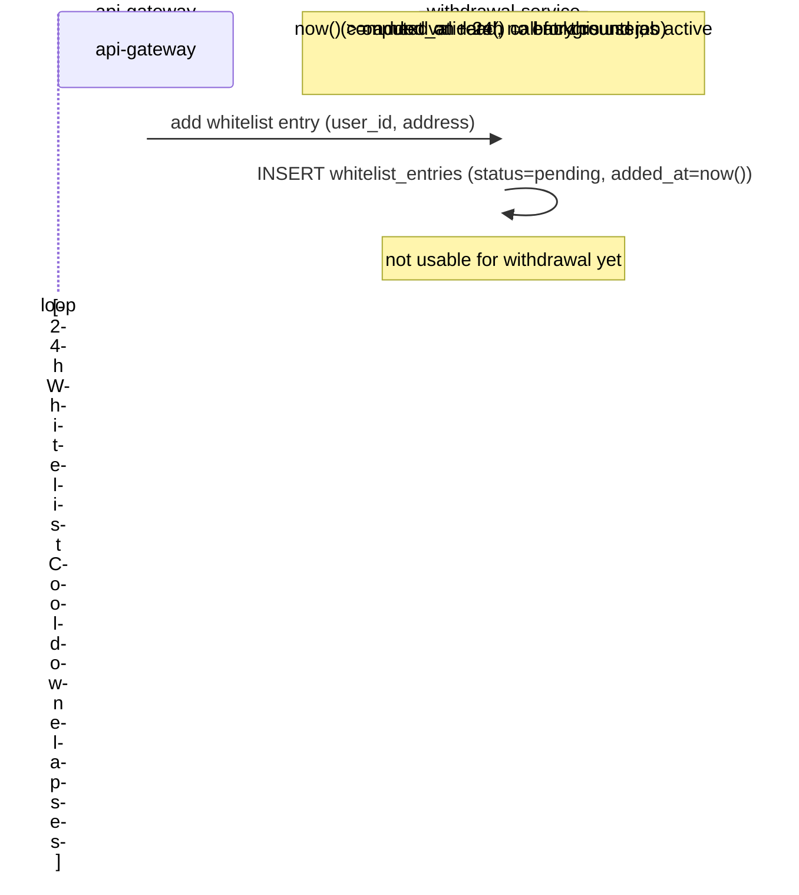

# Withdrawal flow

## Problem

A user with a positive ledger balance (`ledger.md`) requests that funds
be sent to an external on-chain address. Per your decision, this is
fully automatic — no manual review queue. The system must validate the
request, reserve the funds against the ledger, get a signature from
`wallet-service` (new: a signing endpoint, per your decision), broadcast
the transaction, and track it to confirmation — while never leaving a
user debited for a withdrawal that didn't actually happen, and never
signing the same withdrawal twice.

## Bounded context(s)

New bounded context: **Withdrawal**, owned by `withdrawal-service`
(named in `docs/ARCHITECTURE.md`). Talks to `ledger-service` (reserve
funds), `wallet-service` (sign — new surface), the EVM testnet RPC
(broadcast + confirmation), Kafka (producer), and its own Postgres
(withdrawal request state machine).

This also **extends the Wallet & Signing context**: `wallet-service`
gains a signing endpoint. That's a real widening of its trust boundary
— today it only ever returns public addresses; after this it can move
funds on request — so the invariants below treat it as seriously as the
existing key-custody design does.

## Ubiquitous language

- **Withdrawal Request** — one user ask to send `amount` of `asset` to
  `to_address`, identified by a client-supplied `idempotency_key`
  (minted by `api-gateway`, reused as the Ledger Transaction's
  idempotency key too — one key, one meaning, across both contexts).
  `UNIQUE(idempotency_key)` on the `withdrawal_requests` table — the
  request's own creation is idempotent, not just its later steps (see
  invariant #11).
- **Hot Wallet** — the single on-chain address (per this doc's
  recommendation — see Open Questions #1) that every withdrawal is
  actually paid out from, regardless of which address the user
  originally deposited to. A reserved derivation index in
  `wallet-service`'s existing HD wallet, distinct from user addresses.
- **Reservation** — the Ledger Transaction that debits the user's
  Account the moment a Withdrawal Request is accepted (not when it
  finally confirms on-chain). Uses the invariant already defined in
  `ledger.md` (balance can never go negative) as its safety net.
- **Hot Wallet Nonce** — the EVM account nonce for the Hot Wallet
  address. Must be allocated atomically and monotonically, exactly like
  `wallet-service`'s existing per-user derivation-index allocation — the
  same class of bug (two concurrent signs claiming the same value)
  applies here too.
- **Compensating Entry** — a new Ledger Transaction that credits the
  user back after a Withdrawal Request ends up never having landed on
  the canonical chain — either because it never broadcast successfully,
  or because it was abandoned after a Nonce Gap (below). Never a
  mutation of the original debit (`ledger.md`'s immutability
  invariant). Uses its own idempotency key, deterministically derived
  from the original — **`{idempotency_key}:refund`** — never the
  original key itself (that's already taken by the Reservation, and
  `ledger_transactions.idempotency_key` is unique). A retried
  compensation attempt hits the same `{idempotency_key}:refund` key and
  no-ops via `ledger.md`'s own idempotent-apply mechanism, so a crash
  between posting the refund and marking the Withdrawal Request
  `failed` can never double-refund.
- **Nonce Gap** — the situation where a Hot Wallet transaction at nonce
  N is no longer present in the canonical chain (a reorg deeper than
  Withdrawal Confirmation Depth). By EVM's strict per-account nonce
  ordering, this invalidates every Hot Wallet transaction at nonce ≥ N
  on the new canonical chain too — not just the one at N. Both
  `withdrawal-service` and `sweeper` draw nonces from the same Hot
  Wallet sequence, so a Nonce Gap can freeze both withdrawals and
  Sweeps/Gas Top-Ups (`deposit-flow.md`) at once.
- **Withdrawal Confirmation Depth** — a deeper confirmation threshold
  than deposits use (`deposit-flow.md`'s Confirmation Depth) before
  marking a Withdrawal Request `confirmed`, since funds leaving custody
  are more sensitive than funds arriving. Reduces how often a Nonce Gap
  happens; can't eliminate it.
- **Disputed** — the state a `confirmed` Withdrawal Request moves to
  when a Nonce Gap is detected at or above its nonce. Resolved only by
  explicit operator action — back to `confirmed` (original tx safely
  rebroadcast at the same nonce) or to `failed` with a Compensating
  Entry (abandoned, after a nonce-filler tx clears the gap).
- **Minimum Withdrawal Amount** — the smallest amount of an asset a
  Withdrawal Request may move, set per-asset on the Asset Registry
  (`ledger.md`'s `min_withdrawal_amount` field) at registration time.
  **Decided:** for native coin, 15× the current typical gas cost of a
  withdrawal tx (e.g. ~21,000 gas × 2 gwei ≈ 0.000042 ETH gas cost →
  min ≈ 0.0006 ETH); for ERC-20, set manually by the operator at
  registration, since there's no price oracle to compare a token's
  value against gas cost automatically (`ledger.md`'s Open Questions
  #3). Exists both for economics (a withdrawal shouldn't cost the Hot
  Wallet more in gas than it moves) and to make spamming
  `withdrawal-service` with dust requests — and burning through Hot
  Wallet nonces doing it — less attractive.
- **Withdrawal Whitelist** — the set of addresses a user has approved
  as withdrawal destinations. A Withdrawal Request's `to_address` must
  be an `active` entry in the requester's whitelist, checked at
  validation alongside Minimum Withdrawal Amount.
- **Whitelist Entry** — one `(user_id, address)` pair, state `pending`
  (just added) or `active` (usable for withdrawal). Removal is instant
  — an entry simply stops existing, no state needed for that direction.
- **Whitelist Cooldown** — **Decided: 24 hours.** The delay between a
  Whitelist Entry's `added_at` and the moment it becomes `active`. This
  is the actual security property, not the whitelist's existence: an
  attacker who compromises a user's session can add their own address,
  but can't withdraw to it for 24h — giving the real user a window to
  notice and remove it. Computed on read (`now() >= added_at +
  cooldown`), not by a background job flipping status — a missed or
  delayed job would otherwise silently widen the window.

Withdrawal Request states: a row exists first (invariant #11), then
moves `requested → validated → reserved → signed → broadcast →
confirmed`, with `rejected` (failed validation or insufficient funds,
terminal, no reservation made) and `failed` (terminal, triggers a
Compensating Entry — reached either from `reserved` if it never
broadcast, or from `disputed` if abandoned) as off-ramps, plus
`disputed` (a `confirmed` request whose tx was reorged out — see
invariants #7–9) which resolves back to `confirmed` or forward to
`failed`, always by explicit operator action. See Open Questions #3
for the one remaining unresolved failure mode.

## Aggregates & invariants

1. **A Withdrawal Request's ledger Reservation and its own status move
   together.** `withdrawal-service` calls `ledger.apply()`; only on
   success does it set status = `reserved`. On "insufficient funds," it
   sets `rejected` — never a partial reservation.
2. **A Withdrawal Request can be signed at most once.** Guarded the same
   way as ledger idempotency: `UPDATE withdrawal_requests SET
   status='signing' WHERE status='reserved'`, zero rows affected means
   a duplicate/retry, skip. Prevents a retried event from asking
   `wallet-service` to sign (and therefore spend) the same withdrawal
   twice.
3. **A Withdrawal Request that fails before broadcast is refunded via a
   Compensating Entry, never a mutation of the original debit.** Ties
   directly to `ledger.md`'s entry-immutability invariant. Posted with
   idempotency key `{idempotency_key}:refund` (see Compensating Entry
   above) — a crash-and-retry of the refund step itself can't double-
   credit the user.
4. **A Withdrawal Request that has already been broadcast is never
   auto-refunded.** Only a request that provably never reached the chain
   is safe to reverse automatically. Anything with a tx hash needs
   positive proof it didn't land before any compensating action — see
   Open Questions #3.
5. **`wallet-service` signs for the Hot Wallet only, and the caller
   specifies *what* to send, never *which key*.** The signing request
   carries `{to_address, asset, amount, chain_id}` — there is no
   parameter that lets a caller pick a derivation index. This means even
   a fully compromised `withdrawal-service` can't turn the signing
   endpoint into a way to drain an arbitrary user's address; the blast
   radius is capped at "can spend from the Hot Wallet."
6. **Hot Wallet nonce allocation is atomic and monotonic** — same
   `UPDATE ... RETURNING` pattern `wallet-service` already uses for
   derivation-index allocation (`internal/storage/postgres.go`'s
   `allocateIndex`). No two signing calls can be issued the same nonce.
7. **`wallet-service` refuses to allocate a new Hot Wallet nonce while a
   Nonce Gap is open, regardless of who's asking.** `withdrawal-service`
   and `sweeper` both draw from the same Hot Wallet nonce sequence, so
   this has to be enforced centrally, in the one place that actually
   allocates nonces — not duplicated (and possibly missed) in every
   caller.
8. **A detected Nonce Gap at N freezes every Withdrawal Request at
   nonce ≥ N, not just the one that triggered detection.** Reflects the
   EVM invariant that nonce N+1 can never be canonically confirmed while
   nonce N isn't — treating them independently would be wrong, not just
   incomplete.
9. **Resolving a `disputed` Withdrawal Request is always an explicit
   operator action, never automatic.** Either rebroadcast the original
   signed raw tx (safe — identical nonce and payload, no new signature,
   no double-spend risk), or submit a nonce-filler transaction to
   abandon it and trigger a Compensating Entry. This is the one case
   kept out of "fully automatic" — see Open Questions #4's resolution.
10. **A Withdrawal Request below the asset's Minimum Withdrawal Amount
    is rejected at validation, before any ledger Reservation is made.**
    Same off-ramp as any other validation failure — `rejected`, no
    Entry ever posted — so a dust request never even touches the
    Ledger or claims a Hot Wallet nonce.
11. **A Withdrawal Request's own row is created idempotently, before
    anything else runs.** `INSERT INTO withdrawal_requests
    (idempotency_key, ...) ON CONFLICT (idempotency_key) DO NOTHING`,
    checked first — a concurrent duplicate `POST /withdrawals` (client
    retry, double-click, network retry) can race to create the row, but
    only one insert wins. The loser doesn't re-validate, re-reserve, or
    call `wallet-service` again — it reads back the existing row and
    returns *its* current status. This closes the gap invariants #1–2
    already assumed: they guard against re-signing or re-reserving an
    *existing* request, but not against two requests existing in the
    first place for the same `idempotency_key`.
12. **A Withdrawal Request's `to_address` must be an `active` Whitelist
    Entry for that user, checked at validation** — same step as
    Minimum Withdrawal Amount (invariant #10), before any Reservation.
    An address that's `pending` (still cooling down) or was never
    whitelisted at all is rejected the same way as any other validation
    failure — `rejected`, no Entry ever posted.
13. **Adding a Whitelist Entry never takes effect immediately.** Created
    `pending`; only usable once Whitelist Cooldown has elapsed. Removing
    a Whitelist Entry takes effect immediately, no cooldown — a cooldown
    protects against *gaining* a new withdrawal destination, not against
    losing one, so there's no symmetric risk to guard on the remove
    path.
14. **A Withdrawal Request's `to_address` is also checked against the
    Screening List** (`compliance-screening.md`) at the same validation
    step, alongside the whitelist and minimum-amount checks — a match
    rejects the request before any Reservation.

## Diagram

Nonce Gap detection and recovery (invariants #7–9):

Whitelist Entry lifecycle (invariants #12–13):

## Alternatives considered

- **Pay out from each user's own derived deposit address (no Hot
  Wallet / no sweep).** Rejected: every user address would need its own
  maintained native-coin gas balance before it could pay out anything —
  true even for ERC-20 withdrawals, since gas is always paid in native
  coin by the sending address. Not how custody systems are actually
  run at any real scale. Recommending the Hot Wallet / sweep model
  instead — see Open Questions #1, since it also means a small addition
  to `deposit-flow.md`.
- **Manual/threshold review queue.** This is the alternative to "fully
  automatic" you already decided against; not re-litigating it. I am
  flagging one narrow exception in Open Questions #4 — confirmed-then-
  reorged withdrawals — as a case I'd keep out of full automation
  regardless.
- **`withdrawal-service` holds its own key material instead of calling
  `wallet-service`.** Rejected outright, not seriously considered — it
  directly violates this project's stated security model (one service
  holds key material, never exposes private keys).
- **Block the HTTP response until the withdrawal confirms.** Rejected —
  testnet confirmation takes real wall-clock time. The request returns
  quickly with a request ID; confirmation is tracked asynchronously,
  consistent with how the rest of this system is event-driven.
- **Auto-rebroadcast on Nonce Gap detection, no operator involved.**
  Rebroadcasting the *same* signed tx is provably safe, so this was
  tempting — but a Nonce Gap can also mean the operator (or a future
  policy) wants to change what happens at that nonce (different gas
  price, abandon it entirely), and auto-resolving removes that choice
  right when something already went wrong in an unusual way. Rejected —
  matches your standing decision to keep this one case out of full
  automation.
- **Treat each disputed Withdrawal Request independently instead of
  freezing the whole nonce ≥ N range.** Rejected — it's not just simpler,
  it's wrong: EVM won't canonically confirm nonce N+1 while nonce N
  isn't confirmed, so treating them independently would let
  `withdrawal-service`/`sweeper` keep issuing transactions that can
  never actually land.
- **No cooldown, whitelist entries active immediately.** Rejected —
  this is the whole point of a whitelist. Without a delay, an attacker
  who compromises a user's session can add their own address and
  withdraw to it in the same request; the whitelist would add an extra
  API call for a real user's convenience while doing nothing for
  security.
- **Let users disable the whitelist requirement entirely** (some real
  exchanges offer this as an opt-out for convenience, at higher risk).
  Not offering this for v1 — matches the project's existing conservative
  stance (fully automatic withdrawals, mandatory Minimum Withdrawal
  Amount) of not giving users a lever to weaken custody controls.

## Open questions

1. **Sweep vs. direct model — the biggest open item.** I'm recommending
   user deposit addresses stay attribution-only, and a Sweep step
   (small addition to `deposit-flow.md`, not written yet) consolidates
   confirmed deposits into the Hot Wallet per asset. All withdrawals pay
   out from there. This is standard custodial-exchange practice and
   sidesteps per-address gas funding. I didn't fold this into
   `deposit-flow.md` silently since it changes that doc's shape — want
   your sign-off first, then I'll add that section.
   **Decided (PR #1): approved.** The Sweep section is now written up
   in `deposit-flow.md`, including the gas-funding mechanics.
2. **`withdrawal-service` ↔ `wallet-service` auth.** This is new surface
   that can move funds. Options range from "same Docker network, no
   auth, testnet-only" (matches the project's current low-ceremony local
   setup) to a shared bearer secret or mTLS. This is a security-posture
   call, not something I'll default silently.
   **Decided (PR #1): mTLS.**
3. **Stuck/dropped broadcast handling.** A withdrawal that's broadcast
   but never confirms (underpriced, replaced, dropped from mempool) is
   the trickiest failure mode here — refunding it safely requires
   certainty it's truly dead, not just slow. I don't have a concrete
   timeout/replacement policy yet and would rather work it out with you
   than guess a number that's wrong in a way that loses money.
4. ~~Confirmed-then-reorged withdrawal.~~ **Decided (recommendation
   accepted):** not automated. Full design: a **Nonce Gap** (a Hot
   Wallet tx at nonce N reorged out) invalidates every Hot Wallet tx at
   nonce ≥ N too, by EVM's own nonce-ordering rule — so this isn't just
   about one withdrawal, it can stall `withdrawal-service` and `sweeper`
   both, since they share one Hot Wallet nonce sequence. On detection:
   `wallet-service` stops allocating new nonces (invariant #7), every
   affected Withdrawal Request moves to `disputed` (invariant #8), and
   an operator resolves it explicitly (invariant #9) — either
   rebroadcasting the original signed tx (safe: identical nonce and
   payload, no double-spend risk) or abandoning it with a nonce-filler
   tx plus a Compensating Entry. See the new invariants #7–9, the
   Nonce Gap / Disputed terms above, and the recovery diagram. Also
   recommending **Withdrawal Confirmation Depth be deeper than
   deposit-flow.md's Confirmation Depth**, since funds leaving custody
   are more sensitive than funds arriving — reduces how often this
   triggers, doesn't eliminate it. Confirm you're good with this shape;
   the actual depth values still wait on chain choice (#3 above and
   deposit-flow.md #3/#6).
5. ~~Dust/minimum withdrawal amount~~ **Decided:** see Minimum
   Withdrawal Amount above and invariant #10 — 15× gas cost for native
   coin, operator-set for ERC-20, enforced at validation. **Still
   open:** whether the Hot Wallet's own gas balance needs low-balance
   alerting — not designing now, flagging for the observability phase
   (roadmap step 3).
6. **Withdrawal Whitelist Cooldown: Decided (24h).** One honest gap
   worth flagging: the cooldown's security value depends on the user
   actually noticing a new `pending` entry before it activates, but
   this project has no notification/email service (not on the roadmap
   yet). Without one, the 24h window is real but silent — a user only
   discovers an unauthorized addition by manually checking their
   whitelist page. Do you want a minimal notification mechanism in
   scope now, or accept this as a known gap until `history-service`/
   notifications exist?
7. **How is "add a Whitelist Entry" itself authenticated?** This
   project has no user-auth design yet at all (not even Withdrawal
   Requests specify how `api-gateway` authenticates the caller) — so
   this inherits that same, already-existing gap rather than being a
   new one. Flagging so it's not mistaken for solved just because
   whitelist entries now exist.
