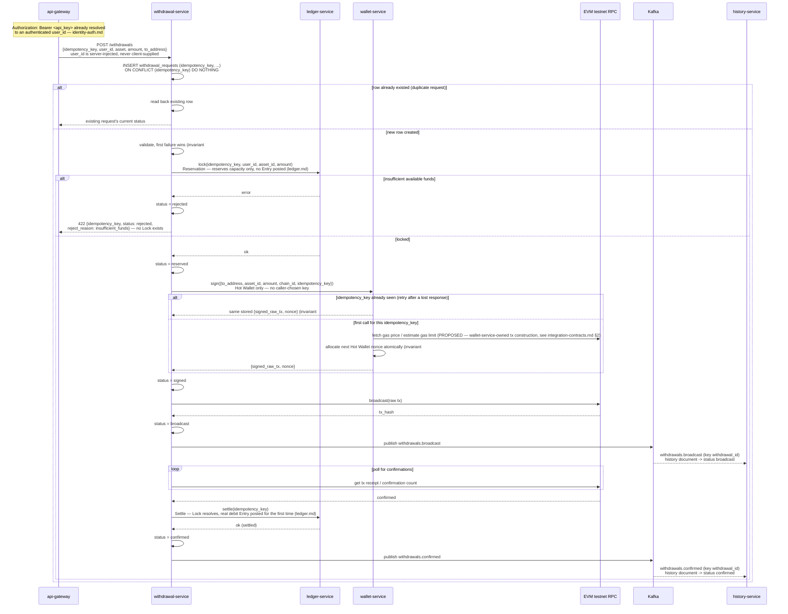
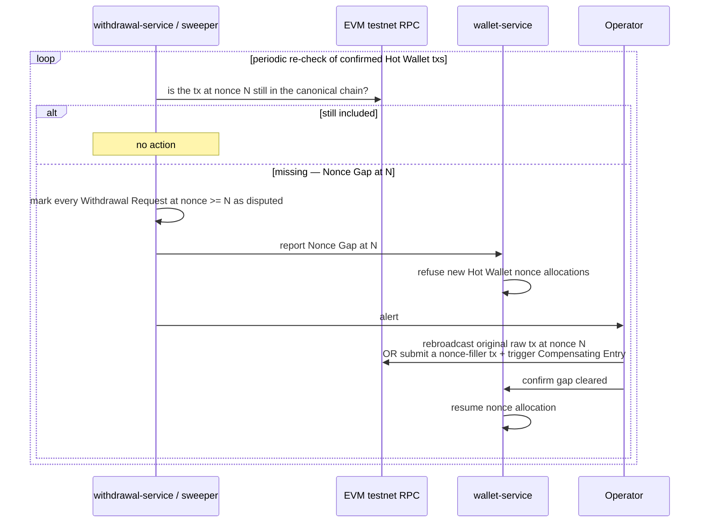
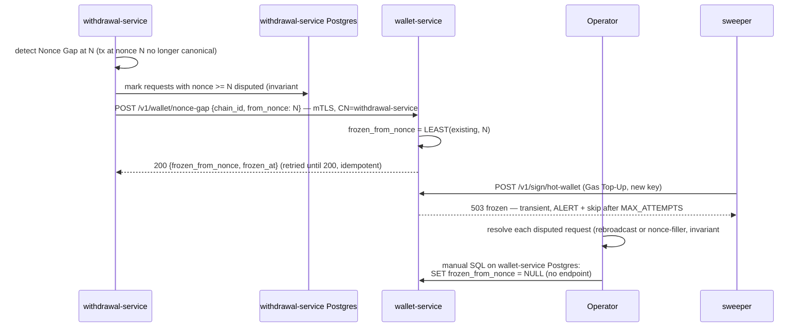
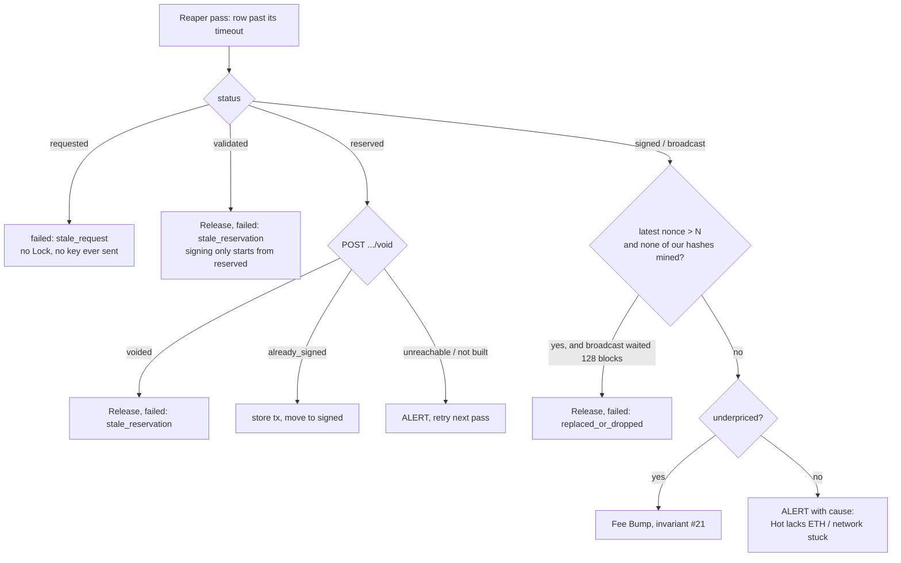
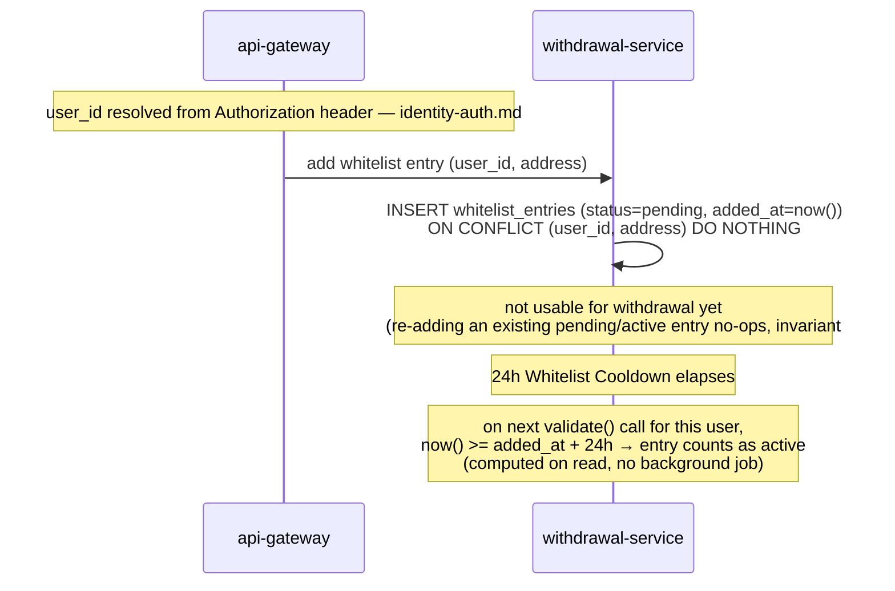

# Withdrawal flow

## Problem

A user with a positive ledger balance (`ledger.md`) requests that funds
be sent to an external on-chain address. Per your decision, this is
fully automatic — no manual review queue. The system must validate the
request, reserve the funds against the ledger, get a signature from
`wallet-service` (new: a signing endpoint, per your decision), broadcast
the transaction, and track it to confirmation — while never leaving a
user debited for a withdrawal that didn't actually happen, and never
signing the same withdrawal twice.

## Bounded context(s)

New bounded context: **Withdrawal**, owned by `withdrawal-service`
(named in `docs/ARCHITECTURE.md`). Talks to `ledger-service` (reserve
funds), `wallet-service` (sign — new surface), the EVM testnet RPC
(broadcast + confirmation), Kafka (producer), and its own Postgres
(withdrawal request state machine).

This also **extends the Wallet & Signing context**: `wallet-service`
gains a signing endpoint. That's a real widening of its trust boundary
— today it only ever returns public addresses; after this it can move
funds on request — so the invariants below treat it as seriously as the
existing key-custody design does.

**Depends on `identity-auth.md`**: every `user_id` referenced below is
the authenticated caller's, resolved by `api-gateway` from an API Key —
never a client-supplied field. This doc assumed that dependency existed
before `identity-auth.md` actually specified it (see former Open
Question #7).

## Ubiquitous language

- **Withdrawal Request** — one user ask to send `amount` of `asset` to
  `to_address`, identified by a client-supplied `idempotency_key`
  (minted by `api-gateway`, reused as the Ledger Transaction's
  idempotency key too — one key, one meaning, across both contexts).
  `UNIQUE(idempotency_key)` on the `withdrawal_requests` table — the
  request's own creation is idempotent, not just its later steps (see
  invariant #11). **This same `idempotency_key` is also reused, unchanged,
  as the idempotency key on the `POST /v1/sign/hot-wallet` call this
  request eventually makes** — see invariant #16.
  **Revised — Decided (Tech Lead), invariant #20, Open Questions #11:** the key is client-supplied (the client sends it in the
  `POST /v1/withdrawals` body; `api-gateway` forwards it, it does not mint
  it — the "minted by `api-gateway`" wording above contradicts
  `integration-contracts.md` §2/§4 and is superseded). It is unique **per
  user**, `UNIQUE(user_id, idempotency_key)`, and it is **never** used
  outside `withdrawal-service`: every downstream key is the Withdrawal
  Key below.
- **Withdrawal Key** — **Decided (Tech Lead), new (invariant #20).**
  `withdrawal:{withdrawal_id}`, where `withdrawal_id` is a UUID
  `withdrawal-service` mints when it inserts the Withdrawal Request row.
  Globally unique by construction, never chosen by a client. It is the
  key used for the ledger Lock/Settle/Release, for `POST
  /v1/sign/hot-wallet`, and (with a `:refund` suffix) for a
  Compensating Entry; `withdrawal_id` is carried on
  `withdrawals.broadcast`/`withdrawals.confirmed`.
- **Hot Wallet** — the single on-chain address (per this doc's
  recommendation — see Open Questions #1) that every withdrawal is
  actually paid out from, regardless of which address the user
  originally deposited to. Derived from its own, separate seed that
  `wallet-service` holds apart from the seed that derives user deposit
  addresses — **not** a reserved index in the same HD tree as user
  addresses. (This entry previously said the opposite — "a reserved
  derivation index in `wallet-service`'s existing HD wallet, distinct
  from user addresses" — written before `wallet-tiering.md` existed.
  That was stale, not a live disagreement: `wallet-tiering.md` invariant
  #1 later decided, and the Tech Lead approved, that Hot's signing key
  must be a separate seed precisely so one compromised seed can never
  expose both "every user's transient private key" and "the automated
  payout key." Fixed here to match. Source of truth going forward:
  `wallet-tiering.md` invariant #1, not this doc.)
- **Reservation** — the Lock (`ledger.md`) placed against the user's
  Account the moment a Withdrawal Request is accepted (not when it
  finally confirms on-chain). Reserves capacity out of the user's
  Available Balance without moving any real money yet: no Entry is
  posted, `total_balance` doesn't change, only `locked_balance` does.
  Uses `ledger.md`'s Lock-creation invariant (Available Balance can
  never go negative) as its safety net. Resolves to a real debit only
  when the Withdrawal Request actually reaches `confirmed` (Settle,
  `ledger.md`) — everything before that is reversible by Release alone,
  no Compensating Entry needed (see invariant #3, revised).
- **Hot Wallet Nonce** — the EVM account nonce for the Hot Wallet
  address. Must be allocated atomically and monotonically, exactly like
  `wallet-service`'s existing per-user derivation-index allocation — the
  same class of bug (two concurrent signs claiming the same value)
  applies here too. (This is a distinct nonce sequence from a user
  address's own EVM nonce, used only for Sweep transactions — see
  `deposit-flow.md`'s Sweep-related invariants for that, unrelated,
  sequence.)
- **Compensating Entry** — a new Ledger Transaction that credits the
  user back after a Withdrawal Request that had already **Settled**
  (`ledger.md` — real money already left `total_balance`) turns out not
  to have actually landed on the canonical chain. **This is now the
  only case that needs one**, since Settle is the sole point where an
  Entry is posted: it's the `disputed` → abandoned path after a Nonce
  Gap (below), reached only from `confirmed` (invariant #9). Any
  Withdrawal Request that fails *before* Settle — i.e., before
  `confirmed` — never had an Entry posted for it in the first place, so
  it's reversed by simply Releasing its Lock (`ledger.md`), not by a
  Compensating Entry (see invariant #3, revised). Never a mutation of
  the original debit (`ledger.md`'s immutability invariant). Uses its
  own idempotency key, deterministically derived from the original —
  **`{idempotency_key}:refund`** — never the original key itself
  (that's already taken by the Settle-time debit, and
  `ledger_transactions.idempotency_key` is unique). A retried
  compensation attempt hits the same `{idempotency_key}:refund` key
  (**Decided, invariant #20: `{Withdrawal Key}:refund`, i.e.
  `withdrawal:{withdrawal_id}:refund`**) and
  no-ops via `ledger.md`'s own idempotent-apply mechanism, so a crash
  between posting the refund and marking the Withdrawal Request
  `failed` can never double-refund. **As implemented (task 3.5):** `POST
  /v1/ledger/transactions {idempotency_key:
  "withdrawal:{withdrawal_id}:refund", source_type: "correction",
  entries: [{corrects_entry_id} for each Settle entry_id]}` — the two
  ids come from Settle's response (`entry_ids`, PROPOSED additive field,
  `integration-contracts.md` §2), stored with the request; the ledger
  derives the exact negations (`ledger.md` invariant #11).
- **Nonce Gap** — the situation where a Hot Wallet transaction at nonce
  N is no longer present in the canonical chain (a reorg deeper than
  Withdrawal Confirmation Depth). By EVM's strict per-account nonce
  ordering, this invalidates every Hot Wallet transaction at nonce ≥ N
  on the new canonical chain too — not just the one at N. Both
  `withdrawal-service` and `sweeper` draw nonces from the same Hot
  Wallet sequence, so a Nonce Gap can freeze both withdrawals and
  Sweeps/Gas Top-Ups (`deposit-flow.md`) at once. **A second, distinct
  cause of the same failure shape (a stranded, never-confirmable nonce)
  is now also prevented separately: see invariant #16** — that one is
  caused by a lost HTTP response, not a reorg, and is prevented at
  allocation time rather than detected after the fact.
- **Withdrawal Confirmation Depth** — a deeper confirmation threshold
  than deposits use (`deposit-flow.md`'s Confirmation Depth) before
  marking a Withdrawal Request `confirmed`, since funds leaving custody
  are more sensitive than funds arriving. Reduces how often a Nonce Gap
  happens; can't eliminate it. **Decided: 64 blocks (~12.8 minutes at
  Sepolia's ~12s average block time)** — exactly double
  `deposit-flow.md`'s 32-block Confirmation Depth, per this term's own
  stated invariant. Also grounded in a real Ethereum post-merge concept,
  same as the deposit-side number: 64 blocks ≈ two epochs, roughly what
  a full node exposes via the `finalized` block tag (reverting a
  finalized block requires a large-scale validator-slashing event, not
  an ordinary short reorg) — a meaningfully stronger guarantee than
  deposit-flow.md's `safe`-tag-equivalent depth, appropriate since these
  are funds leaving custody rather than arriving.
- **Disputed** — the state a `confirmed` Withdrawal Request moves to
  when a Nonce Gap is detected at or above its nonce. Resolved only by
  explicit operator action — back to `confirmed` (original tx safely
  rebroadcast at the same nonce) or to `failed` with a Compensating
  Entry (abandoned, after a nonce-filler tx clears the gap).
- **Minimum Withdrawal Amount** — the smallest amount of an asset a
  Withdrawal Request may move, set per-asset on the Asset Registry
  (`ledger.md`'s `min_withdrawal_amount` field) at registration time.
  **Decided:** for native coin, 15× the current typical gas cost of a
  withdrawal tx (e.g. ~21,000 gas × 2 gwei ≈ 0.000042 ETH gas cost →
  min ≈ 0.0006 ETH); for ERC-20, set manually by the operator at
  registration, since there's no price oracle to compare a token's
  value against gas cost automatically (`ledger.md`'s Open Questions
  #3). Exists both for economics (a withdrawal shouldn't cost the Hot
  Wallet more in gas than it moves) and to make spamming
  `withdrawal-service` with dust requests — and burning through Hot
  Wallet nonces doing it — less attractive.
- **Withdrawal Whitelist** — the set of addresses a user has approved
  as withdrawal destinations. A Withdrawal Request's `to_address` must
  be an `active` entry in the requester's whitelist, checked at
  validation alongside Minimum Withdrawal Amount.
- **Whitelist Entry** — one `(user_id, address)` pair, state `pending`
  (just added), `active` (usable for withdrawal) or `blocked` (a
  withdrawal to it reverted through no fault of ours, or an operator
  blocked it — invariant #25, Decided). `(user_id, address)`
  is unique — see invariant #15. Removal is instant — an entry simply
  stops existing, no state needed for that direction. **Listing —
  Decided (Tech Lead):** a user can list their own entries (`GET
  /v1/whitelist` → `[{"id","address","status","added_at"}]`, own entries
  only, `status` computed on read as for validation, newest `added_at`
  first, no pagination yet), so a `pending` entry an attacker added is
  visible during the cooldown and can be removed (Open Questions #6).
- **Whitelist Cooldown** — **Decided: 24 hours.** The delay between a
  Whitelist Entry's `added_at` and the moment it becomes `active`. This
  is the actual security property, not the whitelist's existence: an
  attacker who compromises a user's session can add their own address,
  but can't withdraw to it for 24h — giving the real user a window to
  notice and remove it. Computed on read (`now() >= added_at +
  cooldown`), not by a background job flipping status — a missed or
  delayed job would otherwise silently widen the window.

- **Fee Bump** — **Decided (invariant #21).** A replacement of a
  stuck Hot Wallet tx: same nonce, same destination/amount/data, higher
  fees, signed by `wallet-service`. Any version may be mined, never more
  than one.
- **Gas Expense Account** — **Decided (`ledger.md` invariant #12,
  invariant #26 here).** The ledger's system account that records every wei of gas
  our own transactions spend.
- **Signature Void** — **Decided (invariant #22).** `wallet-service`'s
  atomic promise that a Hot Wallet key it has not signed will never be
  signed; the only safe basis for Releasing a `reserved` request.
- **Nonce Filler** — **Decided (invariant #23).** An operator-issued
  0-value Hot Wallet self-transfer at a stuck tx's nonce, signed by
  `wallet-service` via its CLI, that consumes the nonce so the original
  tx can never land.
- **Fail reasons** (`failed` rows; `sign_refused` and `tx_reverted`
  Decided; carried as `reason` on `withdrawals.failed`):
  `sign_refused`, `tx_reverted`, `stale_request`, `stale_reservation`,
  `replaced_or_dropped`, `destination_not_whitelisted` /
  `destination_on_screening_list` (pre-sign re-check, #23);
  `abandoned_refunded` / `abandoned` (operator abandon of a `disputed`
  request, #9 — PROPOSED).
  `policy_refused` (`hsm-gateway`'s Signing Policy said no, `422` on the
  sign call, `key-custody-hsm.md` Open question 4: handled like
  `sign_refused`, the Lock is Released, an operator alert fires).

Withdrawal Request states: a row exists first (invariant #11), then
moves `requested → validated → reserved → signed → broadcast →
confirmed`, with `confirmed` the only transition that Settles the Lock
(`ledger.md`) and posts the real debit Entry — everything before it is
still just a Lock, no money has actually moved. `rejected` (failed
validation or insufficient available funds, terminal, no Lock ever
created) and `failed` (terminal) are the off-ramps: reached from
`reserved`/`signed`/`broadcast` it means Releasing the Lock (no Entry
was ever posted, so nothing needs compensating); reached from
`disputed` (below) it means a Compensating Entry, since by then the
Lock had already Settled and real money had already moved — see the
revised invariant #3. `disputed` (a `confirmed` request whose tx was
reorged out — see invariants #7–9) resolves back to `confirmed` or
forward to `failed`, always by explicit operator action. See Open
Questions #3 for the one remaining unresolved failure mode.

## Aggregates & invariants

1. **A Withdrawal Request's ledger Reservation and its own status move
   together.** `withdrawal-service` calls `ledger.lock(idempotency_key,
   user_id, asset_id, amount)` — **not `account_id`**: `withdrawal-service`
   never knows `ledger-service`'s internal Account primary key, only the
   `user_id` it already has (from the authenticated request) and the
   `asset_id` the withdrawal names; `ledger-service` resolves the Account
   internally (`ledger.md`'s Lock definition). Only on success does
   `withdrawal-service` set status = `reserved`. On "insufficient
   available funds," it sets `rejected` — never a partial lock.
2. **A Withdrawal Request can be signed at most once.** **Revised —
   Decided (Tech Lead), implemented in task 3.3: there is no `signing`
   intermediate state.** The guarantee comes from
   two things together: `wallet-service` signs at most once per
   Withdrawal Key and replays the stored tx on any retry (invariant
   #16), and the pipeline's `reserved → signed` transition is a guarded
   `UPDATE ... WHERE status='reserved'` that stores the returned raw tx,
   nonce and hash. A crash or a lost response simply leaves the row
   `reserved`; the next pass calls sign again with the same key and gets
   the same tx back, never a second nonce. (The original text used
   `UPDATE ... SET status='signing' WHERE status='reserved'`; a `signing`
   row would have needed its own recovery rule for exactly the same
   "did `wallet-service` sign or not?" question, so it added nothing.)
   **After signing, a request only ever moves forward** — a signed tx
   holds Hot Wallet nonce N, and abandoning it would strand N and block
   every later Hot Wallet tx (invariants #16, #17).
   Outcomes (task 3.3):
   - **Refused signature → Release + `failed` / `sign_refused`
     (Decided, Tech Lead)** — `wallet-service` `400`/`409`/`422`, on the
     premise that no nonce was allocated — **amended (Decided, Tech
     Lead, Open Questions #16): only `400`/`422`.** `409` means "this key
     was already signed for a *different* request", so a nonce *is*
     allocated: `409` → ALERT, the row is left for an operator, never
     Released (implemented, commit e425734). `503`/5xx/timeouts are
     retried with the same key.
   - **Tx mined but reverted (`receipt.status = 0`) → Decided (Tech
     Lead):** wait until the receipt is Withdrawal Confirmation Depth
     (64 blocks) deep first — a reorg can change it — then ledger
     Release (no Entry was posted), `broadcast → failed` with reason
     `tx_reverted`, **no automatic retry**. The **revert reason** is
     recorded (replayed with `eth_call` at the parent block, or a trace
     if the node supports it) in the logs and on the `withdrawals.failed`
     event (invariant #24); the state machine is unchanged. The nonce is
     consumed on-chain, so nothing is stranded. If the cause is the Hot
     Wallet lacking the token or ETH (our operational fault, not the
     user's), ops get an `ALERT`; a later retry may be allowed — not
     designed yet (Open Questions #21). (The implementation in task 3.3
     Releases as soon as the receipt is reverted; it must wait for the
     depth and record the reason — task 3.14.)
   - **Broadcast answered "nonce too low" while our tx is not mined →
     ALERT, left for an operator (Decided)** — another tx used nonce N;
     invariant #4 forbids auto-resolution here, the Reaper's proof rule
     (#17) decides later.
   - **Settle conflict (the Lock was already released) → ALERT, left
     (Decided).**
3. **A Withdrawal Request that fails before it Settles is reversed by
   Releasing its Lock, never by a Compensating Entry.** Since the
   Reservation (`ledger.md`'s Lock) never posts an Entry, a failure
   anywhere between `reserved` and `broadcast` — a signing failure, a
   broadcast failure, or any abandonment short of `confirmed` — is
   undone with `ledger.release(idempotency_key)`: `locked_balance` goes
   back down, `total_balance` was never touched, so there's nothing to
   compensate. This replaces this doc's earlier design, where the
   Reservation debited immediately and every such failure needed a
   refund Entry. A Compensating Entry is now needed only for the one
   case where real money already moved: a `confirmed` (already-Settled)
   Withdrawal Request later reorged out and abandoned (`disputed` →
   `failed`, invariant #9) — see the revised Compensating Entry
   definition above.
4. **A Withdrawal Request that has already been broadcast is never
   auto-released.** Only a request that provably never reached the chain
   is safe to reverse automatically — releasing a Lock for a broadcast
   tx that later lands on-chain would let a Settle attempt run against
   capacity that's already been given back to the user. Anything with a
   tx hash needs positive proof it didn't land before any Lock
   resolution — see Open Questions #3. **Extended (Decided, invariant
   #17 rewrite):** the same holds for `signed` — a signed tx can still
   reach the chain, so a `signed` request is never released on a timeout
   either, only on positive proof.
5. **`wallet-service` signs for the Hot Wallet only, and the caller
   specifies *what* to send, never *which key* nor *how the transaction
   is built*.** The signing request carries `{to_address, asset_id,
   amount, chain_id, idempotency_key}` (the `idempotency_key` addition
   is new — see invariant #16) — there is no parameter that lets a
   caller pick a derivation index, and (**PROPOSED**, Tech Lead sign-off
   pending — full design in `docs/design/integration-contracts.md` §2)
   no gas parameter either: `wallet-service` is proposed to construct
   the transaction itself, fetching current gas price and estimating gas
   limit via its own EVM RPC client, rather than trusting a caller-
   supplied gas price/limit. Either way, the caller can never dictate a
   derivation index; the gas-construction question is the one part of
   this invariant not yet decided. This means even a fully compromised
   `withdrawal-service` can't turn the signing endpoint into a way to
   drain an arbitrary user's address; the blast radius is capped at "can
   spend from the Hot Wallet" (and, if the gas-construction proposal is
   approved, "at a price it doesn't get to pick either"). An optional
   caller-supplied `max_gas_price` safety ceiling (never a dictated
   price, just a cap on cost exposure) is also **PROPOSED** — see
   `integration-contracts.md` §2 and this doc's Open Questions.
   **Cross-reference:** this "blast radius capped" argument depends on
   `wallet-service` actually enforcing *who* is allowed to call this
   endpoint by client-certificate identity, not just that the request
   body has no key-selecting field — see
   `docs/design/service-auth-mtls.md` invariants #2 and #4
   (CN-based authorization).
6. **Hot Wallet nonce allocation is atomic and monotonic** — same
   `UPDATE ... RETURNING` pattern `wallet-service` already uses for
   derivation-index allocation (`internal/storage/postgres.go`'s
   `allocateIndex`). No two signing calls can be issued the same nonce.
   This prevents two *different* signing calls from colliding on one
   nonce; it does not, by itself, prevent one caller's *retried* call
   from being allocated a *different* nonce for what should have been
   the same request — see invariant #16, which closes that gap.
7. **`wallet-service` refuses to allocate a new Hot Wallet nonce while a
   Nonce Gap is open, regardless of who's asking.** `withdrawal-service`
   and `sweeper` both draw from the same Hot Wallet nonce sequence, so
   this has to be enforced centrally, in the one place that actually
   allocates nonces — not duplicated (and possibly missed) in every
   caller.
8. **A detected Nonce Gap at N freezes every Withdrawal Request at
   nonce ≥ N, not just the one that triggered detection.** Reflects the
   EVM invariant that nonce N+1 can never be canonically confirmed while
   nonce N isn't — treating them independently would be wrong, not just
   incomplete. **Detection and marking — Decided (Tech Lead),
   implemented in task 3.4:** every pass re-checks the receipts of
   `confirmed` txs mined in the last `NONCE_GAP_WINDOW` blocks (default
   256). A receipt missing on **two consecutive passes** (one miss could
   be a node hiccup) declares a gap at the **lowest** such nonce N. In
   one transaction `withdrawal-service` records the gap (table
   `nonce_gaps`) and moves every request on that chain at nonce ≥ N that
   holds a tx — `signed`, `broadcast` and `confirmed` — to `disputed`,
   storing its prior status in `disputed_from`. Then it calls `POST
   /v1/wallet/nonce-gap` (invariant #19), retried until `200`.
9. **Resolving a `disputed` Withdrawal Request is always an explicit
   operator action, never automatic.** Either rebroadcast the original
   signed raw tx (safe — identical nonce and payload, no new signature,
   no double-spend risk), or submit a nonce-filler transaction to
   abandon it and trigger a Compensating Entry. This is the one case
   kept out of "fully automatic" — see Open Questions #4's resolution.
   **Abandon, as implemented in task 3.5:** an operator CLI on
   `withdrawal-service`, `service -abandon <withdrawal_id>`. It refuses
   unless on-chain proof holds: the request's tx is not mined **and** the
   Hot Wallet's `latest` nonce is past the request's nonce (a Nonce
   Filler, invariant #23, consumed it). Then: `disputed_from =
   confirmed` → refund via the Compensating Entry (the Lock had already
   Settled); any other `disputed_from` (`signed`, `broadcast`) →
   Release. Finally `disputed → failed` with reason
   **`abandoned_refunded`** or **`abandoned`** (both PROPOSED). Being a
   `→ failed` transition, it must also publish `withdrawals.failed`
   (invariant #24) and post the filler's Gas Fee (invariant #26) — see
   Open Questions #25.
10. **A Withdrawal Request below the asset's Minimum Withdrawal Amount
    is rejected at validation, before any ledger Reservation is made.**
    Same off-ramp as any other validation failure — `rejected`, no
    Entry ever posted — so a dust request never even touches the
    Ledger or claims a Hot Wallet nonce. **Validation response —
    Decided (Tech Lead), implemented in task 3.2:** every validation
    rejection returns `422 {"idempotency_key","status":"rejected",
    "reject_reason"}` (never `202` + rejected); a request that passes
    returns `202 {"idempotency_key","status":"validated"}` (`"reserved"`
    once task 3.3 adds the Reservation); no verdict returns `503` with
    the row left `requested` (invariants #11, #18). Order, first failure
    wins, with its `reject_reason`: asset registered
    (`asset_not_registered`) → `to_address` well-formed and non-zero
    (`invalid_to_address`) → amount ≤ uint256 max (`amount_too_large`)
    → amount ≥ Minimum Withdrawal Amount
    (`below_minimum_withdrawal_amount`) → active Whitelist Entry
    (`destination_not_whitelisted`: no entry, or still `pending`,
    invariant #12) → Screening List (`destination_on_screening_list`,
    #14) → Hot/Warm (`destination_is_system_wallet`, local, #18) →
    deposit address (`destination_is_deposit_address`, remote, #18).
    After validation, a ledger Reservation refused for lack of
    Available Balance (task 3.3) returns the same shape with
    `reject_reason` `insufficient_funds` (**Decided**, Tech Lead); the row
    is `rejected` and no Lock exists.
11. **A Withdrawal Request's own row is created idempotently, before
    anything else runs.** `INSERT INTO withdrawal_requests
    (idempotency_key, ...) ON CONFLICT (idempotency_key) DO NOTHING`,
    checked first — a concurrent duplicate `POST /withdrawals` (client
    retry, double-click, network retry) can race to create the row, but
    only one insert wins. The loser doesn't re-validate, re-reserve, or
    call `wallet-service` again — it reads back the existing row and
    returns *its* current status. This closes the gap invariants #1–2
    already assumed: they guard against re-signing or re-reserving an
    *existing* request, but not against two requests existing in the
    first place for the same `idempotency_key`. **Decided (Tech Lead,
    Open Questions #9b, option B): a duplicate `POST` never re-validates,
    whatever the row's status — including `requested`.** Only the
    original `POST` handler, in-line, ever advances a row out of
    `requested`; no background worker re-drives it. A row left in
    `requested` (a fail-closed `503` during validation, or a crash
    mid-validation) is therefore inert, and the Reaper later marks it
    `failed` (invariant #17); the client retries with a **new**
    `idempotency_key`, which cannot double-spend because the old row can
    never move again. **Same user, same `idempotency_key`, different
    request** (`asset_id`, `amount` or `to_address` differ from the stored
    row) **returns `409`** and changes nothing — **Decided (Tech Lead),
    implemented in task 3.1**; an identical replay gets the existing
    row's status as before. Every state transition is a guarded `UPDATE ...
    WHERE status = <expected>`, so a Reaper write and a late in-line
    transition can never both succeed. (Uniqueness scope: see invariant
    #20, Decided.)
12. **A Withdrawal Request's `to_address` must be an `active` Whitelist
    Entry for that user, checked at validation** — same step as
    Minimum Withdrawal Amount (invariant #10), before any Reservation.
    An address that's `pending` (still cooling down) or was never
    whitelisted at all is rejected the same way as any other validation
    failure — `rejected`, no Entry ever posted. (See also invariant
    #18: the entry's address must additionally not be one of our own
    deposit addresses.)
13. **Adding a Whitelist Entry never takes effect immediately.** Created
    `pending`; only usable once Whitelist Cooldown has elapsed. Removing
    a Whitelist Entry takes effect immediately, no cooldown — a cooldown
    protects against *gaining* a new withdrawal destination, not against
    losing one, so there's no symmetric risk to guard on the remove
    path.
14. **A Withdrawal Request's `to_address` is also checked against the
    Screening List** (`compliance-screening.md`) at the same validation
    step, alongside the whitelist and minimum-amount checks — a match
    rejects the request before any Reservation.
15. **A Whitelist Entry's `(user_id, address)` pair is unique.**
    **Decided** (`docs/design/integration-contracts.md` Open Questions
    #10). `UNIQUE(user_id, address)` on `whitelist_entries` —
    `INSERT ... ON CONFLICT (user_id, address) DO NOTHING`. Re-adding an
    address that already has a `pending` or `active` entry for that
    user is a no-op: it neither errors nor restarts that entry's
    Whitelist Cooldown clock.
16. **Hot Wallet signing is idempotent per `idempotency_key` —
    `wallet-service` never signs twice for the same key.** Strengthens
    invariant #6: atomic nonce allocation alone prevents two *different*
    calls from ever colliding on the same nonce, but it does not prevent
    one caller's *retried* call — e.g. after the HTTP response to a
    successful sign was lost in transit (timeout, connection reset) —
    from being treated as a brand-new request and allocated a
    *different* nonce for what should have been the same transaction.
    That strands the first nonce forever, because EVM's strict
    per-account nonce ordering means a later nonce can never confirm
    while an earlier one from the same account is missing — the exact
    same failure shape as a Nonce Gap (invariants #7–9), just caused by
    a lost response instead of a reorg, and happening at the point of
    allocation rather than being detected later. `wallet-service`
    persists `(idempotency_key -> nonce, signed_raw_tx)` the first time
    it signs for a given key; every subsequent `POST /v1/sign/hot-wallet`
    call carrying that same key returns the identical stored
    `{nonce, signed_raw_tx}` instead of allocating anything new or
    signing again. The `idempotency_key` used here is the *same* key the
    Withdrawal Request already carries throughout its lifecycle
    (**Decided, invariant #20: the Withdrawal Key
    `withdrawal:{withdrawal_id}`, not the client's key**)
    (Ubiquitous language > *Withdrawal Request*) — reused as-is on this
    call, never minted fresh per signing attempt. The identical
    requirement applies to this endpoint's other two callers — the
    Treasury Sweep caller (`wallet-tiering.md`, `withdrawal-service`'s
    sweep-monitor loop) and the Gas Top-Up caller (`sweeper`,
    `deposit-flow.md`) — which have no pre-existing per-request key the
    way a Withdrawal Request does; see those docs for their **PROPOSED**
    key-minting schemes.
17. **A Lock does not stay `active` forever — but the Reaper never
    strands a Hot Wallet nonce.** A periodic **Reaper** in
    `withdrawal-service` reclaims stuck requests, only when it can
    *prove* nothing can still reach the chain *and* no Hot Wallet nonce
    is left allocated-but-unused. **Rewritten — Decided (Tech Lead),
    including the timeout values.** The earlier text Released `reserved` and
    `signed` rows on a timeout alone because "nothing was broadcast";
    that is safe for the user's balance but, if `wallet-service` had
    already signed, nonce N stays allocated and unused, and every later
    Hot Wallet tx (every user's withdrawal, every Gas Top-Up, Treasury
    Sweeps) queues behind it forever — the failure invariant #16 exists
    to prevent. Rules, per state (every write a guarded `UPDATE ... WHERE
    status = <expected>`):
    - **`requested`** past the **Stuck Request Timeout** (**Decided: 5
      minutes**): mark `failed` / `stale_request`. No Lock and no
      Withdrawal Key has ever left the service. Unchanged.
    - **`validated`** past the **Stuck Reservation Timeout** (**Decided:
      5 minutes**; Open Questions #14, Decided): Release (idempotent; a
      `404` "never locked" is fine), then `failed` / `stale_reservation`.
      Unchanged, and **confirmed safe**: the Lock is placed by the
      request handler, and signing is only ever attempted by the
      pipeline from `reserved`, so a `validated` row's Withdrawal Key has
      never been sent to `wallet-service` and no nonce can exist.
    - **`reserved`** past the Stuck Reservation Timeout: a sign call may
      have succeeded with the response lost, so a nonce may exist.
      Released **only** when `wallet-service` positively guarantees the
      key is not signed and never will be: the Reaper calls `POST
      /v1/sign/hot-wallet/{key}/void` (invariant #22). `voided` →
      Release, `failed` / `stale_reservation`. `already_signed` → store
      the returned tx and move the row to `signed` (it is a normal
      signed request from then on). `wallet-service` unreachable or
      frozen → ALERT, retry next pass. Race-free: void and sign take the
      same `wallet-service` lock, so either the sign landed first
      (`already_signed`) or any later sign for that key gets `410` and
      allocates nothing (the pipeline treats `410` as "row already
      reaped" — the guarded `UPDATE` finds it `failed`). **Until invariant #22 is built:
      ALERT only, never Release.** (A read-only lookup alone is not
      enough to Release safely — a sign call already in flight can land
      after the lookup said "not signed"; see invariant #22.)
    - **`signed`** past the Stuck Reservation Timeout: **never Released
      on a timeout** (Decided, Open Questions #19 — the only way out is
      the on-chain proof below). The pipeline keeps re-broadcasting the stored
      (latest) raw tx. The Reaper raises an ALERT naming the likely
      cause, from live reads: **underpriced** (the tx's `maxFeePerGas` is
      below the current base fee, or the node answered "underpriced" /
      "fee too low") → a Fee Bump is the fix (invariant #21, automatic
      once built); **Hot Wallet lacks ETH** (balance < value + max gas
      cost) → operator replenishes Hot (`wallet-tiering.md`);
      **nonce used by another tx** (mined nonce > N and none of this
      request's tx hashes is mined) → the proof case below.
    - **`signed` or `broadcast`, nonce consumed by another tx** —
      `eth_getTransactionCount(hot_wallet, "latest")` > N (**`latest`,
      i.e. mined, not `pending`**: the earlier text said `pending`,
      which counts our own still-in-mempool tx and would "prove" a live
      tx dead) **and** no receipt exists for **any** tx hash this request
      has (original and every Fee Bump replacement, invariant #21). Then
      nonce N is consumed on-chain, so nothing is stranded, and none of
      our versions can ever land: Release, `failed` /
      `replaced_or_dropped`. For `broadcast` this additionally waits for
      the **Stuck Broadcast Timeout** (**Decided: 128 blocks**) as
      before, so the Reaper never races a slow confirmation; for
      `signed` it applies as soon as it is observed. This is also how a
      Nonce Filler (invariant #23) completes.
    - **`broadcast`, past the Stuck Broadcast Timeout, nonce not
      consumed** (the tx may still be in a mempool, or the network is
      stuck): ALERT only, as before — plus an automatic Fee Bump if the
      tx is underpriced (invariant #21). **Checked against the stranding
      argument:** this rule never Releases while nonce N is unconsumed,
      and the proof rule above Releases only once N is consumed on-chain
      by something, so the `broadcast` rules never strand a nonce.
18. **A Withdrawal Request's `to_address` must not be one of our own
    addresses: a user deposit address, the Hot Wallet, or the Warm
    Wallet.** **Decided (Tech Lead):** the deposit-address rule (option
    (b), `deposit-flow.md` Open Questions #13), the `CN=withdrawal-service`
    grant on the existing `GET /v1/addresses/{address}` (Open Questions
    #9a), the `422 destination_is_deposit_address` code (#9c), and the
    Hot/Warm rule (#9d) with its `422 destination_is_system_wallet` code.
    **Cold Wallet addresses are deliberately not rejected** (Decided,
    Tech Lead). Warm address source: **Decided** (Open Questions #10) —
    `GET /v1/wallet/system-addresses`. Why: a
    Hot Wallet Outflow is never a deposit (`deposit-flow.md` invariant
    #17), so a withdrawal into a deposit address would debit the
    requester, credit nobody and strand the funds; a withdrawal to the
    Hot Wallet is a self-send that debits the user for nothing; one to
    the Warm Wallet silently moves the user's money into treasury.
    Rules:
    - **Deposit addresses:** `withdrawal-service` calls `wallet-service`'s
      `GET /v1/addresses/{address}` (mTLS, `CN=withdrawal-service`).
      `200` = one of ours -> reject. `404` = not ours -> continue. **Any
      other outcome (timeout, connection error, 5xx, 403) fails closed:**
      never treated as "not ours" — the same contract as `chain-watcher`'s
      `deposit-flow.md` invariant #1 (a wrong "no" loses money silently;
      a wrong "retry" only costs time). Live call on every check, **no
      negative cache** (unlike `chain-watcher`'s, which only delays a
      deposit). TOCTOU: a deposit address is issued before anyone can
      send to it and is not guessable, so an address that is `404` now
      cannot realistically become `200` before broadcast, and a `200`
      never stops being ours; the only real hazard is a cached "no",
      which this forbids.
    - **Hot and Warm Wallet addresses (Decided, Open Questions #10):**
      both from one call, `GET /v1/wallet/system-addresses` → `{chain_id,
      hot, warm}` (mTLS, `CN=withdrawal-service`), fetched once at
      startup and cached — same rule as `wallet-tiering.md` invariant #8
      and `deposit-flow.md` invariant #15, never an env var.
      `withdrawal-service` does not accept `POST /v1/withdrawals` or
      `POST /v1/whitelist` until it has both (fail closed, like
      `chain-watcher`'s invariant #17 startup rule). `hot` is derived by
      `wallet-service` from the `hot_wallet` seed; `warm` comes from the
      operator file `infra/treasury.yaml`, read by `wallet-service` only
      (`wallet-tiering.md` invariant #9). The Warm seed is still never in
      any always-on service.
    - **Comparison:** byte-wise address equality (never string/checksum
      casing). Hot and Warm are local, in-memory comparisons.
    - **Where it runs:** after asset registered, well-formed non-zero
      address, amount ≤ uint256, Minimum Withdrawal Amount (#10), active
      Whitelist Entry (#12) and Screening List (#14) — full order and
      codes under invariant #10; then the Hot/Warm comparison (local, cheap);
      then the deposit-address lookup last (the only network call);
      then the ledger Reservation. Every check precedes any Lock or Hot
      Wallet nonce claim (same off-ramp guarantee as #10).
    - **What the client sees:** the request goes to `rejected` (terminal,
      no Lock) and `POST /v1/withdrawals` returns `422
      {"idempotency_key","status":"rejected","reject_reason"}` with reason
      `destination_is_deposit_address` (Decided) or, for Hot/Warm,
      **`destination_is_system_wallet`** (**Decided** — one code for both
      tiers, so it does not reveal which treasury address was hit). A
      Cold Wallet address is not rejected (Decided).
      While the lookup dependency is unavailable the response is `503`
      and the row stays `requested`; per invariant #11 (Decided, option B)
      that `idempotency_key` is spent — a retry with it only reads back
      `requested` until the Reaper marks it `failed` (invariant #17) — so
      the `503` body tells the client to retry with a **new**
      `idempotency_key`.
    - **Whitelist interaction — enforced at both points, request time
      authoritative.** `POST /v1/whitelist` applies the same three
      checks and refuses such an address up front with the same `422`
      codes (fail closed: `503`, never "create it anyway"), so a user
      does not wait out the 24h Whitelist Cooldown for an unusable entry.
      The request-time check is the one that counts, because entries
      that predate this rule must still be caught.
19. **`withdrawal-service` tells `wallet-service` about a Nonce Gap
    through one endpoint, and only an operator can lift the freeze.**
    **Decided (Tech Lead), Open Questions #12 (main question resolved;
    two operator-procedure sub-questions still open).** Closes a real gap: invariants #7-#8
    require the freeze to be central in `wallet-service`, and
    `wallet-service` already stores it (`hot_wallet_nonces.frozen_from_nonce`,
    `LEAST` semantics, `storage.FreezeNonceGap`; `POST
    /v1/sign/hot-wallet` returns `503` while it is set), but no
    interface existed for the detector to set it.
    - **Endpoint:** `POST /v1/wallet/nonce-gap` on `wallet-service`'s mTLS
      listener, body `{"chain_id", "from_nonce"}` → `200 {"chain_id",
      "frozen_from_nonce", "frozen_at"}` returning the **effective**
      freeze (the lower of any existing value and `from_nonce`). `400`
      malformed; `404` no Hot Wallet nonce row for that chain (nothing
      was ever signed, so no gap can exist); `422` if `from_nonce >=
      next_nonce` (a nonce never allocated cannot be a gap — rejects a
      buggy or hostile caller instead of freezing on nonsense).
    - **Allow-list:** `CN=withdrawal-service` only — it is the only
      component that tracks Hot Wallet transactions to Withdrawal
      Confirmation Depth and so the only Nonce Gap detector. `sweeper`
      does not detect gaps and is not on the list.
    - **Idempotency:** naturally idempotent, no key — `LEAST` and
      `COALESCE(frozen_at, now())` make a repeat with the same
      `from_nonce` a no-op, and a lower one only ever widens the freeze
      (invariant #8). Safe to retry until `200`; `withdrawal-service`
      marks the affected requests `disputed` first (its own DB, together
      with the `nonce_gaps` row — invariant #8), then calls this,
      retrying on failure. **As implemented (Decided):** the response
      is the effective freeze; `422` for a never-allocated nonce, `404`
      if the chain never signed.
    - **While frozen:** every *new* Hot Wallet signature is refused
      (`503`) for every caller; an idempotent replay of an
      already-signed key still returns its stored result (the stored
      signature is looked up before the freeze check). `sweeper`: Gas
      Top-Ups fail with `503` (transient), so after `MAX_ATTEMPTS` the
      deposit is `ALERT`-logged and skipped (`deposit-flow.md` invariant
      #16) — safe, the credit is already in the ledger; native Sweeps are
      unaffected (they sign with the user's key and nonce, not the Hot
      Wallet's). Treasury Sweeps stall the same way. New withdrawals
      reach `reserved`, cannot be signed, and the Reaper Releases them
      after the Stuck Reservation Timeout — safe, but see Open
      Questions #13.
    - **Unfreeze:** **no endpoint.** An operator clears it by a manual DB
      action on `wallet-service`'s Postgres (`UPDATE hot_wallet_nonces
      SET frozen_from_nonce = NULL, frozen_at = NULL WHERE chain_id = ?`,
      the same statement `storage.ResolveNonceGap` runs), after resolving
      each `disputed` request per invariant #9 — matching the plan's
      "operator resolution is a manual DB action, no UI yet". Keeping it
      off the mTLS listener means no service certificate, including a
      compromised `withdrawal-service`, can ever lift a freeze.
20. **A client's `idempotency_key` is scoped to that user and never
    leaves `withdrawal-service`; every downstream key is the
    server-minted Withdrawal Key.** **Decided (Tech Lead), Open
    Questions #11.** Fixes a design bug:
    `UNIQUE(idempotency_key)` was global over a client-supplied value, so
    (a) user B posting a key user A already used read back A's row,
    status and `tx_hash`; (b) `GET /v1/withdrawals/{idempotency_key}`
    let any authenticated user read any user's withdrawal by key; (c)
    the same client string was reused verbatim as the ledger Lock key and
    the `wallet-service` signing key, a namespace shared with `sweeper`'s
    `gas-topup:...` keys — a user choosing a key equal to a future Gas
    Top-Up key would make that top-up `409` forever. Rules:
    - `withdrawal_requests` gets `withdrawal_id UUID PRIMARY KEY`
      (server-minted) and `UNIQUE(user_id, idempotency_key)`; the
      invariant #11 insert becomes `ON CONFLICT (user_id,
      idempotency_key) DO NOTHING`. The same key from two users is two
      requests.
    - `GET /v1/withdrawals/{idempotency_key}` looks up `(authenticated
      user_id, idempotency_key)`; another user's key is `404`,
      indistinguishable from a key that does not exist.
    - Withdrawal Key `withdrawal:{withdrawal_id}` is used for `lock` /
      `settle` / `release`, for `POST /v1/sign/hot-wallet`, and as
      `withdrawal:{withdrawal_id}:refund` for a Compensating Entry. It is
      recomputable from the row, so retries after a crash use the same
      key, exactly as before.
    - `withdrawals.broadcast`/`withdrawals.confirmed` add `withdrawal_id`
      and use it as the Kafka message key and the consumer dedup key
      (`history-service` currently keys its document on
      `withdrawal:<idempotency_key>` — a code change, plan task 3.11).
21. **A stuck Hot Wallet tx is unblocked by re-signing the same nonce
    with a higher fee (Fee Bump), never by abandoning it.** **Decided
    (Tech Lead), task 3.13.** `wallet-service` today replays
    the stored tx for a key (invariant #16), which is right for retries
    but means an underpriced tx can never be fixed. New explicit path:
    `POST /v1/sign/hot-wallet/{key}/replace` `{"replacement_seq",
    "max_gas_price"?}` → `{"signed_raw_tx","tx_hash","nonce",
    "replacement_seq","max_fee_per_gas","max_priority_fee_per_gas"}`.
    - **Same tx, new fee only.** `wallet-service` rebuilds the
      replacement from the *stored* original (same nonce, `to`, value,
      data, chain) — the request has no field that could change
      destination or amount, so a replacement can never redirect funds.
      Fees = max(current network fees, previous version's fees × 1.125,
      rounded up) on both `maxFeePerGas` and `maxPriorityFeePerGas`
      (nodes require ≥10% on both to accept a replacement), capped by
      the caller's optional `max_gas_price` and by a hard ceiling in
      `wallet-service`'s own config — **Decided: 50 gwei max fee per gas,
      default 50 gwei** (Open Questions #18); above the cap → `422`,
      nothing signed.
    - **Keyed and persisted:** new table `hot_wallet_replacements(key,
      replacement_seq, nonce, signed_raw_tx, tx_hash, fees, created_at)`,
      PK `(key, replacement_seq)` (the original stays in
      `hot_wallet_signatures`, whose `UNIQUE(chain_id, nonce)` is why
      replacements need their own table). The caller sends
      `replacement_seq` = last + 1: the same seq replays the stored
      replacement (idempotent), any other gap → `409`. Allocates no new
      nonce. Refused with `503` while a Nonce Gap freeze covers N
      (invariant #19); `404` if the key was never signed; `409` if the
      key belongs to another caller CN (invariant #22).
    - **Who calls it:** `CN=withdrawal-service` and **`CN=sweeper`
      (Decided, Open Questions #17)**, each only for its own keys
      (`caller_cn`): withdrawal-service for Withdrawal Keys, `sweeper`
      for its Gas Top-Up keys (`deposit-flow.md` invariant #18). Both
      bump automatically when the node refuses a broadcast as
      underpriced, or when a tx is not mined after **20 blocks** and is
      underpriced against the current base fee; at most **5** bumps per
      key, then ALERT (**Decided**, Open Questions #18).
    - **Which tx is tracked:** every version is stored on the request
      (new `withdrawal_txs(withdrawal_id, replacement_seq, tx_hash,
      raw_tx)`); the pipeline re-broadcasts only the latest. Any of them
      can be mined, never more than one (same nonce). Confirmation,
      Settle and `withdrawals.confirmed` use whichever hash has a
      receipt, and the row's `tx_hash` is updated to it — so
      `withdrawals.confirmed.tx_hash` can differ from the earlier
      `withdrawals.broadcast.tx_hash` (`history-service` must take the
      confirmed one). The Reaper's proof rule (#17) checks all of them.
22. **`wallet-service` can say whether it signed a Hot Wallet key — and
    can atomically promise it never will.** **Decided (Tech Lead), task
    3.13.** Needed by the Reaper's `reserved` rule
    (#17). Two endpoints, because a read alone is racy:
    - `GET /v1/sign/hot-wallet/{key}` → `200 {"nonce","signed_raw_tx",
      "tx_hash","replacements":[...]}` or `404` (not signed). Read-only,
      for diagnostics and the Reaper's ALERT detail. **Not sufficient to
      Release:** a sign call already in flight (or a second
      `withdrawal-service` instance) can sign after the `404`.
    - `POST /v1/sign/hot-wallet/{key}/void` → `200 {"status":"voided"}`
      or `200 {"status":"already_signed", "nonce", "signed_raw_tx",
      "tx_hash"}`. Under the same `hot_wallet_nonces` row lock signing
      takes, it either finds the signature and returns it, or inserts a
      **void tombstone** for the key; any later `POST
      /v1/sign/hot-wallet` with a voided key is refused (`410`) and
      allocates nothing. Idempotent (a second void returns `voided`).
      This makes "Release a `reserved` row" safe by construction.
    - **Key scoping per caller:** `hot_wallet_signatures` (and the
      tombstones and replacements) gain a `caller_cn` column, set from
      the verified client certificate at sign time. Lookup, void and
      replace act only on rows whose `caller_cn` equals the caller's CN;
      another caller's key reads as `404` (GET) or `409` (void,
      replace). Keys stay globally unique (the existing PK, and every
      caller already namespaces its keys: `withdrawal:…`, `gas-topup:…`),
      so `sweeper` and `withdrawal-service` cannot collide, and neither
      can inspect or void the other's signatures. Rows signed before the
      migration have `caller_cn` NULL → treated as not the caller's.
    - **Allow-list (Decided):** `GET` and `replace`:
      `CN=withdrawal-service`, `CN=sweeper` (`sweeper` has no database,
      so it reads the key's replacements from `GET` to know the next
      `replacement_seq` and which hashes to watch). `void`:
      `CN=withdrawal-service` only (`sweeper` never releases anything).
23. **A request is re-checked against its whitelist entry and the
    Screening List immediately before signing; after signing it is never
    silently blocked, only cancelled by an operator Nonce Filler.**
    **Decided (Tech Lead), task 3.13; the CLI form of the filler is
    Decided too (Open Questions #20).**
    - **Before sign (`reserved → signed`):** re-check that the Whitelist
      Entry is still `active` and the address is not on the Screening
      List (both local). Failure → Release, `failed` with
      `destination_not_whitelisted` / `destination_on_screening_list`.
      No nonce exists yet, so this is free. A request normally reaches
      this step seconds after validation, but a request stuck in
      `reserved` (e.g. a Nonce Gap freeze) can sit there long enough for
      a user to remove the entry.
    - **After sign:** blocking broadcast would strand nonce N, so the
      pipeline does **not** re-check on its own. If a request has been
      `signed` but not broadcast for longer than the Stuck Reservation
      Timeout **and** the re-check now fails, the Reaper raises an
      ALERT; the operator decides whether to let it go out or cancel it.
    - **Nonce Filler (operator, cancels a signed tx):** a 0-value
      Hot Wallet → Hot Wallet tx at the same nonce N with a higher fee
      (the same replacement mechanics as invariant #21), so N is
      consumed and the withdrawal can never land. Signed by
      `wallet-service` itself — the Hot key never leaves it — through an
      **operator CLI subcommand of the `wallet-service` binary** (`service
      hot-wallet cancel --key withdrawal:{id}`), run inside the
      `wallet-service` container like the existing seed-init command; it
      records the filler as a replacement (kind `cancel`) and broadcasts
      it. **No network endpoint**, so no service certificate can cancel
      a payout. Once the filler is mined, the Reaper's proof rule
      (#17: nonce consumed, none of our hashes mined) Releases the Lock
      and fails the request `replaced_or_dropped`. Because the filler
      reuses nonce N inside `wallet-service`, `next_nonce` needs no reset
      afterwards — this answers Open Questions #12's two sub-questions
      for this case (Decided). The same subcommand fills a nonce for
      Nonce Gap recovery (invariant #9).
24. **Every transition to `failed` publishes `withdrawals.failed`.**
    **Decided (Tech Lead), including the payload
    (`integration-contracts.md` §1).** So `history-service` (and future
    notifications) can tell the user a withdrawal will not happen and
    their funds are available again. Written to the same outbox, in the
    same transaction as the guarded `→ failed` UPDATE, published after
    the broker acks (same at-least-once pattern as the other withdrawal
    events), Kafka key `withdrawal_id`. Carries `reason` (the fail
    reasons above) and, for `tx_reverted`, the `revert_reason`.
    **`rejected` does not publish it — Decided, Open Questions #23:** a
    rejection happens synchronously inside `POST /v1/withdrawals`, the
    client already got the `422` with its `reject_reason`, no funds were
    ever held, and the request never appeared in history.
25. **A destination that made a withdrawal revert through no fault of
    ours is blocked on that user's whitelist.** **Decided (Tech Lead),
    Open Questions #24; task 3.14.** When a withdrawal fails
    `tx_reverted` and the revert reason is not our operational fault
    (not the Hot Wallet lacking the token or ETH — e.g. a contract
    recipient that rejects the transfer), `withdrawal-service` marks
    that user's Whitelist Entry for the address `blocked` (a third state
    beside `pending`/`active`), in the same transaction as the `→
    failed` update. An **operator may also block** an entry (manual DB
    action, like other operator resolutions here, no endpoint). Validation
    treats `blocked` as not active (`reject_reason`
    `destination_not_whitelisted`, invariant #12), so no further
    withdrawal to it can burn gas. `GET /v1/whitelist` shows `blocked`.
    The only way back is for the user to delete the entry and re-add it,
    which starts a new `pending` entry and a new 24h Whitelist Cooldown;
    re-adding a `blocked` entry without deleting it stays a no-op
    (invariant #15). Blocking never touches other users' entries for the
    same address.
26. **Every wei of gas a Hot Wallet withdrawal tx spends is recorded in
    the ledger, once, after it is final.** **Decided (Tech Lead) that it
    goes in the ledger (Open Questions #22), with the Entry design in
    `ledger.md` invariant #12 (Decided).** `withdrawal-service` posts
    `POST /v1/ledger/gas-fees` for the mined tx (whichever Fee Bump
    version landed) with its `gasUsed` and `effectiveGasPrice` from the
    receipt: at Settle for a confirmed withdrawal, at the `→ failed`
    for a `tx_reverted` one (both after Withdrawal Confirmation Depth),
    and for a mined Nonce Filler when the Reaper Releases its request
    (the filler's hash comes from `GET /v1/sign/hot-wallet/{key}`). The
    user is never charged (Released in full on a revert; debited exactly
    `amount` at Settle). A signed tx that never lands spends nothing and
    posts nothing.

## Diagram

Nonce Gap detection and recovery (invariants #7–9):

Nonce Gap freeze and operator unfreeze (invariant #19, **Decided**):

Reaper decisions per stuck state (invariant #17, rewritten — **Decided**):

Whitelist Entry lifecycle (invariants #12–13, #15; creation also refuses a deposit / Hot / Warm address, #18):

## Alternatives considered

- **(Reaper rewrite) Keep releasing `reserved`/`signed` on a timeout,
  and accept the occasional stranded nonce.** Rejected: one stranded
  nonce blocks every later Hot Wallet tx for all users until an
  operator fills it — a system-wide outage traded for one user's
  temporarily locked funds.
- **(Reaper rewrite) Release `reserved` after a read-only lookup says
  "not signed".** Rejected: racy — a sign call in flight can complete
  after the lookup. The atomic Signature Void (#22) closes the race at
  the one place that allocates nonces.
- **(Nonce Filler) A filler endpoint on `wallet-service`'s mTLS
  listener for a new `CN=operator`.** Rejected for now: puts a "cancel
  any payout" capability on the network; a CLI inside the container has
  the same power with no remote surface.

- **Pay out from each user's own derived deposit address (no Hot
  Wallet / no sweep).** Rejected: every user address would need its own
  maintained native-coin gas balance before it could pay out anything —
  true even for ERC-20 withdrawals, since gas is always paid in native
  coin by the sending address. Not how custody systems are actually
  run at any real scale. Recommending the Hot Wallet / sweep model
  instead — see Open Questions #1, since it also means a small addition
  to `deposit-flow.md`.
- **Manual/threshold review queue.** This is the alternative to "fully
  automatic" you already decided against; not re-litigating it. I am
  flagging one narrow exception in Open Questions #4 — confirmed-then-
  reorged withdrawals — as a case I'd keep out of full automation
  regardless.
- **`withdrawal-service` holds its own key material instead of calling
  `wallet-service`.** Rejected outright, not seriously considered — it
  directly violates this project's stated security model (one service
  holds key material, never exposes private keys).
- **Block the HTTP response until the withdrawal confirms.** Rejected —
  testnet confirmation takes real wall-clock time. The request returns
  quickly with a request ID; confirmation is tracked asynchronously,
  consistent with how the rest of this system is event-driven.
- **Auto-rebroadcast on Nonce Gap detection, no operator involved.**
  Rebroadcasting the *same* signed tx is provably safe, so this was
  tempting — but a Nonce Gap can also mean the operator (or a future
  policy) wants to change what happens at that nonce (different gas
  price, abandon it entirely), and auto-resolving removes that choice
  right when something already went wrong in an unusual way. Rejected —
  matches your standing decision to keep this one case out of full
  automation.
- **Treat each disputed Withdrawal Request independently instead of
  freezing the whole nonce ≥ N range.** Rejected — it's not just simpler,
  it's wrong: EVM won't canonically confirm nonce N+1 while nonce N
  isn't confirmed, so treating them independently would let
  `withdrawal-service`/`sweeper` keep issuing transactions that can
  never actually land.
- **No cooldown, whitelist entries active immediately.** Rejected —
  this is the whole point of a whitelist. Without a delay, an attacker
  who compromises a user's session can add their own address and
  withdraw to it in the same request; the whitelist would add an extra
  API call for a real user's convenience while doing nothing for
  security.
- **Let users disable the whitelist requirement entirely** (some real
  exchanges offer this as an opt-out for convenience, at higher risk).
  Not offering this for v1 — matches the project's existing conservative
  stance (fully automatic withdrawals, mandatory Minimum Withdrawal
  Amount) of not giving users a lever to weaken custody controls.
- **Leave `POST /v1/sign/hot-wallet` without an idempotency key and rely
  solely on invariant #2's `status='signing' WHERE status='reserved'`
  guard, as originally designed.** Rejected on Tech Lead review: that
  guard only prevents `withdrawal-service` from *asking* twice in the
  normal case; it does nothing if the first call's response is simply
  lost (timeout/connection reset) after `wallet-service` already signed
  server-side — a retry (by `withdrawal-service` itself, an operator, or
  a retry mechanism) would then be indistinguishable from a genuinely
  new request and would allocate a second, stranding nonce. Invariant
  #16 (idempotency key persisted alongside the signed result) closes
  this without weakening invariant #2, which is still needed for the
  ordinary "don't sign a request that's still `reserved`" case.
- **Debit the user's Account at Reservation time instead of
  Lock-then-Settle** (this doc's original design). Rejected on review:
  it meant every pre-broadcast failure — by far the common case — needed
  a Compensating Entry just to undo something that never actually left
  custody, touching `ledger.md`'s immutable Entries table for money that
  never moved. The Lock/Settle/Release split (`ledger.md`) reserves
  capacity without pretending funds moved until a Withdrawal Request
  actually reaches `confirmed`, and confines Compensating Entries to the
  one case that genuinely needs one: a `disputed` withdrawal abandoned
  after it had already Settled (invariant #9). See the revised
  invariant #3 and Compensating Entry definition above.

## Open questions

1. **Sweep vs. direct model — the biggest open item.** I'm recommending
   user deposit addresses stay attribution-only, and a Sweep step
   (small addition to `deposit-flow.md`, not written yet) consolidates
   confirmed deposits into the Hot Wallet per asset. All withdrawals pay
   out from there. This is standard custodial-exchange practice and
   sidesteps per-address gas funding. I didn't fold this into
   `deposit-flow.md` silently since it changes that doc's shape — want
   your sign-off first, then I'll add that section.
   **Decided (PR #1): approved.** The Sweep section is now written up
   in `deposit-flow.md`, including the gas-funding mechanics.
2. **`withdrawal-service` ↔ `wallet-service` auth.** This is new surface
   that can move funds. Options range from "same Docker network, no
   auth, testnet-only" (matches the project's current low-ceremony local
   setup) to a shared bearer secret or mTLS. This is a security-posture
   call, not something I'll default silently.
   **Decided (PR #1): mTLS.** Full CA/certificate-issuance and
   CN-based authorization design (the "which caller may call which
   endpoint" piece this decision didn't originally cover):
   `docs/design/service-auth-mtls.md`.
3. ~~**Stuck/dropped broadcast handling / stuck Locks.** A withdrawal
   that's broadcast but never confirms (underpriced, replaced, dropped
   from mempool) is the trickiest failure mode here — Releasing its Lock
   safely (per the revised invariant #3/#4) requires certainty it's
   truly dead, not just slow. Also raised independently on review: a
   Lock that never resolves at all (crash before broadcast, or a
   genuinely stuck tx) leaves the user's funds frozen forever with no
   mechanism to reclaim them — someone has to release it eventually.~~
   **Decided: mechanism resolved, exact numbers still Tech Lead's call.**
   A periodic Reaper (new invariant #17) reclaims stuck requests using
   the same proof technique the Nonce Gap design already established —
   compare the Hot Wallet's live on-chain nonce against the stuck tx's
   nonce, never a bare timeout alone: `reserved`/`signed` (no `tx_hash`
   yet) is always safe to auto-Release once past a **Stuck Reservation
   Timeout**; `broadcast` is safe to auto-Release once past a **Stuck
   Broadcast Timeout** *and* the on-chain nonce has moved past it
   (proof this exact tx was replaced/dropped, not just slow); otherwise
   the Reaper alerts an operator rather than guessing. Two numbers are
   still open, same shape as `wallet-tiering.md`'s Hot Floor/Ceiling
   split (mechanism decided here, absolute values are a risk-tolerance
   call): **Stuck Reservation Timeout** (recommend something short and
   generous, e.g. a few minutes — nothing was ever broadcast in this
   state, so there's no cost to reclaiming quickly) and **Stuck
   Broadcast Timeout** (recommend at least Withdrawal Confirmation
   Depth's 64-block window plus margin, e.g. 128 blocks (~25.6 min), so
   the Reaper never races a tx that's simply slow to confirm). Confirm
   these two values, or set your own — the mechanism doesn't change
   either way. This is a separate question from Withdrawal Confirmation
   Depth (resolved, see below) — Confirmation Depth is about how long to
   wait once a tx *is* included before calling it final; this was about
   what to do when a broadcast tx never gets included at all, or a
   request never gets that far.
   **Decided (Tech Lead): Stuck Reservation Timeout = 5 minutes, Stuck
   Broadcast Timeout = 128 blocks.** Invariant #17 updated.
4. ~~Confirmed-then-reorged withdrawal.~~ **Decided (recommendation
   accepted):** not automated. Full design: a **Nonce Gap** (a Hot
   Wallet tx at nonce N reorged out) invalidates every Hot Wallet tx at
   nonce ≥ N too, by EVM's own nonce-ordering rule — so this isn't just
   about one withdrawal, it can stall `withdrawal-service` and `sweeper`
   both, since they share one Hot Wallet nonce sequence. On detection:
   `wallet-service` stops allocating new nonces (invariant #7), every
   affected Withdrawal Request moves to `disputed` (invariant #8), and
   an operator resolves it explicitly (invariant #9) — either
   rebroadcasting the original signed tx (safe: identical nonce and
   payload, no double-spend risk) or abandoning it with a nonce-filler
   tx plus a Compensating Entry. See the new invariants #7–9, the
   Nonce Gap / Disputed terms above, and the recovery diagram. Also
   recommending **Withdrawal Confirmation Depth be deeper than
   deposit-flow.md's Confirmation Depth**, since funds leaving custody
   are more sensitive than funds arriving. **Depth values now resolved:**
   Sepolia is the chosen testnet — Withdrawal Confirmation Depth = 64
   blocks (~12.8 minutes), double deposit-flow.md's 32-block
   Confirmation Depth. See the Withdrawal Confirmation Depth entry in
   Ubiquitous language above for the full rationale.
5. ~~Dust/minimum withdrawal amount~~ **Decided:** see Minimum
   Withdrawal Amount above and invariant #10 — 15× gas cost for native
   coin, operator-set for ERC-20, enforced at validation. **Still
   open:** whether the Hot Wallet's own gas balance needs low-balance
   alerting — not designing now, flagging for the observability phase
   (roadmap step 3).
6. **Withdrawal Whitelist Cooldown: Decided (24h).** One honest gap
   worth flagging: the cooldown's security value depends on the user
   actually noticing a new `pending` entry before it activates, but
   this project has no notification/email service (not on the roadmap
   yet). Without one, the 24h window is real but silent — a user only
   discovers an unauthorized addition by manually checking their
   whitelist page. Do you want a minimal notification mechanism in
   scope now, or accept this as a known gap until `history-service`/
   notifications exist?
   **Partly closed — Decided (Tech Lead):** there was not even a way to
   *see* the whitelist; `GET /v1/whitelist` (Whitelist Entry term,
   `integration-contracts.md` §2) now lists the caller's entries with
   their computed `pending`/`active` status. Notifications remain a known
   gap.
7. ~~How is "add a Whitelist Entry" itself authenticated?~~ **Decided,
   resolved:** see `identity-auth.md` — every `api-gateway` request
   (whitelist management included) now requires a valid API Key, and
   `user_id` is server-injected from it, never client-supplied. This
   was flagged as inherited from a project-wide gap; that gap is what
   `identity-auth.md` closes.
8. **Decided (Tech Lead, 2026-09-29): yes, and yes to `max_gas_price`.**
   Original proposal: should `wallet-service` own full EVM
   transaction construction (gas price/limit, via its own EVM RPC
   client), rather than the caller supplying gas parameters?** This is
   a real, previously-unresolved gap — the signing request shape never
   said how gas gets set. Recommending `wallet-service` own it (invariant
   #5 above), since it keeps "caller can't influence how the tx is built
   beyond what it's for" true for gas the same way it's already true for
   the destination key. This is a genuine new dependency, though: it
   means `wallet-service` needs its own EVM RPC client, which
   `docs/ARCHITECTURE.md`'s `wallet-service` row doesn't list today
   (proposed addition there too, marked pending). Full design and the
   request/response shape this implies: `docs/design/integration-contracts.md`
   §2. Please confirm this is the right call before Milestone 0 work on
   the signing endpoint starts — the alternative (caller estimates gas,
   passes it in) is architecturally simpler but weakens the
   invariant-#5 security property and was not silently chosen instead.
   Also open within the same proposal: whether to accept an optional
   caller-supplied `max_gas_price` ceiling (a cost-exposure cap, not a
   dictated price) — recommending yes, but flagging it as a separate
   yes/no since it could reasonably be deferred to the observability
   phase instead.
9. **Resolved (Tech Lead) — all four sub-questions decided; invariant
   #18 updated.** (a) reuse `GET /v1/addresses/{address}` and grant
   `CN=withdrawal-service`; (b) option B: invariant #11 unchanged, the
   Reaper fails stale `requested` rows (timeout 5 min, Decided),
   client uses a new key; (c) keep `422 destination_is_deposit_address`;
   (d) also reject the Hot and Warm Wallet addresses with `422
   destination_is_system_wallet` (Decided); Cold Wallet addresses are
   not rejected (Decided); Warm source Decided, #10. Original text:
   ~~**New (Tech Lead resolved `deposit-flow.md` Open Questions #13 as
   option (b); invariant #18 is the design).** The rule is decided; these
   details are **PROPOSED** for confirmation:
   (a) **New authz grant:** `CN=withdrawal-service` on `wallet-service`'s
   `GET /v1/addresses/{address}` (today `chain-watcher` only). Note the
   endpoint returns `user_id`, which `withdrawal-service` does not need;
   a compromised `withdrawal-service` could use it to map addresses to
   users. Alternative for least privilege: a separate existence-only
   endpoint (e.g. `HEAD /v1/addresses/{address}`, `204`/`404`, own
   allow-list). I kept the existing endpoint to avoid a second one for
   a testnet system — your call.
   (b) **Where a transient failure leaves the request:** invariant #18
   returns `503` and does not mark the request `rejected`, leaving the
   row in `requested`. But invariant #11 says a duplicate `POST` reads
   back the existing row without re-validating, so as written a request
   stuck in `requested` would never be retried and the Reaper (#17)
   covers only `reserved`/`signed`/`broadcast`. Proposal: a duplicate
   `POST` for a row still in `requested` re-runs validation (side-effect
   free, so safe), refining #11. Needs a decision.
   (c) **Error disclosure:** the distinct `destination_is_deposit_address`
   reason tells a user that an address they typed belongs to this
   system. Low sensitivity (validation only reaches it for addresses
   the user already whitelisted, and creation-time refusal lets them
   probe the same way); flagging in case you prefer a generic
   "destination not allowed".
   (d) **Not covered:** the Hot Wallet's own address and the Warm Wallet
   address as withdrawal destinations are not addressed here.~~
10. ~~**Open: where does the Warm Wallet address come from?** Needed by
    invariant #18 (reject withdrawals/whitelist entries to it) and —
    an existing, previously unnoticed gap — by the Treasury Sweep itself
    (`wallet-tiering.md`'s diagram signs `to=Warm address` with no
    designed source). `wallet-service` cannot derive it (Warm's seed is
    never in an always-on service). It is public, not secret, but it is
    operator-chosen, so it must come from config somewhere. My
    recommendation: one canonical operator config file (same pattern as
    `infra/assets.yaml`, e.g. `infra/treasury.yaml` with the Warm (and
    Cold) address per chain), loaded by `wallet-service` only and served
    by extending `GET /v1/wallet/hot-address` into e.g. `GET
    /v1/wallet/system-addresses` → `{hot, warm}`; `wallet-service` could
    then also enforce server-side that a Treasury Sweep's destination is
    Warm. Alternatives: the same file mounted into `withdrawal-service`
    directly, or an env var (rejected by default — drift, per
    `deposit-flow.md` invariant #15). Cold: **Decided (Tech Lead) — Cold
    Wallet addresses are not rejected as withdrawal destinations**, so
    only the Warm address is needed from this source.~~
    **Decided (Tech Lead): approved as recommended.** One operator file,
    `infra/treasury.yaml`, read by `wallet-service` only, served by a new
    `GET /v1/wallet/system-addresses` → `{chain_id, hot, warm}` (mTLS,
    `CN=withdrawal-service` only) that sits **beside** `GET
    /v1/wallet/hot-address` (unchanged, still used by `sweeper` and
    `chain-watcher`). `wallet-service` fails startup if the file or the
    Warm address for its chain is missing or malformed. Full rules:
    `wallet-tiering.md` invariant #9.
11. ~~**PROPOSED: per-user idempotency keys and a server-minted Withdrawal
    Key (invariant #20).** Changes `withdrawal-flow.md`,
    `integration-contracts.md` §1/§2/§3/§4 and `ledger.md` (key source
    only — `ledger-service`'s code is unaffected, it takes any string
    up to 256 chars). Touches built code in two places: `pkg/events`
    (add `withdrawal_id` to both withdrawal events) and
    `history-service` (key on it). Needs approval before M3 starts,
    since task 3.1's schema depends on it.~~ **Decided (Tech Lead):
    approved as proposed.**
12. ~~**PROPOSED: Nonce Gap freeze endpoint `POST /v1/wallet/nonce-gap`
    (invariant #19), `CN=withdrawal-service` only, no unfreeze
    endpoint.**~~ **Decided (Tech Lead): approved as proposed** — manual
    operator SQL to unfreeze. **Still open** underneath it: after an operator resolves a
    gap, does `wallet-service`'s `next_nonce` need resetting (e.g. to the
    chain's pending nonce)? `storage.ResolveNonceGap` deliberately leaves
    it alone because no doc says; if the operator used nonce-fillers
    signed outside `wallet-service`, `next_nonce` can be behind the
    chain. And how nonce-fillers are signed at all (the Hot key is only
    in `wallet-service`) is not designed. Both belong to invariant #9's
    operator procedure. **Decided answer: invariant #23 / Open Questions
    #20** — fillers are signed inside `wallet-service` (CLI subcommand)
    at the stuck nonce, so `next_nonce` needs no reset.
13. **Open, minor: should `withdrawal-service` refuse new withdrawals
    while a Nonce Gap is open,** instead of reserving funds that the
    Reaper then Releases 5 minutes later (`failed`)? Safe either way;
    refusing up front (`503`) is kinder but needs `withdrawal-service`
    to track its own "frozen" flag. Not designed.
14. ~~**PROPOSED addition: the Reaper also covers `validated`** (invariant
    #17) — a crash after `lock()` succeeded but before `reserved` left
    an active Lock no rule covered. Confirm.~~ **Decided (Tech Lead):
    yes.** Also Decided: Stuck Request Timeout = 5 minutes.
15. **Backlog, not M3 (raised by the Tech Lead): several Hot Wallets as
    backup**, so a Nonce Gap freeze on one does not stop all
    withdrawals. Out of scope here; tracked in `IMPLEMENTATION_PLAN.md`
    Backlog and `wallet-tiering.md` Open Questions #8.
16. ~~**Open — conflict with a Decided rule, flagged for the Tech Lead.**
    The invariant #2 outcomes are now Decided (no `signing` state;
    `sign_refused` for `400`/`409`/`422`; `tx_reverted` after depth). But
    the pipeline, as decided, treats `wallet-service`'s `409` as
    "refused, no nonce" and Releases. `409`
    means the key was already signed for a *different* request (its
    `request_hash` differs), so a nonce **is** allocated. It should ALERT
    and leave the row, not Release. Reachable only if the request sent
    for a key ever changes (e.g. `chain_id` config change between
    attempts), but the wrong branch strands a nonce. Proposed fix (task
    3.13), only if you agree: `409` → ALERT, leave the row.~~
    **Decided (Tech Lead): `409` → ALERT, never Released** (implemented,
    commit e425734); invariant #2 amended.
17. **Decided (Tech Lead): `sweeper` gets the replace endpoint for its
    own Gas Top-Up keys** (`caller_cn` scoping) and bumps automatically
    like `withdrawal-service` (`deposit-flow.md` invariant #18, task
    2.8). Original question: **Stuck Gas Top-Ups.** A `sweeper` Gas Top-Up also holds a Hot
    Wallet nonce; if it is underpriced, it blocks withdrawals too.
    `sweeper` re-signs with the same key (gets the same tx back) and
    gives up after `MAX_ATTEMPTS`, leaving the nonce stuck. Options:
    give `sweeper` the replace endpoint for its own keys (caller scoping
    makes that safe), or have the operator Nonce Filler / a manual bump
    handle it. Not designed here.
18. **Decided (Tech Lead): Fee Bump trigger 20 blocks, factor ×1.125,
    max 5 bumps; hard ceiling 50 gwei max fee per gas** (`wallet-service`
    config, default 50 gwei).
19. **Decided (Tech Lead): `signed` rows are never Released on a timeout,
    but are Released on the on-chain proof** (nonce consumed, none of
    our hashes mined) — needed so a Nonce Filler can finish the request.
    This is the one exception to "never Released by the Reaper", and it
    never strands a nonce.
20. **Decided (Tech Lead): the Nonce Filler is a `wallet-service` CLI
    subcommand, not an endpoint** (invariant #23) — this also answers
    Open Questions #12's sub-questions (fillers are signed inside
    `wallet-service` at the stuck nonce, so `next_nonce` needs no
    reset).
21. **Open, not needed for M3 (Tech Lead):
    retrying a withdrawal that reverted through our own fault** (Hot
    Wallet lacked the token or ETH). Today `tx_reverted` is terminal and
    the user must submit a new request. A retry would need a new
    Withdrawal Key (the old nonce is consumed), a fresh Lock, and a rule
    for telling "our fault" from "recipient rejected it" from the revert
    reason. Not designed.
22. **Decided (Tech Lead): gas is recorded in the ledger, in a system
    Gas Expense Account** — invariant #26 here and `ledger.md` invariant
    #12 (Entry design Decided too, `ledger.md` Open Questions #5). Original question: **who
    pays the gas of a withdrawal tx?** The Hot Wallet pays
    gas for every withdrawal (and for a reverted one, which moved nothing
    and Released the user in full), and nothing records it. Options:
    (a) operational expense outside the ledger, tracked like a Treasury
    Movement (`wallet-tiering.md` invariant #5) for reconciliation;
    (b) a system expense account in `ledger.md`, posted at Settle /
    revert; (c) charge the user a fee (a product decision). Note the
    ledger's Chain Account reconciliation against the Hot Wallet's real
    balance (`ledger.md`) drifts by every gas payment until this is
    decided.
23. **Decided (Tech Lead): `withdrawals.failed` is not published for
    `rejected`** (invariant #24).
24. **Decided (Tech Lead) as proposed, and operators may also block —
    invariant #25.** Original proposal (interpreting the Tech Lead's "blocking this address
    should be tied to the whitelist, task 3.7"): a destination that made
    a withdrawal revert can be blocked through the whitelist.** Rule:
    when a withdrawal fails `tx_reverted` and the revert reason is not
    our fault (not Hot Wallet balance — e.g. a contract recipient that
    rejects the transfer), `withdrawal-service` marks that user's
    Whitelist Entry `blocked` (new state, beside `pending`/`active`).
    Validation treats `blocked` like "not active" (`reject_reason`
    `destination_not_whitelisted`), so no further withdrawal to it can
    burn gas; `GET /v1/whitelist` shows `blocked` (task 3.7's listing);
    the only way back is for the user to delete and re-add the entry,
    which restarts the 24h cooldown. Alternative: delete the entry
    outright (simpler, but the user loses the explanation). Confirm the
    rule, the state name, and whether an operator can also block.
25. **PROPOSED (task 3.5, implemented): the Settle response's additive
    `entry_ids` field and the fail reasons `abandoned_refunded` /
    `abandoned`** (invariant #9). Confirm. Two consistency points for
    the abandon path, to check against the implementation: (a) it is a
    `→ failed` transition, so it must publish `withdrawals.failed`
    (#24) and post the mined filler's Gas Fee (#26); (b) **gap found:**
    for `disputed_from = confirmed`, a Gas Fee was already posted at
    Settle for the original tx, which was later reorged out and so never
    actually paid gas. That Gas Fee should be reversed too, by a
    correction naming its two entries — but `POST /v1/ledger/gas-fees`
    returns only `ledger_transaction_id`, not `entry_ids`, so the same
    additive field would be needed there. Decide whether to reverse it
    or accept the small overstatement.
