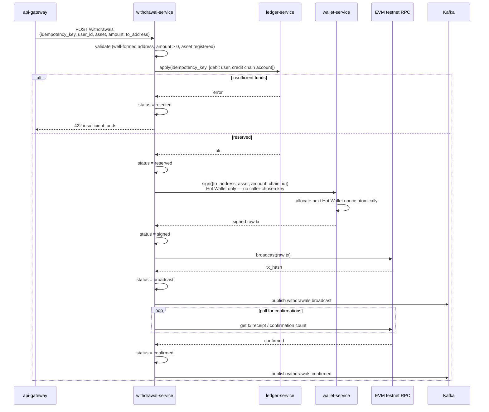

# Withdrawal flow

## Problem

A user with a positive ledger balance (`ledger.md`) requests that funds
be sent to an external on-chain address. Per your decision, this is
fully automatic — no manual review queue. The system must validate the
request, reserve the funds against the ledger, get a signature from
`wallet-service` (new: a signing endpoint, per your decision), broadcast
the transaction, and track it to confirmation — while never leaving a
user debited for a withdrawal that didn't actually happen, and never
signing the same withdrawal twice.

## Bounded context(s)

New bounded context: **Withdrawal**, owned by `withdrawal-service`
(named in `docs/ARCHITECTURE.md`). Talks to `ledger-service` (reserve
funds), `wallet-service` (sign — new surface), the EVM testnet RPC
(broadcast + confirmation), Kafka (producer), and its own Postgres
(withdrawal request state machine).

This also **extends the Wallet & Signing context**: `wallet-service`
gains a signing endpoint. That's a real widening of its trust boundary
— today it only ever returns public addresses; after this it can move
funds on request — so the invariants below treat it as seriously as the
existing key-custody design does.

## Ubiquitous language

- **Withdrawal Request** — one user ask to send `amount` of `asset` to
  `to_address`, identified by a client-supplied `idempotency_key`
  (minted by `api-gateway`, reused as the Ledger Transaction's
  idempotency key too — one key, one meaning, across both contexts).
- **Hot Wallet** — the single on-chain address (per this doc's
  recommendation — see Open Questions #1) that every withdrawal is
  actually paid out from, regardless of which address the user
  originally deposited to. A reserved derivation index in
  `wallet-service`'s existing HD wallet, distinct from user addresses.
- **Reservation** — the Ledger Transaction that debits the user's
  Account the moment a Withdrawal Request is accepted (not when it
  finally confirms on-chain). Uses the invariant already defined in
  `ledger.md` (balance can never go negative) as its safety net.
- **Hot Wallet Nonce** — the EVM account nonce for the Hot Wallet
  address. Must be allocated atomically and monotonically, exactly like
  `wallet-service`'s existing per-user derivation-index allocation — the
  same class of bug (two concurrent signs claiming the same value)
  applies here too.
- **Compensating Entry** — a new Ledger Transaction that credits the
  user back after a Withdrawal Request fails before it reached the
  chain. Never a mutation of the original debit (`ledger.md`'s
  immutability invariant).

Withdrawal Request states: `requested → validated → reserved → signed →
broadcast → confirmed`, with `rejected` (failed validation or
insufficient funds, terminal, no reservation made) and `failed`
(reserved but never broadcast, terminal, triggers a Compensating Entry)
as the off-ramps. See Open Questions #3–4 for the two failure modes I'm
not resolving unilaterally.

## Aggregates & invariants

1. **A Withdrawal Request's ledger Reservation and its own status move
   together.** `withdrawal-service` calls `ledger.apply()`; only on
   success does it set status = `reserved`. On "insufficient funds," it
   sets `rejected` — never a partial reservation.
2. **A Withdrawal Request can be signed at most once.** Guarded the same
   way as ledger idempotency: `UPDATE withdrawal_requests SET
   status='signing' WHERE status='reserved'`, zero rows affected means
   a duplicate/retry, skip. Prevents a retried event from asking
   `wallet-service` to sign (and therefore spend) the same withdrawal
   twice.
3. **A Withdrawal Request that fails before broadcast is refunded via a
   Compensating Entry, never a mutation of the original debit.** Ties
   directly to `ledger.md`'s entry-immutability invariant.
4. **A Withdrawal Request that has already been broadcast is never
   auto-refunded.** Only a request that provably never reached the chain
   is safe to reverse automatically. Anything with a tx hash needs
   positive proof it didn't land before any compensating action — see
   Open Questions #3.
5. **`wallet-service` signs for the Hot Wallet only, and the caller
   specifies *what* to send, never *which key*.** The signing request
   carries `{to_address, asset, amount, chain_id}` — there is no
   parameter that lets a caller pick a derivation index. This means even
   a fully compromised `withdrawal-service` can't turn the signing
   endpoint into a way to drain an arbitrary user's address; the blast
   radius is capped at "can spend from the Hot Wallet."
6. **Hot Wallet nonce allocation is atomic and monotonic** — same
   `UPDATE ... RETURNING` pattern `wallet-service` already uses for
   derivation-index allocation (`internal/storage/postgres.go`'s
   `allocateIndex`). No two signing calls can be issued the same nonce.

## Diagram

## Alternatives considered

- **Pay out from each user's own derived deposit address (no Hot
  Wallet / no sweep).** Rejected: every user address would need its own
  maintained native-coin gas balance before it could pay out anything —
  true even for ERC-20 withdrawals, since gas is always paid in native
  coin by the sending address. Not how custody systems are actually
  run at any real scale. Recommending the Hot Wallet / sweep model
  instead — see Open Questions #1, since it also means a small addition
  to `deposit-flow.md`.
- **Manual/threshold review queue.** This is the alternative to "fully
  automatic" you already decided against; not re-litigating it. I am
  flagging one narrow exception in Open Questions #4 — confirmed-then-
  reorged withdrawals — as a case I'd keep out of full automation
  regardless.
- **`withdrawal-service` holds its own key material instead of calling
  `wallet-service`.** Rejected outright, not seriously considered — it
  directly violates this project's stated security model (one service
  holds key material, never exposes private keys).
- **Block the HTTP response until the withdrawal confirms.** Rejected —
  testnet confirmation takes real wall-clock time. The request returns
  quickly with a request ID; confirmation is tracked asynchronously,
  consistent with how the rest of this system is event-driven.

## Open questions

1. **Sweep vs. direct model — the biggest open item.** I'm recommending
   user deposit addresses stay attribution-only, and a Sweep step
   (small addition to `deposit-flow.md`, not written yet) consolidates
   confirmed deposits into the Hot Wallet per asset. All withdrawals pay
   out from there. This is standard custodial-exchange practice and
   sidesteps per-address gas funding. I didn't fold this into
   `deposit-flow.md` silently since it changes that doc's shape — want
   your sign-off first, then I'll add that section.
2. **`withdrawal-service` ↔ `wallet-service` auth.** This is new surface
   that can move funds. Options range from "same Docker network, no
   auth, testnet-only" (matches the project's current low-ceremony local
   setup) to a shared bearer secret or mTLS. This is a security-posture
   call, not something I'll default silently.
3. **Stuck/dropped broadcast handling.** A withdrawal that's broadcast
   but never confirms (underpriced, replaced, dropped from mempool) is
   the trickiest failure mode here — refunding it safely requires
   certainty it's truly dead, not just slow. I don't have a concrete
   timeout/replacement policy yet and would rather work it out with you
   than guess a number that's wrong in a way that loses money.
4. **Confirmed-then-reorged withdrawal.** I'd recommend this one case
   is *not* automated — freeze it and require manual review rather than
   auto-retry, since blind re-signing risks a double-payment if the
   original transaction actually did land. This is the one place I'd
   push back on "fully automatic" as stated; want your explicit call on
   it.
5. **Dust/minimum withdrawal amount**, and whether the Hot Wallet's own
   gas balance needs low-balance alerting — not designing now, flagging
   for the observability phase (roadmap step 3).
